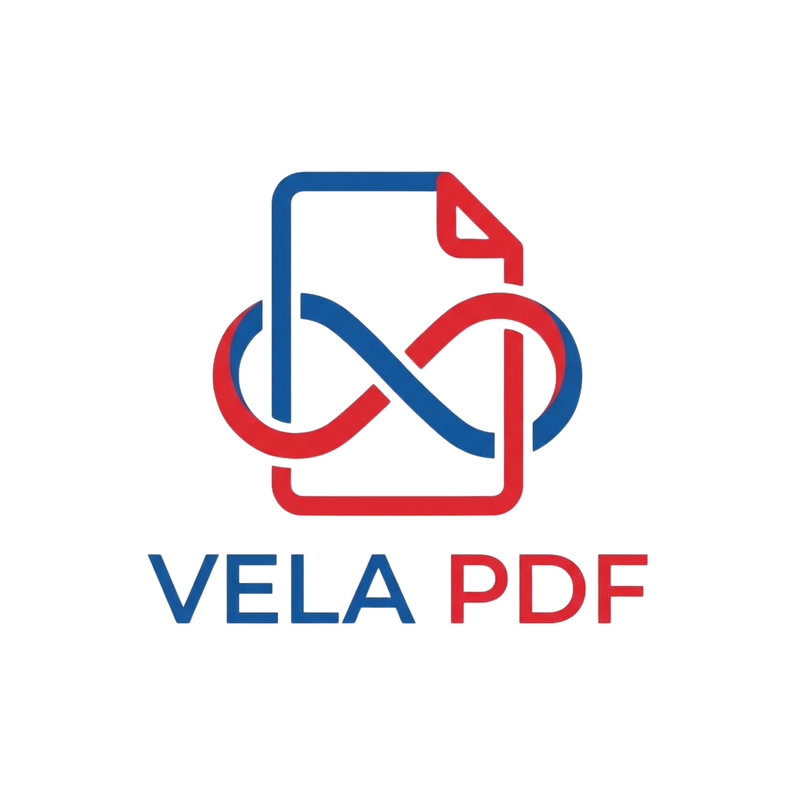

<p align="center">
  
</p>

<h1 align="center">VelaPDF</h1>

<p align="center">
  <strong>Aplikasi Android PDF Tools & Analisis Ringkasan Dokumen Cerdas 100% Offline (ML Kit OCR + Rule-Based Inference).</strong>
</p>

<p align="center">
  <a href="https://developer.android.com"></a>
  <a href="https://kotlinlang.org"></a>
  <a href="https://developer.android.com/jetpack/compose"></a>
  <a href="https://github.com/useripx/velapdfv1"></a>
</p>

<p align="center">
  <a href="https://github.com/useripx/velapdfv1/stargazers"></a>
  <a href="https://github.com/useripx/velapdfv1/network/members"></a>
  
  
</p>

---

## Ikhtisar Proyek

**VelaPDF** (`com.njagakneai.velapdf`) adalah aplikasi Android utilitas dokumen PDF dan analisis ringkasan dokumen cerdas berbasis arsitektur **MVVM + Clean Architecture** dengan **Jetpack Compose**, **Dagger Hilt**, **Room**, dan **DataStore**. Aplikasi dirancang *offline-first* sehingga seluruh utilitas pengelolaan PDF dan analisis dokumen berjalan langsung di perangkat pengguna tanpa bergantung pada layanan awan berbayar.

---

## Fitur Utama

- **Image to PDF:** Pindai dokumen kamera (Google ML Kit Document Scanner) atau pilih gambar galeri, atur urutan halaman, kompres ukuran file, dan konversi menjadi berkas PDF lokal.
- **Merge PDF:** Gabungkan beberapa berkas PDF dan gambar hingga 100 berkas / 500 halaman secara luring menggunakan **iText7 Core** & Android `PdfRenderer`.
- **PDF to Image:** Ekspor halaman PDF menjadi gambar (`JPG`/`PNG`/`WEBP`) atau arsip `.zip` ke direktori lokal.
- **Edit & Scan Ulang Dokumen:** Pindai ulang dan kelola format output hasil pindai sebelum disimpan.
- **Riwayat & Pengaturan Lokal:** Penyimpanan riwayat otomatis pada **Room Database** serta preferensi tema/ukuran halaman/kualitas kompresi di **DataStore Preferences**.
- **Mode Tamu Offline & Autentikasi Opsional:** Mendukung **"Masuk Sebagai Tamu (Mode Offline)"** maupun opsi masuk Google/Email via Credential Manager & Firebase.
- **OCR & Analisis Dokumen AI — ASK Vela (`v1.5.0` Offline AI & Hybrid Extractor):** Pemindaian kamera/galeri & pembacaan rentang halaman berkas PDF secara **100% luring** melalui arsitektur hibrida (**iText7 `PdfTextExtractor`** untuk PDF digital presisi tinggi + fallback otomatis **Google ML Kit OCR** pada halaman citra/scan), prapemrosesan NLP Bahasa Indonesia (termasuk pelestarian negasi/modalitas), Ontologi & SPO (*4 berkas JSON*), serta *Forward Chaining* untuk menghasilkan ringkasan isi dokumen adaptif, butir poin penting berbasis aturan, kesimpulan terstruktur, pencarian & hapus massal riwayat lokal (Room), dan ekspor ringkasan ke PDF.

---

## Arsitektur Proyek

```text
com.njagakneai.velapdf
├── data/          # Room Database (v2), History/Analysis DAO, DataStore Preferences, MlKitRepository, DocumentAnalysisRepository
├── di/            # Dagger Hilt Modules (DatabaseModule, AnalysisModule)
├── domain/        # Model Analisis, NLP Preprocessor, OntologyLoader, RuleInferenceEngine (Forward Chaining), FactBasedSummarizer
├── ui/
│   ├── components/ # Komponen Compose reusable (GridImagePicker, AnalysisProgressOverlay, CompressionDialog, dll.)
│   ├── navigation/ # Navigation Compose NavGraph
│   ├── screen/     # Layar Jetpack Compose (Dashboard, AskVela, DocumentSummary, OcrPreview, ImageToPdf, MergePdf, PdfToImage, History, Settings)
│   ├── theme/      # Material 3 Theme & HankenGrotesk Typography
│   ├── view/       # MainActivity (@AndroidEntryPoint)
│   └── viewmodel/  # @HiltViewModel + StateFlow (termasuk DocumentAnalysisViewModel)
└── utils/         # PdfGenerator, PdfMergerEngine, PdfToImageEngine, SummaryPdfExporter, BitmapProcessor, FileUriHelper, NotificationHelper
```

---

## Tech Stack Aktual

| Komponen | Teknologi & Versi Terkunci |
| :--- | :--- |
| **Bahasa & Target Android** | Kotlin `2.4.20` (`compileSdk 37`, `targetSdk 36`, `minSdk 26`, Java `11`) |
| **Build System** | Gradle `9.8.0` / AGP `9.4.1` / KSP `2.3.6` (Kotlin DSL + Version Catalog) |
| **UI & Navigasi** | Jetpack Compose BOM `2026.09.00` (Material 3) & Navigation Compose `2.10.2` |
| **Dependency Injection** | Dagger Hilt `2.60.1` |
| **Penyimpanan Lokal** | Room `2.8.5` & DataStore Preferences `1.2.1` |
| **PDF & OCR Engine** | iText7 Core `9.8.0`, ML Kit Document Scanner `16.0.0`, ML Kit Text Recognition `16.0.1` |
| **Autentikasi Opsional** | Firebase BOM `34.19.0`, Credential Manager `1.6.0`, Google ID `1.2.1` |

---

## Panduan Build Lokal

### 1. Prasyarat
- **Android Studio** terbaru dengan JDK 17+ / JBR terpasang.
- **Android SDK** Platform 37 & Build Tools terkait.

### 2. Clone Repositori
```bash
git clone https://github.com/useripx/velapdfv1.git
cd velapdfv1
```

### 3. Konfigurasi Lokal `google-services.json` *(Dilindungi `.gitignore`)*
Demi keamanan repositori publik, berkas konfigurasi Firebase (`app/google-services.json`) tidak disertakan di GitHub:
1. Buat atau buka proyek Firebase untuk package `com.njagakneai.velapdf` (daftarkan SHA-1 `debug` dari `./gradlew signingReport`).
2. Unduh `google-services.json` dari Firebase Console dan letakkan di `app/google-services.json` pada direktori lokal Anda.
3. Untuk pengujian fitur luring sehari-hari di aplikasi, Anda dapat langsung memilih **"Masuk Sebagai Tamu (Mode Offline)"** pada layar login.

### 4. Verifikasi & Jalankan
```bash
./gradlew testDebugUnitTest lintDebug assembleDebug
```

---

## Lisensi & Pengembang

- **Pemilik Proyek:** **useripx** — [GitHub](https://github.com/useripx)
- **Lisensi:** MIT License

<p align="center">
  
</p>
