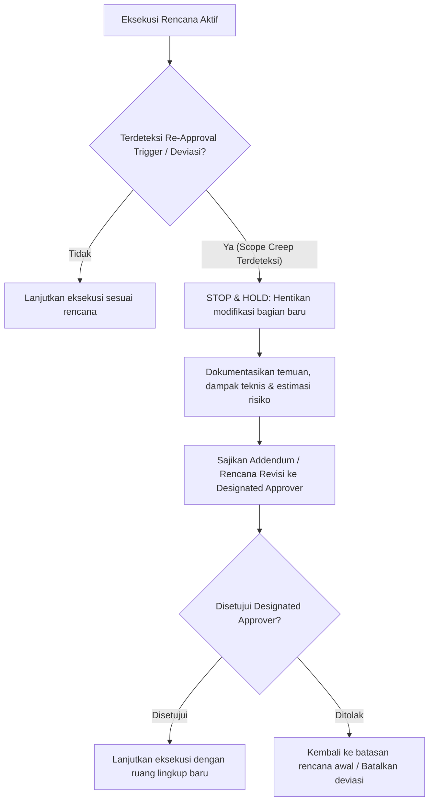

# Approval Governance Specification

> **DOCUMENT ID:** DOC-GOV-APP-001  
> **VERSION:** v2.0.0  
> **STATUS:** ACTIVE / MANDATORY  
> **AUTHORITY LEVEL:** Level 2 — Domain Governance Specification  
> **OTORITAS TERTINGGI:** Designated Approver (sebagaimana didefinisikan dalam [config/organization.md](../config/organization.md), saat ini: **Yogi Ario - Project Owner / Lead Developer**)  
> **TARGET PENGGUNA:** Seluruh Pengembang Manusia dan AI Agent  
> **ACUAN UTAMA (SSOT):** [Docs/universal-rule.md](universal-rule.md) (Level 1 Universal Governance)  
> **DOKUMEN TERKAIT:** [Docs/Governance_Hierarchy.md](Governance_Hierarchy.md), [Docs/Agent_Authority_Matrix.md](Agent_Authority_Matrix.md), [Docs/Glossary.md](Glossary.md)

---

## 1. Pendahuluan

Dokumen ini menetapkan ketentuan, batas kewenangan, batasan cakupan, dan prosedur formal persetujuan (*Approval Governance*) dalam siklus hidup kolaborasi rekayasa perangkat lunak antara manusia dan AI Agent. Prinsip tata kelola ini dirancang untuk mencegah eksekusi sepihak (*unilateral action*), kebocoran kode/kredensial, perubahan destruktif pada konfigurasi, dan pergeseran ruang lingkup (*scope creep*).

---

## 2. Otoritas Tunggal Pemberi Persetujuan

1. **Pemegang Otoritas Mutlak:**  
   Satu-satunya entitas yang memiliki wewenang untuk memberikan persetujuan implementasi, perubahan arsitektur, dan rilis adalah **Designated Approver** yang tercantum secara resmi pada [config/organization.md](../config/organization.md) (saat ini: **Yogi Ario**).
2. **Larangan Persetujuan Asumtif:**  
   AI Agent **MUST NOT** berasumsi atau mengartikan frasa pasif, ketidakhadiran tanggapan, atau perintah eksploratif ("coba lihat", "pelajari repositori", "analisis struktur") sebagai bentuk persetujuan modifikasi kode.
3. **Persetujuan Tertulis dan Eksplisit:**  
   Persetujuan dinyatakan sah hanya jika Designated Approver memberikan konfirmasi eksplisit (seperti tombol/tindakan *Approve* pada artifact, frasa "Setuju", "Lanjut", "Eksekusi", atau respon tertulis setara).
4. **Pembedaan Konseptual Governance:**
   - **Approval (Persetujuan):** Mandat manusia formal untuk memulai eksekusi berdasarkan rencana kerja yang disetujui.
   - **Verification (Verifikasi):** Pembuktian teknis objektif bahwa kode/artefak memenuhi spesifikasi teknis.
   - **Validation (Validasi):** Konfirmasi bahwa hasil kerja memenuhi kebutuhan operasional dan nilai bisnis.
   - **Production Authorization (Otorisasi Produksi):** Pengesahan tertinggi oleh Designated Approver untuk melakukan merge ke cabang `main` atau deployment produksi.

---

## 3. Matriks Batas Kewenangan (Scope Matrix)

Tabel berikut mengklasifikasikan tindakan yang boleh dieksekusi secara otonom oleh AI Agent versus tindakan yang mutlak membutuhkan persetujuan:

| Kategori Tindakan | Tindakan Spesifik | Batas Kewenangan | Ketentuan Tambahan |
| :--- | :--- | :--- | :--- |
| **Eksplorasi & Analisis** | Membaca file repositori, file konfigurasi, log | **AUTONOMOUS (Otonom)** | Wajib mematuhi mode read-only. |
| **Pemeriksaan Status** | Menjalankan `git status`, `git branch`, direktori check | **AUTONOMOUS (Otonom)** | Dilarang menjalankan perintah yang memodifikasi working tree. |
| **Penyusunan Perencanaan** | Membuat draf *Implementation Plan*, *Task Status*, *ADR* | **AUTONOMOUS (Otonom)** | Berupa berkas perencanaan tertulis untuk ditinjau Designated Approver. |
| **Pengujian Dry-Run** | Menjalankan static analysis / linter tanpa auto-fix | **AUTONOMOUS (Otonom)** | Tidak boleh memodifikasi file target. |
| **Modifikasi Kode Sumber** | Menulis, mengedit, merefaktor, atau menghapus kode aplikasi | **MUST OBTAIN APPROVAL** | Dilarang keras menyentuh kode sebelum plan disetujui (*Zero-Code Rule*). |
| **Perubahan Dependensi** | Menambah / memperbarui paket di manajer paket | **MUST OBTAIN APPROVAL** | Wajib menyertakan analisis dampak dependensi dan lisensi. |
| **Perubahan Skema Data** | Migrasi basis data, perubahan struktur tabel / model | **MUST OBTAIN APPROVAL** | Wajib menyertakan skenario rollback jika migrasi gagal. |
| **Operasi Git Berdampak** | Checkout branch baru, commit, merge ke `develop` | **MUST OBTAIN APPROVAL** | Wajib mematuhi konvensi penamaan branch dan isolasi branch `main`. |
| **Penggunaan Skill Baru** | Mengaktifkan skill/plugin/automasi baru di repositori aktif | **MUST OBTAIN APPROVAL** | Wajib melalui validasi sandbox (*Prinsip 6: No Validated Skill, No Production Use*). |
| **Merge ke Main / Rilis** | Penggabungan ke cabang `main` atau pemicu rilis produksi | **MUST OBTAIN APPROVAL** | Mensyaratkan Otorisasi Produksi formal setelah Quality Gate 5. |

---

## 4. Format dan Struktur Lingkup Persetujuan (Approval Scope Specification)

Setiap pengajuan persetujuan rencana kerja (*Implementation Plan*) **MUST** memuat atribut spesifikasi ruang lingkup terikat (*scope-bound attributes*) berikut secara eksplisit:

1. **Task Identifier (`Task ID`):** Rujukan unik tugas/tiket kerja (contoh: `TASK-CORE-001`, `UREV-2026-001`).
2. **Objective / Purpose:** Pernyataan ringkas tujuan teknis yang akan dicapai.
3. **Target File Whitelist:** Daftar lengkap berkas yang diizinkan untuk dibuat, dimodifikasi, atau dihapus. Modifikasi berkas di luar daftar ini dilarang keras tanpa re-approval.
4. **Target Environment & Branch:** Cabang Git kerja dan lingkungan eksekusi spesifik (contoh: branch `feature/rev-01`, environment `local-test`).
5. **Acceptance Criteria & Verification Plan:** Indikator keberhasilan objektif dan pengujian yang akan dijalankan untuk memverifikasi hasil.
6. **Rollback & Recovery Plan:** Langkah mitigasi atau pengembalian kondisi jika eksekusi mengalami kegagalan.
7. **Approver & Timestamp:** Identitas pemberi persetujuan resmi dan waktu persetujuan diberikan (format ISO 8601 / WIB).

---

## 5. Prinsip Spesifisitas Persetujuan (Approval Specificity)

Persetujuan yang diberikan oleh Designated Approver **bersifat spesifik terhadap ruang lingkup yang diajukan** (*scope-bound*):

> **Aturan Spesifisitas:**  
> 1. Persetujuan untuk menganalisis proyek **BUKAN** persetujuan untuk mengubah kode.  
> 2. Persetujuan untuk mengubah satu modul/file **BUKAN** persetujuan untuk merefaktor seluruh modul sekitar.  
> 3. Persetujuan untuk mengimplementasikan di cabang fitur / `develop` **BUKAN** persetujuan untuk melakukan deployment atau merge ke `main`.  
> 4. Persetujuan satu rencana kerja **BUKAN** cek kosong untuk pekerjaan selanjutnya yang belum diajukan.

---

## 6. Pemicu Persetujuan Ulang (Re-Approval Triggers)

AI Agent **MUST** seketika menghentikan eksekusi (*STOP & HOLD*) dan mengajukan persetujuan ulang (*Re-Approval Request*) apabila terjadi salah satu pemicu berikut:

1. **Penyimpangan Berkas (File Whitelist Deviation):** Diperlukannya pembuatan, modifikasi, atau penghapusan berkas yang tidak tercantum dalam *Target File Whitelist* awal.
2. **Perubahan Arsitektur / Dependensi:** Ditemukannya kebutuhan menambahkan pustaka/pustaka pihak ketiga, mengubah arsitektur sistem, atau mengubah konfigurasi lingkungan.
3. **Perubahan Skema Data / Kontrak API:** Adanya perubahan struktur skema basis data, model entitas, atau *breaking change* pada antarmuka API.
4. **Perluasan Lingkungan / Cabang Git:** Kebutuhan transisi ke cabang lain (misal dari feature branch ke `develop`, atau dari `develop` ke `main`).
5. **Kegagalan Pengujian Kritis / Risiko Baru:** Ditemukannya defek dengan tingkat keparahan *Critical* atau celah keamanan yang tidak terantisipasi dalam rencana awal.

---

## 7. Protokol Penanganan Pergeseran Ruang Lingkup (Scope Creep Protocol)

Saat AI Agent sedang mengeksekusi rencana implementasi yang disetujui, alur penanganan deviasi adalah sebagai berikut:

1. **STOP & HOLD:** AI Agent **MUST NOT** memperluas modifikasi ke berkas di luar daftar target rencana awal.
2. **Dokumentasikan Temuan:** Jelaskan mengapa perbaikan tambahan tersebut diperlukan, apa dampaknya terhadap waktu dan stabilitas, serta apa risikonya jika ditunda.
3. **Pengajuan Addendum:** Ajukan penambahan cakupan sebagai draf revisi rencana kerja (*Addendum Implementation Plan*) untuk disetujui.

---

## 8. Protokol Penanganan Penolakan (Rejection Handling Protocol)

Jika Designated Approver menolak rencana kerja yang diajukan (*Implementation Plan*) atau menolak hasil implementasi pada tahap verifikasi:

1. **Penghentian Segera:** AI Agent **MUST** seketika menghentikan eksekusi atau membatalkan perubahan yang belum disetujui.
2. **Pencatatan Masukan (Feedback Capture):** AI Agent **MUST** mencatat poin-poin keberatan dan arahan Designated Approver ke dalam catatan kerja.
3. **Analisis Alternatif:** AI Agent **MUST** mengkaji ulang pendekatan teknis, mengidentifikasi kelemahan dari rencana sebelumnya, dan merumuskan minimal dua alternatif solusi baru yang disertai perbandingan *trade-off*.
4. **Penyajian Ulang Rencana:** AI Agent menyajikan revisi rencana kerja baru dengan menandai secara jelas bagian mana yang telah diperbaiki sesuai umpan balik.

---

## 9. Rekam Jejak Persetujuan (Audit Trail)

Seluruh persetujuan formal **MUST** dapat ditelusuri melalui dokumen rekam jejak repositori:

1. **Dokumen Rencana Kerja (`Docs/Implementation_plan.md`):** Mencantumkan status "APPROVED BY DESIGNATED APPROVER" beserta tanggal persetujuan.
2. **Arsip Rencana Kerja (`Docs/Implementation_plan/<nomor>_tahap...`):** Menyimpan salinan permanen dari rencana yang telah dieksekusi dan tervalidasi.
3. **Log Keputusan (`Docs/Decision_Log.md`):** Setiap keputusan arsitektur atau pemilihan trade-off wajib dicatat dengan status persetujuan eksplisit.
4. **Flat Changelog (`changelog/changelog<jam><ampm><ddmmyyyy>.md`):** Mencatat ringkasan pekerjaan yang selesai dieksekusi berdasarkan rencana yang disetujui.
