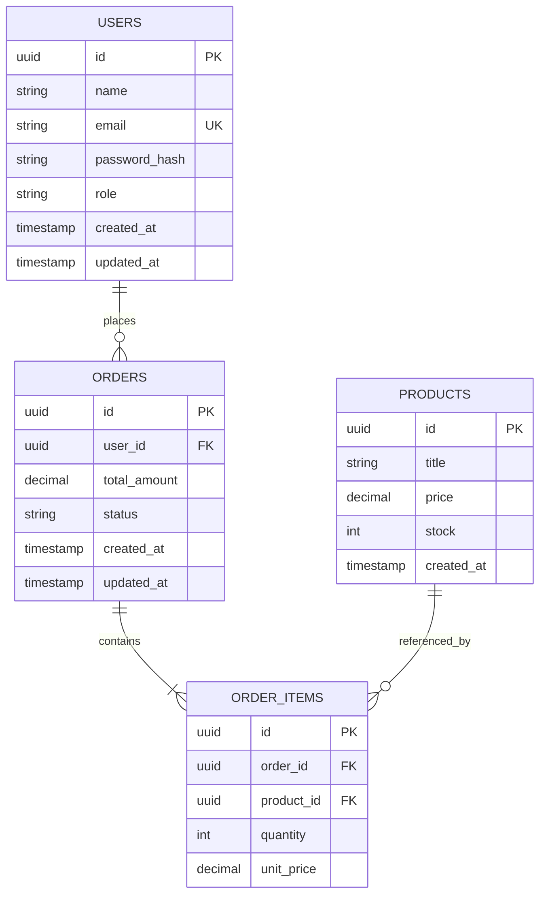

# Database Design & Data Dictionary — [Isi Manual: Nama Proyek]

> **STATUS DOKUMEN:** RANCANGAN BASIS DATA AKTIF (ACTIVE DATABASE DESIGN)  
> **LANGKAH WORKFLOW:** Step 3 of 12 Engineering Workflow  
> **PEMILIK PROYEK:** Yogi Ario  
> **PENYUSUN:** [Isi Manual: Nama AI Agent / Pengembang]  
> **TANGGAL:** [Isi Manual: DD/MM/YYYY]  
> **SISTEM BASIS DATA:** [Isi Manual: PostgreSQL / MySQL / SQLite / MongoDB]  
> **ACUAN STANDAR:** [Docs/Standards/Database_API_Standards.md](Standards/Database_API_Standards.md)

---

## 1. Diagram Relasi Entitas (Entity-Relationship Diagram - ERD)

---

## 2. Kamus Data (Data Dictionary)

### 2.1 Tabel: `users`
Menyimpan informasi identitas dan kredensial pengguna aplikasi.

| Nama Kolom | Tipe Data | Nullable | Default | Batasan & Keterangan |
| :--- | :--- | :---: | :---: | :--- |
| `id` | `UUID` / `BIGINT` | **NO** | `gen_random_uuid()` | **Primary Key**, identitas unik pengguna. |
| `name` | `VARCHAR(100)` | **NO** | - | Nama lengkap pengguna. |
| `email` | `VARCHAR(255)` | **NO** | - | **Unique Index**, alamat email aktif untuk login. |
| `password_hash` | `VARCHAR(255)` | **NO** | - | Hash kata sandi menggunakan Argon2id atau Bcrypt. |
| `role` | `VARCHAR(30)` | **NO** | `'customer'` | Peran pengguna: `'admin'`, `'customer'`, `'staff'`. |
| `is_active` | `BOOLEAN` | **NO** | `TRUE` | Status keaktifan akun pengguna. |
| `created_at` | `TIMESTAMP WITH TZ` | **NO** | `CURRENT_TIMESTAMP` | Waktu pembuatan akun (UTC). |
| `updated_at` | `TIMESTAMP WITH TZ` | **NO** | `CURRENT_TIMESTAMP` | Waktu pembaruan data terakhir (UTC). |

---

### 2.2 Tabel: `orders`
Menyimpan ringkasan transaksi pesanan yang dilakukan pengguna.

| Nama Kolom | Tipe Data | Nullable | Default | Batasan & Keterangan |
| :--- | :--- | :---: | :---: | :--- |
| `id` | `UUID` | **NO** | `gen_random_uuid()` | **Primary Key**. |
| `user_id` | `UUID` | **NO** | - | **Foreign Key** merujuk ke `users(id)` ON DELETE RESTRICT. |
| `total_amount` | `DECIMAL(12,2)` | **NO** | `0.00` | Total nilai pembayaran pesanan. |
| `status` | `VARCHAR(30)` | **NO** | `'pending'` | Status pesanan: `'pending'`, `'paid'`, `'cancelled'`. |
| `created_at` | `TIMESTAMP WITH TZ` | **NO** | `CURRENT_TIMESTAMP` | Waktu transaksi dibuat (UTC). |

---

## 3. Strategi Indeksasi & Optimasi Query (Indexing Strategy)

| Nama Tabel | Nama Indeks | Kolom yang Diindeks | Tipe Indeks | Tujuan Optimasi |
| :--- | :--- | :--- | :---: | :--- |
| `users` | `idx_users_email_unique` | `email` | UNIQUE | Mempercepat pencarian login & mencegah duplikasi. |
| `orders` | `idx_orders_user_id` | `user_id` | BTREE | Mempercepat query riwayat order per pengguna. |
| `orders` | `idx_orders_status_created` | `status, created_at` | COMPOSITE | Mempercepat filter pesanan aktif berdasarkan tanggal. |

---

## 4. Riwayat Migrasi Skema Basis Data (Database Migration Log)

| Nama Berkas Migrasi | Tanggal Dijalankan | Deskripsi Perubahan Skema | Skrip Rollback Tersedia |
| :--- | :---: | :--- | :---: |
| `20261107000001_create_users_table.sql` | [DD/MM/YYYY] | Membuat tabel `users` dan indeks email unik. | **Ya (`down`)** |
| `20261107000002_create_orders_table.sql` | [DD/MM/YYYY] | Membuat tabel `orders` dan foreign key `user_id`. | **Ya (`down`)** |

---

> [!tip] PETUNJUK KHUSUS
> Gunakan template ini untuk merancang struktur database relasional maupun non-relasional pada proyek Anda. Hapus catatan tip ini setelah dokumen disesuaikan.
