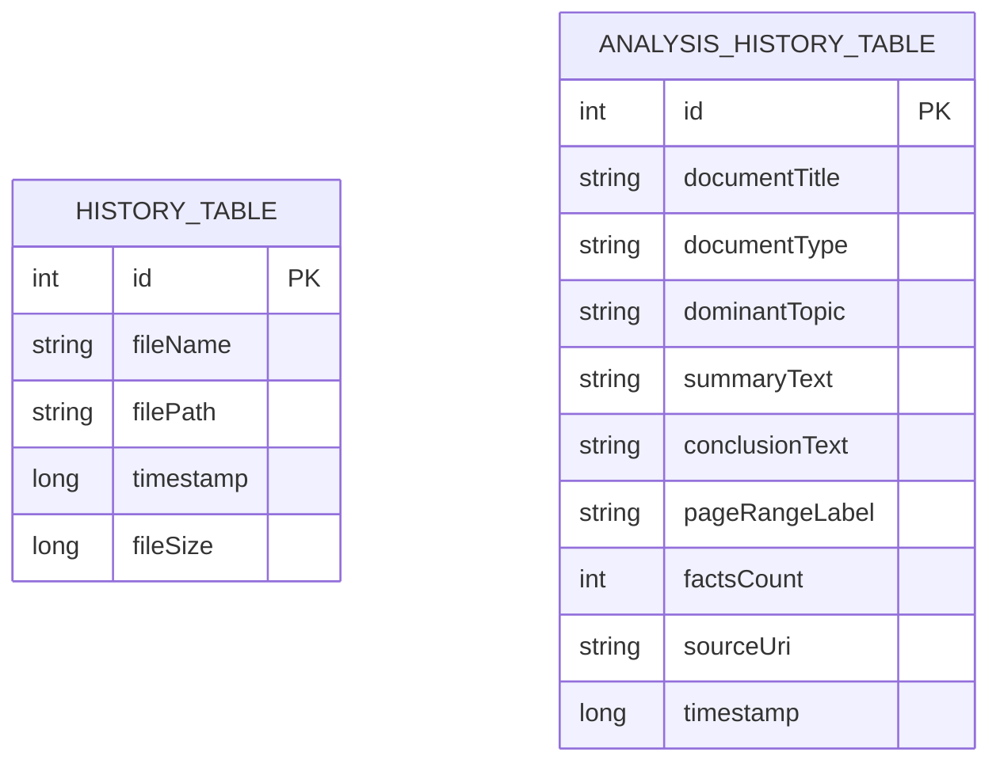

# Database Design & Data Dictionary — VelaPDF (`velapdf_database`)

> **STATUS DOKUMEN:** RANCANGAN BASIS DATA AKTIF (ROOM SQLITE v2)  
> **PEMILIK PROYEK:** Yogi Ario Pratama (`@useripx`)  
> **PENYUSUN:** Carl (`AGT-PRD-DEV-001`)  
> **TANGGAL DIPERBARUI:** 11/11/2026  
> **SISTEM BASIS DATA:** SQLite Lokal via Jetpack Room (`2.8.5`) — 100% Luring (*Offline-First*)  
> **ACUAN STANDAR:** [Docs/Standards/Database_API_Standards.md](Standards/Database_API_Standards.md)

---

## 1. Diagram Relasi Entitas (Entity-Relationship Diagram - ERD)

---

## 2. Kamus Data (Data Dictionary)

### 2.1 Tabel: `history_table` (Versi 1 — Riwayat Berkas PDF Lokal)
Menyimpan metadata berkas PDF hasil pemindaian kamera, konversi gambar ke PDF, atau penggabungan PDF lokal.  
Entitas Kotlin: [`HistoryEntity.kt`](file:///C:/Users/yogia/AndroidStudioProjects/VelaPDF/app/src/main/java/com/njagakneai/velapdf/data/model/HistoryEntity.kt) | DAO: [`HistoryDao.kt`](file:///C:/Users/yogia/AndroidStudioProjects/VelaPDF/app/src/main/java/com/njagakneai/velapdf/data/database/HistoryDao.kt)

| Nama Kolom | Tipe SQLite | Kotlin Type | Nullable | Default / Aturan | Keterangan |
| :--- | :--- | :--- | :---: | :--- | :--- |
| `id` | `INTEGER` | `Int` | **NO** | `PRIMARY KEY AUTOINCREMENT` | Identitas unik entri riwayat berkas. |
| `fileName` | `TEXT` | `String` | **NO** | - | Nama berkas PDF yang dihasilkan atau disimpan. |
| `filePath` | `TEXT` | `String` | **NO** | - | Jalur absolut lokal atau string URI berkas. |
| `timestamp` | `INTEGER` | `Long` | **NO** | Epoch ms | Waktu pembuatan/pemrosesan berkas. |
| `fileSize` | `INTEGER` | `Long` | **NO** | Bytes | Ukuran berkas dalam byte. |

---

### 2.2 Tabel: `analysis_history_table` (Versi 2 — Arsip Ringkasan & Kesimpulan ASK Vela)
Menyimpan riwayat hasil analisis OCR + NLP Lokal + Rule-Based Inference (Forward Chaining) dalam Bahasa Indonesia agar dapat dibuka kembali secara instan tanpa perlu mengulang OCR.  
Entitas Kotlin: [`AnalysisHistoryEntity.kt`](file:///C:/Users/yogia/AndroidStudioProjects/VelaPDF/app/src/main/java/com/njagakneai/velapdf/data/model/AnalysisHistoryEntity.kt) | DAO: [`AnalysisHistoryDao.kt`](file:///C:/Users/yogia/AndroidStudioProjects/VelaPDF/app/src/main/java/com/njagakneai/velapdf/data/database/AnalysisHistoryDao.kt)

| Nama Kolom | Tipe SQLite | Kotlin Type | Nullable | Default / Aturan | Keterangan |
| :--- | :--- | :--- | :---: | :--- | :--- |
| `id` | `INTEGER` | `Int` | **NO** | `PRIMARY KEY AUTOINCREMENT` | Identitas unik entri riwayat analisis. |
| `documentTitle` | `TEXT` | `String` | **NO** | - | Judul / nama berkas dokumen yang diringkas. |
| `documentType` | `TEXT` | `String` | **NO** | - | Jenis dokumen hasil inferensi aturan (mis. `Surat Keputusan (SK)`, `Buku Ajar / Referensi Teknis`). |
| `dominantTopic` | `TEXT` | `String` | **NO** | - | Topik utama atau kata kunci dominan hasil NLP. |
| `summaryText` | `TEXT` | `String` | **NO** | - | Daftar poin intisari ringkasan terurut per nomor & halaman. |
| `conclusionText` | `TEXT` | `String` | **NO** | - | Paragraf kesimpulan otomatis dalam Bahasa Indonesia. |
| `pageRangeLabel` | `TEXT` | `String` | **NO** | - | Label cakupan halaman (mis. `Hal. 23 - 35 (dari 120 hal.)`). |
| `factsCount` | `INTEGER` | `Int` | **NO** | - | Jumlah fakta semantik SPO yang terekstrak dari dokumen. |
| `sourceUri` | `TEXT` | `String` | **NO** | - | String URI sumber PDF/gambar untuk ketertelusuran. |
| `timestamp` | `INTEGER` | `Long` | **NO** | Epoch ms | Waktu analisis selesai dijalankan (`ORDER BY timestamp DESC`). |

---

## 3. Strategi Migrasi Skema (Room Migration)

| Versi | Deskripsi Perubahan Skema | Implementasi Kode | Kebijakan Destructive Migration |
| :---: | :--- | :--- | :--- |
| `v1` | Inisialisasi `AppDatabase` dengan `history_table`. | [`AppDatabase.kt`](file:///C:/Users/yogia/AndroidStudioProjects/VelaPDF/app/src/main/java/com/njagakneai/velapdf/data/database/AppDatabase.kt) | Tidak diaktifkan |
| `v1 -> v2` | Menambah tabel `analysis_history_table` secara non-destruktif via `MIGRATION_1_2` (`CREATE TABLE IF NOT EXISTS`). | [`DatabaseModule.kt`](file:///C:/Users/yogia/AndroidStudioProjects/VelaPDF/app/src/main/java/com/njagakneai/velapdf/di/DatabaseModule.kt) | **Dilarang keras** (`fallbackToDestructiveMigration()` tidak digunakan; seluruh data `history_table` pengguna terjaga aman). |

---

## 5. Pembaruan Tahap 02 — Pencarian & Hapus Massal Aman (Room Tetap `v2`)

Pada **Tahap 02**, fitur manajemen riwayat `analysis_history_table` ditingkatkan **tanpa mengubah skema tabel dan tanpa menaikkan versi database** (tetap Room `version = 2`):

| Komponen | Penambahan / Fungsi | Detail Teknis |
| :--- | :--- | :--- |
| **DAO Batch Delete** | [`AnalysisHistoryDao.deleteByIds(ids: List<Int>)`](file:///C:/Users/yogia/AndroidStudioProjects/VelaPDF/app/src/main/java/com/njagakneai/velapdf/data/database/AnalysisHistoryDao.kt#L25-L26) | Menjalankan query `@Query("DELETE FROM analysis_history_table WHERE id IN (:ids)")`. |
| **Chunked Delete Helper** | [`deleteAnalysesBatched(dao, ids, batchSize = 500)`](file:///C:/Users/yogia/AndroidStudioProjects/VelaPDF/app/src/main/java/com/njagakneai/velapdf/data/repository/DocumentAnalysisRepository.kt#L335-L344) via [`deleteSavedAnalyses(ids)`](file:///C:/Users/yogia/AndroidStudioProjects/VelaPDF/app/src/main/java/com/njagakneai/velapdf/data/repository/DocumentAnalysisRepository.kt#L326-L328) | Melakukan `ids.distinct().chunked(500)` pada `Dispatchers.IO` agar eksekusi `IN (:ids)` tetap berada jauh di bawah batas maksimum variabel bind SQLite (`999` parameter) meskipun riwayat yang dihapus berjumlah ribuan entri. |
| **Pure Filter Search** | [`filterAnalysisHistory`](file:///C:/Users/yogia/AndroidStudioProjects/VelaPDF/app/src/main/java/com/njagakneai/velapdf/ui/viewmodel/DocumentAnalysisViewModel.kt) | Pencarian *case-insensitive* di lapisan ViewModel atas `judulDokumen`, `jenisDokumen`, `topikUtama`, `ringkasanText`, dan `kesimpulanText` tanpa memerlukan indeks FTS baru pada Room. |
