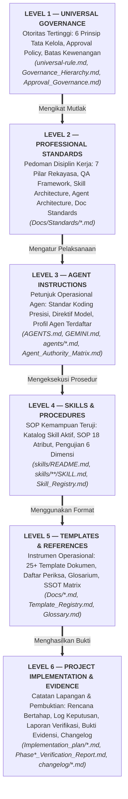

# HIERARKI DOKUMENTASI FINAL (LEVEL 1 S.D. LEVEL 6)

> **DOCUMENT ID:** DOC-NAV-HIE-001  
> **VERSION:** v1.0.0  
> **STATUS:** ACTIVE  
> **AUTHORITY LEVEL:** Level 5 — Reference & Navigation Guide  
> **OWNER:** Yogi Ario (Project Owner) & AI Engineering Team  
> **LAST UPDATED:** 07/11/2026  
> **AUTHORITATIVE SOURCE (SSOT):** `Docs/Standards/Documentation_Standards.md`  
> **RELATED DOCUMENTS:** `Docs/universal-rule.md`, `Docs/Governance_Hierarchy.md`, `Docs/Single_Source_of_Truth_Matrix.md`, `Docs/Template_Registry.md`  

---

## 1. Pendahuluan

Dokumen ini merupakan panduan navigasi resmi yang memetakan seluruh berkas dalam repositori **Universal AI Engineering Standard** ke dalam struktur hierarki 6 tingkat (*6-Level Documentation Hierarchy*).

Tujuan utama hierarki ini adalah:
1. Memberikan peta jalan navigasi yang jelas bagi manusia dan AI Agent.
2. Memastikan rantai otoritas (*chain of authority*) berjalan searah dari prinsip tertinggi hingga rincian implementasi.
3. Mencegah terciptanya duplikasi aturan atau konflik norma antar-dokumen.

---

## 2. Diagram Visual Hierarki 6 Tingkat

---

## 3. Rincian Tingkatan Dokumen & Garis Otoritas

### Tingkat 1: Level 1 — Universal Governance
- **Fungsi:** Mengatur filosofi, prinsip dasar, dan batas kewenangan mutlak ekosistem.
- **Karakteristik:** Tidak bergantung pada teknologi, bahasa pemrograman, atau domain bisnis tertentu. Bersifat kekal kecuali diubah secara sadar oleh Pemilik Proyek.
- **Berkas Inti:**
  - [`Docs/universal-rule.md`](universal-rule.md) (Master Aturan Tertinggi)
  - [`Docs/Governance_Hierarchy.md`](Governance_Hierarchy.md) (Hierarki Tata Kelola)
  - [`Docs/Approval_Governance.md`](Approval_Governance.md) (Kebijakan Persetujuan & Gerbang Otorisasi)

### Tingkat 2: Level 2 — Professional Standards
- **Fungsi:** Menetapkan kriteria mutu teknis dan disiplin pelaksanaan rekayasa.
- **Karakteristik:** Standar profesional mendalam yang harus dipatuhi saat merancang, membangun, menguji, dan memelihara sistem.
- **Berkas Inti di `Docs/Standards/`:**
  - Rekayasa: `Engineering_Standards.md`, `Requirements_Engineering.md`, `Architecture_Design.md`, `Coding_Standards.md`, `Git_Version_Control.md`, `Database_API_Standards.md`, `Security_Engineering.md`, `Deployment_Maintenance.md`.
  - Jaminan Mutu: `QA_Framework.md`, `Testing_Strategy.md`, `Test_Case_Management.md`, `Defect_Management.md`, `Verification_Evidence.md`.
  - Skill AI: `Skill_Architecture.md`, `Skill_Lifecycle_Governance.md`, `Skill_Validation_Testing.md`.
  - Agen AI: `Agent_Architecture_Governance.md`, `Agent_Orchestration_Handoff.md`, `Tool_Governance_Execution.md`, `Error_Handling_Recovery.md`.
  - Dokumentasi: `Documentation_Standards.md`, `Documentation_Change_Management.md`, `Repository_Health_Standard.md`.

### Tingkat 3: Level 3 — AI Agent Instructions
- **Fungsi:** Direktif perilaku langsung saat AI Agent beroperasi di repositori.
- **Karakteristik:** Membatasi tindakan otonom agen, menegakkan 4 standar presisi koding, dan mengarahkan perilaku sesuai peran.
- **Berkas Inti:**
  - [`AGENTS.md`](../AGENTS.md) (Panduan Operasional AI Agent & Clean Coding)
  - [`GEMINI.md`](../GEMINI.md) (Direktif Model Gemini & AI Coding Agents)
  - [`Docs/Agent_Authority_Matrix.md`](Agent_Authority_Matrix.md) (Matriks Wewenang 10 Aksi)
  - Profil Agen di [`agents/`](../agents/) (`lead-developer.md`, `ai-manager.md`, `qa-agent.md`, `reviewer-agent.md`)

### Tingkat 4: Level 4 — Skills & Procedures
- **Fungsi:** SOP operasional formal kemampuan kerja yang teruji dan dapat dieksekusi berulang kali.
- **Karakteristik:** Berkas terstruktur 18 atribut `SKILL.md` yang telah lulus uji 6 dimensi (100% PASS).
- **Berkas Inti:**
  - [`skills/README.md`](../skills/README.md) (Katalog & Panduan Skill)
  - [`Docs/Skill_Registry.md`](Skill_Registry.md) (Registri Master Skill Aktif)
  - Contoh Validated Skill: [`skills/software-engineering/requirement-analysis/SKILL.md`](../skills/software-engineering/requirement-analysis/SKILL.md)

### Tingkat 5: Level 5 — Templates & References
- **Fungsi:** Alat bantu operasional untuk mendokumentasikan perencanaan, analisis, dan pengujian secara seragam.
- **Karakteristik:** Formulir baku dengan instruksi pengisian yang jelas serta glosarium istilah rujukan.
- **Berkas Inti:**
  - [`Docs/Template_Registry.md`](Template_Registry.md) (Katalog Master Seluruh Template)
  - [`Docs/Single_Source_of_Truth_Matrix.md`](Single_Source_of_Truth_Matrix.md) (Matriks Sumber Otoritatif)
  - [`Docs/Glossary.md`](Glossary.md) (Kamus Istilah Teknis & Tata Kelola)
  - 25+ Template operasional (SRS, Architecture, ADR Decision Log, Test Report, Defect Log, Handoff, dll.)

### Tingkat 6: Level 6 — Project-Specific Implementation & Evidence
- **Fungsi:** Bukti nyata pelaksanaan pekerjaan, riwayat obrolan, log insiden, dan perubahan kode.
- **Karakteristik:** Berkas dinamis yang mencatat fakta empiris proyek spesifik secara kronologis.
- **Berkas Inti:**
  - `Docs/Implementation_plan/*.md` (Rencana sekuensial fase)
  - `Docs/Phase*_Verification_Report.md` (Laporan audit hasil verifikasi)
  - `Docs/chat/*.md` (Pencadangan riwayat obrolan sesi kerja)
  - `Docs/Evidence/SS/valid/` & `error/` (Tangkapan layar bukti pengujian)
  - `changelog/*.md` (Flat changelog berurut 2-digit kronologis)

---

## 4. Aturan Pewarisan & Resolusi Konflik (Conflict Resolution Rules)

1. **Prinsip Garis Komando Aturan:**
   $$\text{Level 1} > \text{Level 2} > \text{Level 3} > \text{Level 4} > \text{Level 5} > \text{Level 6}$$
2. **Klausul Mengikat:**
   - Apabila terdapat perbedaan penafsiran antara dokumen Level 3 (misal: `AGENTS.md`) dengan Level 1 (misal: `universal-rule.md`), maka klausul pada **Level 1 berlaku mutlak**.
   - Dokumen Level yang lebih rendah dilarang membuat pengecualian atau kelonggaran terhadap aturan Level yang lebih tinggi tanpa izin tertulis Yogi Ario.
3. **Mekanisme Eskalasi Konflik:**
   Jika agen menemukan kontradiksi antar-dokumen, agen **WAJIB** berhenti sejenak, menetapkan status `BLOCKED`, mencatat kontradiksi dalam `Decision_Log.md`, dan meminta keputusan penyelarasan dari Yogi Ario.
