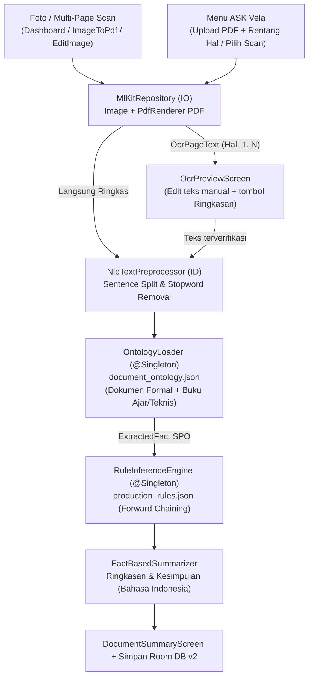

# Implementation Plan — Tahap 1 (Chained): Pipeline Offline OCR, Rule-Based Inference, Tombol "Ringkasan" & Menu "ASK Vela" (Bahasa Indonesia)

> **STATUS:** MENUNGGU PERSETUJUAN YOGI ARIO (CHAINED PLAN PASCA-TAHAP 00)  
> **NOMOR TAHAPAN:** Tahap 01 (Core AI Feature: Offline OCR + Rule-Based Inference + ASK Vela)  
> **PROYEK:** VelaPDF (`com.njagakneai.velapdf` — `v1.3 Beta Revision 3`)  
> **PEMILIK PROYEK:** Yogi Ario Pratama (`@useripx`)  
> **PENYUSUN:** Carl (`AGT-PRD-DEV-001`)  
> **TANGGAL:** 11/11/2026  
> **TARGET BRANCH:** `feature/01_ocr_dan_ask_vela` (bercabang dari `develop`, tidak menyentuh `main` sebelum rilis)  
> **ACUAN BATASAN & TESTBED:** [`batasan_masalah.md`](file:///C:/Users/yogia/AndroidStudioProjects/VelaPDF/aturan/Docs/batasan_masalah.md) & [`aturan/alatuji/`](file:///C:/Users/yogia/AndroidStudioProjects/VelaPDF/aturan/alatuji)

---

## 1. Tujuan & Skenario Utama Pengguna (Tahap 1)

Tahap 1 membangun dan menghubungkan fitur inti **VelaPDF** yang masih terputus/placeholder pada audit Fase 0 ([`DEF-LEG-005`](file:///C:/Users/yogia/AndroidStudioProjects/VelaPDF/aturan/Docs/Defect_Log.md#L30) & [`DEF-LEG-007`](file:///C:/Users/yogia/AndroidStudioProjects/VelaPDF/aturan/Docs/Defect_Log.md#L32)) agar berjalan **100% luring (*offline-first*)** tanpa Q&A chatbot atau LLM awan, khusus dokumen **Bahasa Indonesia**:

1. **Alur A — Pindai Kamera / Edit Gambar -> Tombol `"Ringkasan"` Offline:**
   - Pengguna memotret beberapa halaman dokumen/buku cetak (misalnya buku *IoT* halaman 23 s.d. 35) via *ML Kit Document Scanner* di [`DashboardScreen.kt`](file:///C:/Users/yogia/AndroidStudioProjects/VelaPDF/app/src/main/java/com/njagakneai/velapdf/ui/screen/DashboardScreen.kt) atau [`ImageToPdfScreen.kt`](file:///C:/Users/yogia/AndroidStudioProjects/VelaPDF/app/src/main/java/com/njagakneai/velapdf/ui/screen/ImageToPdfScreen.kt).
   - Saat meninjau / mengedit hasil pindai ([`EditImageScreen.kt`](file:///C:/Users/yogia/AndroidStudioProjects/VelaPDF/app/src/main/java/com/njagakneai/velapdf/ui/screen/EditImageScreen.kt) maupun pra-tinjau multi-halaman di `ImageToPdfScreen` / [`OcrPreviewScreen.kt`](file:///C:/Users/yogia/AndroidStudioProjects/VelaPDF/app/src/main/java/com/njagakneai/velapdf/ui/screen/OcrPreviewScreen.kt)), tersedia tombol **`"Ringkasan"`** yang menjalankan **ML Kit Text Recognition** + **NLP Lokal** + **Rule-Based Inference (Forward Chaining)** secara offline dan langsung menampilkan **Ringkasan & Kesimpulan Bahasa Indonesia**.
2. **Alur B — Menu `"ASK Vela"` (Unggah PDF atau Pilih Hasil Scan):**
   - Dua kartu placeholder `"Tahap Pengembangan"` di [`DashboardScreen.kt`](file:///C:/Users/yogia/AndroidStudioProjects/VelaPDF/app/src/main/java/com/njagakneai/velapdf/ui/screen/DashboardScreen.kt#L601-L614) diaktifkan menjadi gerbang menu **`ASK Vela`**.
   - Di `AskVelaScreen`, pengguna dapat memilih: **(1) Unggah Berkas PDF** (dengan opsi rentang halaman), **(2) Pindai / Ambil Foto Halaman**, atau **(3) Pilih Hasil Scan / Dokumen Tersimpan**, lalu memperoleh klasifikasi jenis dokumen, topik dominan, ringkasan ekstraktif, dan **kesimpulan akhir dalam Bahasa Indonesia**.

---

## 2. Arsitektur Teknis & Alur Data Tahap 1

### 2.1 Penyesuaian Basis Pengetahuan (`assets/`) untuk Buku & Dokumen Formal
Basis pengetahuan awal di `aturan/alatuji/02_skema_basis_pengetahuan/` baru mencakup 5 kelas naskah formal kampus (`SuratKeputusan`, `SuratEdaran`, `PedomanSOP`, `PeraturanRegulasi`, `LaporanResmi`). Pada Tahap 1, salinan produksi di `app/src/main/assets/` diperluas **tanpa merusak aturan formal `SK-01`..`SK-05`**:
- **`document_ontology.json` (Versi Produksi 2.1):**
  - Tetap mempertahankan 5 kelas formal (`SK-01`..`SK-05`) untuk menjaga akurasi penuh terhadap uji *ground truth* `alatuji/`.
  - Menambah konsep umum untuk dokumen non-regulasi: **`BukuAjarTeknis`** (`bab`, `pendahuluan`, `definisi`, `arsitektur`, `komponen`, `cara kerja`, `kelebihan`, `kesimpulan`, beserta kata kunci serapan teknis seperti *IoT*, *sensor*, *mikrokontroler*, *gateway*, *jaringan*, *protokol*, *algoritma*, *sistem*, *data*) serta **`DokumenInformatifUmum`** agar ringkasan halaman buku atau artikel non-SK menghasilkan topik, pokok bahasan, dan kesimpulan akurat.
- **`production_rules.json` (Versi Produksi 2.1):**
  - Tetap mempertahankan `RULE_01` s.d. `RULE_08`.
  - Menambah aturan inferensi (`RULE_09` s.d. `RULE_12`) untuk: klasifikasi bahan bacaan teknis/buku, identifikasi kalimat definisi/konsep inti, deteksi mekanisme/alur kerja sistem, serta penyintesis **Kesimpulan Otomatis Bahasa Indonesia** (`KESIMPULAN_AKHIR`) dari gabungan topik dominan + kalimat representatif antar-halaman.

---

## 3. Rincian Perubahan Berkas Target (Tahap 1)

### 3.1 Lapisan Data & Database (`app/src/main/java/.../data/` & `di/`)
- **Perluasan [`MlKitRepository.kt`](file:///C:/Users/yogia/AndroidStudioProjects/VelaPDF/app/src/main/java/com/njagakneai/velapdf/data/ocr/MlKitRepository.kt):**
  - Memastikan seluruh proses `InputImage`, `PdfRenderer`, dan `Bitmap` berjalan pada `Dispatchers.IO` (`withContext(Dispatchers.IO)` — membantu menyelesaikan `DEF-LEG-003` pada OCR).
  - Menambah `extractFromPdfUri(documentId, pdfUri, startPage, endPage, onProgress)` dengan scaling terkendali agar konsumsi bitmap efisien + `bitmap.recycle()` dan penanganan aman untuk PDF terenkripsi/rusak (mengatasi pesan error spesifik tanpa crash/NPE).
  - Menambah `extractPagesFromUris(uris, onProgress)` untuk pemrosesan multi-halaman hasil scan kamera.
- **Migrasi Room Database `v1 -> v2` (`AppDatabase.kt`, `DatabaseModule.kt`):**
  - Menambah entitas `AnalysisHistoryEntity` & `AnalysisHistoryDao` untuk menyimpan hasil ringkasan & kesimpulan ASK Vela secara luring (`judulDokumen`, `jenisDokumen`, `topikUtama`, `ringkasanText`, `kesimpulanText`, `jumlahHalaman`, `rentangHalaman`, `sourceUri`, `timestamp`).
  - Menaikkan `@Database(..., version = 2)` pada [`AppDatabase.kt`](file:///C:/Users/yogia/AndroidStudioProjects/VelaPDF/app/src/main/java/com/njagakneai/velapdf/data/database/AppDatabase.kt) dengan implementasi `Migration(1, 2)` eksplisit di [`DatabaseModule.kt`](file:///C:/Users/yogia/AndroidStudioProjects/VelaPDF/app/src/main/java/com/njagakneai/velapdf/di/DatabaseModule.kt) (**tanpa** `fallbackToDestructiveMigration`).
  - Menyediakan binding Hilt `@Singleton` untuk komponen OCR, NLP, Ontology, Inference, dan Summarizer (`di/AnalysisModule.kt`).

### 3.2 Lapisan Domain (`app/src/main/java/.../domain/`)
- **`domain/model/DocumentAnalysisModels.kt`** — Model domain analisis, fakta SPO, aturan terpicu, progres bertahap (`AnalysisUiState`), dan model output ringkasan + kesimpulan Indonesia (`DocumentSummary`).
- **`domain/nlp/NlpTextPreprocessor.kt`** — Segmentasi kalimat (melindungi singkatan akademik/formal maupun angka sub-bab seperti `2.1`, `Hal.`, `No.`), pembersihan teks OCR, *stopword removal* Bahasa Indonesia, pembobotan TF/posisi seksi (judul bab, definisi, konklusi), dan deteksi topik dominan.
- **`domain/ontology/OntologyLoader.kt`** — Pemuatan JSON ontologi dari `assets/document_ontology.json` dan ekstraksi fakta semantik SPO per kalimat + deteksi entitas/istilah kunci.
- **`domain/inference/RuleInferenceEngine.kt`** — Mesin *Forward Chaining* evaluasi kondisi aturan produksi berprioritas untuk menghasilkan butir fakta turunan & kesimpulan terstruktur.
- **`domain/summary/FactBasedSummarizer.kt`** — Menyusun paket output final berisi: Klasifikasi Dokumen, Topik Utama, **Ringkasan Poin Per Halaman/Tematik**, dan **Kesimpulan Akhir (Bahasa Indonesia)** lengkap dengan rujukan nomor halaman (`Hal. X`).

### 3.3 Lapisan UI & Navigasi (`ui/viewmodel/`, `ui/screen/`, `ui/navigation/`)
- **[`OcrViewModel.kt`](file:///C:/Users/yogia/AndroidStudioProjects/VelaPDF/app/src/main/java/com/njagakneai/velapdf/ui/viewmodel/OcrViewModel.kt) & `DocumentAnalysisViewModel.kt`:**
  - Menghubungkan pemrosesan multi-halaman URI & PDF ber-rentang halaman ke pipeline `OCR -> NLP -> Ontology -> Inference -> Summarizer` dengan `StateFlow` yang konsisten dan reaktif.
- **Integrasi Tombol `"Ringkasan"` Pasca-Scan / Edit:**
  - [`EditImageScreen.kt`](file:///C:/Users/yogia/AndroidStudioProjects/VelaPDF/app/src/main/java/com/njagakneai/velapdf/ui/screen/EditImageScreen.kt): Menambah tombol **"Ringkasan AI (Offline)"** agar gambar yang baru dipindai/diedit bisa langsung diringkas isinya.
  - [`ImageToPdfScreen.kt`](file:///C:/Users/yogia/AndroidStudioProjects/VelaPDF/app/src/main/java/com/njagakneai/velapdf/ui/screen/ImageToPdfScreen.kt): Menambah opsi aksi **"Ringkasan"** di samping tombol buat PDF ketika gambar scan dipilih (`selectedImages.isNotEmpty()`), sehingga kumpulan foto halaman buku (mis. 5–13 foto halaman berurutan) bisa diringkas sekaligus.
  - [`DashboardScreen.kt`](file:///C:/Users/yogia/AndroidStudioProjects/VelaPDF/app/src/main/java/com/njagakneai/velapdf/ui/screen/DashboardScreen.kt):
    - Saat **Scan Dokumen** selesai (`scannerLauncher`), selain menghasilkan PDF, memberi alur langsung menuju peninjauan/ringkasan atau menyimpan ke riwayat scan yang siap dipilih di **ASK Vela**.
    - Mengaktifkan kartu **"ASK Vela — Analisis & Ringkasan Dokumen Offline"** dan daftar **Riwayat Ringkasan**.
    - Menyelaraskan teks versi hardcode `"VelaPDF v1.0.0"` di drawer (`DashboardScreen.kt:241`) dengan `BuildConfig` / `versionName` aktual (`DEF-LEG-006`).
  - [`OcrPreviewScreen.kt`](file:///C:/Users/yogia/AndroidStudioProjects/VelaPDF/app/src/main/java/com/njagakneai/velapdf/ui/screen/OcrPreviewScreen.kt): Memperbaiki bug sinkronisasi state `remember(textData.pageNumber, textData.rawText)` pada `OutlinedTextField` dan menghubungkan tombol konfirmasi -> **`"Buat Ringkasan"`**.
- **Layar Baru `AskVelaScreen.kt` & `DocumentSummaryScreen.kt` + [`NavGraph.kt`](file:///C:/Users/yogia/AndroidStudioProjects/VelaPDF/app/src/main/java/com/njagakneai/velapdf/ui/navigation/NavGraph.kt):**
  - Rute `Screen.AskVela`, `Screen.OcrPreview`, dan `Screen.DocumentSummary` lengkap dengan alur navigasi bersih tanpa placeholder mati.

### 3.4 Pengujian Unit Lokal (`app/src/test/`) — Mengatasi `DEF-LEG-007`
- `NlpTextPreprocessorTest.kt` — Uji pemecahan kalimat singkatan, penyaringan kata tugas Bahasa Indonesia, dan skor bobot teks buku vs surat formal.
- `RuleInferenceEngineTest.kt` — Uji klasifikasi & aturan terhadap 5 sampel resmi (`SK-01`..`SK-05` mengacu `ground_truth_facts.json` di `aturan/alatuji/`) **dan** skenario halaman buku *IoT Bahasa Indonesia* (halaman 23–35).
- `FactBasedSummarizerTest.kt` — Uji bahwa output kesimpulan & ringkasan terisi Bahasa Indonesia, mencantumkan referensi halaman, dan tetap aman saat teks pendek/minim kata kunci.

---

## 4. Konfirmasi 3 Poin Keputusan UX Sebelum Eksekusi Tahap 1

Mengacu pada [`batasan_masalah.md` §3](file:///C:/Users/yogia/AndroidStudioProjects/VelaPDF/aturan/Docs/batasan_masalah.md#L44-L49), mohon Yogi konfirmasi 3 preferensi antarmuka berikut agar implementasi Tahap 1 langsung tepat sasaran:

| No | Poin Keputusan UX | Opsi A *(Direkomendasikan Carl)* | Opsi B |
| :---: | :--- | :--- | :--- |
| **1** | **Fungsi Tab Bawah `"Convert"` di [`DashboardScreen.kt`](file:///C:/Users/yogia/AndroidStudioProjects/VelaPDF/app/src/main/java/com/njagakneai/velapdf/ui/screen/DashboardScreen.kt#L301-L344)** | Ganti rute placeholder [`ConverterScreen.kt`](file:///C:/Users/yogia/AndroidStudioProjects/VelaPDF/app/src/main/java/com/njagakneai/velapdf/ui/screen/ConverterScreen.kt) yang kosong dengan menyusun Bottom Bar aktif: **`Beranda` (`Dashboard`)**, **`Scan`**, **`ASK Vela`**, dan **`Settings`** *(+ `ConverterScreen.kt` dihapus bersih)*. | Pertahankan 3 tab, dan arahkan klik **`Convert`** langsung ke layar **`ImageToPdf`**. |
| **2** | **Pemilihan Rentang Halaman saat Upload PDF di `ASK Vela`** | Tampilkan opsi **`Semua Halaman (maks. 35 hal)`** atau **`Pilih Rentang Halaman (Dari Hal. __ s.d. __)`** — cocok langsung untuk memproses buku *IoT halaman 23 s.d. 35* tanpa membebani memori HP. | Otomatis memproses seluruh PDF berurutan dari halaman 1 hingga batas aman 35 halaman (tanpa input nomor awal/akhir). |
| **3** | **Opsi Ekspor di Layar Hasil Ringkasan (`DocumentSummaryScreen`)** | Simpan ke **Riwayat Room Lokal** + **Salin Teks** + **Bagikan Teks** + **Ekspor Ringkasan ke berkas `.pdf`** *(memakai library iText7 yang sudah terpasang)*. | Simpan ke **Riwayat Room Lokal** + **Salin Teks** + **Bagikan Teks** saja *(tanpa ekspor ke `.pdf`)*. |

---

## 5. Urutan Verifikasi Pasca-Implementasi Tahap 1

1. Unit Test JVM lengkap: `.\gradlew.bat testDebugUnitTest --no-daemon` -> 100% `PASS` (NLP + Ontology + Forward Chaining SK-01..05 & Buku IoT + Summarizer).
2. Verifikasi Lint & Kompilasi APK Debug: `.\gradlew.bat lintDebug assembleDebug --no-daemon` -> `0 errors` & `BUILD SUCCESSFUL`.
3. Perbarui `aturan/Docs/Defect_Log.md` (`DEF-LEG-005`, `DEF-LEG-006`, `DEF-LEG-007`), `Task_Status.md`, `Database_Design.md`, dan catat changelog `02changelog...md` sebelum merge `feature/01_ocr_dan_ask_vela` ke `develop`.

---

> 🛑 **Menunggu persetujuan Yogi Ario atas rencana Tahap 1 serta pilihan atas 3 poin UX pada Bagian 4 (misalnya: "Setuju lanjut, pilih Opsi A semua") sebelum penulisan kode Tahap 1 dimulai.**
