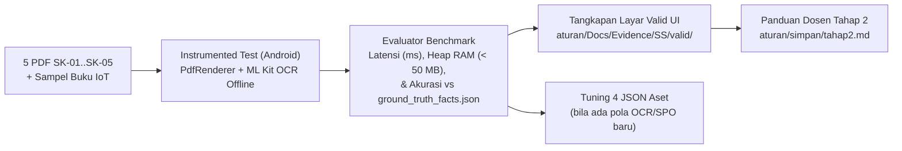

# Implementation Plan — Tahap 02: Evaluasi Testbed Akademik (`SK-01` s.d. `SK-05` & Buku IoT), Pengujian Visual Emulator/Perangkat & Profiling Memori

> **STATUS:** MENUNGGU TINJAUAN & KEPUTUSAN YOGI ARIO (CHAINED PLAN — TAHAP 02)  
> **NOMOR TAHAPAN:** Tahap 02 (Validasi Empiris Testbed, Bukti Visual UI, & Audit Memori `< 50 MB`)  
> **PROYEK:** VelaPDF (`com.njagakneai.velapdf`)  
> **PEMILIK PROYEK:** Yogi Ario Pratama (`@useripx`)  
> **PENYUSUN:** Carl (`AGT-PRD-DEV-001`)  
> **TANGGAL:** 11/11/2026  
> **PRASYARAT SELESAI (TAHAP 01):** Branch `feature/01_ocr_dan_ask_vela` lulus `testDebugUnitTest` (`11/11` PASS), `lintDebug` (`0` errors / `48` warnings / `1` hint), dan `assembleDebug` (`BUILD SUCCESSFUL in 1m 53s`).  
> **ACUAN TESTBED:** [`testbed_hardware_software.md`](file:///C:/Users/yogia/AndroidStudioProjects/VelaPDF/aturan/alatuji/05_spesifikasi_testbed/testbed_hardware_software.md) & [`ground_truth_facts.json`](file:///C:/Users/yogia/AndroidStudioProjects/VelaPDF/aturan/alatuji/04_sampel_dokumen_uji/ground_truth_facts.json)

---

## 1. Latar Belakang & Tujuan Tahap 02

Implementasi arsitektur penuh **Tahap 01** sudah terpasang dan terverifikasi lewat JVM unit test + Lint + Debug APK build. Namun sesuai [`Test_Report.md`](file:///C:/Users/yogia/AndroidStudioProjects/VelaPDF/aturan/Docs/Test_Report.md) dan pedoman pengujian empiris di [`aturan/alatuji/06_pemetaan_tugas_akademik/`](file:///C:/Users/yogia/AndroidStudioProjects/VelaPDF/aturan/alatuji/06_pemetaan_tugas_akademik), terdapat 3 celah pembuktian yang harus dituntaskan pada **Tahap 02** agar kuat secara teknis maupun siap untuk data Sempro / Bab IV Skripsi:

1. **Uji End-to-End 5 Berkas PDF Sampel Asli (`SK-01` s.d. `SK-05`):** Mengukur akurasi ekstraksi fakta SPO (*Precision / Recall / F1*) dan kesesuaian kaidah yang menyala (*Fired Rules*) melawan acuan resmi [`ground_truth_facts.json`](file:///C:/Users/yogia/AndroidStudioProjects/VelaPDF/aturan/alatuji/04_sampel_dokumen_uji/ground_truth_facts.json), termasuk uji nyata `PdfRenderer` + ML Kit Text Recognition di perangkat/emulator Android.
2. **Uji Lapangan Dokumen Non-Surat (Foto / PDF Buku Ajar *IoT* Hal. 23–35):** Menguji ketahanan ekstraksi OCR terhadap citra kamera nyata / scan multi-halaman dan memperkaya `nlp_lexicon_id.json` serta `spo_pattern_dictionary.json` bila ditemukan kosakata/noise OCR baru.
3. **Pengambilan Bukti Visual & Profiling Sumber Daya:** Mengisi folder [`aturan/Docs/Evidence/SS/valid/`](file:///C:/Users/yogia/AndroidStudioProjects/VelaPDF/aturan/Docs/Evidence/SS/valid) secara nyata, memastikan jejak lalu lintas jaringan = `0 byte` (*Airplane Mode On*), serta memvalidasi alokasi *heap memory* berada di batas aman **< 50 MB** sesuai [`testbed_hardware_software.md`](file:///C:/Users/yogia/AndroidStudioProjects/VelaPDF/aturan/alatuji/05_spesifikasi_testbed/testbed_hardware_software.md#L28).

> 💬 *Slot Komentar Seksi 1 — Apakah prioritas utama Tahap 02 sudah sesuai dengan kebutuhan Sempro & implementasi lapangan Anda?*

---

## 2. Rencana Paket Pekerjaan Teknis (Scope Tahap 02)

### Paket Kerja A — Benchmark Otomatis (`androidTest`) atas `SK-01` s.d. `SK-05`
- Membuat suite pengujian terinstrumentasi (`app/src/androidTest/`) atau utilitas evaluasi yang membaca 5 PDF asli di `aturan/alatuji/04_sampel_dokumen_uji/`:
  - `SK-01_Surat_Keputusan_Rektor.pdf`
  - `SK-02_Surat_Edaran_Jadwal_KRS.pdf`
  - `SK-03_Pedoman_SOP_Ujian_Skripsi.pdf`
  - `SK-04_Peraturan_Tata_Tertib_Kampus.pdf`
  - `SK-05_Laporan_Ringkasan_Kegiatan.pdf`
- Membandingkan fakta SPO & kaidah terpicu terhadap [`ground_truth_facts.json`](file:///C:/Users/yogia/AndroidStudioProjects/VelaPDF/aturan/alatuji/04_sampel_dokumen_uji/ground_truth_facts.json) serta mencatat latensi tahap-demi-tahap (`OCR`, `NLP`, `SPO/Ontologi`, `Forward Chaining`, `Summarizer`) dan puncak memori heap (`Debug.getNativeHeapAllocatedSize()` / JVM heap).

### Paket Kerja B — Uji Visual Alur Pengguna & Pengisian `Evidence/SS/valid/`
Memverifikasi secara visual di Android Emulator / Xiaomi Redmi Note 11 seluruh alur UI baru:
1. [`DashboardScreen.kt`](file:///C:/Users/yogia/AndroidStudioProjects/VelaPDF/app/src/main/java/com/njagakneai/velapdf/ui/screen/DashboardScreen.kt): Bilah navigasi bawah 4 tab (`Beranda`, `Scan`, `ASK Vela`, `Settings`), dialog pilihan pasca-pindai, dan kartu shortcut `ASK Vela` aktif.
2. [`EditImageScreen.kt`](file:///C:/Users/yogia/AndroidStudioProjects/VelaPDF/app/src/main/java/com/njagakneai/velapdf/ui/screen/EditImageScreen.kt) & [`ImageToPdfScreen.kt`](file:///C:/Users/yogia/AndroidStudioProjects/VelaPDF/app/src/main/java/com/njagakneai/velapdf/ui/screen/ImageToPdfScreen.kt): Tombol `Ringkasan AI (Offline)` & `Edit OCR`.
3. [`OcrPreviewScreen.kt`](file:///C:/Users/yogia/AndroidStudioProjects/VelaPDF/app/src/main/java/com/njagakneai/velapdf/ui/screen/OcrPreviewScreen.kt): Penyuntingan teks per halaman tanpa bug state antarpindah halaman + tombol CTA bawah.
4. [`AskVelaScreen.kt`](file:///C:/Users/yogia/AndroidStudioProjects/VelaPDF/app/src/main/java/com/njagakneai/velapdf/ui/screen/AskVelaScreen.kt): Unggah PDF (`Semua Hal. maks. 35` vs `Rentang Hal.`), pindai kamera, dan riwayat tersimpan.
5. [`DocumentSummaryScreen.kt`](file:///C:/Users/yogia/AndroidStudioProjects/VelaPDF/app/src/main/java/com/njagakneai/velapdf/ui/screen/DocumentSummaryScreen.kt): Klasifikasi kelas ontologi, fakta SPO, daftar kaidah `RULE_*`, kesimpulan Bahasa Indonesia, dan ekspor PDF via [`SummaryPdfExporter.kt`](file:///C:/Users/yogia/AndroidStudioProjects/VelaPDF/app/src/main/java/com/njagakneai/velapdf/utils/SummaryPdfExporter.kt).

### Paket Kerja C — Penyempurnaan Ringan & Dokumentasi Akhir Tahap 02
- Perbaikan lint minor pada fitur baru (mis. saran `UseKtx` pada [`AskVelaScreen.kt`](file:///C:/Users/yogia/AndroidStudioProjects/VelaPDF/app/src/main/java/com/njagakneai/velapdf/ui/screen/AskVelaScreen.kt#L360)) dan tuning berkas JSON bila pengujian dokumen PDF/buku fisik menemukan pola tambahan.
- Pemutakhiran [`Test_Report.md`](file:///C:/Users/yogia/AndroidStudioProjects/VelaPDF/aturan/Docs/Test_Report.md), pencadangan hasil metrik ke dokumen akademik terkait, serta pembuatan **`aturan/simpan/tahap2.md`** + indeks [`Panduan_Belajar_Dosen.md`](file:///C:/Users/yogia/AndroidStudioProjects/VelaPDF/aturan/Docs/Panduan_Belajar_Dosen.md).

> 💬 *Slot Komentar Seksi 2 — Apakah ada pola dokumen atau kasus buku ajar khusus yang ingin Anda tambahkan ke benchmark Tahap 02?*

---

## 3. Pertanyaan Klarifikasi & Pilihan Keputusan (Wajib Dipilih Sebelum Eksekusi Tahap 02)

### Keputusan 3.1 — Target Perangkat Uji Visual & Benchmark Empiris
- **Opsi A (Direkomendasikan):** Jalankan **Emulator Android** terlebih dahulu untuk verifikasi UI cepat + tangkapan screenshot (`Evidence/SS/valid/`), lalu lanjutkan pengujian **Perangkat Fisik (Xiaomi Redmi Note 11, Airplane Mode On)** melalui ADB untuk pencatatan angka latensi dan heap RAM < 50 MB sesuai `testbed_hardware_software.md`.
- **Opsi B:** Gunakan **Android Emulator** saja untuk seluruh pengujian visual dan benchmark sementara perangkat fisik belum disiapkan.

### Keputusan 3.2 — Penanganan Defect Legacy Terisolasi (`DEF-LEG-001` s.d. `DEF-LEG-004` & `DEF-LEG-008`)
- **Opsi A (Direkomendasikan — Fokus Penuh Sempro):** Jangan ubah modul legacy non-AI yang tidak menghambat alur utama (`HistoryViewModel`, `OcrHelper`, dll.); fokus pada kestabilan alur OCR Offline + ASK Vela + Summary + Ekspor PDF serta bersihkan warning minor fitur baru (`AskVelaScreen.kt:360`).
- **Opsi B:** Sekalian refaktor semua sisa defect legacy terbuka sebelum penggabungan ke `develop`.

### Keputusan 3.3 — Status Git Branch `feature/01_ocr_dan_ask_vela` Sebelum Memulai Tahap 02
- **Opsi A (Direkomendasikan — Alur GitFlow Rapi):** Tinjau commit Tahap 01 di `feature/01_ocr_dan_ask_vela`, setujui untuk **push ke `origin` (`velapdfv1.git`) dan merge ke `develop`** (sementara `main` tetap bersih), lalu mulai Tahap 02 di branch `feature/02_evaluasi_testbed_dan_ui`.
- **Opsi B:** Tahan hasil Tahap 01 pada `feature/01_ocr_dan_ask_vela` terlebih dahulu hingga uji visual Emulator/Perangkat selesai, baru merge sekaligus ke `develop`.

> 💬 *Slot Komentar Seksi 3 — Pilih opsi (mis. "3.1 Opsi A, 3.2 Opsi A, 3.3 Opsi A") atau beri catatan perubahan sebelum mengklik Approve/Proceed.*

---

## 4. Kriteria Selesai (*Definition of Done*) Tahap 02

| No | Kriteria Verifikasi | Target |
| :---: | :--- | :--- |
| 1 | Benchmark end-to-end 5 PDF (`SK-01` s.d. `SK-05`) vs `ground_truth_facts.json` | Terukur & terekam di `Test_Report.md` |
| 2 | Uji batas memori & status 100% offline (`Airplane Mode On`) | Alokasi heap `< 50 MB`, transmisi jaringan `0 byte` |
| 3 | Tangkapan layar nyata alur Scan/OCR/ASK Vela/Summary/Export PDF | Tersimpan di `aturan/Docs/Evidence/SS/valid/` |
| 4 | Gradle Quality Gate (`testDebugUnitTest`, `lintDebug`, `assembleDebug`) | `BUILD SUCCESSFUL` dengan `0` lint error & `0` test fail |
| 5 | Panduan Belajar & Tanya Jawab Dosen Tahap 02 | Tersimpan di `aturan/simpan/tahap2.md` & terindeks |
