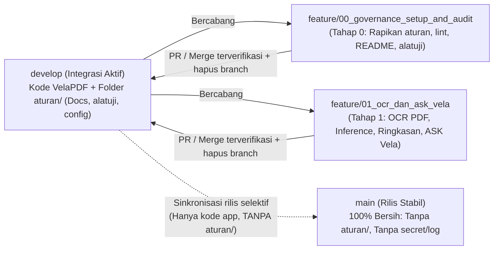

# Implementation Plan — Tahap 0 (Revisi 2): Bootstrap Repositori `velapdfv1`, Strategi Branch, Penyelarasan `aturan/`, `alatuji/` & Batasan Masalah Sempro

> **STATUS:** DISETUJUI & SELESAI (100% PASS — 11/11/2026)  
> **NOMOR TAHAPAN:** Tahap 00 (Handover Bootstrap, Git Cleanup & Governance Setup)  
> **PROYEK:** VelaPDF (`com.njagakneai.velapdf` — `v1.3 Beta Revision 3`)  
> **PEMILIK PROYEK:** Yogi Ario (`@useripx`)  
> **PENYUSUN:** Carl (`AGT-PRD-DEV-001`)  
> **TANGGAL:** 11/11/2026  
> **REMOTE TARGET:** `https://github.com/useripx/velapdfv1.git` *(terverifikasi kosong: `0` refs)*  
> **POLA ARSITEKTUR:** `MVVM + Clean Architecture` (`Jetpack Compose`, `Dagger Hilt`, `Room 2.8.5`, `DataStore`, `StateFlow`, `Coroutines`)  
> **ACUAN AUDIT:** [`Project_Analysis.md`](file:///C:/Users/yogia/AndroidStudioProjects/VelaPDF/aturan/Docs/Project_Analysis.md) & [`Defect_Log.md`](file:///C:/Users/yogia/AndroidStudioProjects/VelaPDF/aturan/Docs/Defect_Log.md)

---

## 1. Ringkasan Revisi & Keputusan yang Sudah Disepakati

Berdasarkan tinjauan komentar Yogi Ario atas draf awal Tahap 0:
1. **Fitur KHS Dihilangkan Permanen:** Penghapusan `PreviewKhsScreen.kt` & `KhsExporter.kt` dipertahankan permanen agar fokus penuh ke utilitas PDF + **OCR & Analisis Dokumen AI (ASK Vela / Ringkasan)**.
2. **Keamanan Konfigurasi Firebase (`Paling Aman`):** `app/gs.json` dihapus (duplikat); `.gitignore` diperketat (`*.jks`, `*.keystore`, `*.log`, `node_modules/`, dan `app/google-services.json`); `app/google-services.json` dikeluarkan dari tracking Git (`git rm --cached`) namun **tetap disimpan di disk lokal** agar laptop Yogi tetap bisa mem-build langsung tanpa kebocoran file ke GitHub.
3. **Pembersihan Total Sampah & File Mati:** Menghapus `app/gs.json`, crash logs (`hs_err_pid23324.log`, `hs_err_pid23732.log`, `replay_pid23732.log`), `velapdf_template/`, serta **5 file stub kosong tanpa referensi** (`MainActivity.kt` root template `"Hello Android!"`, `di/AppModule.kt`, `domain/PdfConverterEngine.kt`, `ui/viewmodel/MainViewModel.kt`, `utils/PermissionUtils.kt`).
4. **Perbaikan Lint Paling Aman (`Opsi B`):** Menyertakan perbaikan surgical 2 baris (`HistoryScreen.kt:98` memakai `LocalLocale.current.platformLocale` & `AndroidManifest.xml:5` menambah `<uses-feature android:name="android.hardware.camera" android:required="false" />`) agar 3 quality gate (`assembleDebug`, `testDebugUnitTest`, `lintDebug`) langsung **100% PASS** di commit baseline.
5. **Penyelarasan `aturan/` & Kebutuhan Sempro:**
   - `aturan/config/organization.md` diselaraskan ke persona **Carl**, path `aturan/Docs/`, dan aturan chat backup yang konsisten dengan `universal-rule.md`.
   - Folder `aturan/` **wajib hanya ada mentok di `develop` (dan branch fitur)** — dilarang keras ikut masuk ke branch `main`.
   - `aturan/Docs/batasan_masalah.md` dibuat terstruktur untuk bahan **Sempro** Yogi Ario (berisi batasan tanpa tanya jawab interaktif Q&A, batasan **hanya Bahasa Indonesia**, plus butir-butir batasan teknis lain sesuai konfirmasi Bagian 3 di bawah).

---

## 2. Arsitektur Branch Git & Rencana Pengelolaan `velapdfv1.git` (Penjelasan Lengkap)

Sesuai permintaan agar folder `aturan/` **mentok di `develop`** dan `main` **bersih hanya menyisakan proyek Android VelaPDF**:

### 2.1 Peran Masing-Masing Branch
1. **`main` (Produksi / Rilis Bersih):**
   - **Isi:** **Hanya proyek aplikasi VelaPDF** (`app/`, `gradle/`, `gradlew`, `gradlew.bat`, `build.gradle.kts`, `settings.gradle.kts`, `gradle.properties`, `.gitignore`, `README.md`). **Folder `aturan/` 0% ada di `main`.**
   - **Aturan:** Dilarang commit langsung atau menjalankan pengembangan fitur di `main`. Pembaruan ke `main` hanya dilakukan saat rilis stabil atas otorisasi eksplisit Yogi Ario, dengan menyalin snapshot kode aplikasi bersih dari `develop` (tanpa folder `aturan/`) lalu diverifikasi lewat `git ls-tree -r --name-only main` dan Gradle build.
2. **`develop` (Branch Integrasi Pengembangan):**
   - **Isi:** Seluruh kode aplikasi terintegrasi **ditambah folder `aturan/`** (`config/`, `Docs/`, `alatuji/`, `changelog/`, `Rules/`, `Standards/`, `skills/`).
   - **Aturan:** Menjadi induk cabang kerja fitur dan tempat bertumpunya tata kelola proyek.
3. **`feature/<nomor>_<nama>` & `fix/<nama>` (Branch Kerja Sementara):**
   - Tahap 0 dikerjakan di `feature/00_governance_setup_and_audit` (lalu di-merge ke `develop` dan branch fitur dihapus).
   - Tahap 1 dikerjakan di `feature/01_ocr_dan_ask_vela` (bercabang dari `develop` setelah Tahap 0 beres, lalu di-merge kembali ke `develop` setelah seluruh uji PASS).

### 2.2 Pilihan Kritis Riwayat Commit Awal (`velapdfv1.git`) & 16 Branch Lama (Butuh Keputusan)
Saat ini di repo lokal masih terdapat **61 commit lama `PanjaluPDF`** (yang salah satu commit lamanya `543e3c6` pernah memuat `google-services.json` lama & fitur KHS) serta **16 branch lokal lama** (`feat/tahap1dan2`, `feature/Backend-*`, `feature/mergepdf`, dll.), sedangkan remote `https://github.com/useripx/velapdfv1.git` masih **kosong (`0` commit)**.

- **Opsi Git-A (Push Riwayat Lama Apa Adanya + Commit Baseline Baru):**
  - Kelebihan: Histori 61 commit `PanjaluPDF` tetap terbawa di `velapdfv1.git`.
  - Kekurangan (**Risiko Keamanan!**): File `google-services.json` lama & kode `PanjaluPDF`/KHS tetap tercatat dalam riwayat GitHub `velapdfv1.git` dan bisa memicu peringatan secret scanning.
- **Opsi Git-B (Direkomendasikan — Inisialisasi Riwayat Bersih `velapdfv1` + Arsip Lokal Aman):**
  - Mengamankan riwayat lama `PanjaluPDF` pada branch/tag arsip lokal (`archive/panjalupdf-legacy`, tidak di-push ke `velapdfv1.git`), lalu menginisialisasi `main` (commit baseline proyek bersih VelaPDF tanpa `aturan/` & tanpa `google-services.json`) dan `develop` (branch dari `main` yang menambahkan folder `aturan/` & `alatuji/`), serta membersihkan 16 branch `PanjaluPDF` lama setelah Yogi cek tidak ada yang dibutuhkan lagi.
  - Kelebihan: Repo `velapdfv1.git` **100% bersih sejak commit pertama** (nol kebocoran config Firebase di seluruh history, nol jejak KHS/PanjaluPDF, `main` super bersih, `develop` rapi dengan `aturan/`).

> **💬 Komentar / Pilihan Yogi Ario (Bagian 2 — Git History):** *(Pilih **Opsi Git-B** [Rekomen] atau **Opsi Git-A**, dan konfirmasi apakah 16 branch lama `PanjaluPDF` boleh dibersihkan)*

---

## 3. Klarifikasi Fitur Belum Ada vs Batasan Masalah (Untuk Tahap 1 & `batasan_masalah.md`)

Sesuai pesan Yogi: *"kalau ada yang sekiranya belum ada tanyakan ke saya dulu boleh tidak dimasukkan ke sini fiturnya atau kita masukkan ke batasan masalah"*. Dari hasil audit kode eksisting, berikut daftar poin yang belum tersedia / masih setengah jalan untuk Anda tentukan apakah **dimasukkan ke Tahap 1** atau **dicatat ke `aturan/Docs/batasan_masalah.md`**:

| No | Aspek / Celah yang Ditemukan di Codebase & Konsep | Usulan A: Tambah / Perbaiki di Tahap 1 | Usulan B: Masuk ke `batasan_masalah.md` (Sempro) |
| :---: | :--- | :--- | :--- |
| **1** | **Bahasa Dokumen & Keluaran** *(Sudah dikonfirmasi)* | Deteksi istilah teknis umum (mis. *IoT, MQTT, sensor*) dalam teks Indonesia | **Ya — Batasan Masalah #2:** Aplikasi hanya menganalisis teks & menghasilkan ringkasan/kesimpulan dalam **Bahasa Indonesia** (belum mendukung multi-bahasa asing penuh). |
| **2** | **Tanya Jawab Interaktif (Q&A / LLM)** *(Sudah dikonfirmasi)* | Tidak ada chatbot Q&A | **Ya — Batasan Masalah #1:** Menu **ASK Vela** & tombol Ringkasan hanya memproduksi ringkasan/kesimpulan otomatis berbasis aturan tanpa Q&A / AI cloud. |
| **3** | **PDF Terkunci Password & Tulisan Tangan** | Hanya memproses PDF standar & hasil scan cetak | **Rekomen masuk Batasan Masalah #3:** Tidak mendukung dokumen PDF terenkripsi/berkata sandi, tulisan tangan (*handwriting*), maupun ekstraksi rumus matematika/tabel rumit. |
| **4** | **Pemilihan Rentang Halaman pada PDF/Buku Tebal** *(mis. buku IoT hal. 23–35)* | **Rekomen masuk Tahap 1:** Saat unggah PDF di **ASK Vela**, pengguna bisa memilih rentang halaman (mis. **Dari Hal. 23 s.d. 35**) + batas aman maks. 30 halaman per proses agar memori HP offline aman | Catat batas maksimal halaman per analisis (mis. maks. 30 halaman per sesi scan/analisis) untuk menjaga batas memori ($\le 50\text{ MB}$) & latensi lokal. |
| **5** | **Tab Bawah `"Convert"` (`ConverterScreen`) di `DashboardScreen`** | **Rekomen perbaiki di Tahap 1:** Saat ini tab `"Convert"` membuka `ConverterScreen` yang kosong (`images = emptyList()`). Arahkan tab `"Convert"` ke `ImageToPdf` (atau jadikan gerbang `ASK Vela` / hapus tab kosong) | Jika dibiarkan tidak terpakai, berisiko terlihat bug saat demo Sempro. |
| **6** | **Ekspor Hasil Ringkasan (`DocumentSummaryScreen`)** | Simpan ringkasan ke **Riwayat SQLite Room** + tombol **Salin / Bagikan Teks** *(opsional: tambah tombol Ekspor Ringkasan ke PDF)* | Jika cukup teks + simpan ke Room (+ share teks), ekspor ke format `.docx`/`.txt` tidak disertakan. |
| **7** | **Edit Gambar Lanjutan di `EditImageScreen`** | Di Tahap 1, fokus pada **Review / Edit Halaman & Teks Hasil Scan + tombol "Ringkasan"** *(crop/filter tetap via ML Kit Scanner)* | **Rekomen masuk Batasan Masalah:** Editing grafis manual lanjutan (tanda tangan, watermark, anotasi coretan, atur brightness/contrast manual) di luar lingkup. |
| **8** | **Format Berkas Lain & Sinkronisasi Cloud** | Hanya menerima **Kamera/Foto** & **PDF**; login punya mode **"Masuk Sebagai Tamu (Mode Offline)"** | **Rekomen masuk Batasan Masalah:** Tidak mendukung input `.docx`/`.pptx`/audio dan tidak ada sinkronisasi ringkasan antar-perangkat via cloud. |

> **💬 Komentar / Keputusan Yogi Ario (Bagian 3 — Fitur vs Batasan Masalah):** *(Konfirmasi poin 3–8 mana yang ingin dimasukkan ke Tahap 1 vs masuk `batasan_masalah.md`)*

---

## 4. Daftar Berkas Target Tahap 0 (Sudah Diperbarui)

### Dibuat Baru:
- `aturan/Docs/batasan_masalah.md` — Naskah terstruktur Batasan Masalah untuk keperluan Sempro & batasan implementasi sistem.
- `aturan/alatuji/` — Salinan utuh aset uji & referensi metopen dari `C:\Users\yogia\Music\Docs\metopen\`.
- `aturan/Docs/Implementation_plan/00_tahap00_Implementation_plan_bootstrap_dan_penyelarasan.md` — Arsip setelah Tahap 0 selesai.

### Dimodifikasi (Surgical Changes):
- [`organization.md`](file:///C:/Users/yogia/AndroidStudioProjects/VelaPDF/aturan/config/organization.md) — Ganti ke persona **Carl**, arahkan path ke `aturan/Docs/`, sinkronkan kebijakan chat backup.
- [`AGENTS.md`](file:///C:/Users/yogia/AndroidStudioProjects/VelaPDF/aturan/AGENTS.md) & [`GEMINI.md`](file:///C:/Users/yogia/AndroidStudioProjects/VelaPDF/aturan/GEMINI.md) — Perjelas aturan `aturan/` **mentok di `develop`**, path `aturan/Docs/` & `aturan/alatuji/`, serta arsitektur aktual `MVVM + Clean Architecture` + Compose + Hilt.
- [`Android_Kotlin_MVVM_Rules.md`](file:///C:/Users/yogia/AndroidStudioProjects/VelaPDF/aturan/Docs/Rules/Android_Kotlin_MVVM_Rules.md) — Selaraskan peta folder `data/`, `domain/`, `di/`, `ui/screen/`, `ui/viewmodel/`, `utils/`, Room `2.8.5`, `DataStore`, `Compose`, `Hilt`.
- [`.gitignore`](file:///C:/Users/yogia/AndroidStudioProjects/VelaPDF/.gitignore) — Aktifkan blokir `*.jks`, `*.keystore`, `*.log`, `node_modules/`, dan `app/google-services.json`.
- [`README.md`](file:///C:/Users/yogia/AndroidStudioProjects/VelaPDF/README.md) — Header dengan [`logo.png`](file:///C:/Users/yogia/AndroidStudioProjects/VelaPDF/app/src/main/res/drawable/logo.png), badge `useripx/velapdfv1`, deskripsi fitur (tanpa KHS), dan panduan lokal `google-services.json`.
- [`HistoryScreen.kt`](file:///C:/Users/yogia/AndroidStudioProjects/VelaPDF/app/src/main/java/com/njagakneai/velapdf/ui/screen/HistoryScreen.kt#L98) & [`AndroidManifest.xml`](file:///C:/Users/yogia/AndroidStudioProjects/VelaPDF/app/src/main/AndroidManifest.xml#L5) — Perbaikan 2 baris lint error `DEF-LEG-009`.

### Dihapus Permanen (Pembersihan Sampah & Stub Mati):
- `app/gs.json`, `hs_err_pid23324.log`, `hs_err_pid23732.log`, `replay_pid23732.log`, `velapdf_template/`
- 5 file stub Kotlin kosong tanpa referensi: `com/njagakneai/velapdf/MainActivity.kt`, `di/AppModule.kt`, `domain/PdfConverterEngine.kt`, `ui/viewmodel/MainViewModel.kt`, `utils/PermissionUtils.kt`
- Penghapusan KHS lama (`PreviewKhsScreen.kt`, `KhsExporter.kt`) tetap permanen.

---

## 5. Rencana Tahapan Eksekusi Tahap 0 & Pengujian

### Batch 1: Pembersihan Aman, `.gitignore`, & `aturan/` + `alatuji/`
- [ ] Menghapus sampah root/duplikat + 5 stub Kotlin kosong tanpa referensi, dan memperketat `.gitignore` (termasuk mengeluarkan `app/google-services.json` dari index Git tanpa menghapus file lokal).
- [ ] Menyalin `C:\Users\yogia\Music\Docs\metopen\` → `aturan/alatuji/` dengan verifikasi checksum `SK-01`..`SK-05`.
- [ ] Menulis `aturan/Docs/batasan_masalah.md` sesuai keputusan akhir Bagian 3 (siap untuk rujukan Sempro).
- [ ] Menyesuaikan `organization.md`, `AGENTS.md`, `GEMINI.md`, `Android_Kotlin_MVVM_Rules.md` (menegaskan Clean `main` Strict tanpa `aturan/`).

### Batch 2: Pembaruan `README.md` & Surgical Lint Fix (`DEF-LEG-009`)
- [ ] Memperbarui `README.md` dengan `app/src/main/res/drawable/logo.png` & badge `useripx/velapdfv1`.
- [ ] Memperbaiki `HistoryScreen.kt:98` (`LocalLocale.current.platformLocale`) & `AndroidManifest.xml:5` (`<uses-feature android:name="android.hardware.camera" android:required="false" />`).

### Batch 3: Verifikasi 3 Gerbang Gradle & Sinkronisasi Git ke `velapdfv1.git`
- [ ] Menjalankan `.\gradlew.bat testDebugUnitTest lintDebug assembleDebug --no-daemon` → Target **100% PASS (0 Error)** pada state `develop` DAN memverifikasi build juga lulus jika dicek sebagai `main` (tanpa `aturan/`).
- [ ] Mengubah `origin` → `https://github.com/useripx/velapdfv1.git`, menerapkan strategi branch `Opsi Git-B` (atau `Git-A` sesuai pilihan), memastikan `git ls-tree -r --name-only main` **0% mengandung `aturan/` dan `google-services.json`**, lalu `git push` ke `velapdfv1.git` (`main` & `develop`).
- [ ] Mencatat changelog pertama `aturan/changelog/01changelog...md`, memperbarui `Defect_Log.md` (`DEF-LEG-004` & `DEF-LEG-009` retest PASS), dan menerbitkan draf *Implementation Plan* **Tahap 1** (`feature/01_ocr_dan_ask_vela`).

---

## 6. Gerbang Persetujuan Final (Approval Gate)

> 🛑 **Menunggu keputusan Yogi Ario atas Bagian 2.2 (`Opsi Git-B` vs `Git-A` & 16 branch lama) dan Bagian 3 (poin 3–8 masuk Tahap 1 vs `batasan_masalah.md`) sebelum eksekusi dimulai.**
