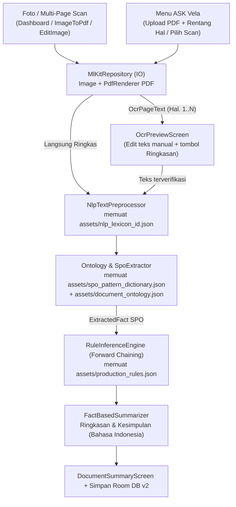

> [!NOTE]
> **STATUS: ARCHIVED / COMPLETED — Tahap 01**
> - **Branch:** `feature/01_ocr_dan_ask_vela`
> - **Disetujui oleh:** Yogi Ario (`@useripx`)
> - **Verifikasi Build & Test:** `.\gradlew.bat testDebugUnitTest lintDebug assembleDebug --no-daemon` — `BUILD SUCCESSFUL in 1m 53s` (11/11 unit tests PASS, 0 lint errors / 48 warnings / 1 hint, :app:assembleDebug PASS). Uji UI Emulator/Perangkat dijadwalkan pada Tahap 02.
> - **Panduan Belajar & Tanya Jawab Dosen:** [`aturan/simpan/tahap1.md`](../../simpan/tahap1.md)

---
# Implementation Plan — Tahap 1 (Revisi 1): Pipeline Offline OCR, 4 Kamus/Basis Pengetahuan JSON (`NLP + SPO + Ontologi + Rules`), Tombol "Ringkasan" & Menu "ASK Vela"

> **STATUS:** MENUNGGU PERSETUJUAN YOGI ARIO (REVISI 1 — PENAMBAHAN KAMUS NLP & SPO JSON)  
> **NOMOR TAHAPAN:** Tahap 01 (Core AI Feature: Offline OCR + 4-Layer JSON Rule-Based Inference + ASK Vela)  
> **PROYEK:** VelaPDF (`com.njagakneai.velapdf` — `v1.3 Beta Revision 3`)  
> **PEMILIK PROYEK:** Yogi Ario Pratama (`@useripx`)  
> **PENYUSUN:** Carl (`AGT-PRD-DEV-001`)  
> **TANGGAL:** 11/11/2026  
> **TARGET BRANCH:** `feature/01_ocr_dan_ask_vela` (bercabang dari `develop`, tidak menyentuh `main` sebelum rilis)  
> **ACUAN BATASAN & TESTBED:** [`batasan_masalah.md`](file:///C:/Users/yogia/AndroidStudioProjects/VelaPDF/aturan/Docs/batasan_masalah.md) & [`aturan/alatuji/`](file:///C:/Users/yogia/AndroidStudioProjects/VelaPDF/aturan/alatuji)

---

## 1. Tujuan & Skenario Utama Pengguna (Tahap 1)

Tahap 1 membangun dan menghubungkan fitur inti **VelaPDF** yang masih terputus/placeholder pada audit Fase 0 ([`DEF-LEG-005`](file:///C:/Users/yogia/AndroidStudioProjects/VelaPDF/aturan/Docs/Defect_Log.md#L30) & [`DEF-LEG-007`](file:///C:/Users/yogia/AndroidStudioProjects/VelaPDF/aturan/Docs/Defect_Log.md#L32)) agar berjalan **100% luring (*offline-first*)** tanpa Q&A chatbot atau LLM awan, khusus dokumen **Bahasa Indonesia**, dengan **pemisahan penuh kamus NLP, kamus pola SPO, ontologi, dan aturan inferensi ke berkas JSON eksternal (`app/src/main/assets/`)**:

1. **Alur A — Pindai Kamera / Edit Gambar -> Tombol `"Ringkasan"` Offline:**
   - Pengguna memotret beberapa halaman dokumen/buku cetak (misalnya buku *IoT* halaman 23 s.d. 35) via *ML Kit Document Scanner* di [`DashboardScreen.kt`](file:///C:/Users/yogia/AndroidStudioProjects/VelaPDF/app/src/main/java/com/njagakneai/velapdf/ui/screen/DashboardScreen.kt) atau [`ImageToPdfScreen.kt`](file:///C:/Users/yogia/AndroidStudioProjects/VelaPDF/app/src/main/java/com/njagakneai/velapdf/ui/screen/ImageToPdfScreen.kt).
   - Saat meninjau / mengedit hasil pindai ([`EditImageScreen.kt`](file:///C:/Users/yogia/AndroidStudioProjects/VelaPDF/app/src/main/java/com/njagakneai/velapdf/ui/screen/EditImageScreen.kt) maupun pra-tinjau multi-halaman di `ImageToPdfScreen` / [`OcrPreviewScreen.kt`](file:///C:/Users/yogia/AndroidStudioProjects/VelaPDF/app/src/main/java/com/njagakneai/velapdf/ui/screen/OcrPreviewScreen.kt)), tersedia tombol **`"Ringkasan"`** yang menjalankan **ML Kit Text Recognition** + **NLP Leksikal (`nlp_lexicon_id.json`)** + **Ekstraktor SPO (`spo_pattern_dictionary.json`)** + **Ontologi (`document_ontology.json`)** + **Forward Chaining (`production_rules.json`)** secara offline untuk langsung menampilkan **Ringkasan & Kesimpulan Bahasa Indonesia**.
2. **Alur B — Menu `"ASK Vela"` (Unggah PDF atau Pilih Hasil Scan):**
   - Dua kartu placeholder `"Tahap Pengembangan"` di [`DashboardScreen.kt`](file:///C:/Users/yogia/AndroidStudioProjects/VelaPDF/app/src/main/java/com/njagakneai/velapdf/ui/screen/DashboardScreen.kt#L601-L614) diaktifkan menjadi gerbang menu **`ASK Vela`**.
   - Di `AskVelaScreen`, pengguna dapat memilih: **(1) Unggah Berkas PDF** (dengan opsi rentang halaman), **(2) Pindai / Ambil Foto Halaman**, atau **(3) Pilih Hasil Scan / Dokumen Tersimpan**, lalu memperoleh klasifikasi jenis dokumen, topik dominan, fakta SPO terstruktur, ringkasan ekstraktif, dan **kesimpulan akhir dalam Bahasa Indonesia**.

---

## 2. Arsitektur 4 Berkas JSON Basis Pengetahuan & Leksikon (`app/src/main/assets/`)

Menjawab temuan tepat dari Yogi Ario: pada prototipe awal [`aturan/alatuji/01_kode_sumber/`](file:///C:/Users/yogia/AndroidStudioProjects/VelaPDF/aturan/alatuji/01_kode_sumber), daftar kata NLP (*stopwords*, singkatan, penanda seksi) di [`NlpTextPreprocessor.kt`](file:///C:/Users/yogia/AndroidStudioProjects/VelaPDF/aturan/alatuji/01_kode_sumber/NlpTextPreprocessor.kt#L18-L30) dan pola ekstraksi fakta **SPO (Subjek–Predikat–Objek)** di [`OntologyLoader.kt`](file:///C:/Users/yogia/AndroidStudioProjects/VelaPDF/aturan/alatuji/01_kode_sumber/OntologyLoader.kt#L109-L240) **masih hardcoded di kode Kotlin** dan folder `app/src/main/assets/` belum dibuat di repo.

Agar mesin AI rule-based **100% data-driven** (mudah diperluas tanpa ubah logika inti dan kuat secara ilmiah untuk Sempro/Skripsi), Tahap 1 menempatkan **4 berkas JSON terpisah** di **`app/src/main/assets/`**:

| No | Nama Berkas JSON (`app/src/main/assets/`) | Istilah Akademik / Sebutan Resmi | Peran & Isi Spesifik di VelaPDF |
| :---: | :--- | :--- | :--- |
| **1** | **`nlp_lexicon_id.json`** | **Korpus & Kamus Leksikon NLP Bahasa Indonesia** (*NLP Corpus & Lexicon Dictionary*) | Menyimpan daftar eksternal **1) `stopwords`** (kata tugas/hubung Bahasa Indonesia baku seperti *yang, di, ke, dari, adalah, merupakan, dengan, oleh*, dst.), **2) `protectedAbbreviations`** (*No., Hal., Lamp., Dr., dkk., dll., dsb., Yth., S.Kom., M.Kom.* agar pemecah kalimat tidak memotong tengah singkatan), **3) `sectionMarkers`** (penanda struktur seksi dokumen formal & buku ajar seperti `HEADER`, `CLAUSE`, `DEFINITION`, `MECHANISM`, `CONCLUSION`), dan **4) `domainBoostTerms`** (kata kunci serapan teknis penting seperti *IoT, MQTT, sensor, mikrokontroler, gateway, broker, jaringan*). |
| **2** | **`spo_pattern_dictionary.json`** | **Kamus Pola Ekstraksi Fakta Semantik SPO** (*SPO Pattern / Semantic Triple Lexicon*) | Menggantikan regex hardcoded di `OntologyLoader.kt` dengan definisi JSON deklaratif (`patternId`, `subject`, `predicate`, `category`, `regexPattern`, `captureGroup`, `domainScope`) untuk **dua kelompok dokumen**: **(a) Dokumen Formal** (`Dokumen -> memilikiNomor`, `diterbitkanPadaTanggal`, `memuatPerihal`, `PihakPenerbit -> memilikiKewenangan`, `PihakTerkait -> memilikiKewajiban`, `BatasWaktu -> berakhirPada`, `PihakTerkait -> memilikiLarangan`), dan **(b) Buku Ajar / Referensi Teknis** (`Konsep -> memilikiDefinisi`, `Sistem -> memilikiKomponen`, `Sistem -> memilikiFungsi`, `Sistem -> bekerjaMelalui`, `Metode -> memilikiKeunggulan`, `Metode -> memilikiKeterbatasan`, `Dokumen -> memilikiKesimpulan`). |
| **3** | **`document_ontology.json`** | **Taksonomi Ontologi Konsep Dokumen** (*Document Domain Ontology v2.1*) | Mempertahankan 5 kelas formal [`alatuji/`](file:///C:/Users/yogia/AndroidStudioProjects/VelaPDF/aturan/alatuji/02_skema_basis_pengetahuan/document_ontology.json) (`SuratKeputusan`, `SuratEdaran`, `PedomanSOP`, `PeraturanRegulasi`, `LaporanResmi` — tetap akurat untuk uji `SK-01`..`SK-05`) **ditambah kelas umum**: **`BukuAjarTeknis`** dan **`DokumenInformatifUmum`** lengkap dengan `lexicalKeywords` agar halaman buku cetak/PDF non-SK (seperti buku *IoT* hal. 23–35) terklasifikasi dengan benar. |
| **4** | **`production_rules.json`** | **Basis Aturan Produksi IF–THEN** (*Forward Chaining Rule Base v2.1*) | Mempertahankan `RULE_01` s.d. `RULE_08` (untuk `SK-01`..`SK-05`), ditambah **`RULE_09` s.d. `RULE_12`** untuk membangkitkan kesimpulan dokumen buku/artikel berbasis fakta SPO definisi, komponen, mekanisme kerja, serta poin inti kesimpulan **Bahasa Indonesia**. |

> **Keunggulan Arsitektur 4-JSON:** Ketiga kelas domain pemroses (`NlpTextPreprocessor`, `OntologyLoader`/`SpoPatternExtractor`, `RuleInferenceEngine`) dibuat menerima *JSON loader* berbasis JVM murni (`InputStream` / string asset), sehingga **seluruh 4 JSON di `app/src/main/assets/` dapat diuji langsung oleh `testDebugUnitTest` tanpa emulator**.

---

## 3. Rincian Perubahan Berkas Target (Tahap 1)

### 3.1 Aset Pengetahuan & Leksikon (`C:\Users\yogia\AndroidStudioProjects\VelaPDF\app\src\main\assets\`) *(Folder Baru — Belum Ada di Repo Saat Ini)*
- Folder `C:\Users\yogia\AndroidStudioProjects\VelaPDF\app\src\main\assets\` **memang belum ada saat ini** (`app\src\main\` baru berisi `java\`, `res\`, dan `AndroidManifest.xml`) dan baru akan **dibuat pada Tahap 1**:
- Baru: `C:\Users\yogia\AndroidStudioProjects\VelaPDF\app\src\main\assets\nlp_lexicon_id.json`
- Baru: `C:\Users\yogia\AndroidStudioProjects\VelaPDF\app\src\main\assets\spo_pattern_dictionary.json`
- Baru: `C:\Users\yogia\AndroidStudioProjects\VelaPDF\app\src\main\assets\document_ontology.json` *(diadaptasi & diperluas dari `C:\Users\yogia\AndroidStudioProjects\VelaPDF\aturan\alatuji\02_skema_basis_pengetahuan\document_ontology.json`)*
- Baru: `C:\Users\yogia\AndroidStudioProjects\VelaPDF\app\src\main\assets\production_rules.json` *(diadaptasi & diperluas dari `C:\Users\yogia\AndroidStudioProjects\VelaPDF\aturan\alatuji\02_skema_basis_pengetahuan\production_rules.json`)*

### 3.2 Lapisan Data & Database (`app/src/main/java/.../data/` & `di/`)
- **Perluasan [`MlKitRepository.kt`](file:///C:/Users/yogia/AndroidStudioProjects/VelaPDF/app/src/main/java/com/njagakneai/velapdf/data/ocr/MlKitRepository.kt):**
  - Seluruh proses `InputImage`, `PdfRenderer`, dan `Bitmap` dijalankan di `Dispatchers.IO` (`withContext(Dispatchers.IO)`).
  - Menambah `extractFromPdfUri(documentId, pdfUri, startPage, endPage, onProgress)` dengan scaling terkendali + `bitmap.recycle()` per halaman agar konsumsi RAM efisien serta penanganan aman untuk PDF terkunci/rusak.
  - Menambah `extractPagesFromUris(uris, onProgress)` untuk pemrosesan multi-halaman hasil scan kamera.
- **Migrasi Room Database `v1 -> v2` (`AppDatabase.kt`, `DatabaseModule.kt`):**
  - Menambah `AnalysisHistoryEntity` & `AnalysisHistoryDao` untuk menyimpan hasil ringkasan & kesimpulan ASK Vela secara luring (`judulDokumen`, `jenisDokumen`, `topikUtama`, `ringkasanText`, `kesimpulanText`, `jumlahHalaman`, `rentangHalaman`, `sourceUri`, `timestamp`).
  - Menaikkan `@Database(..., version = 2)` pada [`AppDatabase.kt`](file:///C:/Users/yogia/AndroidStudioProjects/VelaPDF/app/src/main/java/com/njagakneai/velapdf/data/database/AppDatabase.kt) dengan implementasi `Migration(1, 2)` eksplisit di [`DatabaseModule.kt`](file:///C:/Users/yogia/AndroidStudioProjects/VelaPDF/app/src/main/java/com/njagakneai/velapdf/di/DatabaseModule.kt) (**tanpa** `fallbackToDestructiveMigration`).
  - Menambah `di/AnalysisModule.kt` untuk menyediakan loader aset JSON & mesin inferensi sebagai `@Singleton`.

### 3.3 Lapisan Domain (`app/src/main/java/.../domain/`)
- **`domain/model/DocumentAnalysisModels.kt`** — Model Leksikon NLP JSON (`NlpLexiconConfig`), Kamus Pola SPO (`SpoPatternEntry`), Fakta SPO (`ExtractedFact`), `InferenceResult`, `AnalysisUiState`, dan `DocumentSummary`.
- **`domain/nlp/NlpTextPreprocessor.kt`** — Membaca `nlp_lexicon_id.json` untuk tokenisasi, *stopword removal*, proteksi singkatan, bobot kalimat (TF & posisi seksi), dan ekstraksi kata kunci topik dominan.
- **`domain/ontology/OntologyLoader.kt` & `SpoPatternExtractor.kt`** — Memuat `document_ontology.json` & `spo_pattern_dictionary.json`, lalu mengekstrak fakta SPO secara data-driven berbasis kamus JSON.
- **`domain/inference/RuleInferenceEngine.kt`** — Memuat `production_rules.json` dan mengeksekusi *Forward Chaining* berprioritas.
- **`domain/summary/FactBasedSummarizer.kt`** — Menyusun Klasifikasi Dokumen, Topik Dominan, Daftar Fakta SPO Terdeteksi, **Ringkasan Poin Per Halaman**, dan **Kesimpulan Akhir (Bahasa Indonesia)** lengkap dengan rujukan halaman (`Hal. X`).

### 3.4 Lapisan UI & Navigasi (`ui/viewmodel/`, `ui/screen/`, `ui/navigation/`)
- **[`OcrViewModel.kt`](file:///C:/Users/yogia/AndroidStudioProjects/VelaPDF/app/src/main/java/com/njagakneai/velapdf/ui/viewmodel/OcrViewModel.kt) & `DocumentAnalysisViewModel.kt`:** Menghubungkan OCR multi-halaman & PDF ke pipeline 4-JSON dengan `StateFlow`.
- **Integrasi Tombol `"Ringkasan"` Pasca-Scan / Edit:**
  - [`EditImageScreen.kt`](file:///C:/Users/yogia/AndroidStudioProjects/VelaPDF/app/src/main/java/com/njagakneai/velapdf/ui/screen/EditImageScreen.kt): Tombol **"Ringkasan AI (Offline)"** langsung di layar edit gambar hasil pindai.
  - [`ImageToPdfScreen.kt`](file:///C:/Users/yogia/AndroidStudioProjects/VelaPDF/app/src/main/java/com/njagakneai/velapdf/ui/screen/ImageToPdfScreen.kt): Aksi **"Ringkasan"** saat 1–N foto scan dipilih (`selectedImages.isNotEmpty()`).
  - [`OcrPreviewScreen.kt`](file:///C:/Users/yogia/AndroidStudioProjects/VelaPDF/app/src/main/java/com/njagakneai/velapdf/ui/screen/OcrPreviewScreen.kt): Perbaikan sinkronisasi `remember(textData.pageNumber, textData.rawText)` dan tombol **"Buat Ringkasan"**.
  - [`DashboardScreen.kt`](file:///C:/Users/yogia/AndroidStudioProjects/VelaPDF/app/src/main/java/com/njagakneai/velapdf/ui/screen/DashboardScreen.kt): Mengaktifkan alur pasca-scan & kartu **"ASK Vela — Analisis & Ringkasan Dokumen Offline"**, serta menyelaraskan versi `"VelaPDF v1.0.0"` (`DEF-LEG-006`).
- **Layar Baru `AskVelaScreen.kt` & `DocumentSummaryScreen.kt` + [`NavGraph.kt`](file:///C:/Users/yogia/AndroidStudioProjects/VelaPDF/app/src/main/java/com/njagakneai/velapdf/ui/navigation/NavGraph.kt):** Rute `Screen.AskVela`, `Screen.OcrPreview`, dan `Screen.DocumentSummary`.

### 3.5 Pengujian Unit Lokal (`app/src/test/`) — Mengatasi `DEF-LEG-007`
- `NlpLexiconAndPreprocessorTest.kt` — Uji pemuatan asli `app/src/main/assets/nlp_lexicon_id.json`, proteksi singkatan, dan *stopword removal* Bahasa Indonesia.
- `SpoPatternAndRuleEngineTest.kt` — Uji pemuatan asli `spo_pattern_dictionary.json`, `document_ontology.json`, dan `production_rules.json` terhadap sampel `SK-01`..`SK-05` (`ground_truth_facts.json`) **serta** teks buku *IoT Bahasa Indonesia* (halaman 23–35).
- `FactBasedSummarizerTest.kt` — Uji sintesis ringkasan & kesimpulan Bahasa Indonesia + rujukan halaman.

---

## 4. Konfirmasi 3 Poin Keputusan UX Sebelum Eksekusi Tahap 1

Mengacu pada [`batasan_masalah.md` §3](file:///C:/Users/yogia/AndroidStudioProjects/VelaPDF/aturan/Docs/batasan_masalah.md#L44-L49), mohon Yogi konfirmasi 3 preferensi antarmuka berikut bersamaan dengan persetujuan rencana 4-JSON di atas:

| No | Poin Keputusan UX | Opsi A *(Direkomendasikan Carl)* | Opsi B |
| :---: | :--- | :--- | :--- |
| **1** | **Fungsi Tab Bawah `"Convert"` di [`DashboardScreen.kt`](file:///C:/Users/yogia/AndroidStudioProjects/VelaPDF/app/src/main/java/com/njagakneai/velapdf/ui/screen/DashboardScreen.kt#L301-L344)** | Ganti rute placeholder [`ConverterScreen.kt`](file:///C:/Users/yogia/AndroidStudioProjects/VelaPDF/app/src/main/java/com/njagakneai/velapdf/ui/screen/ConverterScreen.kt) yang kosong dengan menyusun Bottom Bar aktif: **`Beranda` (`Dashboard`)**, **`Scan`**, **`ASK Vela`**, dan **`Settings`** *(+ `ConverterScreen.kt` dihapus bersih)*. | Pertahankan 3 tab, dan arahkan klik **`Convert`** langsung ke layar **`ImageToPdf`**. |
| **2** | **Pemilihan Rentang Halaman saat Upload PDF di `ASK Vela`** | Tampilkan opsi **`Semua Halaman (maks. 35 hal)`** atau **`Pilih Rentang Halaman (Dari Hal. __ s.d. __)`** — cocok langsung untuk memproses buku *IoT halaman 23 s.d. 35* tanpa membebani memori HP. | Otomatis memproses seluruh PDF berurutan dari halaman 1 hingga batas aman 35 halaman (tanpa input nomor awal/akhir). |
| **3** | **Opsi Ekspor di Layar Hasil Ringkasan (`DocumentSummaryScreen`)** | Simpan ke **Riwayat Room Lokal** + **Salin Teks** + **Bagikan Teks** + **Ekspor Ringkasan ke berkas `.pdf`** *(memakai library iText7 yang sudah terpasang)*. | Simpan ke **Riwayat Room Lokal** + **Salin Teks** + **Bagikan Teks** saja *(tanpa ekspor ke `.pdf`)*. |

---

## 5. Urutan Verifikasi Pasca-Implementasi Tahap 1

1. Unit Test JVM lengkap (menguji 4 file JSON real di `app/src/main/assets/`): `.\gradlew.bat testDebugUnitTest --no-daemon` -> 100% `PASS`.
2. Verifikasi Lint & Kompilasi APK Debug: `.\gradlew.bat lintDebug assembleDebug --no-daemon` -> `0 errors` & `BUILD SUCCESSFUL`.
3. Perbarui `aturan/Docs/Defect_Log.md` (`DEF-LEG-005`, `DEF-LEG-006`, `DEF-LEG-007`), `Task_Status.md`, `Database_Design.md`, dan catat changelog `02changelog...md` sebelum merge `feature/01_ocr_dan_ask_vela` ke `develop`.

---

> 🛑 **Menunggu persetujuan Yogi Ario atas arsitektur 4-JSON (`nlp_lexicon_id.json`, `spo_pattern_dictionary.json`, `document_ontology.json`, `production_rules.json`) dan pilihan atas 3 poin UX pada Bagian 4 sebelum penulisan kode Tahap 1 dimulai.**

