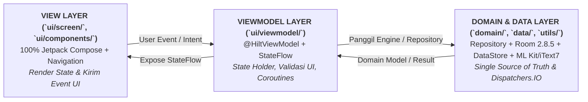

# ATURAN TEKNIS ANDROID MOBILE KOTLIN (ARSITEKTUR MVVM)

> **DOCUMENT ID:** RUL-MOB-KTL-001  
> **VERSION:** v1.1.0  
> **STATUS:** AKTIF (LEVEL 3 DOMAIN & PLATFORM RULES)  
> **SUMBER ATURAN UTAMA (LEVEL 1):** [`aturan/Docs/universal-rule.md`](../universal-rule.md) *(Wajib dipatuhi dan memiliki otoritas tertinggi)*  
> **SUMBER STANDAR TEKNIS (LEVEL 2):** [`aturan/Docs/Standards/Engineering_Standards.md`](../Standards/Engineering_Standards.md) & [`aturan/Docs/Standards/Coding_Standards.md`](../Standards/Coding_Standards.md)  
> **INDUK OPERASIONAL (LEVEL 3):** [`aturan/AGENTS.md`](../../AGENTS.md)  
> **ATURAN PENDAMPING HANDOVER:** [`aturan/Docs/Rules/Legacy_Handover_Protocol.md`](Legacy_Handover_Protocol.md)  
> **DESIGNATED APPROVER / PROJECT OWNER:** Rujuk [`aturan/config/organization.md`](../../config/organization.md) *(Yogi Ario — Partner AI: Carl)*  
> **ARSITEKTUR TERKONFIRMASI:** **MVVM + Clean Architecture (`data/` / `domain/` / `di/` / `ui/` / `utils/`) — 100% Jetpack Compose + Dagger Hilt**

---

## 1. Pemisahan Lapisan MVVM & Aliran Data (*Unidirectional Data Flow*)

Seluruh pengembangan fitur baru maupun pemeliharaan modul pada aplikasi Android Kotlin ini **MUST** mematuhi batas tanggung jawab antar-lapisan **MVVM**:



### 1.1 Aturan Lapisan View (`MainActivity` Compose Host, `@Composable` Screens & Components)
- Proyek VelaPDF menggunakan **100% Jetpack Compose** (Material Design 3 + Navigation Compose pada `ui/screen/`, `ui/components/`, `ui/navigation/`, `ui/theme/`). Dilarang mencampur layout XML Views baru.
- View **MUST** hanya bertugas merender *UI State* (`collectAsState()`) dan meneruskan aksi pengguna (*click*, *input*, *lifecycle event*) ke `ViewModel` yang di-inject via Hilt (`hiltViewModel()`).
- View **MUST NOT** berisi logika bisnis, kalkulasi data kompleks, pemrosesan PDF/OCR berat, maupun kueri database (*Room DAO*) secara langsung.

### 1.2 Aturan Lapisan ViewModel (`ui/viewmodel/`)
- `ViewModel` bertindak sebagai *state holder* (`@HiltViewModel`) yang tahan terhadap *configuration change* (rotasi layar).
- `ViewModel` **MUST NOT** menyimpan referensi langsung ke `Activity` atau `View` *(pengecualian khusus: `Context` aplikasi / parameter URI sementara di metode fungsi hanya bila diperlukan API sistem seperti `ContentResolver` atau `FileProvider`)*.
- Seluruh *state* UI **MUST** menggunakan **`StateFlow` / `MutableStateFlow`** agar seragam dengan codebase VelaPDF (jangan perkenalkan `LiveData`).
- Kejadian satu kali (*one-time events* seperti navigasi, Toast, Snackbar) **MUST** ditangani dengan pola yang tidak memicu pengulangan saat rotasi layar (`SharedFlow` / `Channel` / state event yang di-reset eksplisit).

### 1.3 Aturan Lapisan Domain & Data (`domain/`, `data/`, `di/`, `utils/`)
- `domain/` menampung model domain murni (`OcrModels`, model fakta semantik/inferensi) dan engine logika murni Kotlin (NLP, ontologi, *Forward Chaining*, *summarizer*) yang dapat diuji lewat JVM unit test tanpa bergantung pada UI/Android Framework.
- `Repository` / `DataSource` (`data/ocr/`, `data/repository/`, `data/database/`, `data/preferences/`) menjadi antarmuka tunggal bagi `ViewModel` menggunakan **Room (`AppDatabase`)** dan **DataStore Preferences (`velapdf_settings`)**, terikat melalui **Dagger Hilt (`di/`)**.
- Operasi I/O (rendering PDF `PdfRenderer`, pemrosesan bitmap, penyalinan `Uri`, database, OCR ML Kit) **MUST** dipindahkan ke `Dispatchers.IO` (atau `Dispatchers.Default` untuk komputasi CPU berat) dan mengembalikan pembungkus hasil/error yang aman (*sealed state* / `Result<T>`).
- Kegagalan baca berkas, OCR kosong, atau error parsing JSON **MUST NOT** menyebabkan *uncaught exception* yang membuat aplikasi *force close*.

---

## 2. Penguncian Gradle, Android SDK & Dependensi (*Dependency Lock*)

Mengingat aplikasi ini merupakan kelanjutan dari pengembang sebelumnya:

1. **Larangan Upgrade/Downgrade Sepihak:** AI Agent **MUST NOT** mengubah versi berikut tanpa persetujuan eksplisit tertulis dari Project Owner (Yogi Ario) disertai analisis dampak build:
   - `compileSdk`, `targetSdk`, `minSdk`
   - Versi *Android Gradle Plugin (AGP)*, versi *Kotlin*, versi *Gradle Wrapper* (`gradle/wrapper/gradle-wrapper.properties`)
   - Daftar dependensi di `build.gradle`, `build.gradle.kts`, atau `gradle/libs.versions.toml`
2. **Satu Framework Dependency Injection (DI):** Gunakan kerangka DI yang sudah terpasang oleh pengembang sebelumnya (Hilt, Koin, Dagger, atau manual Factory/Service Locator). AI Agent **MUST NOT** menambahkan framework DI kedua di dalam proyek yang sama.
3. **Larangan Library Tanpa Izin:** Penambahan library pihak ketiga baru **MUST** diajukan terlebih dahulu melalui [`Docs/Implementation_plan.md`](../Implementation_plan.md) dan dicatat pada [`Docs/Decision_Log.md`](../Decision_Log.md) setelah disetujui.

---

## 3. Konsistensi UI Toolkit (XML Views vs Jetpack Compose)

- AI Agent **MUST** memeriksa pada Fase 0 (*Audit Baseline*) apakah pengembang sebelumnya menggunakan **XML Views (ViewBinding/DataBinding)**, **Jetpack Compose**, atau **kombinasi bertahap**.
- Fitur baru dan perbaikan **MUST** mengikuti UI Toolkit yang sudah dominan digunakan pada modul terkait.
- AI Agent **MUST NOT** menyisipkan layar Jetpack Compose ke proyek XML murni (atau sebaliknya) secara sepihak tanpa persetujuan tertulis dari Yogi Ario dan catatan ADR di [`Docs/Decision_Log.md`](../Decision_Log.md).

---

## 4. Concurrency Kotlin, Coroutines & Lifecycle Safety

1. **Main-Thread Protection:** Operasi jaringan, dekripsi, pemrosesan gambar besar, atau akses file/database **MUST NOT** dijalankan di Main Thread.
2. **Structured Concurrency:**
   - Gunakan `viewModelScope` di `ViewModel` dan `lifecycleScope` di `Activity`/`Fragment`.
   - **MUST NOT** menggunakan `GlobalScope` atau menelan `CancellationException` secara diam-diam di dalam blok `catch (e: Exception)` *(selalu rethrow `CancellationException` atau tangkap exception spesifik)*.
3. **Lifecycle-Aware State Collection:**
   - Pada `Fragment`/`Activity` (XML): kumpulkan `Flow` menggunakan `viewLifecycleOwner.lifecycleScope.launch` + `repeatOnLifecycle(Lifecycle.State.STARTED)`.
   - Pada Jetpack Compose: gunakan `collectAsStateWithLifecycle()` (bila dependensi `lifecycle-runtime-compose` tersedia di proyek) atau `collectAsState()` sesuai standar proyek.
4. **Null Safety & Clean Kotlin:**
   - **SHOULD NOT** menggunakan operator *double-bang* (`!!`) karena berisiko tinggi menimbulkan `NullPointerException`. Gunakan safe call (`?.`), Elvis (`?:`), `requireNotNull`, atau penanganan error eksplisit.
   - Pisahkan logika bisnis murni dari Android Framework (`android.*`) agar dapat diuji melalui JVM unit test tanpa bergantung pada emulator.

---

## 5. Keamanan Android, Storage, Database & Manifest

1. **Perlindungan Rahasia & Kunci Signing (*Zero Secret Leakage*):**
   - Berkas `local.properties`, `*.jks`, `*.keystore`, `keystore.properties`, serta file kredensial API/Firebase sensitif **MUST** tetap berada di luar Git (tercakup di `.gitignore`).
   - API Key, client secret, atau token rahasia **MUST NOT** ditulis keras (*hardcoded*) di dalam kode Kotlin atau `AndroidManifest.xml`. Gunakan injeksi aman via `local.properties` $\rightarrow$ `BuildConfig` atau penyimpanan terenkripsi runtime (`EncryptedSharedPreferences` / Android Keystore) untuk token sesi pengguna.
2. **Keamanan Database Lokal (Room / SQLite):**
   - Jika mengubah entitas atau menaikkan versi database Room, AI Agent **MUST** menyediakan `Migration(oldVersion, newVersion)` yang teruji.
   - AI Agent **MUST NOT** menambahkan `.fallbackToDestructiveMigration()` secara sepihak karena akan menghapus data pengguna eksisting pada perangkat nyata.
3. **Izin Runtime & Komponen Manifest:**
   - Permintaan izin berbahaya (*runtime permissions* seperti kamera, lokasi, notifikasi `POST_NOTIFICATIONS`, media storage) **MUST** menangani kondisi ditolak (*denied*) maupun ditolak permanen (*permanently denied*) secara anggun tanpa crash.
   - Setiap komponen baru di `AndroidManifest.xml` (`Activity`, `Service`, `BroadcastReceiver`, `ContentProvider`) **MUST** memiliki nilai `android:exported` yang eksplisit dan prinsip hak akses minimal (*least privilege*).
   - Penyimpanan file eksternal **MUST** mematuhi *Scoped Storage* (`MediaStore` / `Storage Access Framework` / `FileProvider`) sesuai `targetSdk` proyek.

---

## 6. Quality Gates & Bukti Verifikasi Wajib (Prinsip 4 & 5)

Sebelum menyatakan tugas selesai (*Done*), AI Agent **MUST** menjalankan dan melampirkan hasil nyata dari gerbang verifikasi berikut (sesuaikan nama variant Gradle jika proyek menggunakan *product flavors*, misal `DevDebug` / `StagingDebug`):

1. **Unit Test Gate (100% PASS):**
   ```bash
   ./gradlew testDebugUnitTest
   ```
   *(Seluruh logika baru di `ViewModel` dan `Repository` wajib memiliki unit test yang lolos 100%).*
2. **Static Analysis / Lint Gate:**
   ```bash
   ./gradlew lintDebug
   ```
   *(Pastikan tidak ada `Lint Error` baru yang diperkenalkan oleh perubahan kode).*
3. **Compilation / Build Gate:**
   ```bash
   ./gradlew assembleDebug
   ```
   *(Build debug harus sukses 0 error dan APK berhasil terbentuk).*
4. **Verifikasi Visual UI & Perilaku Nyata:**
   - Gunakan Android Emulator / perangkat terhubung (`adb`) atau *Compose Preview* (bila memakai Compose) untuk memeriksa tampilan dan alur layar.
   - Simpan tangkapan layar (*screenshot*) hasil uji berhasil di `aturan/Docs/Evidence/SS/valid/` dan bukti temuan bug/crash di `aturan/Docs/Evidence/SS/error/`.
   - **Aturan Transparansi Lingkungan:** Jika mesin saat ini tidak memiliki Android SDK / Emulator / akses ADB yang aktif sehingga build atau uji emulator tidak bisa dijalankan langsung oleh agen, AI Agent **MUST NOT** mengklaim build/UI lolos — laporkan keterbatasan tersebut secara jujur, lampirkan kode/test yang dibuat, dan sertakan panduan verifikasi langkah demi langkah untuk Yogi Ario.

---

## 7. Referensi Dokumen Terkait

- Aturan Induk Proyek: [`AGENTS.md`](../../AGENTS.md)
- Protokol Lanjutan Pengembang Sebelumnya: [`Docs/Rules/Legacy_Handover_Protocol.md`](Legacy_Handover_Protocol.md)
- Audit Kondisi Awal Proyek: [`Docs/Project_Analysis.md`](../Project_Analysis.md)
- Strategi Pengujian Multi-Tier: [`Docs/Standards/Testing_Strategy.md`](../Standards/Testing_Strategy.md)
- Manajemen Error & Pemulihan: [`Docs/Standards/Error_Handling_Recovery.md`](../Standards/Error_Handling_Recovery.md)
