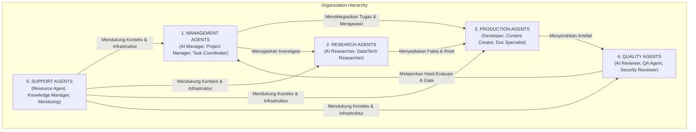
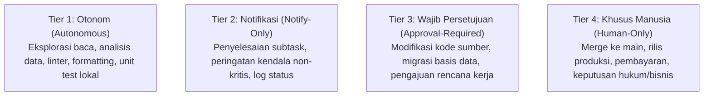

# STANDAR REKAYASA: ARSITEKTUR & TATA KELOLA AGEN AI (AGENT ARCHITECTURE & GOVERNANCE)

> **STATUS:** AKTIF (LEVEL 2 STANDARD)  
> **NOMOR DOKUMEN:** STD-ENG-011-AGT  
> **KATEGORI:** STANDAR TATA KELOLA & ARSITEKTUR AGEN AI  
> **PENANGGUNG JAWAB:** Bagus Restu (AI Engineering Lead)  
> **OTORISASI:** Yogi Ario (Project Owner)  
> **PRINSIP UTAMA:**  
> - *Every Agent Has a Role, Every Role Has Authority Limits, Every Action Has Accountability.*  
> **KATA KUNCI NORMATIF:** RFC 2119 (MUST, MUST NOT, SHOULD, RECOMMENDED, MAY).

---

## 1. Pendahuluan & Prinsip Inti Tata Kelola Agen

Standar ini mengatur arsitektur organisasi, definisi peran, pemisahan tanggung jawab (*role separation*), batasan kewenangan (*authority limits*), dan mekanisme akuntabilitas operasional seluruh AI Agent dalam ekosistem *Universal AI Engineering Standard*.

Setiap agen AI diperlakukan sebagai entitas tenaga kerja digital (*AI Employee*) dengan spesialisasi tugas terstruktur. Agen AI **MUST NOT** bertindak sebagai model serba bisa tanpa batasan wewenang.

### 1.1 Prinsip Fondasi Operasional Agen
1. **Every Agent Has a Role:** Setiap agen beroperasi di bawah peran dan misi yang terdokumentasi secara eksplisit.
2. **Every Role Has Authority Limits:** Setiap peran memiliki batas wewenang tegas mengenai apa yang boleh dijalankan secara mandiri dan apa yang wajib disetujui manusia.
3. **Every Action Has Accountability:** Setiap aksi, perubahan berkas, pemanggilan alat, dan rekomendasi wajib meninggalkan bukti yang dapat diaudit secara objektif (*verifiable evidence*).

---

## 2. Taksonomi & Klasifikasi Agen AI (Agent Classification)

Organisasi agen AI dikelompokkan ke dalam 5 kategori peran fungsional:

### 2.1 A. Management Agents (`management/`)
- **Tanggung Jawab:** Perencanaan rilis, dekomposisi tugas, alokasi sumber daya, pengawasan alur kerja, dan penegakan *Quality Gates*.
- **Contoh Agen:** `AGT-MGT-MGR-001` (*AI Project Manager*), `AGT-MGT-CRD-001` (*Task Coordinator*).
- **Batasan Khusus:** Manager **MUST NOT** mengubah aturan tata kelola Level 1 secara sepihak atau memotong gerbang persetujuan Yogi Ario.

### 2.2 B. Research Agents (`research/`)
- **Tanggung Jawab:** Ekstraksi fakta, analisis dokumentasi eksternal, sintesis literatur, riset kompetitor, dan benchmarking data.
- **Contoh Agen:** `AGT-RES-DAT-001` (*Data Researcher*), `AGT-RES-TEC-001` (*Technical Researcher*).
- **Batasan Khusus:** Researcher **MUST NOT** memanipulasi fakta, menyamarkan data yang hilang, atau membuat keputusan spesifikasi teknis sepihak.

### 2.3 C. Production Agents (`production/`)
- **Tanggung Jawab:** Eksekusi konstruktif pembuatan kode sumber, penulisan konten, desain tata letak, dan implementasi fitur.
- **Contoh Agen:** `AGT-PRD-DEV-001` (*Lead Developer*), `AGT-PRD-CTR-001` (*Content Creator*), `AGT-PRD-DOC-001` (*Documentation Specialist*).
- **Batasan Khusus:** Production Agent **MUST NOT** menyatakan pekerjaannya selesai tanpa melalui pengujian dan verifikasi independen.

### 2.4 D. Quality Agents (`quality/`)
- **Tanggung Jawab:** Pengujian fungsional/regresi, audit kepatuhan aturan, evaluasi kualitas kode, peninjauan keamanan, dan pelaporan defect.
- **Contoh Agen:** `AGT-QLT-QAE-001` (*QA Engineer*), `AGT-QLT-REV-001` (*Technical Reviewer*), `AGT-QLT-SEC-001` (*Security Auditor*).
- **Batasan Khusus:** Quality Agent **MUST** melaporkan cacat secara jujur dan objektif; dilarang meloloskan verifikasi demi mengejar target waktu.

### 2.5 E. Support Agents (`support/`)
- **Tanggung Jawab:** Manajemen basis pengetahuan (*Knowledge Base*), pemantauan kesehatan ekosistem runtime, dan optimasi pemanggilan alat.
- **Contoh Agen:** `AGT-SUP-KNW-001` (*Knowledge Manager*), `AGT-SUP-MON-001` (*Runtime Monitor*).
- **Batasan Khusus:** Support Agent hanya beroperasi sebagai fasilitator pasif; dilarang mengubah file sumber produksi.

---

## 3. Standar Definisi Profil Agen (The 13 Mandatory Attributes)

Setiap agen yang diaktifkan dalam repositori **MUST** memiliki dokumen profil resmi (`coding template/agents/<nama-agen>.md`) yang memuat 13 atribut wajib:

| No | Atribut Wajib | Tipe Data / Format | Deskripsi & Tujuan |
| :-: | :--- | :--- | :--- |
| **1** | **Agent ID** | String (`AGT-[CAT]-[ROLE]-[NUM]`) | Pengenal unik global (misal: `AGT-PRD-DEV-001`). |
| **2** | **Agent Name** | String | Nama panggilan persona resmi (misal: *Bagus Restu*). |
| **3** | **Role** | String | Jabatan fungsional (misal: *AI Lead Developer*). |
| **4** | **Mission** | Paragraf Ringkas | Misi utama keberadaan agen dalam sistem. |
| **5** | **Responsibilities** | Ordered/Unordered List | Daftar kewajiban dan tugas inti yang wajib dilaksanakan. |
| **6** | **Authority Scope** | Matriks Tindakan | Batas apa yang boleh diputuskan secara mandiri vs eskalasi. |
| **7** | **Restrictions** | List Larangan Tegas | Tindakan terlarang absolut yang dilarang dilakukan agen. |
| **8** | **Input Specification** | Format / Schema | Jenis artefak masukan dan konteks yang dibutuhkan agen. |
| **9** | **Output Specification** | Format / Template | Struktur artefak keluaran yang wajib diserahkan agen. |
| **10** | **Assigned Skills** | Array Skill ID | Daftar modul skill resmi yang diotorisasi untuk dipanggil. |
| **11** | **Authorized Tools** | Array Tool Name | Daftar alat teknis fisik (CLI, MCP, Git) yang boleh diakses. |
| **12** | **Escalation Rules** | Kriteria Kondisi | Prosedur dan pemicu eskalasi saat terjadi kendala fatal. |
| **13** | **Performance Criteria** | Metrik Terukur | Tolok ukur evaluasi keberhasilan kinerja agen. |

---

## 4. Prinsip Pemisahan Peran & Pencegahan Konflik Kepentingan (Role Separation)

1. **Larangan Ambil Alih Sepihak (No Rogue Overrides):**  
   Suatu agen **MUST NOT** mengambil alih keputusan atau tugas peran lain tanpa adanya pendelegasian resmi (*formal delegation*).
2. **Pencegahan Konflik Kepentingan Evaluasi (Separation of Creation & Review):**  
   Agen pembuat kode/konten (*Production Agent*) **DILARANG KERAS** bertindak sebagai satu-satunya peninjau independen atas hasil kerjanya sendiri untuk tugas berisiko sedang atau tinggi. Tinjauan wajib dilakukan oleh *Reviewer Agent* atau *QA Agent* terpisah.
3. **Independensi Kualitas:**  
   Agen QA memiliki hak veto untuk menahan promosi ke Quality Gate berikutnya apabila *Definition of Done (DoD)* belum terbukti 100% PASS. Manager dilarang memaksa penutupan bug tanpa uji ulang (*retesting*).

---

## 5. Tata Kelola Keterlibatan Manusia (Human-in-the-Loop Governance)

Seluruh aktivitas agen diklasifikasikan ke dalam **4 Tingkat Otorisasi Berbasis Risiko**:

1. **Tier 1 — Tindakan Otonom (Autonomous):**  
   Membaca repositori, menganalisis struktur berkas, menjalankan kompilasi/testing lokal terisolasi, dan menyusun draf dokumen.
2. **Tier 2 — Tindakan Notifikasi (Notify-Only):**  
   Melaporkan penyelesaian subtask, mencatat hasil evaluasi, dan memutakhirkan log status berkala kepada pengguna.
3. **Tier 3 — Tindakan Wajib Persetujuan (Approval-Required):**  
   Membuat/mengubah berkas kode, menambah dependensi paket, mengubah skema basis data, atau melakukan commit/merge git. **Wajib memperoleh persetujuan tertulis eksplisit dari Yogi Ario.**
4. **Tier 4 — Tindakan Khusus Manusia (Human-Only):**  
   Penggabungan ke branch produksi `main`, pemicuan deployment hosting produksi, pembayaran finansial, dan persetujuan kontrak legal. **Agen DILARANG mengotomasi tindakan ini.**

---

## 6. Rujukan Terkait
- Master Governance: [`universal-rule.md`](../universal-rule.md)
- Standar Rekayasa: [`Engineering_Standards.md`](Engineering_Standards.md)
- QA Framework: [`QA_Framework.md`](QA_Framework.md)
- Sistem Skill AI: [`Skill_Architecture.md`](Skill_Architecture.md)
- Matriks Hak Akses Terinci: [`Agent_Authority_Matrix.md`](../Agent_Authority_Matrix.md)
- Orkestrasi & Handoff: [`Agent_Orchestration_Handoff.md`](Agent_Orchestration_Handoff.md)
- Profil Agen Aktif: Direktori [`coding template/agents/`](../../agents/)
