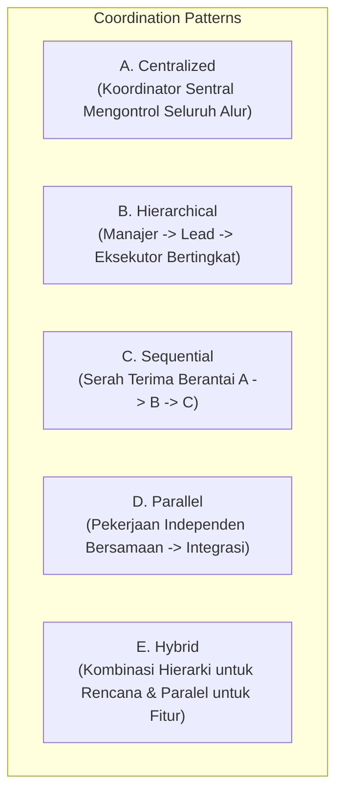
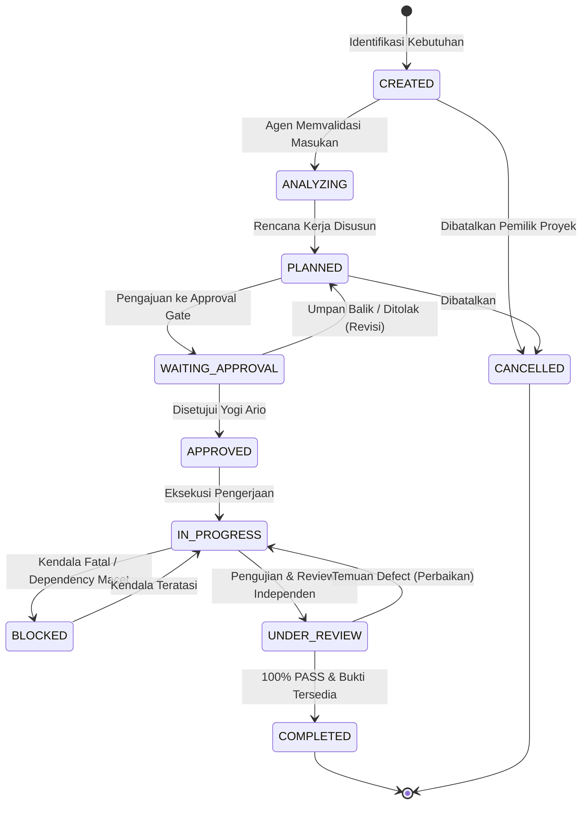

# STANDAR REKAYASA: ORKESTRASI AGEN, PROTOKOL SERAH TERIMA & PENGELOLAAN KONTEKS (AGENT ORCHESTRATION & HANDOFF)

> **STATUS:** AKTIF (LEVEL 2 STANDARD)  
> **NOMOR DOKUMEN:** STD-ENG-012-AGT  
> **KATEGORI:** ORKESTRASI & KOORDINASI MULTI-AGEN  
> **PENANGGUNG JAWAB:** Bagus Restu (AI Engineering Lead)  
> **OTORISASI:** Yogi Ario (Project Owner)  
> **PRINSIP UTAMA:**  
> - *Every Action Has Accountability.*  
> - *No Context Loss, No Unverified Handoff.*  
> **KATA KUNCI NORMATIF:** RFC 2119 (MUST, MUST NOT, SHOULD, RECOMMENDED, MAY).

---

## 1. Pendahuluan

Dokumen ini mengatur model orkestrasi koordinasi antaragen, sistem pengelolaan tugas (*Task Management System*), siklus hidup tugas, protokol serah terima pekerjaan (*Handoff Protocol*), eksekusi paralel yang aman, dan tata kelola konteks (*Context Management*) untuk memastikan kelancaran kolaborasi multi-agen tanpa distorsi informasi.

---

## 2. Model Koordinasi Multi-Agen (Coordination Models)

Pemilihan model koordinasi **MUST** didasarkan pada karakteristik dan tingkat risiko pekerjaan:

| Model Koordinasi | Karakteristik Utama | Kelebihan & Efisiensi | Risiko & Kelemahan | Kapan Digunakan |
| :--- | :--- | :--- | :--- | :--- |
| **A. Centralized** | Satu *Task Coordinator* membagi dan menerima seluruh hasil. | Kontrol visibilitas tinggi, pelaporan terpusat mudah. | *Single point of bottleneck*, latency komunikasi tinggi. | Tugas berskala kecil-menengah dengan modul berdekatan. |
| **B. Hierarchical** | Struktur pohon keputusan: Manager $\rightarrow$ Lead Dev $\rightarrow$ Sub-agent. | Eskalasi terstruktur, pengawasan bertingkat jelas. | Rantai birokrasi lebih panjang, risiko distorsi arahan. | Proyek enterprise kompleks dengan pemisahan domain tegas. |
| **C. Sequential** | Rantai linier: Analis $\rightarrow$ Developer $\rightarrow$ QA $\rightarrow$ Reviewer. | Alur DoR/DoD sangat jelas, tidak ada benturan berkas. | Waktu total lebih lama, ketergantungan sekuensial mutlak. | Fitur inti yang memiliki dependensi teknis berurutan. |
| **D. Parallel** | Eksekusi simultan beberapa modul independen. | Kecepatan penyelesaian maksimal. | Potensi konflik merge, *race condition*, overhead integrasi. | Modul yang terisolasi sempurna (misal: UI terpisah dari skema DB). |
| **E. Hybrid** | Menggabungkan hierarki untuk perencanaan dan paralel untuk eksekusi. | Keseimbangan antara kontrol kualitas dan kecepatan. | Memerlukan aturan handoff dan integrasi yang sangat disiplin. | Siklus pengembangan rilis perangkat lunak modern (default). |

---

## 3. Sistem Pengelolaan Tugas (Task Management System)

### 3.1 Standar Format Spesifikasi Tugas (`TSK-[MODULE]-[NUM]`)
Setiap tugas operasional yang dibuat **MUST** memiliki identitas unik dan terstruktur mengacu pada formulir [`Task_Specification_Template.md`](../Task_Specification_Template.md):
- `Task ID`: Format `TSK-[MODULE]-[NUM]` (misal: `TSK-AUTH-001`).
- `Task Title`: Ringkasan tindakan dan target.
- `Priority`: `P0-Critical`, `P1-High`, `P2-Medium`, `P3-Low`.
- `Assigned Agent`: ID dan Nama Agen pelaksana utama.
- `Acceptance Criteria`: Kriteria keberhasilan biner (PASS / FAIL).
- `Status`: Salah satu dari 10 status siklus hidup tugas.

### 3.2 Siklus Hidup Tugas 10-Status (Task Lifecycle)

### 3.3 Standar Prioritas Tugas Objektif
1. **P0 — Critical:** Kegagalan sistemik, kebocoran keamanan, hambatan fatal (*blocker*) pada rilis utama. Wajib diselesaikan seketika.
2. **P1 — High:** Fitur utama fase aktif yang memiliki dependensi lanjutan terhadap modul lain.
3. **P2 — Medium:** Fungsionalitas standar, peningkatan performa, atau refaktor internal terencana.
4. **P3 — Low:** Penyempurnaan dokumentasi tambahan, kosmetik minor, atau tugas non-esensial.

---

## 4. Protokol Serah Terima Pekerjaan (The 11-Field Handoff Protocol)

Ketika suatu agen menyelesaikan subtask dan menyerahkannya kepada agen lain (misal: Developer menyerahkan ke QA Agent), agen pengirim **MUST** menyusun dokumen handoff resmi mengacu pada [`Agent_Handoff_Template.md`](../Agent_Handoff_Template.md) yang mencakup 11 atribut:

1. **Task ID:** Identifikasi tugas yang diserahterimakan.
2. **Sender Agent:** ID & Nama agen yang menyelesaikan pekerjaan.
3. **Receiver Agent:** ID & Nama agen yang menerima penugasan.
4. **Work Completed:** Rincian spesifik apa yang telah selesai dikerjakan.
5. **Work Remaining:** Bagian pekerjaan yang tersisa untuk diselesaikan.
6. **Inputs & References:** Tautan berkas, spesifikasi, dan dokumen rujukan aktif.
7. **Decisions Made:** Rekaman keputusan teknis penting yang diambil selama pengerjaan.
8. **Known Issues & Flaws:** Keterbatasan atau anomali kecil yang perlu diwaspadai.
9. **Identified Risks:** Potensi dampak terhadap modul lain atau dependensi luar.
10. **Verifiable Evidence:** Tautan hasil test suite terminal atau tangkapan layar validasi.
11. **Expected Next Action:** Tindakan nyata spesifik yang diharapkan dari agen penerima.

> 🛑 **Kewajiban Agen Penerima:** Agen penerima **MUST** memverifikasi kelengkapan 11 atribut di atas sebelum memulai pekerjaan. Jika informasi penting hilang atau ambigu, agen penerima berhak menolak handoff dan meminta kelengkapan data.

---

## 5. Standar Eksekusi Paralel yang Aman (Safe Parallel Execution)

Untuk mencegah benturan kode (*race condition*) dan inkonsistensi data saat beberapa agen bekerja simultan:

1. **Isolasi Berkas Kepemilikan (Strict Resource Ownership):**  
   Dua agen **MUST NOT** memodifikasi berkas kode yang sama pada saat bersamaan. Setiap berkas yang disentuh wajib memiliki satu agen penanggung jawab (*sole writer*).
2. **Penggunaan Feature Branch Terisolasi:**  
   Pekerjaan paralel wajib dilakukan pada sub-branch terpisah (misal: `feature/05a_ui_auth` dan `feature/05b_api_auth`).
3. **Protokol Integrasi & Penggabungan Bertahap:**  
   Penggabungan cabang paralel ke `develop` dilakukan secara berurutan (*sequential merge*). Cabang kedua wajib melakukan rebase/merge dari `develop` terbaru dan lulus uji regresi sebelum disatukan.

---

## 6. Standar Manajemen Konteks (Context Management Standard)

1. **Pemisahan Fakta, Asumsi, dan Rekomendasi:**  
   Dalam seluruh catatan dan komunikasi, agen **MUST** memisahkan secara tegas:
   - *Fakta:* Informasi objektif yang terbukti pada kode, dokumentasi, atau log sistem.
   - *Asumsi:* Perkiraan awal yang belum divalidasi pengguna (wajib diverifikasi).
   - *Rekomendasi:* Saran keahlian profesional berbasis pertimbangan teknis.
2. **Pencegahan Kehilangan Konteks (Context Loss Prevention):**  
   Agen dilarang mengasumsikan agen lain otomatis mengetahui seluruh riwayat percakapan panjang. Seluruh keputusan arsitektur wajib dicatat pada [`Docs/Decision_Log.md`](../Decision_Log.md).
3. **Pembersihan Konteks Tidak Relevan (Anti-Context Bloat):**  
   Jangan menyertakan log debug mentah yang sangat panjang ke dalam pesan serah terima. Buat rangkuman ringkas dengan tautan ke berkas log fisik.

---

## 7. Format Komunikasi Internal Terstruktur

Komunikasi antaragen diatur dalam 7 tipe pesan baku pada [`Communication_Protocol.md`](../Communication_Protocol.md):
- `MSG-UPDATE`: Pembaharuan progres tugas rutin.
- `MSG-HANDOFF`: Penyerahan formal pekerjaan antaragen.
- `MSG-CLARIFY`: Permohonan klarifikasi teknis atas instruksi ambigu.
- `MSG-APPROVAL`: Permohonan persetujuan resmi atas rencana/perubahan.
- `MSG-BLOCKER`: Laporan kendala kritis yang menghentikan progres.
- `MSG-FEEDBACK`: Umpan balik audit atau temuan tinjauan kualitas.
- `MSG-COMPLETE`: Laporan tuntasnya tugas dengan tautan bukti lengkap.

---

## 8. Rujukan Terkait
- Arsitektur Agen: [`Agent_Architecture_Governance.md`](Agent_Architecture_Governance.md)
- Matriks Hak Akses: [`Agent_Authority_Matrix.md`](../Agent_Authority_Matrix.md)
- Template Serah Terima: [`Agent_Handoff_Template.md`](../Agent_Handoff_Template.md)
- Protokol Komunikasi: [`Communication_Protocol.md`](../Communication_Protocol.md)
- Tata Kelola Alat: [`Tool_Governance_Execution.md`](Tool_Governance_Execution.md)
- Penanganan Cacat: [`Error_Handling_Recovery.md`](Error_Handling_Recovery.md)
