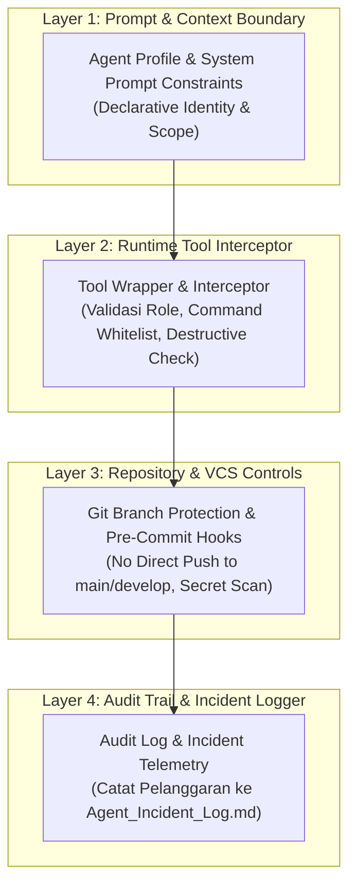
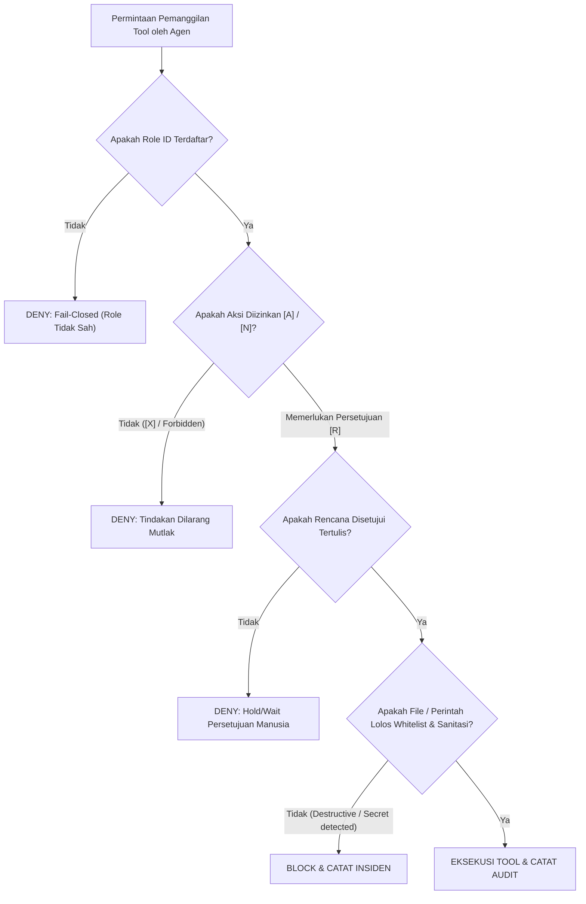

# SPESIFIKASI PENEGAKAN IZIN TEKNIS AGEN AI (AGENT PERMISSION ENFORCEMENT SPECIFICATION)

> **DOCUMENT ID:** SPEC-GOV-APE-001  
> **VERSION:** v1.0.0  
> **STATUS:** AKTIF / MANDATORY  
> **AUTHORITY LEVEL:** Level 3 — Technical Standard & Specification  
> **AUTHORITATIVE SOURCE (SSOT):** [Docs/universal-rule.md](../universal-rule.md), [Docs/Agent_Authority_Matrix.md](../Agent_Authority_Matrix.md), [Docs/Standards/Tool_Governance_Execution.md](Tool_Governance_Execution.md)  
> **TARGET AUDIENCE:** Seluruh Arsitek Sistem, Pengembang Platform, dan AI Agent

---

## 1. Pendahuluan

Dokumen spesifikasi ini menetapkan arsitektur dan mekanisme teknis penegakan hak akses (*technical permission enforcement*) bagi AI Agent dalam ekosistem *Universal AI Engineering Standard*. 

Matriks kewenangan pada [Docs/Agent_Authority_Matrix.md](../Agent_Authority_Matrix.md) tidak boleh hanya menjadi pedoman etika tekstual pasif; seluruh batasan wewenang **MUST** ditegakkan secara aktif melalui arsitektur kendali multi-lapis (*multi-layered technical enforcement architecture*) dengan prinsip dasar **Fail-Closed (Tolak Secara Default Jika Ambigu)**.

---

## 2. Arsitektur Penegakan 4 Lapis (The 4-Layer Enforcement Architecture)

### 2.1 Layer 1: Batasan Konteks & Profil Deklaratif (Prompt & Context Boundary)
- Setiap agen diinisialisasi dengan deklarasi profil resmi (`agents/<role>.md`) yang memuat atribut `Role ID`, `Authority Level`, dan `Permitted Tools`.
- Konteks sesi mengikat agen pada batasan operasional spesifik tugas tanpa memberikan visibilitas terhadap kredensial rahasia atau instruksi di luar ruang lingkup.

### 2.2 Layer 2: Pencegat Runtime & Wrapper Alat (Runtime Tool Interceptor)
Setiap eksekusi alat (`write_file`, `edit_file`, `run_command`, database migration, browser automation) dicegat oleh wrapper runtime dengan algoritma evaluasi berikut:

#### Aturan Sanitasi Perintah Shell (Shell Command Sanitation):
Interceptor **MUST** menolak secara otomatis perintah terminal yang memuat pola destruktif berikut:
- Penghapusan rekursif tidak aman: `rm -rf /`, `rmdir /s /q C:\`, `del /f /s /q *`
- Manipulasi partisi/disk: `format`, `mkfs`, `dd if=`
- Bypass repositori git: `git push --force origin main`, `git push -f origin develop`, `git reset --hard` pada cabang bersama
- Penurunan hak istimewa: `chmod 777`, `grant all privileges` tanpa restriksi

### 2.3 Layer 3: Proteksi Repositori & Kontrol VCS (VCS & Branch Protection)
- **Cabang `main`:** Dilindungi oleh *GitHub/GitLab Branch Protection*. Direct push dilarang mutlak untuk semua agen. Penggabungan hanya melalui Pull Request dengan Otorisasi Produksi formal oleh Designated Approver.
- **Cabang `develop`:** Memerlukan PR, minimal 1 peninjauan independen (QA/Reviewer), dan seluruh status check CI/CD lulus.
- **Pre-commit / Pre-push Hooks:** Memverifikasi ketiadaan berkas berukuran raksasa, berkas rahasia (`.env`, `*.pem`, `*.key`), dan memvalidasi format pesan commit mengikuti konvensi `Conventional Commits`.

### 2.4 Layer 4: Audit & Telemetri Insiden (Audit Trail & Telemetry)
- Setiap upaya eksekusi yang melanggar matriks kewenangan dicatat secara permanen dengan format insiden baku `INC-SEC-[NUM]` ke dalam `Docs/Agent_Incident_Log.md`.
- Jika agen mendeteksi upaya manipulasi atau eskalasi hak akses (*privilege escalation*), agen **MUST** seketika menghentikan eksekusi (*Fail-Closed*) dan melaporkan anomali kepada Designated Approver.

---

## 3. Matriks Penegakan Parameter Alat (Tool Parameter Enforcement)

| Kategori Alat | Parameter Diperiksa | Aturan Validasi Teknis | Tindakan Bila Melanggar |
| :--- | :--- | :--- | :--- |
| **File Write / Edit** | `Path` | Wajib berada di dalam direktori workspace kerja yang disetujui; dilarang mengakses berkas sistem (`/etc/`, `C:\Windows\`, dll.). | Tolak eksekusi (*Path Traversal Block*). |
| **Shell Command** | `CommandLine` | Wajib bebas dari substring terlarang (kredensial mentah, token, pola destruktif sistem). | Tolak eksekusi & catat `INC-SEC`. |
| **Git Operations** | `branch`, `args` | Dilarang menjalankan checkout/push ke `main` secara mandiri; branch baru wajib mematuhi format `feature/` atau `fix/`. | Tolak eksekusi (*VCS Protection Block*). |
| **Database Tool** | `query`, `migration` | Dilarang mengeksekusi `DROP DATABASE` atau modifikasi data produksi tanpa snapshot cadangan. | Tolak eksekusi (*Data Integrity Block*). |

---

## 4. Prosedur Pemulihan dan Penanganan Kegagalan (Failure Handling)

1. **Prinsip Fail-Closed:**  
   Apabila terjadi kegagalan jaringan pada layanan otentikasi izin atau ambiguitas peran agen, sistem penegakan izin **MUST** memilih status menolak (*Deny*) daripada mengizinkan (*Allow*).
2. **Pemberitahuan kepada Pengguna:**  
   Setiap pemblokiran akibat penegakan izin wajib disertai penjelasan transparan mengenai aturan mana yang memicu blokir, peran agen aktif, dan langkah eskalasi yang diperlukan.

---

## 5. Rujukan Dokumen Terkait
- Matriks Hak Akses: [Docs/Agent_Authority_Matrix.md](../Agent_Authority_Matrix.md)
- Tata Kelola Alat: [Docs/Standards/Tool_Governance_Execution.md](Tool_Governance_Execution.md)
- Penanganan Cacat & Pemulihan: [Docs/Standards/Error_Handling_Recovery.md](Error_Handling_Recovery.md)
- Log Insiden: [Docs/Agent_Incident_Log.md](../Agent_Incident_Log.md)
- Konfigurasi Organisasi: [config/organization.md](../../config/organization.md)
