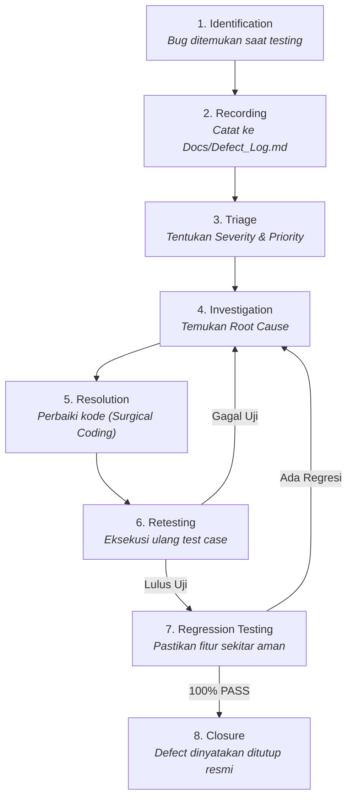

# Defect & Bug Management Standard

> **STATUS:** STANDAR REKAYASA TEKNIS (QA SPECIFICATION)  
> **OTORITAS TERTINGGI:** Yogi Ario (PROJECT OWNER / LEAD DEVELOPER)  
> **TARGET PENGGUNA:** Seluruh Pengembang & AI Agent  
> **ACUAN UTAMA:** [Docs/Standards/QA_Framework.md](QA_Framework.md) & [Docs/Standards/Engineering_Standards.md](Engineering_Standards.md)  
> **PRINSIP TATA KELOLA:** *No Verification, No Completion. Quality Must Be Demonstrated, Not Assumed.*

---

## 1. Pendahuluan

Defect Management adalah standar tata kelola untuk mengidentifikasi, mencatat, memprioritaskan, menginvestigasi, memperbaiki, dan memverifikasi cacat perangkat lunak (*bugs/defects*). Standar ini menjamin bahwa setiap masalah teknis ditangani secara transparan, tidak ada bug yang diabaikan (*swept under the rug*), dan perbaikan terbukti tuntas tanpa menimbulkan regresi baru.

---

## 2. Konvensi Penomoran Defect (Defect ID)

Setiap cacat atau bug yang ditemukan **MUST** dicatat dengan identitas unik:

$$\text{DEF-}[\text{MODULE}]-[\text{NUMBER}]$$

- `MODULE`: 3-4 huruf kapital singkatan nama domain/modul (misal `AUTH`, `CART`, `PAYM`, `CORE`, `UI`).
- `NUMBER`: 3 digit angka urut dimulai dari `001`.

*Contoh ID Defect:*
- `DEF-AUTH-001`: Token JWT tidak kedaluwarsa setelah durasi 15 menit.
- `DEF-CART-002`: Tombol checkout tidak merespons klik pada peramban mobile.
- `DEF-PAYM-001`: Transaksi gagal jika nominal pembayaran mengandung angka desimal.

---

## 3. Pembedaan Tegas: Severity vs Priority

Untuk menentukan alokasi sumber daya perbaikan secara objektif, sistem membedakan secara tegas antara **Severity** (tingkat keparahan dampak teknis) dan **Priority** (urgensi waktu perbaikan):

```text
SEVERITY (Dampak pada Sistem)        PRIORITY (Urgensi Waktu Perbaikan)
├── Critical: Sistem crash / data loss  ├── P0 - Blocker: Perbaiki SEKETIKA (Hotfix)
├── High: Fitur utama mati, tanpa solusi ├── P1 - High: Wajib selesai sebelum rilis aktif
├── Medium: Fitur sekunder rusak / ada solusi├── P2 - Medium: Jadwalkan pada batch berikutnya
└── Low: Kesalahan kosmetik / typo     └── P3 - Low: Perbaiki saat waktu luang
```

### 3.1 Klasifikasi Severity (Tingkat Dampak Teknis):
- **`Critical`:** Sistem mengalami *crash total*, data korup, kebocoran kredensial/kunci rahasia, atau kerentanan keamanan parah (*security breach*).
- **`High`:** Fitur fungsional utama tidak dapat digunakan dan tidak ada solusi alternatif sementara (*workaround*).
- **`Medium`:** Fitur sekunder terganggu atau fitur utama mengalami anomali tetapi pengguna masih dapat menyelesaikan alur melalui *workaround*.
- **`Low`:** Masalah estetika visual, salah ketik teks (*typo*), atau inkonsistensi minor antarmuka yang tidak memengaruhi logika bisnis.

### 3.2 Klasifikasi Priority (Tingkat Urgensi Penanganan):
- **`P0 - Blocker`:** Menghentikan seluruh proses rilis. Wajib diselesaikan seketika (*immediate hotfix*).
- **`P1 - High`:** Wajib diselesaikan sebelum batch atau rilis aktif diserahkan ke Yogi Ario.
- **`P2 - Medium`:** Masalah penting yang dapat dijadwalkan pada batch pengembangan berikutnya.
- **`P3 - Low`:** Penyempurnaan yang dapat dikerjakan jika kapasitas waktu memungkinkan.

---

## 4. Siklus Hidup Defect 8-Langkah (8-Step Defect Lifecycle)

Setiap defect **MUST** melewati alur siklus hidup formal berikut:



### Rincian 8 Tahap:
1. **Identification:** Bug terdeteksi melalui automated test, inspeksi DOM browser, atau tinjauan kode.
2. **Recording:** Daftarkan defect ke berkas [`Docs/Defect_Log.md`](../Defect_Log.md) lengkap dengan langkah reproduksi dan tangkapan layar di `Docs/Evidence/SS/error/`.
3. **Triage:** Menilai dan menetapkan klasifikasi *Severity* dan *Priority* bersama Project Owner jika diperlukan.
4. **Investigation:** Menemukan akar penyebab masalah (*Root Cause Analysis / RCA*).
5. **Resolution:** Mengimplementasikan perbaikan presisi (*Clean & Surgical Coding*) sesuai ruang lingkup yang disetujui.
6. **Retesting:** Menjalankan ulang kasus uji spesifik yang sebelumnya gagal hingga menghasilkan status `PASS`.
7. **Regression Testing:** Menjalankan rangkaian test suite penuh di sekitarnya untuk memastikan perbaikan tidak merusak bagian lain.
8. **Closure:** Defect resmi ditutup (*CLOSED*) dan bukti kelulusan dicatat.

### 🛑 LARANGAN PENUTUPAN DEFECT TANPA VERIFIKASI:
AI Agent **DILARANG KERAS** menutup defect hanya karena kode program telah diubah. Defect hanya sah ditutup jika telah dilakukan pengujian ulang (*retesting*) dan terbukti lulus 100% tanpa regresi.
