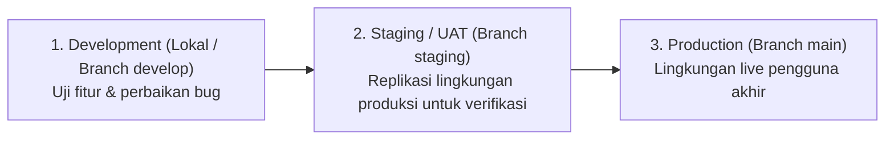
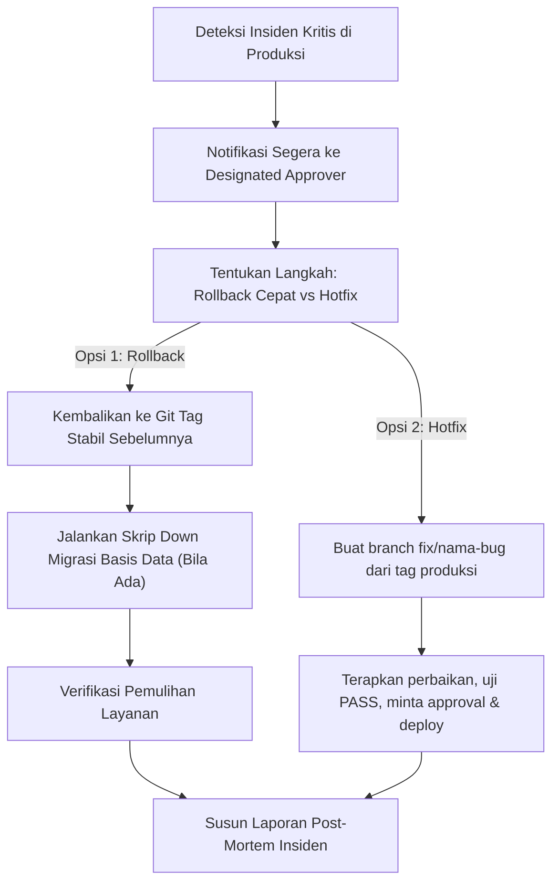

# STANDAR REKAYASA: PENERAPAN, RILIS & PEMELIHARAAN (DEPLOYMENT & MAINTENANCE STANDARDS)

> **DOCUMENT ID:** STD-ENG-007-DEP  
> **VERSION:** v2.0.0  
> **STATUS:** STANDAR REKAYASA TEKNIS (PILLAR 7 SPECIFICATION)  
> **PENANGGUNG JAWAB:** Lead Developer Role (Rujuk [config/organization.md](../../config/organization.md))  
> **OTORISASI:** Designated Approver (Rujuk [config/organization.md](../../config/organization.md), saat ini: **Yogi Ario**)  
> **TARGET PENGGUNA:** Seluruh Pengembang & AI Agent  
> **ACUAN UTAMA:** [Docs/Standards/Engineering_Standards.md](Engineering_Standards.md) & [Docs/universal-rule.md](../universal-rule.md)  
> **PRINSIP TATA KELOLA:** *No Verification, No Completion. Clean Main Policy.*  
> **KATA KUNCI NORMATIF:** RFC 2119 (MUST, MUST NOT, SHOULD, RECOMMENDED, MAY).

---

## 1. Pendahuluan

Dokumen ini mengatur standar operasional persiapan rilis, deployment, observabilitas sistem, dan pemeliharaan jangka panjang (*maintenance*). Tujuannya adalah menjamin bahwa setiap rilis perangkat lunak ke lingkungan produksi berlangsung aman, terencana, dapat dibatalkan secara cepat jika terjadi anomali (*reversible*), dan didukung pemantauan yang andal.

Standar ini membedakan secara tegas antara **Kendali Deployment Universal** (berlaku untuk semua jenis deliverable) dan **Kendali Deployment Spesifik Perangkat Lunak / Basis Data / API**.

---

## 2. Kendali Penerapan Tingkat Universal (Universal Deployment Controls)

Setiap pengesahan deliverable ke tahap rilis (baik berupa aplikasi, pustaka, template, dokumentasi, maupun dataset) **MUST** memenuhi kendali universal berikut:

1. **Verifikasi Kesiapan Konfigurasi:**  
   Memastikan seluruh variabel lingkungan atau parameter target telah terdefinisi pada template bersih (`.env.example`) tanpa ada kunci rahasia yang bocor.
2. **Pengepakan Artefak Bersih (*Clean Artifact Packaging*):**  
   Memastikan tidak ada berkas temporer, cache, log pengujian lokal, atau berkas pribadi yang terbawa ke dalam paket rilis.
3. **Pencatatan Perubahan Formal:**  
   Catatan perubahan rilis wajib terdokumentasi pada flat changelog bertimestamp berurut.
4. **Skenario Pengembalian (Rollback Plan):**  
   Memiliki prosedur tertulis yang jelas untuk membatalkan rilis dan memulihkan sistem ke status stabil sebelumnya.
5. **Otorisasi Manusia (Designated Approver Gate):**  
   Deployment atau penggabungan ke cabang rilis utama (`main`) **DILARANG KERAS** dilakukan secara otonom oleh AI Agent tanpa persetujuan tertulis eksplisit dari Designated Approver.

---

## 3. Kendali Penerapan Spesifik Perangkat Lunak & Basis Data (Software & API Extension)

Khusus untuk sistem aplikasi dengan backend, basis data, atau API aktif:

### 3.1 Manajemen Isolasi Lingkungan

1. **Development (Lokal):** Menggunakan basis data uji terisolasi; log debug diaktifkan.
2. **Staging / Pre-Production:** Replikasi arsitektur produksi untuk uji integrasi akhir dan verifikasi beban.
3. **Production (Live):** Lingkungan live pengguna; debug logging dinonaktifkan.

### 3.2 Prosedur Migrasi Skema Data
- Migrasi skema basis data wajib dieksekusi melalui skrip terversi (*versioned migration script*).
- Sebelum menjalankan migrasi pada lingkungan produksi, skrip rollback (*down*) **MUST** telah diuji coba berhasil di lingkungan staging.
- Wajib melakukan backup snapshot database sebelum eksekusi migrasi skema mayor.

---

## 4. Checklist Pra-Deployment (Pre-Deployment Checklist)

Sebelum suatu versi dirilis ke lingkungan produksi, seluruh checklist berikut **MUST** diverifikasi:

- [ ] **Mandatory Test Gate:** Seluruh pengujian otomatis wajib pada branch integrasi `develop` menghasilkan status **PASS** (0 GAGAL / 0 ERROR).
- [ ] **Bukti Verifikasi Tersedia:** Bukti faktual (log CLI, diff stat, atau screenshot UI di `Docs/Evidence/SS/valid/`) tersimpan lengkap.
- [ ] **Migrasi Basis Data Teruji (Bila Ada DB):** Skrip migrasi dan skrip rollback (*down*) telah diverifikasi di lingkungan staging.
- [ ] **Konfigurasi Lingkungan Lengkap:** Seluruh variabel environment produksi yang diperlukan telah disiapkan pada server target tanpa kebocoran secret.
- [ ] **Dokumentasi & Changelog Selesai:** Berkas changelog flat (`changelog/<nomor-urut>changelog<jam><ampm><ddmmyyyy>.md`) telah dibuat dan dokumen pelacak tugas diperbarui.
- [ ] **Branching Sesuai Standar (Clean Main):** Cabang `main` bersih dari berkas transien internal (log mentah, scrap file, secret).

---

## 5. Otorisasi Rilis Produksi & Penandaan Versi (Release Tagging)

1. **Gerbang Otorisasi Tertulis & Pemicu Komentar `"buatkan rilis"`:**  
   Penggabungan kode bersih aplikasi ke cabang `main` (tanpa membawa folder `aturan/` atau berkas secret lokal) dan pemicuan rilis produksi **mutlak memerlukan otorisasi tertulis Designated Approver**. Secara operasional, ketika Yogi Ario menuliskan komentar **`buatkan rilis`** pada *Implementation Plan* tahap berikutnya (`Tahap N+1`), hal tersebut menjadi otorisasi resmi bahwa versi hasil `Tahap N` sebelumnya telah teruji pada gawai fisik **Infinix Note 30**: agen wajib menyesuaikan/menaikkan `versionCode` & `versionName` di `app/build.gradle.kts` (bila belum dinaikkan), memverifikasi ulang tes & APK, mengintegrasikan kode bersih ke `main`, membuat tag `vX.Y.Z` + GitHub Release beserta APK, baru kemudian mengeksekusi `Tahap N+1`.
2. **Semantic Versioning (SemVer) & Kenaikan Monoton Android:**  
   Setiap rilis produksi ditandai dengan Git Tag semantik `v[MAJOR].[MINOR].[PATCH]` serta `versionCode` Android yang selalu bertambah (+1) agar berkas APK pembaruan dapat dipasang langsung di HP **Infinix Note 30** tanpa error *downgrade*.
3. **Daftar Uji Mandatori Sebelum Minta Rilis:** Lihat [`Docs/Checklist_Uji_HP_Infinix_Note30.md`](../Checklist_Uji_HP_Infinix_Note30.md).

---

## 6. Observabilitas & Pemantauan Operasional

1. **Health Check Endpoint:**  
   Aplikasi backend/API **SHOULD** menyediakan endpoint pemantauan kesehatan sistem (`GET /health` atau `GET /api/health`).
2. **Pemantauan Metrik Kinerja:**  
   Pantau metrik dasar: latensi respons rata-rata, tingkat error (Error Rate 5xx), penggunaan CPU/Memory.
3. **Peringatan Otomatis (Alerting):**  
   Jika rasio error HTTP 5xx melonjak di atas ambang batas toleransi, sistem peringatan wajib memberikan notifikasi ke tim operasional.

---

## 7. Prosedur Tanggap Insiden & Rollback Cepat (Incident & Fast Rollback)

1. **Notifikasi Segera:** Informasikan insiden kepada Designated Approver beserta dampak pengguna dan opsi mitigasi.
2. **Fast Rollback:** Jika akar masalah tidak dapat diperbaiki segera, lakukan rollback sistem seketika ke release tag stabil sebelumnya.
3. **Laporan Pasca-Insiden (Post-Mortem):** Setelah kondisi stabil, susun laporan singkat yang memuat akar penyebab (*root cause*), dampak, kronologi penanganan, dan tindakan pencegahan sistemik.

---

## 8. Rujukan Terkait
- Tata Kelola Git: [Git_Version_Control.md](Git_Version_Control.md)
- Kerangka QA: [QA_Framework.md](QA_Framework.md)
- Standar Basis Data & API: [Database_API_Standards.md](Database_API_Standards.md)
- Log Insiden: [Docs/Agent_Incident_Log.md](../Agent_Incident_Log.md)
- Konfigurasi Organisasi: [config/organization.md](../../config/organization.md)
