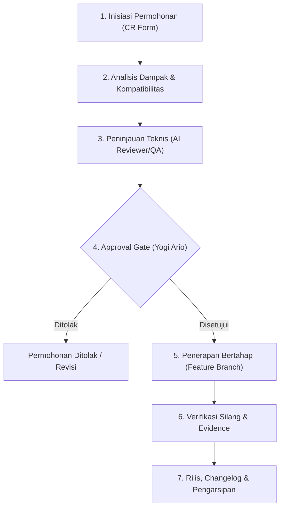

# STANDAR MANAJEMEN PERUBAHAN DOKUMENTASI & VERSI STANDAR

> **DOCUMENT ID:** STD-DOC-CHG-001  
> **VERSION:** v1.0.0  
> **STATUS:** ACTIVE  
> **AUTHORITY LEVEL:** Level 2 — Professional Engineering Standard  
> **OWNER:** Yogi Ario (Project Owner) & AI Engineering Team  
> **LAST UPDATED:** 07/11/2026  
> **AUTHORITATIVE SOURCE (SSOT):** `Docs/Standards/Documentation_Change_Management.md`  
> **RELATED DOCUMENTS:** `Docs/universal-rule.md`, `Docs/Approval_Governance.md`, `Docs/Standards/Documentation_Standards.md`, `Docs/Documentation_Change_Request.md`, `Docs/Standards/Git_Version_Control.md`  

---

## 1. Tujuan & Ruang Lingkup

Standar ini mengatur tata cara pengajuan, penelaahan dampak (*impact analysis*), pengesahan (*approval*), penerapan bertahap, pencatatan riwayat (*changelog*), serta prosedur pemulihan (*rollback*) terhadap perubahan dokumen standar, kebijakan tata kelola, dan template resmi yang telah berstatus `APPROVED` atau `ACTIVE`.

Prinsip utama:
> ***"Setiap perubahan terhadap aturan yang telah disahkan wajib memiliki alasan yang jelas, analisis dampak terukur, persetujuan Yogi Ario, dan jejak audit yang dapat ditelusuri."***

---

## 2. Standar Versi Semantik Dokumentasi (SemVer Standards)

Seluruh dokumen master standar menggunakan konvensi penomoran versi Semantik (*Semantic Versioning* `vX.Y.Z`):

```text
v[MAJOR].[MINOR].[PATCH]
  │       │       └── Perbaikan tipo, klarifikasi kalimat, perbaikan tautan rusak (Non-breaking).
  │       └────────── Penambahan klausul baru, template baru, atau aturan baru yang kompatibel (Backward-compatible).
  └────────────────── Perubahan fundamental prinsip tata kelola, perombakan hierarki, atau penghapusan standar (Breaking changes).
```

### 2.1 Kriteria Perubahan Versi
1. **MAJOR (`X.0.0`):**
   - Perubahan pada 6 Prinsip Tata Kelola Level 1.
   - Perubahan struktur hierarki Level 1 s.d. Level 6.
   - Perubahan wewenang otonom agen yang berdampak kritis pada keselamatan produksi.
   - Wajib persetujuan tertulis eksplisit dari Pemilik Proyek (Yogi Ario).
2. **MINOR (`X.Y.0`):**
   - Penambahan standar teknis baru di folder `Docs/Standards/`.
   - Penambahan template operasional baru di folder `Docs/`.
   - Penambahan profil agen baru di folder `agents/`.
   - Penambahan modul skill baru yang tervalidasi di folder `skills/`.
3. **PATCH (`X.Y.Z`):**
   - Koreksi kesalahan ketik (*typo*), format visual, penyesuaian gaya tabel.
   - Pembaruan tautan relatif yang patah.
   - Klarifikasi narasi tanpa mengubah substansi kebijakan atau batasan teknis.

---

## 3. Siklus Hidup Alur Permohonan Perubahan (Change Request Workflow)

Setiap modifikasi terhadap dokumen standar `APPROVED` wajib melalui **7 Tahap Pengendalian**:



1. **Tahap 1 — Inisiasi Permohonan:** Pengusul mengisi formulir resmi [`Docs/Documentation_Change_Request.md`](../Documentation_Change_Request.md) mencakup latar belakang, dokumen terdampak, dan usulan revisi.
2. **Tahap 2 — Analisis Dampak (*Impact Analysis*):** Mengidentifikasi dokumen turunan yang terpengaruh, risiko inkonsistensi, dan potensi pelanggaran terhadap aturan Level 1.
3. **Tahap 3 — Peninjauan Teknis (*Technical Review*):** AI Reviewer memeriksa apakah perubahan memicu konflik norma atau celah keamanan.
4. **Tahap 4 — Gerbang Persetujuan Manusia (*Approval Gate*):** Pengajuan diajukan kepada Yogi Ario. Dilarang keras menerapkan perubahan dokumen master sebelum ada persetujuan eksplisit.
5. **Tahap 5 — Penerapan Bertahap (*Controlled Execution*):** Perubahan diterapkan pada branch fitur khusus (`feature/...`) tanpa menyentuh branch produksi.
6. **Tahap 6 — Verifikasi Silang & Evidensi:** Pemeriksaan broken link, konsistensi terminologi, dan kelengkapan bukti.
7. **Tahap 7 — Rilis & Pencatatan Changelog:** Perubahan digabungkan ke `develop`, disinkronkan ke branch rilis, dicatat dalam berkas flat changelog bernomor urut 2-digit, dan versi dokumen dinaikkan.

---

## 4. Kebijakan Deprecasi (Deprecation Policy)

Apabila suatu standar atau template akan digantikan oleh standar baru:
1. **Pemberian Label Deprecasi:** Dokumen lama diberi status `DEPRECATED` pada blok metadata.
2. **Peringatan Referensi:** Ditambahkan kotak peringatan (*alert*) di bagian teratas dokumen lama:
   > `[!WARNING] Standar ini telah dinyatakan DEPRECATED per tanggal DD/MM/YYYY dan digantikan oleh [Nama Dokumen Baru](path/to/new_doc.md). Penggunaan untuk modul baru dilarang.`
3. **Masa Transisi (*Grace Period*):** Modul lama diberikan waktu transisi sebelum dokumen dipindahkan ke status `ARCHIVED`. Dokumen lama tidak boleh dihapus secara destruktif dari riwayat git.

---

## 5. Prosedur Pemulihan (Rollback Procedures)

Apabila perubahan standar yang baru dirilis memicu disrupsi operasional, kontradiksi aturan, atau kegagalan kepatuhan:
1. **Deteksi & Notifikasi Cepat:** Status insiden dinaikkan dan dicatat pada `Agent_Incident_Log.md`.
2. **Revert Commit:** Melakukan revert terhadap commit rilis perubahan standar menggunakan perintah `git revert <commit-hash>`.
3. **Restorasi Status:** Dokumen dikembalikan ke versi stabil sebelumnya (`vX.Y.Z-previous`).
4. **Pencatatan Insiden & Post-Mortem:** Dibuat laporan ringkas insiden pada changelog darurat dan evaluasi penyebab disrupsi.
