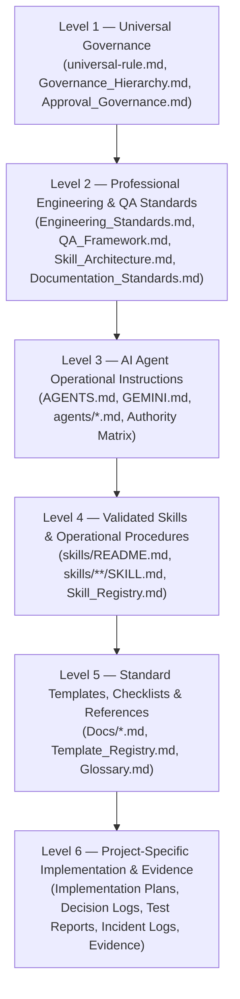

# STANDAR TATA KELOLA DOKUMENTASI & REPOSITORI

> **DOCUMENT ID:** STD-DOC-GOV-001  
> **VERSION:** v1.0.0  
> **STATUS:** ACTIVE  
> **AUTHORITY LEVEL:** Level 2 — Professional Engineering Standard  
> **OWNER:** Yogi Ario (Project Owner) & AI Engineering Team  
> **LAST UPDATED:** 07/11/2026  
> **AUTHORITATIVE SOURCE (SSOT):** `Docs/Standards/Documentation_Standards.md`  
> **RELATED DOCUMENTS:** `Docs/universal-rule.md`, `Docs/Governance_Hierarchy.md`, `Docs/Documentation_Hierarchy.md`, `Docs/Single_Source_of_Truth_Matrix.md`, `Docs/Glossary.md`  

---

## 1. Tujuan & Ruang Lingkup

Standar ini menetapkan pedoman resmi tata kelola, penulisan, penataan, penamaan, dan pemeliharaan seluruh dokumentasi teknis serta struktur repositori dalam ekosistem **Universal AI Engineering Standard**.

Prinsip fundamental:
> ***"One Standard, Clear Structure, Consistent Documentation, Traceable Changes."***

Standar ini mengikat seluruh pengembang manusia, AI Agent pelaksana, pengulas teknis (*reviewer*), dan penguji (*QA*) pada seluruh proyek di bawah ekosistem ini.

---

## 2. Hierarki Dokumentasi 6 Tingkat (Level 1 s.d. Level 6)

Setiap berkas dalam repositori wajib ditempatkan secara tegas pada salah satu tingkatan hierarki berikut:



### 2.1 Level 1 — Universal Governance
- **Definisi:** Aturan dan prinsip tertinggi yang mengikat seluruh agen, manusia, dan proyek tanpa pengecualian.
- **Cakupan:** Enam Prinsip Tata Kelola, Zero-Code Rule, Approval Gate, batasan kewenangan pemilik proyek (*Human-in-the-Loop*).
- **Aturan Otoritas:** Dokumen pada Level 2 hingga Level 6 **DILARANG KERAS** mengesampingkan atau mengubah norma Level 1 tanpa persetujuan eksplisit tertulis dari Yogi Ario.
- **Berkas Kunci:** `Docs/universal-rule.md`, `Docs/Governance_Hierarchy.md`, `Docs/Approval_Governance.md`.

### 2.2 Level 2 — Professional Standards
- **Definisi:** Standar teknis disiplin rekayasa perangkat lunak, jaminan kualitas, tata kelola skill, dan tata kelola agen.
- **Cakupan:** 7 Pilar Rekayasa Perangkat Lunak, QA Framework, Skill Architecture, Agent Architecture, dan Documentation Standards.
- **Berkas Kunci:** Seluruh berkas di dalam direktori `Docs/Standards/`.

### 2.3 Level 3 — AI Agent Instructions
- **Definisi:** Instruksi perilaku dan direktif operasional langsung bagi AI Agent saat membaca konteks repositori.
- **Cakupan:** Panduan penulisan kode presisi (*clean & surgical coding*), pemisahan peran, batasan kewenangan alat (*tools*), dan protokol eskalasi.
- **Berkas Kunci:** `AGENTS.md`, `GEMINI.md`, serta seluruh profil agen di folder `agents/`.

### 2.4 Level 4 — Skills & Operational Procedures
- **Definisi:** Prosedur operasional standar (SOP) kemampuan kerja AI yang dapat dieksekusi secara berulang (*reusable SOPs*).
- **Cakupan:** Berkas `SKILL.md` (18 atribut wajib), modul skill rekayasa perangkat lunak, dan prosedur validasi 6 dimensi.
- **Berkas Kunci:** `skills/README.md`, `skills/**/SKILL.md`, `Docs/Skill_Registry.md`.

### 2.5 Level 5 — Templates, Checklists & References
- **Definisi:** Formulir isian baku, lembar kerja evaluasi, daftar periksa, glosarium istilah, dan pedoman navigasi repositori.
- **Cakupan:** Template SRS, Architecture, Decision Log, Test Report, Defect Log, Glossary, dan Template Registry.
- **Berkas Kunci:** Seluruh template di `Docs/`, `Docs/Template_Registry.md`, `Docs/Glossary.md`.

### 2.6 Level 6 — Project-Specific Implementation & Evidence
- **Definisi:** Artefak kerja riil pelaksanaan proyek atau modul spesifik yang mencatat riwayat implementasi, keputusan, dan bukti verifikasi.
- **Cakupan:** Implementation Plans sekuensial, Verification Reports, Chat Histories, Evidence Screenshots, dan Berkas Changelog.
- **Berkas Kunci:** `Docs/Implementation_plan/*.md`, `Docs/chat/*.md`, `Docs/Evidence/**`, `changelog/*.md`.

---

## 3. Konvensi Penamaan Berkas (Naming Conventions)

Untuk memudahkan pencarian, pengindeksan, dan integrasi lintas sistem operasi, konvensi penamaan berikut **WAJIB** dipatuhi:

| Kategori Berkas | Format Penamaan Baku | Contoh Valid | Contoh Dilarang |
| :--- | :--- | :--- | :--- |
| **Dokumen Standar Inti** | PascalCase dengan garis bawah (`_`) | `Documentation_Standards.md` | `doc-standards.md`, `documentationStandards.md` |
| **Dokumen Template** | PascalCase dengan akhiran deskriptif | `SRS_Template.md`, `Defect_Log.md` | `srs-temp.md`, `template_srs.md` |
| **Profil Agen AI** | Kebab-case lowercase di `agents/` | `lead-developer.md`, `ai-manager.md` | `LeadDev.md`, `agent_manager.md` |
| **Modul Skill SOP** | `SKILL.md` kapital di folder kebab-case | `skills/software-engineering/requirement-analysis/SKILL.md` | `skill.md`, `RequirementSkill.md` |
| **Berkas Changelog** | Flat berurut 2-digit kronologis | `05changelog06am07112026.md` | `changelog_v5.md`, `2026-11-07.md` |
| **Implementation Plan Arsip**| Prefix 2-digit sekuensial di `Docs/Implementation_plan/` | `05_tahap05_Implementation_plan_agent_governance.md` | `plan5.md`, `implementation_plan_5.md` |
| **Laporan Verifikasi** | `Phase[XX]_Verification_Report.md` | `Phase05_Verification_Report.md` | `report-p5.md`, `verification5.md` |

---

## 4. Standar Blok Metadata Dokumen

Setiap dokumen master standar (Level 1 dan Level 2) serta panduan resmi wajib mencantumkan blok metadata terstruktur tepat di bawah judul utama (H1):

```markdown
# [JUDUL DOKUMEN KAPITAL]

> **DOCUMENT ID:** [DOC-CAT-SUB-NUM]  
> **VERSION:** [vX.Y.Z]  
> **STATUS:** [ACTIVE | APPROVED | UNDER_REVIEW | DRAFT | DEPRECATED | ARCHIVED]  
> **AUTHORITY LEVEL:** [Level 1 s.d. Level 6]  
> **OWNER:** [Yogi Ario / AI Engineering Team]  
> **LAST UPDATED:** [DD/MM/YYYY]  
> **AUTHORITATIVE SOURCE (SSOT):** [Path relatif dokumen rujukan otoritatif]  
> **RELATED DOCUMENTS:** [Daftar tautan dokumen pendukung terkait]  
```

---

## 5. Standar Bahasa & Terminologi Teknis

1. **Bahasa Primer:** Seluruh narasi penjelasan, instruksi kerja, deskripsi kriteria penerimaan, dan kebijakan tata kelola ditulis dalam **Bahasa Indonesia formal** yang baku, lugas, santun, dan objektif.
2. **Istilah Teknis Baku:** Istilah teknis rekayasa perangkat lunak internasional tetap dipertahankan dalam Bahasa Inggris (dicetak miring atau menggunakan backticks) guna menjaga presisi dan menghindari distorsi makna.
   - Contoh: *Single Source of Truth*, *Quality Gate*, *Bounded Retry*, *Flaky Test*, *Context Drift*, *Graceful Degradation*, *Pull Request*, *Branching*.
3. **Penyelarasan Glosarium:** Definisi resmi seluruh istilah baku dirujuk secara tunggal pada [`Docs/Glossary.md`](../Glossary.md). Penulis dokumen dilarang mendefinisikan ulang istilah teknis secara berbeda tanpa alasan yang valid.

---

## 6. Standar Klasifikasi Klausul (RFC 2119 Compliance)

Untuk mencegah ambiguitas interpretasi instruksi oleh AI Agent maupun manusia, kata kunci normatif berikut memiliki bobot hukum operasional yang kaku:

- **MUST / WAJIB:** Merupakan persyaratan mutlak bagi implementasi dokumen. Kegagalan memenuhinya diklasifikasikan sebagai *Critical Defect*.
- **MUST NOT / DILARANG:** Merupakan larangan mutlak. Tindakan ini dilarang keras dilakukan dalam kondisi apa pun.
- **SHOULD / SEBAIKNYA:** Merupakan rekomendasi sangat kuat. Deviasi hanya diizinkan apabila terdapat alasan teknis yang sah dan dicatat dalam *Implementation Plan* atau *Decision Log*.
- **SHOULD NOT / TIDAK DISARANKAN:** Menandakan praktik yang tidak dianjurkan karena berisiko memicu kendala kualitas atau keamanan.
- **MAY / DAPAT:** Menandakan pilihan opsional yang bebas ditentukan sesuai kebutuhan dan konteks modul proyek.

---

## 7. Siklus Hidup Status Dokumen (Document Status Lifecycle)

Setiap dokumen tata kelola memiliki status siklus hidup yang tegas:

$$\text{DRAFT} \longrightarrow \text{UNDER\_REVIEW} \longrightarrow \text{APPROVED} \longrightarrow \text{ACTIVE} \longrightarrow \text{DEPRECATED} \longrightarrow \text{ARCHIVED}$$

1. **DRAFT:** Dokumen sedang dalam tahap penyusunan awal; belum dapat dijadikan rujukan kerja produksi.
2. **UNDER_REVIEW:** Dokumen telah lengkap dan sedang ditinjau oleh AI Reviewer / AI QA.
3. **APPROVED:** Dokumen telah disahkan secara formal oleh Pemilik Proyek (Yogi Ario) melalui *Approval Gate*.
4. **ACTIVE:** Dokumen sedang berlaku aktif sebagai standar rujukan operasional di lingkungan proyek.
5. **DEPRECATED:** Dokumen telah digantikan oleh versi baru atau standar lain; penggunaan baru tidak disarankan.
6. **ARCHIVED:** Dokumen sudah tidak berlaku dan disimpan sebagai catatan riwayat sejarah (*historical record*).

---

## 8. Tata Kelola Tautan Relatif & Integritas Referensi

1. **Skema Tautan Markdown:** Seluruh tautan internal wajib menggunakan jalur relatif yang valid dan dapat diklik.
2. **Pemeriksaan Broken Link:** Setiap dokumen baru atau perubahan dokumen wajib diaudit menggunakan checklist kesehatan repositori untuk menjamin tidak ada tautan rusak (*404 / file not found*).
3. **Clean Main Policy:** Branch `main` mutlak terisolasi dari berkas draf, pengujian, berkas obrolan sementara, atau screenshot evidensi. Branch `main` hanya memuat rilis dokumen dan kode stabil yang telah disahkan.
