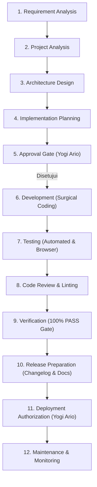

# Professional Engineering Standards — Master Framework

> **STATUS:** STANDAR REKAYASA TINGKAT UNIVERSAL (LEVEL 1 SPECIFICATION)  
> **OTORITAS TERTINGGI:** Yogi Ario (PROJECT OWNER / LEAD DEVELOPER)  
> **TARGET PENGGUNA:** Seluruh Pengembang Manusia & AI Agent  
> **ACUAN UTAMA:** [Docs/universal-rule.md](../universal-rule.md) & [Docs/Governance_Hierarchy.md](../Governance_Hierarchy.md)  
> **PRINSIP UTAMA:** *Consistent Standards, Variable Intelligence.*  
> **ENAM PRINSIP TATA KELOLA:**  
> 1. *No Understanding, No Execution.*  
> 2. *No Plan, No Code.*  
> 3. *No Approval, No Code.*  
> 4. *No Verification, No Completion.*  
> 5. *No Evidence, No Completion.*  
> 6. *No Validated Skill, No Production Use.*  

---

## 1. Pendahuluan & Filosofi Kerja

Dokumen ini adalah **Master Framework Standar Rekayasa Perangkat Lunak Profesional** yang berlaku secara menyeluruh lintas proyek, repositori, dan jenis teknologi. Standar ini menjembatani prinsip tata kelola universal (Governance Foundation) ke dalam pedoman teknis operasional harian para pengembang dan AI Agent.

### 🧭 Prinsip: Consistent Standards, Variable Intelligence
Kemampuan penalaran dan retensi konteks setiap AI Agent dapat bervariasi. Oleh karena itu, siklus rekayasa perangkat lunak **MUST NOT** bergantung pada kejeniusan temporer sebuah model AI. **Standar rekayasa, gerbang mutu (quality gates), format dokumentasi, dan bukti pengujian MUST tetap seragam, terukur, dan konsisten**.

Pendekatan teknis dapat disesuaikan dengan bahasa pemrograman dan framework yang digunakan (*stack-agnostic*), namun kedisiplinan alur kerja, gerbang persetujuan, dan bukti pengujian tidak dapat ditawar.

---

## 2. Peta Dokumen Standar Rekayasa (The 7 Engineering Pillars)

Master Framework ini menaungi 7 pilar spesifikasi teknis modular di dalam direktori `Docs/Standards/`:

| No | Pilar Standar | Berkas Spesifikasi | Fokus Utama |
| :-: | :--- | :--- | :--- |
| **1** | **Requirements Engineering** | [`Requirements_Engineering.md`](Requirements_Engineering.md) | Penomoran REQ, Acceptance Criteria terukur, Traceability Matrix (RTM). |
| **2** | **Architecture & Design** | [`Architecture_Design.md`](Architecture_Design.md) | Modularitas, pemisahan tanggung jawab, data flow, dan ADR dengan trade-off. |
| **3** | **Coding Standards** | [`Coding_Standards.md`](Coding_Standards.md) | Clean & Surgical Coding, konvensi penamaan, error handling, dan sanitasi logging. |
| **4** | **Git & Version Control** | [`Git_Version_Control.md`](Git_Version_Control.md) | Clean main policy, Conventional Commits, PR review, dan flat changelog. |
| **5** | **Database & API Standards** | [`Database_API_Standards.md`](Database_API_Standards.md) | Skema DB, migrasi terkelola, REST API contract, envelope seragam, status codes. |
| **6** | **Security Engineering** | [`Security_Engineering.md`](Security_Engineering.md) | Zero Secret Leakage, OWASP Top 10, RBAC, input sanitization, output encoding. |
| **7** | **Deployment & Maintenance** | [`Deployment_Maintenance.md`](Deployment_Maintenance.md) | Pemisahan environment, checklist pra-rilis, release authorization, incident recovery. |
| **QA**| **Quality Assurance System** | [`QA_Framework.md`](QA_Framework.md) | Sistem QA menyeluruh, 5 Quality Gates, Testing Strategy, Test Case, Defect & Evidence. |
| **SKL**| **AI Employee Skill System** | [`Skill_Architecture.md`](Skill_Architecture.md) | Arsitektur SOP skill, 18 atribut SKILL.md, siklus 9 tahap, validasi 6 dimensi, dan registri. |
| **AGT**| **Agent Governance & Execution** | [`Agent_Architecture_Governance.md`](Agent_Architecture_Governance.md) | Arsitektur 5 peran agen, matriks wewenang, orkestrasi, handoff 11 atribut, dan tool governance. |
| **DOC**| **Documentation & Repository** | [`Documentation_Standards.md`](Documentation_Standards.md) | Hierarki 6 tingkat, SSOT matrix, SemVer dokumentasi, template registry, dan repository health. |

> 🔍 **Spesifikasi Lengkap QA, Skill, Agent & Documentation Systems:**  
> Seluruh detail teknis pengujian, verifikasi, manajemen defect, kapabilitas skill, tata kelola operasional agen, serta standardisasi dokumentasi diatur dalam:
> - [`QA_Framework.md`](QA_Framework.md) — Master QA Framework & 15-Step QA Workflow.
> - [`Testing_Strategy.md`](Testing_Strategy.md) — Multi-Tier & Risk-Based Testing Strategy.
> - [`Test_Case_Management.md`](Test_Case_Management.md) — Format Kasus Uji `TC-[MODULE]-[NUM]` & RTM.
> - [`Defect_Management.md`](Defect_Management.md) — Format Defect `DEF-[MODULE]-[NUM]`, Severity vs Priority & 8-Step Lifecycle.
> - [`Verification_Evidence.md`](Verification_Evidence.md) — Standar Bukti Nyata, Screenshot Browser Bawaan IDE & Sanitasi Log.
> - [`Skill_Architecture.md`](Skill_Architecture.md) — Master Arsitektur Skill, Klasifikasi, Batas Konseptual & 18 Atribut.
> - [`Skill_Lifecycle_Governance.md`](Skill_Lifecycle_Governance.md) — Tata Kelola 9 Tahap Siklus Hidup, Hak Akses Peran, dan Versi Semantik.
> - [`Skill_Validation_Testing.md`](Skill_Validation_Testing.md) — Kerangka Validasi 6 Dimensi, Standar Test Case & Rubrik Mutu.
> - [`Agent_Architecture_Governance.md`](Agent_Architecture_Governance.md) — Master Tata Kelola Agen, 5 Klasifikasi, 13 Atribut Profil & Pemisahan Peran.
> - [`Agent_Orchestration_Handoff.md`](Agent_Orchestration_Handoff.md) — Model Orkestrasi, Task Management, Protokol Handoff 11 Atribut & Manajemen Konteks.
> - [`Tool_Governance_Execution.md`](Tool_Governance_Execution.md) — Tata Kelola 9 Kategori Alat Teknis, Least Privilege & Redaksi Kredensial.
> - [`Error_Handling_Recovery.md`](Error_Handling_Recovery.md) — Klasifikasi 9 Kegagalan, Alur Pemulihan 8-Langkah & Bounded Retry (Maks. 3x).
> - [`Documentation_Standards.md`](Documentation_Standards.md) — Master Tata Kelola Dokumentasi, Hierarki 6 Tingkat, Naming & RFC 2119.
> - [`Documentation_Change_Management.md`](Documentation_Change_Management.md) — Manajemen Perubahan Dokumen, SemVer Standar, dan Rollback.
> - [`Repository_Health_Standard.md`](Repository_Health_Standard.md) — Standar Audit Kesehatan Repositori, Broken Links & Kebersihan Main.

---

## 3. Alur Kerja Rekayasa Terpadu (12-Step Engineering Workflow)

Setiap siklus pengerjaan tugas atau rilis perangkat lunak **MUST** melalui 12 tahapan rekayasa berurutan berikut:

### Rincian 12 Langkah:

1. **Step 1 — Requirement Analysis:**  
   Mengidentifikasi kebutuhan bisnis, kebutuhan fungsional (`REQ-F-xxx`), non-fungsional (`REQ-NF-xxx`), dan batasan sistem. Mengacu pada [`Requirements_Engineering.md`](Requirements_Engineering.md).
2. **Step 2 — Project Analysis:**  
   Memeriksa repositori aktual, struktur berkas, status dependensi, dan batasan teknologi menggunakan template [`Docs/Project_Analysis.md`](../Project_Analysis.md).
3. **Step 3 — Architecture Design:**  
   Menentukan batas modular, pola arsitektur, skema data, kontrak API, dan menyusun *Architecture Decision Record* (ADR) jika terdapat percabangan teknis. Mengacu pada [`Architecture_Design.md`](Architecture_Design.md).
4. **Step 4 — Implementation Planning:**  
   Menyusun rencana kerja tertulis terperinci pada artefak `Docs/Implementation_plan.md` yang memuat target berkas, skenario pengujian, analisis risiko, dan opsi solusi (*No Plan, No Code*).
5. **Step 5 — Approval Gate:**  
   Menyerahkan *Implementation Plan* kepada Yogi Ario. AI Agent **MUST NOT** menyentuh kode sebelum memperoleh persetujuan eksplisit tertulis (*No Approval, No Code*).
6. **Step 6 — Development (Clean & Surgical Coding):**  
   Mengeksekusi modifikasi kode secara terukur, modular, dan presisi. Mengacu pada [`Coding_Standards.md`](Coding_Standards.md).
7. **Step 7 — Testing:**  
   Menjalankan skrip pengujian otomatis (unit/integration) dan otomasi browser bawaan IDE (Chrome DevTools MCP / Chrome automation) dengan inspeksi DOM dan tangkapan layar.
8. **Step 8 — Code Review & Linting:**  
   Memastikan kode bebas dari *dead code*, format kode konsisten, tidak ada secret ter-hardcode, dan mematuhi linter resmi bahasa pemrograman yang digunakan.
9. **Step 9 — Verification:**  
   Memvalidasi hasil pengujian terhadap kriteria keberhasilan. Suatu tugas hanya boleh dinyatakan selesai jika membuktikan **100% PASS (0 GAGAL / 0 ERROR)** dengan bukti screenshot tersimpan di `Docs/Evidence/SS/valid/` atau `error/` (*No Verification, No Completion & No Evidence, No Completion*).
10. **Step 10 — Release Preparation:**  
    Memperbarui dokumentasi formal (`Docs/Task_Status.md`, `Docs/Decision_Log.md`, `Docs/Test_Report.md`), membuat flat changelog bertimestamp berurut (`changelog/<nomor-urut>changelog<jam><ampm><ddmmyyyy>.md`), dan mencadangkan rencana ke `Docs/Implementation_plan/<nomor>_tahap...`.
11. **Step 11 — Deployment Authorization:**  
    Penggabungan branch ke `develop` dan permohonan otorisasi manual kepada Yogi Ario untuk rilis produksi ke branch `main`. AI Agent **MUST NOT** melakukan merge atau commit langsung ke branch `main`.
12. **Step 12 — Maintenance & Monitoring:**  
    Pemantauan log operasional, penanganan insiden, dan penyiapan rencana implementasi tahap berikutnya (*Chained Implementation Plan*).

---

## 4. Definition of Ready (DoR) & Definition of Done (DoD)

### 4.1 Definition of Ready (DoR) — Syarat Mulai Pengerjaan
Suatu tugas atau tiket fitur **DILARANG** dieksekusi sebelum seluruh kondisi berikut terpenuhi:
- [ ] **Kejelasan Tujuan:** Masalah bisnis dan tujuan teknis terdefinisi secara tertulis.
- [ ] **Ruang Lingkup Pasti:** Batasan *In-Scope* dan *Out-of-Scope* telah disepakati.
- [ ] **Requirement Spesifik:** Kebutuhan fungsional (`REQ-F-xxx`) terdokumentasi dan memiliki *Acceptance Criteria* yang terukur.
- [ ] **Identifikasi Dependensi & Risiko:** Ketergantungan modul eksternal dan risiko awal telah diidentifikasi beserta mitigasinya.
- [ ] **Pola Arsitektur Terkonfirmasi:** Pola arsitektur telah disetujui (tidak ada asumsi sepihak oleh AI Agent).
- [ ] **Implementation Plan Disetujui:** Rencana tertulis telah disahkan secara eksplisit oleh Yogi Ario (*No Approval, No Code*).

### 4.2 Definition of Done (DoD) — Syarat Penyelesaian Tugas
Suatu tugas atau modul **DILARANG** dilaporkan selesai (*completed*) sebelum seluruh kondisi berikut terpenuhi:
- [ ] **Kesesuaian Requirement:** Seluruh kebutuhan fungsional dan kriteria penerimaan terbukti terpenuhi 100%.
- [ ] **Verifikasi Pengujian 100% PASS:** Test suite otomatis dijalankan dengan hasil `100% PASS (0 GAGAL / 0 ERROR)`.
- [ ] **Bukti Nyata Tersimpan:** Tangkapan layar browser valid/error tersimpan rapi di direktori `Docs/Evidence/SS/valid/` atau `error/`.
- [ ] **Ketiadaan Utang Teknis Kritis:** Tidak ada compiler error, broken imports, unhandled exceptions, atau secret yang terekspos.
- [ ] **Dokumentasi Terbarui:** `Docs/Task_Status.md`, `Docs/Decision_Log.md`, dan `Docs/Test_Report.md` telah disinkronkan.
- [ ] **Pencadangan Rencana Kerja:** Berkas rencana kerja dicadangkan ke `Docs/Implementation_plan/<nomor>_tahap...`.
- [ ] **Changelog Flat Tersedia:** Berkas changelog bertimestamp dibuat flat berurut di `changelog/<nomor-urut>changelog<jam><ampm><ddmmyyyy>.md`.
- [ ] **Branching Sesuai Standar:** Pekerjaan berada di branch `feature/<nomor>_<nama>` atau `fix/<nama>` dan telah di-merge ke `develop`. **Branch `main` tetap bersih dari berkas non-produksi.**
- [ ] **Chained Plan Proaktif:** Rencana kerja untuk tahapan selanjutnya telah langsung disusun untuk ditinjau Yogi Ario.

---

## 5. Rekayasa Berbasis Risiko (Risk-Based Engineering)

Untuk mencegah *over-engineering* pada tugas sederhana dan mencegah kecerobohan pada tugas kritis, rekayasa perangkat lunak diklasifikasikan ke dalam **4 Tingkat Risiko (Risk Tiers)**:

| Tingkat Risiko | Karakteristik Perubahan | Persyaratan Analisis & Desain | Persyaratan Pengujian | Gerbang Persetujuan (Approval) |
| :--- | :--- | :--- | :--- | :--- |
| **Low Risk** | Perubahan teks UI, dokumentasi markdown, perbaikan styling CSS minor tanpa manipulasi layout, penambahan komentar kode. | Rencana kerja ringkas (1-2 paragraf) pada implementation plan. | Manual visual check / linter check lulus. | Approval standar Yogi Ario. |
| **Medium Risk** | Penambahan fungsi/fitur baru yang terisolasi, penambahan endpoint API baru, penambahan tabel baru tanpa relasi ke tabel inti, optimasi algoritma lokal. | Implementation plan terperinci dengan analisis trade-off dan daftar berkas target. | Unit test otomatis mencakup logika baru (100% PASS) + visual screenshot bila ada UI. | Approval formal Yogi Ario sebelum coding. |
| **High Risk** | Modifikasi skema basis data existing, perubahan tabel inti (Users, Transaksi), refaktor modul arsitektur inti, perubahan dependensi mayor. | Implementation plan mendalam + dokumen ADR + analisis dampak ketergantungan + skenario rollback database tertulis. | Automated unit & integration testing 100% PASS + pengujian regresi + validasi backup data. | Double-check review & approval eksplisit Yogi Ario. |
| **Critical Risk** | Perubahan sistem autentikasi, enkripsi password, logika transaksi keuangan, konfigurasi keamanan jaringan, migrasi infrastruktur produksi. | Threat modeling lengkap + Security impact assessment + ADR mendalam + persetujuan skenario rollback multi-tahap. | Security scanning + Penetration dry-run + Automated end-to-end testing 100% PASS. | Approval tertulis khusus Yogi Ario; AI Agent dilarang mengeksekusi secara otonom. |

### Prinsip Penentuan Risiko:
Klasifikasi risiko **MUST NOT** diukur hanya dari jumlah baris kode (*lines of code*). Modifikasi 1 baris kode yang mematikan validasi token autentikasi dikategorikan sebagai **Critical Risk**, sementara penambahan 300 baris dokumentasi markdown dikategorikan sebagai **Low Risk**.

---

## 6. Prinsip Rekayasa Proporsional (Proportional Engineering)

Tingkat kedalaman dokumen dan verifikasi harus proporsional terhadap kompleksitas dan risiko proyek:
- Proyek berskala kecil / prototipe MVP tidak boleh dipaksa membuat arsitektur enterprise berlapis-lapis yang tidak dibutuhkan (*anti-overengineering*).
- Namun, **6 Prinsip Tata Kelola, Gerbang Persetujuan Yogi Ario, dan Kebijakan Clean `main` Branch berlaku mutlak tanpa pengecualian**, berapapun skala proyeknya.
