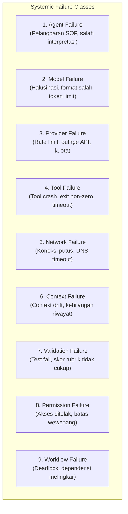

# STANDAR REKAYASA: PENANGANAN KESALAHAN & PEMULIHAN OPERASIONAL (ERROR HANDLING & RECOVERY)

> **STATUS:** AKTIF (LEVEL 2 OPERATIONAL STANDARD)  
> **NOMOR DOKUMEN:** STD-ENG-014-AGT  
> **VERSION:** v2.0.0  
> **KATEGORI:** KETAHANAN SISTEM & PEMULIHAN KENDALA (RESILIENCE & RECOVERY)  
> **PENANGGUNG JAWAB:** Lead Developer Role (Rujuk [config/organization.md](../../config/organization.md))  
> **OTORISASI:** Designated Approver (Rujuk [config/organization.md](../../config/organization.md), saat ini: **Yogi Ario**)  
> **PRINSIP UTAMA:**  
> - *Fail Safely, Recover Gracefully, Escalate Transparently.*  
> - *Idempotency-Aware Bounded Retries (No Blind Retries, No Hidden Failures).*  
> **KATA KUNCI NORMATIF:** RFC 2119 (MUST, MUST NOT, SHOULD, RECOMMENDED, MAY).

---

## 1. Pendahuluan

Dokumen ini mengatur klasifikasi sistemik seluruh kendala operasional, prosedur pemulihan terukur (*bounded recovery*), pencegahan perulangan tanpa batas (*infinite retry prevention*), pemeliharaan konteks status, dan eskalasi transparan kepada Designated Approver saat terjadi kegagalan dalam ekosistem agen AI.

Kegagalan operasional harus dihadapi sebagai kejadian terduga (*predictable exception*) yang memiliki alur penanganan baku, bukan sebagai kekacauan tak terkendali.

---

## 2. Klasifikasi Sembilan Kategori Kegagalan (The 9 Failure Categories)

Setiap kegagalan yang terjadi selama pengerjaan tugas **MUST** diklasifikasikan ke dalam 9 kategori diskrit:



| No | Kategori Kegagalan | Akar Penyebab Umum | Strategi Mitigasi Awal |
| :-: | :--- | :--- | :--- |
| **1** | **Agent Failure** | Agen melompati langkah SOP atau salah membaca spesifikasi. | Reset langkah ke checkpoint terakhir, baca ulang spesifikasi. |
| **2** | **Model Failure** | Output halusinasi atau pelanggaran skema JSON/Markdown. | Ulangi generasi dengan batasan ketat (*temperature low / structured schema*). |
| **3** | **Provider Failure** | HTTP 429 (Rate Limit) atau HTTP 503 (Provider Outage). | Jeda eksponensial (*exponential backoff*) atau beralih model cadangan. |
| **4** | **Tool Failure** | Perintah shell gagal, exit code $\neq 0$, dependensi hilang. | Periksa argumen, sanitasi path, aktifkan prosedur *fallback*. |
| **5** | **Network Failure** | Kegagalan soket internet atau putusnya jaringan lokal. | Retry terikat timeout (*timeout handling*). |
| **6** | **Context Failure** | Kehilangan konteks penting akibat riwayat percakapan panjang. | Rangkum status dan baca ulang [Decision_Log.md](../Decision_Log.md). |
| **7** | **Validation Failure** | Kasus uji gagal atau kriteria penerimaan belum terpenuhi. | Analisis log error, perbaiki implementasi secara presisi, uji ulang terisolasi. |
| **8** | **Permission Failure** | Agen mencoba mengakses alat atau berkas di luar wewenangnya. | Hentikan seketika (*Fail-Closed*); minta otorisasi eksplisit kepada Designated Approver. |
| **9** | **Workflow Failure** | Dependensi antar-tugas saling mengunci (*deadlock*). | Eskalasi ke koordinasi tugas untuk restrukturisasi urutan. |

---

## 3. Alur Kerja Pemulihan 8-Langkah (8-Step Error Recovery Workflow)

Saat terjadi kendala dalam eksekusi tugas, agen pelaksana **MUST** melalui alur pemulihan terstruktur berikut:

```text
===================================================================================
 ALUR PEMULIHAN KENDALA OPERASIONAL (8-STEP ERROR RECOVERY)
 1. Detect Failure          : Mendeteksi error code, exception, atau anomali output.
 2. Classify Failure        : Mengkategorikan ke dalam 1 s.d. 9 kategori kegagalan.
 3. Assess Impact           : Menganalisis risiko terhadap data, integritas & keamanan.
 4. Retry if Safe (Bounded) : Menjalankan percobaan ulang terkendali berbasis kategori.
 5. Switch Tool / Fallback  : Mengaktifkan alat alternatif bila diotorisasi dalam SOP.
 6. Preserve Task Context   : Menyimpan snapshot status pengerjaan agar tidak hilang.
 7. Record Evidence         : Mencatat rincian insiden ke Docs/Agent_Incident_Log.md.
 8. Escalate if Unresolved  : Menghentikan tugas & melaporkan status BLOCKED ke Approver.
===================================================================================
```

---

## 4. Aturan Percobaan Ulang Terbatas Berbasis Kategori & Idempotensi (Bounded Retry Policy)

Untuk mencegah agen terjebak dalam *infinite retry loops* atau merusak integritas sistem:

### 4.1 Kebijakan Batas Percobaan Ulang Spesifik Kategori (Category-Specific Retry Bounds)
1. **Operasi Non-Idempoten (Mutasi Data, Hapus File, Transaksi Eksternal):**  
   **MAKSIMAL 0 RETRY (DILARANG RETRY OTOMATIS).** Verifikasi status aktual sistem terlebih dahulu atau eskalasi ke Designated Approver sebelum mengambil tindakan lanjutan.
2. **Permission Failure (Kategori 8):**  
   **MAKSIMAL 0 RETRY.** Tolak secara langsung (*Fail-Closed*). Dilarang mengulang pemanggilan alat yang ditolak oleh sistem izin.
3. **Model / Agent Parsing Failure (Kategori 1 & 2):**  
   **MAKSIMAL 1 RETRY** dengan perbaikan prompt terstruktur dan parameter temperatur rendah.
4. **Transient Network & Provider Rate-Limit (Kategori 3 & 5):**  
   **MAKSIMAL 3 KALI RETRY** dengan jeda waktu meningkat secara eksponensial (*exponential backoff*: 2 detik, 4 detik, 8 detik).
5. **Tool Execution Failure (Kategori 4):**  
   **MAKSIMAL 2 KALI RETRY** hanya jika kegagalan disebabkan oleh argumen sintaksis yang dapat diperbaiki atau pembersihan cache sementara.

### 4.2 Prinsip Fail-Fast
Jika batas maksimal percobaan telah tercapai dan kegagalan berlanjut, agen **MUST** seketika menghentikan eksekusi, beralih ke prosedur fallback, atau menetapkan status **BLOCKED**.

---

## 5. Struktur Standar Catatan Insiden (`INC-[CAT]-[NUM]`)

Setiap insiden kegagalan yang memerlukan eskalasi atau pemulihan formal **MUST** dicatat ke dalam [Docs/Agent_Incident_Log.md](../Agent_Incident_Log.md) menggunakan pola ID baku `INC-[CAT]-[NUM]` (contoh: `INC-TOOL-001`, `INC-SEC-002`, `INC-NET-003`):

```markdown
### INC-[CAT]-[NUM]: [Ringkasan Kendala]
- **Timestamp:** YYYY-MM-DD HH:MM WIB
- **Task ID Terkait:** TSK-[MODULE]-[NUM] / UREV-[NUM]
- **Agen Terdampak:** AGT-[CAT]-[ROLE]-[NUM]
- **Kategori Kegagalan:** [Agent | Model | Provider | Tool | Network | Context | Validation | Permission | Workflow]
- **Tingkat Keparahan:** [Low | Medium | High | Critical]
- **Idempotensi Tindakan:** [Idempotent | Non-Idempotent]
- **Deskripsi Kejadian:** [Uraian kronologis kegagalan]
- **Pesan / Kode Error Mentah:** `[Salinan pesan error teknis mentah]`
- **Dampak Operasional:** [Pengaruh terhadap jadwal dan integritas berkas]
- **Upaya Pemulihan Dilakukan:** [Langkah 1..N yang telah dicoba, jumlah retry]
- **Hasil Pemulihan:** [RESOLVED / BLOCKED / ESCALATED]
- **Konfirmasi Approver:** [Terkonfirmasi Designated Approver: YYYY-MM-DD]
```

---

## 6. Prosedur Eskalasi & Penetapan Status BLOCKED

Jika seluruh jalur pemulihan lokal dan prosedur fallback gagal menyelesaikan kendala:

1. **Ubah Status Tugas Menjadi BLOCKED:**  
   Agen **MUST** segera mengubah status tugas pada [Docs/Task_Status.md](../Task_Status.md) menjadi **BLOCKED**.
2. **Penyusunan Blocker Report (MSG-BLOCKER):**  
   Agen menyusun laporan ringkas yang memuat:
   - Apa yang sedang dikerjakan.
   - Apa kendala persis yang dihadapi beserta bukti log/screenshot.
   - Apa yang telah dicoba dan mengapa gagal.
   - Opsi solusi atau keputusan yang dibutuhkan dari Designated Approver.
3. **Dilarang Menebak Solusi Berbahaya:**  
   Agen dilarang keras mencoba jalan pintas yang melanggar tata kelola (misal: mematikan linter, mengabaikan test gagal, atau memaksa commit) demi menghindari status BLOCKED.

---

## 7. Rujukan Terkait
- Arsitektur Agen: [Agent_Architecture_Governance.md](Agent_Architecture_Governance.md)
- Spesifikasi Penegakan Izin Teknis: [Agent_Permission_Enforcement_Spec.md](Agent_Permission_Enforcement_Spec.md)
- Tata Kelola Alat: [Tool_Governance_Execution.md](Tool_Governance_Execution.md)
- Log Insiden Agen: [Docs/Agent_Incident_Log.md](../Agent_Incident_Log.md)
- Pelacak Defect: [Defect_Management.md](Defect_Management.md)
- QA Framework: [QA_Framework.md](QA_Framework.md)
- Konfigurasi Organisasi: [config/organization.md](../../config/organization.md)
