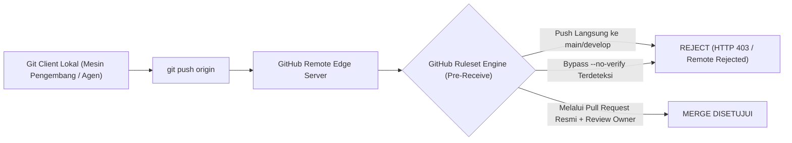

# SPESIFIKASI GITHUB SERVER-SIDE RULESETS (BRANCH PROTECTION)

> **DOCUMENT ID:** SPEC-SEC-RST-001  
> **VERSION:** v1.0.0  
> **STATUS:** PRODUCTION SECURITY SPECIFICATION  
> **AUTHORITY:** Designated Approver (Yogi Ario — `useripx`)  
> **TARGET REPOSITORY:** `https://github.com/useripx/aturan.git`  
> **PURPOSE:** Menutup celah bypass lokal (`--no-verify` / direct CLI) dengan meletakkan verifikasi mutlak pada pre-receive hook server remote GitHub.  

---

## 1. Arsitektur Proteksi Server-Side



---

## 2. Definisi Ruleset Branch `main` (Production Branch)

* **Nama Ruleset:** `Protect-Production-Main`
* **Target Ref:** `refs/heads/main`
* **Enforcement:** `Active`
* **Konfigurasi JSON (GitHub API / gh api):**
  ```json
  {
    "name": "Protect-Production-Main",
    "target": "branch",
    "enforcement": "active",
    "conditions": {
      "ref_name": {
        "include": ["refs/heads/main"],
        "exclude": []
      }
    },
    "rules": [
      {
        "type": "deletion"
      },
      {
        "type": "non_fast_forward"
      },
      {
        "type": "pull_request",
        "parameters": {
          "required_approving_review_count": 1,
          "dismiss_stale_reviews_on_push": true,
          "require_code_owner_review": true,
          "require_last_push_approval": true,
          "required_reviewers": [
            {
              "reviewer": "useripx"
            }
          ]
        }
      },
      {
        "type": "required_status_checks",
        "parameters": {
          "strict_required_status_checks_policy": true,
          "required_status_checks": [
            {
              "context": "Governance Verification Suite"
            }
          ]
        }
      },
      {
        "type": "required_signatures"
      }
    ],
    "bypass_actors": []
  }
  ```

---

## 3. Definisi Ruleset Branch `develop` (Integration Branch)

* **Nama Ruleset:** `Protect-Integration-Develop`
* **Target Ref:** `refs/heads/develop`
* **Enforcement:** `Active`
* **Konfigurasi JSON:**
  ```json
  {
    "name": "Protect-Integration-Develop",
    "target": "branch",
    "enforcement": "active",
    "conditions": {
      "ref_name": {
        "include": ["refs/heads/develop"],
        "exclude": []
      }
    },
    "rules": [
      {
        "type": "deletion"
      },
      {
        "type": "non_fast_forward"
      },
      {
        "type": "pull_request",
        "parameters": {
          "required_approving_review_count": 1,
          "dismiss_stale_reviews_on_push": true,
          "require_last_push_approval": true
        }
      },
      {
        "type": "required_status_checks",
        "parameters": {
          "strict_required_status_checks_policy": true,
          "required_status_checks": [
            {
              "context": "Governance Verification Suite"
            }
          ]
        }
      }
    ],
    "bypass_actors": []
  }
  ```

---

## 4. Prosedur Aktivasi oleh Project Owner (Manual via Web UI)
1. Buka repositori `https://github.com/useripx/aturan`.
2. Klik **Settings** $\rightarrow$ **Rules** $\rightarrow$ **Rulesets**.
3. Klik **New ruleset** $\rightarrow$ **New branch ruleset**.
4. Masukkan nama `Protect-Production-Main`, pilih target `Default branch` (`main`), centang aturan di atas, dan klik **Save changes**.
5. Ulangi untuk branch `develop`.
