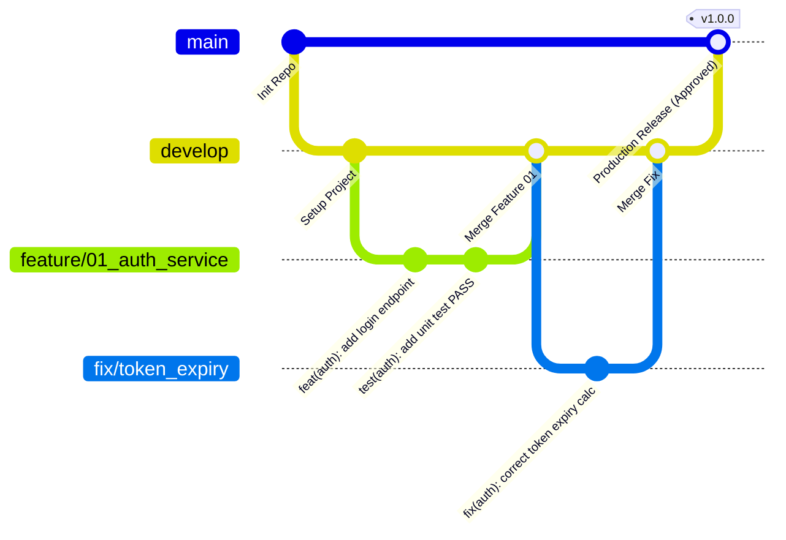

# STANDAR REKAYASA: TATA KELOLA GIT & KONTROL VERSI (GIT VERSION CONTROL STANDARDS)

> **DOCUMENT ID:** STD-ENG-005-GIT  
> **VERSION:** v2.0.0  
> **STATUS:** AKTIF (LEVEL 2 OPERATIONAL STANDARD)  
> **KATEGORI:** KONTROL VERSI, BRANCHING & INTEGRASI  
> **PENANGGUNG JAWAB:** Lead Developer Role (Rujuk [config/organization.md](../../config/organization.md))  
> **OTORISASI:** Designated Approver (Rujuk [config/organization.md](../../config/organization.md), saat ini: **Yogi Ario**)  
> **ACUAN UTAMA:** [Docs/Standards/Engineering_Standards.md](Engineering_Standards.md) & [Docs/universal-rule.md](../universal-rule.md)  
> **PRINSIP TATA KELOLA:** *No Plan, No Code. No Approval, No Code. Clean Main Policy.*  
> **KATA KUNCI NORMATIF:** RFC 2119 (MUST, MUST NOT, SHOULD, RECOMMENDED, MAY).

---

## 1. Pendahuluan

Version Control System (Git) adalah tulang punggung kolaborasi rekayasa perangkat lunak. Standar ini mengatur manajemen branch, konvensi commit, gerbang peninjauan kode (*code review*), kebijakan rilis, serta mekanisme pemulihan darurat (*rollback*) untuk memastikan riwayat repositori selalu bersih, terlacak, dan aman.

---

## 2. Strategi Branching Git & Kebijakan Clean `main`

Arsitektur branch repositori diatur dengan pembagian tugas yang tegas:

### 2.1 Branch `main` (Mahkota Produksi Terlindungi & Bersih)
- **Status:** Produksi stabil (*Stable Production*). Berisi kode aplikasi rilis dan artefak produksi terverifikasi.
- **Larangan Direct Commit/Push:** AI Agent dan pengembang **DILARANG KERAS** melakukan commit atau push langsung ke `main`.
- **Kebijakan Isolasi Berkas Transien (Clean Main Policy):**
  Cabang `main` menampung kode sumber aplikasi yang siap rilis beserta aset resmi repositori yang terkelola (seperti dokumentasi resmi rilis, panduan arsitektur, suite pengujian resmi, dan konfigurasi CI/CD).
  **Berkas transien non-produksi berikut DILARANG MASUK ke cabang `main`:**
  * Berkas kredensial, kunci privat, token otentikasi, dan file `.env` lokal (*Zero Secret Leakage*).
  * Berkas skrip scratch sementara dan data dump pengujian lokal.
  * Berkas rekaman obrolan mentah internal (`Docs/chat/`).
  * Tangkapan layar evidensi sementara yang belum terverifikasi atau tangkapan error temporer.
- **Otorisasi Rilis Produksi:** Penggabungan (*merge*) ke `main` dan pembuatan rilis tag **mutlak memerlukan Otorisasi Produksi tertulis dari Designated Approver**.

### 2.2 Branch `develop` (Branch Integrasi Pengembangan)
- Menjadi cabang pusat integrasi aktif untuk seluruh pekerjaan fitur dan perbaikan yang telah lulus uji.
- Seluruh branch fitur dan bug fix bercabang dari `develop` dan digabungkan kembali ke `develop` melalui Pull Request / review.

### 2.3 Konvensi Penamaan Branch Kerja
Setiap pekerjaan mandiri **MUST** dibuatkan branch terpisah dengan format:
- **Fitur Baru (Feature):** `feature/<nomor>_<nama_fitur_singkat>`  
  *Contoh:* `feature/01_user_registration`, `feature/02_shopping_cart`.
- **Perbaikan Bug (Fix):** `fix/<nama_bug_atau_masalah>`  
  *Contoh:* `fix/payment_callback_timeout`, `fix/navbar_overflow`.
- **Tugas Khusus / Dokumentasi (Chore / Docs):** `chore/<nama_tugas>` atau `docs/<nama_dokumen>`.

---

## 3. Matriks Kewenangan Diskrit Operasi Git

| Operasi Git | Developer | QA Engineer | Reviewer | AI Manager | Designated Approver |
| :--- | :---: | :---: | :---: | :---: | :---: |
| **Checkout / Buat Branch Fitur** | `[A]` | `[A]` | `[A]` | `[A]` | `[A]` |
| **Commit Lokal (Branch Fitur)** | `[N]` | `[N]` *(Test docs)* | `[X]` | `[N]` | `[A]` |
| **Push ke Remote (Branch Fitur)** | `[N]` | `[N]` | `[X]` | `[N]` | `[A]` |
| **Pengajuan Pull Request (PR)** | `[A]` | `[A]` | `[A]` | `[A]` | `[A]` |
| **Persetujuan Review Teknis PR** | `[X]` | `[A]` | `[A]` | `[N]` | `[A]` |
| **Merge PR ke `develop`** | `[R]` *(Setelah QG1-4)* | `[X]` | `[X]` | `[X]` | `[A]` |
| **Merge ke `main` / Tag Release** | `[X]` | `[X]` | `[X]` | `[X]` | `[A]` *(Manual Sign-off)* |

---

## 4. Konvensi Pesan Commit (Conventional Commits)

Format pesan commit **MUST** informatif, singkat, dan mematuhi standar *Conventional Commits*:

$$\text{<type>}(\text{<scope>}): \text{<subject singkat>}$$

### 4.1 Tipe Commit yang Diizinkan:
- `feat`: Penambahan fitur atau kapabilitas baru.
- `fix`: Perbaikan bug atau penanganan kesalahan logika.
- `docs`: Pembaruan atau penambahan dokumentasi markdown.
- `style`: Penyesuaian format, spasi, titik koma (tanpa perubahan logika kode).
- `refactor`: Restrukturisasi kode tanpa mengubah fungsionalitas eksternal.
- `perf`: Optimasi performa atau efisiensi algoritma/query.
- `test`: Penambahan atau perbaikan unit test / integration test.
- `chore`: Pembaruan konfigurasi dependensi, build script, atau tooling (.gitignore, package.json).

---

## 5. Standar Pencatatan Changelog Flat Bertimestamp Berurut

Setiap kali menyelesaikan suatu batch tugas atau rilis fitur, AI Agent **MUST** mencatat perubahan ke dalam berkas changelog:

- **Lokasi Penyimpanan:** Wajib disimpan langsung (**FLAT**) di dalam folder `changelog/` tanpa subdirektori.
- **Pola Penamaan Berurut (Sequential 2-Digit):** `changelog/<nomor-urut>changelog<jam><ampm><ddmmyyyy>.md`
  * 2 digit nomor urut kronologis (`00` untuk template, `01` untuk rilis/fase pertama, `02`, `03`, dst.) agar berkas tersusun rapi secara kronologis di file explorer.
  * 2 digit jam dan periode (`03am`, `02pm`, huruf am/pm kecil).
  * 8 digit tanggal (`ddmmyyyy`).
  * *Contoh:* 
    - `changelog/00changelog-template.md` (Template rujukan master)
    - `changelog/01changelog12am07112026.md` (Fase 01)
    - `changelog/02changelog05am07112026.md` (Fase 02)
    - `changelog/03changelog06am07112026.md` (Fase 03)
- **Isi Berkas:** Ringkasan perubahan, berkas dibuat/diubah/dihapus, bukti verifikasi pengujian, dan status update dokumen. Mengacu pada `00changelog-template.md`.

---

## 6. Strategi Pemulihan Darurat & Rollback (Emergency Rollback)

Jika terjadi kesalahan fatal atau regresi kritis setelah commit/merge:
1. **Rollback Lokal:** Gunakan `git restore <file>` atau `git revert <commit-hash>` untuk membatalkan perubahan secara aman dan tercatat.
2. **Larangan Force Push:** AI Agent **DILARANG KERAS** menjalankan `git push --force` atau `git push -f` pada branch publik (`develop`, `main`, atau branch rilis bersama) tanpa otorisasi tertulis eksplisit dari Designated Approver.
3. **Transparansi Insiden:** Setiap rollback harus segera dilaporkan alasannya kepada Designated Approver dan dicatat pada changelog.

---

## 7. Rujukan Terkait
- Matriks Hak Akses: [Docs/Agent_Authority_Matrix.md](../Agent_Authority_Matrix.md)
- Spesifikasi Penegakan Izin Teknis: [Agent_Permission_Enforcement_Spec.md](Agent_Permission_Enforcement_Spec.md)
- Standar Penerapan: [Deployment_Maintenance.md](Deployment_Maintenance.md)
- Konfigurasi Organisasi: [config/organization.md](../../config/organization.md)
