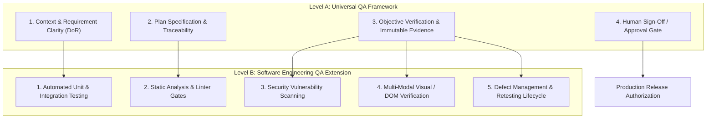
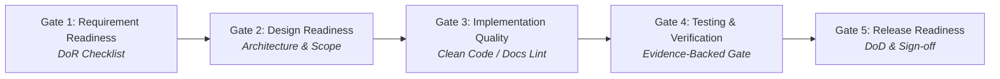

# STANDAR REKAYASA: MASTER QUALITY ASSURANCE FRAMEWORK (QA FRAMEWORK)

> **DOCUMENT ID:** STD-ENG-011-QA  
> **VERSION:** v2.0.0  
> **STATUS:** AKTIF (LEVEL 2 OPERATIONAL STANDARD)  
> **KATEGORI:** PENJAMINAN MUTU, TESTING & VERIFIKASI  
> **PENANGGUNG JAWAB:** Lead QA Role (Rujuk [config/organization.md](../../config/organization.md))  
> **OTORISASI:** Designated Approver (Rujuk [config/organization.md](../../config/organization.md), saat ini: **Yogi Ario**)  
> **ACUAN UTAMA:** [Docs/Standards/Engineering_Standards.md](Engineering_Standards.md) & [Docs/universal-rule.md](../universal-rule.md)  
> **PRINSIP UTAMA QA:**  
> - *No Verification, No Completion.*  
> - *No Evidence, No Completion.*  
> - *Quality Must Be Demonstrated, Not Assumed.*  
> - *Risk-Based & Task-Type Specific Quality Gates.*  
> **KATA KUNCI NORMATIF:** RFC 2119 (MUST, MUST NOT, SHOULD, RECOMMENDED, MAY).

---

## 1. Pendahuluan & Pemisahan Kerangka Mutu Universal vs Rekayasa Perangkat Lunak

Quality Assurance (QA) bukan sekadar aktivitas pemeriksaan akhir untuk mencari bug sebelum rilis, melainkan sistem pengendalian mutu proaktif yang terintegrasi di seluruh siklus hidup pengerjaan tugas.

Guna menjaga universalitas standar, kerangka QA dibagi menjadi dua tingkatan:



1. **Universal QA Framework (Tingkat Umum):** Mengikat seluruh kategori tugas (termasuk riset, audit, dokumentasi, konfigurasi, dan rekayasa kode). Menuntut pemenuhan DoR, dokumen rencana, pembuktian objektif, dan persetujuan manusia.
2. **Software Engineering QA Extension (Tingkat Rekayasa Kode):** Diterapkan khusus untuk proyek atau tugas modifikasi kode sumber perangkat lunak, mencakup eksekusi automated test runner, analisis statis, pengujian regresi, dan pengujian browser/UI.

---

## 2. Pembedaan Terminologi Kualitas (QA Terminology)

| Istilah | Definisi Operasional | Karakteristik Utama |
| :--- | :--- | :--- |
| **Quality Assurance (QA)** | Proses terencana dan sistematis untuk **mencegah terjadinya kesalahan** sejak tahap analisis dan desain. | Proaktif, berfokus pada proses (*process-oriented*), mencegah defect lahir. |
| **Quality Control (QC)** | Aktivitas operasional untuk **memeriksa dan mengevaluasi hasil kerja** apakah telah sesuai spesifikasi. | Reaktif, berfokus pada produk (*product-oriented*), menyaring defect sebelum rilis. |
| **Testing** | Aktivitas mengeksekusi skrip atau interaksi sistem untuk **menemukan kegagalan atau bug**. | Eksekusi teknis, menjalankan test case terencana (unit, integration, E2E). |
| **Verification** | Pemeriksaan objektif apakah produk dibangun sesuai dengan spesifikasi teknis dan desain yang disepakati (*"Are we building the product right?"*). | Menguji kesesuaian terhadap dokumen arsitektur, kontrak API, dan coding standard. |
| **Validation** | Pemeriksaan objektif apakah produk yang dibangun benar-benar memenuhi kebutuhan dan tujuan akhir pengguna (*"Are we building the right product?"*). | Menguji kesesuaian terhadap *user requirements* dan sasaran bisnis. |

---

## 3. Lima Gerbang Kualitas Proporsional (The 5 Risk-Based Quality Gates)

Setiap tahapan pengembangan dalam proyek **MUST** melewati gerbang kualitas bertingkat sebelum diizinkan melangkah ke tahapan berikutnya:



### 3.1 Penerapan Gerbang Berdasarkan Jenis Tugas (Task-Type Tailoring)

| Jenis Tugas | Gate 1 (Req) | Gate 2 (Design) | Gate 3 (Impl/Syntax) | Gate 4 (Verification) | Gate 5 (Release) |
| :--- | :---: | :---: | :---: | :---: | :---: |
| **Software Coding** | REQ ID & DoR | ADR / Skema DB | Linter & Clean Code | Test Suite + Evidensi | DoD + Approver Sign-off |
| **Documentation / Audit** | Ruang Lingkup Dokumen | Struktur & Outline | Markdown Lint / Broken Link | Verifikasi Link & Diff | Reviewer + Approver Sign-off |
| **Data / Research** | Hipotesis / Brief | Metodologi | Sanitasi Data | Replikasi Analisis | Approver Sign-off |

### 3.2 Kriteria Kelulusan Gerbang Mutu:
- **Gate 1 — Requirement Readiness:** DoR terpenuhi, tidak ada asumsi liar yang belum terkonfirmasi.
- **Gate 2 — Design Readiness:** Desain modular, analisis trade-off tercatat, target file whitelist disepakati.
- **Gate 3 — Implementation Quality:** Clean & surgical coding, linter 0 error, zero secret leakage.
- **Gate 4 — Testing & Verification:** Seluruh pengujian wajib dan relevan lulus (*PASS*), evidensi tersimpan, tidak ada open critical defect. Pengecualian/N/A didokumentasikan sah.
- **Gate 5 — Release Readiness:** Kriteria DoD terpenuhi, changelog dibuat, dan otorisasi tertulis diperoleh dari Designated Approver.

---

## 4. Alur Kerja QA 15-Langkah (15-Step QA Workflow)

```text
===================================================================================
 FASE 1: PERENCANAAN & ANALISIS MUTU
 1. Understand Requirements      : Memvalidasi kebutuhan & batasan sistem (Prinsip 1).
 2. Define Quality Criteria       : Menetapkan ambang batas keberhasilan & Acceptance Criteria.
 3. Prepare Test Strategy         : Menentukan tingkat pengujian berbasis risiko (Risk-Based).
 4. Prepare Test Cases            : Menyusun skenario uji terstruktur (TC-[MODULE]-[NUM]).
 5. Prepare Test Environment      : Menyiapkan isolasi environment & synthetic test data.
===================================================================================
 FASE 2: EKSEKUSI & PENGELOLAAN DEFECT
 6. Execute Tests                 : Menjalankan test suite otomatis, verifikasi CLI / browser.
 7. Record Results                : Mencatat status hasil aktual (PASS, FAIL, BLOCKED, SKIPPED).
 8. Analyze Defects               : Mengklasifikasi bug berdasarkan Severity vs Priority.
 9. Fix and Retest                : Memperbaiki kode & melakukan retesting terisolasi.
 10. Execute Regression Tests     : Memastikan tidak ada kerusakan pada fitur eksisting.
===================================================================================
 FASE 3: VERIFIKASI, BUKTI & GERBANG RILIS
 11. Verify Acceptance Criteria   : Memvalidasi pemenuhan seluruh kriteria penerimaan.
 12. Collect Evidence             : Mengarsip log terminal, hash, atau screenshot di Docs/Evidence/.
 13. Evaluate Quality Gates       : Memeriksa kelulusan Gate 1 s.d. Gate 5.
 14. Prepare QA Report            : Memperbarui Docs/Test_Report.md & flat changelog.
 15. Release Readiness Review     : Memohon otorisasi rilis produksi kepada Designated Approver.
===================================================================================
```

---

## 5. Metrik Kualitas Perangkat Lunak (Quality Metrics)

1. **Requirement Coverage (%):**  
   Target: **100%** untuk seluruh kebutuhan fungsional kritis (*Must Have*).
2. **Mandatory Test Pass Rate (%):**  
   Target: **100%** kasus uji wajib yang relevan lulus (0 GAGAL / 0 ERROR pada pengujian mandatory).
3. **Defect Escape Rate (%):**  
   Rasio bug yang lolos ke lingkungan staging/produksi dibanding total bug yang ditemukan selama pengembangan. Target: `< 5%`.
4. **Code Coverage (%):**  
   Target sehat: `>= 80%` pada layer domain/logika bisnis. Peringatan: Coverage tinggi bukan jaminan bebas bug fungsional.
5. **Mean Time to Resolve (MTTR):**  
   Rata-rata waktu penyelesaian dan pengujian ulang defect teridentifikasi.

---

## 6. Rujukan Terkait
- Strategi Pengujian: [Testing_Strategy.md](Testing_Strategy.md)
- Standar Evidensi: [Verification_Evidence.md](Verification_Evidence.md)
- Pengelolaan Cacat: [Defect_Management.md](Defect_Management.md)
- Checklist Verifikasi: [Docs/Verification_Checklist.md](../Verification_Checklist.md)
- Laporan Pengujian: [Docs/Test_Report.md](../Test_Report.md)
- Konfigurasi Organisasi: [config/organization.md](../../config/organization.md)
