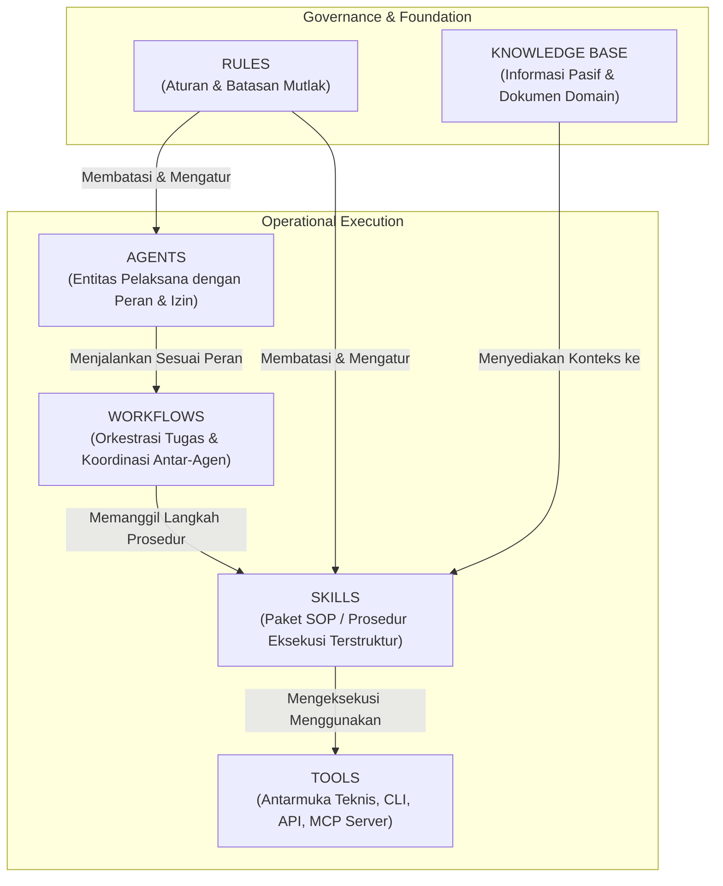

# STANDAR REKAYASA: ARSITEKTUR SISTEM SKILL KARYAWAN AI (SKILL ARCHITECTURE)

> **STATUS:** AKTIF (LEVEL 2 STANDARD)  
> **NOMOR DOKUMEN:** STD-ENG-008-SKL  
> **KATEGORI:** STANDAR ARSITEKTUR KEMAMPUAN AI  
> **PENANGGUNG JAWAB:** Bagus Restu (AI Engineering Lead)  
> **OTORISASI:** Yogi Ario (Project Owner)  
> **FILOSOFI DASAR:**  
> - *Consistent Standards, Variable Intelligence.*  
> **PRINSIP UTAMA:**  
> - *No Validated Skill, No Production Use.*  
> **KATA KUNCI NORMATIF:** RFC 2119 (MUST, MUST NOT, SHOULD, RECOMMENDED, MAY).

---

## 1. Pendahuluan & Filosofi Sistem Skill

Sistem **Skill Karyawan AI (*AI Employee Skill System*)** merupakan kerangka kerja terstandarisasi untuk mendokumentasikan, mengemas, menguji, memvalidasi, dan mengeksekusi kemampuan operasional AI Agent. 

Skill bukan sekadar instruksi *prompt* panjang atau perintah percakapan lepas. Skill merupakan **aset pengetahuan operasional terstruktur (*Standard Operating Procedures / SOP*)** yang menjamin AI Agent mampu menyelesaikan tugas secara konsisten, aman, terukur, dan dapat digunakan kembali (*reusable*) lintas agen dan proyek.

### 1.1 Filosofi "Consistent Standards, Variable Intelligence"
Setiap model bahasa atau agen AI dapat memiliki tingkat kecerdasan, parameter kontekstual, dan spesialisasi peran yang berbeda (*Variable Intelligence*). Namun demikian, seluruh agen **MUST** beroperasi di bawah standar struktur, siklus hidup, pengujian, kontrol akses, dan pembuktian yang seragam (*Consistent Standards*).

### 1.2 Prinsip Mutlak "No Validated Skill, No Production Use"
AI Agent **MUST NOT** menggunakan skill apa pun di lingkungan produksi (*production environment*) sebelum skill tersebut secara formal berstatus **VALIDATED** (lulus 6 dimensi pengujian) dan **APPROVED** (memperoleh otorisasi tertulis dari Project Owner).

---

## 2. Batas Konseptual Komponen Sistem AI (Conceptual Boundaries)

Untuk mencegah ambiguitas tanggung jawab dan tumpang tindih desain, sistem membedakan 6 komponen inti:



1. **Rules (Aturan):**
   Ketentuan tata kelola mutlak yang **MUST NOT** dilanggar dalam kondisi apa pun (misal: *Universal Governance*, 6 Prinsip Tata Kelola, *Clean Main Policy*). Rules berada di atas hierarki seluruh komponen.
2. **Skills (Kemampuan Prosedural):**
   Paket panduan kerja terstruktur (*executable operational SOP*) yang menjelaskan **BAGAIMANA** suatu pekerjaan spesifik diselesaikan langkah demi langkah, input apa yang dibutuhkan, batasan apa yang berlaku, dan output apa yang harus dihasilkan.
3. **Tools (Alat Teknis):**
   Antarmuka teknis fisik yang digunakan agen saat bekerja, seperti command line (PowerShell/Bash), Chrome DevTools MCP, Git, file reader/writer, API eksternal, atau compiler. Tool adalah sarana eksekusi, bukan prosedur itu sendiri.
4. **Agents (Agen Pelaksana):**
   Entitas AI otonom atau semi-otonom yang memiliki peran (*role*), batas kewenangan, dan tanggung jawab pekerjaan (misal: *Manager*, *Researcher*, *Creator*, *Developer*, *Reviewer*, *QA Agent*).
5. **Workflows (Alur Kerja Terpadu):**
   Rangkaian urutan pekerjaan tingkat tinggi yang mengorkestrasi keterlibatan antar-agen atau antarlangkah dari awal hingga akhir (misal: *12-Step Engineering Workflow*, *15-Step QA Workflow*).
6. **Knowledge Base (Basis Pengetahuan):**
   Repositori informasi, spesifikasi bisnis, skema basis data, dan referensi domain pasif yang dibaca agen sebagai acuan konteks saat mengeksekusi skill.

---

## 3. Klasifikasi Skill Multi-Disiplin (Skill Classification)

Skill dikelompokkan ke dalam taksonomi berbasis fungsi dan domain untuk memudahkan pencarian (*discovery*) dan kontrol izin:

### 3.1 A. General Skills (`general/`)
Kemampuan dasar yang dapat diterapkan lintas domain dan peran:
- `SKL-GEN-RES`: *Information & Web Research*
- `SKL-GEN-DOC`: *Document Analysis & Extraction*
- `SKL-GEN-SUM`: *Context & Meeting Summarization*
- `SKL-GEN-PLN`: *Operational & Task Planning*
- `SKL-GEN-REP`: *Technical & Progress Report Writing*
- `SKL-GEN-DAT`: *Exploratory Data Analysis*
- `SKL-GEN-QAR`: *Quality & Compliance Review*

### 3.2 B. Software Engineering Skills (`software-engineering/`)
Kemampuan spesifik siklus rekayasa perangkat lunak:
- `SKL-ENG-REQ`: *Requirement Analysis & Specification*
- `SKL-ENG-ARC`: *Architecture & Modular System Design*
- `SKL-ENG-REV`: *Surgical Code Review & Static Analysis*
- `SKL-ENG-DBG`: *Systematic Root-Cause Debugging*
- `SKL-ENG-TST`: *Multi-Tier Automated Testing*
- `SKL-ENG-DBA`: *Relational Database & Migration Design*
- `SKL-ENG-API`: *REST/GraphQL Contract Design & Integration*
- `SKL-ENG-SEC`: *Vulnerability Assessment & Security Review*
- `SKL-ENG-DOC`: *Engineering & Technical Documentation*

### 3.3 C. Business Skills (`business/`)
Kemampuan analitis dan operasional komersial:
- `SKL-BUS-MKT`: *Market & Competitor Analysis*
- `SKL-BUS-ANA`: *Business Process Modeling & Gap Analysis*
- `SKL-BUS-PRO`: *Proposal & Bid Development*
- `SKL-BUS-FIN`: *Basic Financial Modeling & Unit Economics*
- `SKL-BUS-CSU`: *Customer Communication & Inquiry Handling*

### 3.4 D. Creative Skills (`creative/`)
Kemampuan kreasi konten dan visual:
- `SKL-CRE-WRI`: *Copywriting & Content Strategy*
- `SKL-CRE-DES`: *UI/UX Wireframing & Design Assistance*
- `SKL-CRE-PRS`: *Executive Presentation Deck Development*
- `SKL-CRE-CRV`: *Creative Quality & Brand Consistency Review*

### 3.5 E. Domain-Specific Skills (`domain-specific/`)
Kemampuan dengan regulasi, terminologi, dan risiko ketat (memerlukan *sandboxing* dan *human-in-the-loop* wajib):
- `SKL-DOM-EDU`: *Educational Curriculum & Learning Assessment*
- `SKL-DOM-LEG`: *Contract Clause Identification & Legal Compliance*
- `SKL-DOM-HLT`: *Medical Literature Synthesis (Non-diagnostic)*
- `SKL-DOM-FIN`: *Regulatory Financial Audit & Fraud Pattern Detection*

---

## 4. Struktur Direktori Standar Repositori Skill

Seluruh modul skill disimpan di bawah direktori `coding template/skills/` dengan hierarki modular berikut:

```text
coding template/
└── skills/
    ├── README.md                                      <- Master index & petunjuk penggunaan
    ├── template/
    │   └── SKILL.md                                   <- Master template rujukan SKILL.md
    ├── general/
    │   └── <skill-name>/
    │       ├── SKILL.md                               <- Dokumen prosedur operasional resmi
    │       ├── test_cases.md                          <- Skenario uji tervalidasi
    │       ├── evaluation_rubric.md                   <- Rubrik penilaian kualitas output
    │       └── changelog.md                           <- Catatan pembaruan internal skill
    ├── software-engineering/
    │   └── <skill-name>/
    │       └── SKILL.md
    ├── business/
    ├── creative/
    └── domain-specific/
```

---

## 5. Struktur Wajib Berkas `SKILL.md` (The 18 Mandatory Attributes)

Setiap berkas `SKILL.md` **MUST** memuat 18 atribut baku berikut tanpa pengecualian:

| No | Atribut Wajib | Tipe Data / Format | Deskripsi & Tujuan |
| :-: | :--- | :--- | :--- |
| **1** | **Skill Name** | String | Nama resmi kemampuan (misal: *Surgical Code Review*). |
| **2** | **Skill ID** | String (`SKL-[CAT]-[CODE]-[NUM]`) | Pengidentifikasi unik global (misal: `SKL-ENG-REQ-001`). |
| **3** | **Version** | SemVer (`vMAJOR.MINOR.PATCH`) | Nomor versi semantik terikat changelog. |
| **4** | **Description** | Paragraf | Ringkasan singkat kapabilitas skill (1-2 kalimat). |
| **5** | **Purpose** | Paragraf / Bullet | Alasan keberadaan skill dan nilai tambah operasionalnya. |
| **6** | **Scope & Boundaries** | Tabel / Bullet | Batas tegas apa yang termasuk (*In-Scope*) dan dilarang (*Out-of-Scope*). |
| **7** | **Intended Agent Roles** | Array / List | Peran agen yang berhak mengeksekusi (*Developer*, *Reviewer*, dsb.). |
| **8** | **Prerequisites** | List | Kondisi awal dan data masukan yang wajib ada sebelum mulai. |
| **9** | **Required Tools** | List Tool / MCP | Alat teknis yang wajib tersedia (CLI, Git, DevTools, dsb.). |
| **10** | **Input Specification** | Schema / Format | Spesifikasi format data masukan yang diterima. |
| **11** | **Output Specification** | Schema / Template | Struktur dan format artefak keluaran yang dihasilkan. |
| **12** | **Execution Procedure** | Ordered List (1..N) | Prosedur langkah demi langkah (*SOP*) eksekusi skill. |
| **13** | **Constraints & Fallback** | List | Batasan teknis dan prosedur mitigasi bila terjadi kegagalan. |
| **14** | **Safety & Security** | List / Checklist | Pencegahan kebocoran secret, prompt injection, dan isolasi tools. |
| **15** | **Quality Criteria** | Rubrik / Ambang Batas | Standar mutu minimal output untuk dinyatakan lulus. |
| **16** | **Validation Method** | Referensi Uji | Cara pembuktian validitas skill terhadap test case. |
| **17** | **Evidence Requirements** | List Bukti | Bukti nyata yang wajib dilampirkan (log, diff, screenshot). |
| **18** | **Known Limitations** | List | Kelemahan atau kondisi di mana skill tidak boleh digunakan. |

---

## 6. Prinsip Penggunaan Kembali (Skill Reusability Principles)

1. **Pemisahan Logika Umum vs Spesifik Proyek:**
   Skill pada kategori *General* dan *Software Engineering* **MUST NOT** diikat (*hardcoded*) ke nama proyek atau framework tertentu. Kebutuhan spesifik proyek disuplai melalui parameter input atau konfigurasi.
2. **Parameterisasi di Atas Duplikasi:**
   Jika dua kebutuhan pekerjaan memiliki 80% alur yang sama, pengembang skill **MUST NOT** membuat dua skill duplikat. Gunakan parameter fleksibel pada `Input Specification`.
3. **Pencatatan Dependensi Eksplisit:**
   Skill yang membutuhkan output dari skill lain **MUST** mencantumkan ID dependensi secara jelas pada atribut `Prerequisites`.
4. **Asumsi Ketiadaan Tools (Graceful Degradation):**
   Skill **MUST NOT** mengasumsikan tools selalu tersedia atau selalu berhasil. Setiap skill wajib menyediakan prosedur *Fallback* yang aman.

---

## 7. Rujukan Terkait
- Master Governance: [`universal-rule.md`](../universal-rule.md)
- Standar Rekayasa: [`Engineering_Standards.md`](Engineering_Standards.md)
- QA Framework: [`QA_Framework.md`](QA_Framework.md)
- Siklus Hidup & Hak Akses: [`Skill_Lifecycle_Governance.md`](Skill_Lifecycle_Governance.md)
- Validasi & Pengujian Skill: [`Skill_Validation_Testing.md`](Skill_Validation_Testing.md)
- Registri Skill Aktif: [`Skill_Registry.md`](../Skill_Registry.md)
