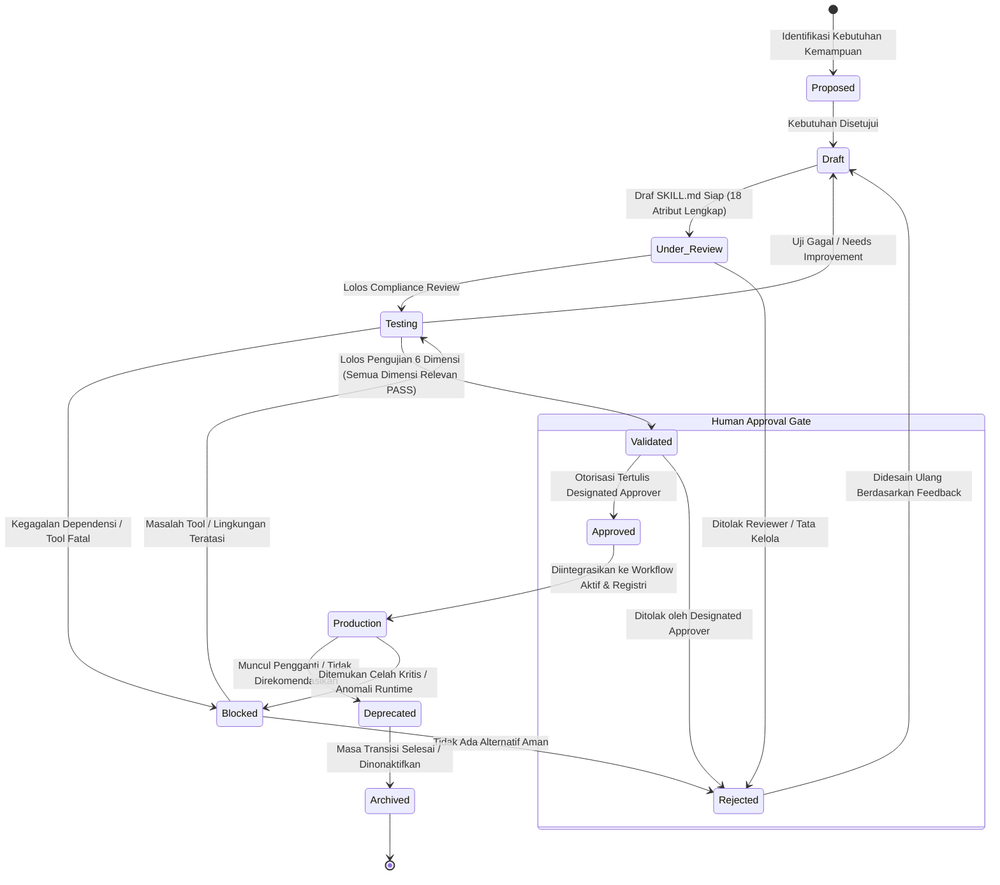

# STANDAR REKAYASA: TATA KELOLA SIKLUS HIDUP & HAK AKSES SKILL (SKILL LIFECYCLE & GOVERNANCE)

> **STATUS:** AKTIF (LEVEL 2 OPERATIONAL STANDARD)  
> **NOMOR DOKUMEN:** STD-ENG-009-SKL  
> **VERSION:** v2.0.0  
> **KATEGORI:** TATA KELOLA SIKLUS HIDUP & KEAMANAN SKILL  
> **PENANGGUNG JAWAB:** Lead Developer Role (Rujuk [config/organization.md](../../config/organization.md))  
> **OTORISASI:** Designated Approver (Rujuk [config/organization.md](../../config/organization.md), saat ini: **Yogi Ario**)  
> **PRINSIP UTAMA:**  
> - *No Validated Skill, No Production Use.*  
> - *Validated $\neq$ Approved $\neq$ Production.*  
> - *Resilient Lifecycle with Defined BLOCKED and REJECTED Paths.*  
> **KATA KUNCI NORMATIF:** RFC 2119 (MUST, MUST NOT, SHOULD, RECOMMENDED, MAY).

---

## 1. Pendahuluan

Dokumen ini mengatur siklus hidup formal, tata kelola izin (*access control*), pemeliharaan versi semantik, alur pengembangan, dan alur eksekusi operasional seluruh skill AI dalam ekosistem *Universal AI Engineering Standard*.

Setiap kemampuan baru yang dibangun untuk AI Agent **MUST** dikelola melalui siklus hidup terkontrol demi menjamin keamanan, keandalan, dan keterlacakan institusional.

---

## 2. Status Siklus Hidup Skill & Mesin Status (Lifecycle States & State Machine)

Siklus hidup skill dikelola melalui status formal dengan kriteria transisi yang terdefinisi ketat:



### 2.1 Kriteria Transisi Setiap Status

| Status | Definisi Operasional | Syarat Masuk (Entry Criteria) | Syarat Keluar (Exit Criteria) |
| :--- | :--- | :--- | :--- |
| **1. Proposed** | Kebutuhan kemampuan baru diidentifikasi dan diajukan. | Adanya tiket kebutuhan atau celah operasional yang teridentifikasi. | Deskripsi masalah, tujuan, dan estimasi nilai disetujui lead agent. |
| **2. Draft** | Spesifikasi teknis dan prosedur SOP sedang ditulis. | Formulir skill dibuat dengan status Draft. | 18 atribut wajib terisi lengkap dan siap ditinjau. |
| **3. Under Review** | Peninjauan kepatuhan terhadap Governance dan standar teknis. | Dokumen `SKILL.md` lengkap diserahkan ke *Reviewer Agent*. | Tidak ada pelanggaran tata kelola, tidak ada eskalasi wewenang, skenario uji disepakati. |
| **4. Testing** | Pengujian terhadap test suite fungsional dan edge cases. | Lingkungan pengujian terisolasi dan data uji sintetis siap. | Eksekusi seluruh skenario uji menghasilkan bukti nyata (*logs/diffs*). |
| **5. Blocked** | Pengujian atau eksekusi terhenti akibat kegagalan alat/lingkungan. | Tool crash, rate limit provider, dependensi hilang, atau permission denied. | Akar masalah teknis teratasi, tool fallback diverifikasi, atau eskalasi selesai. |
| **6. Rejected** | Usulan atau hasil uji ditolak karena tidak layak atau berisiko tinggi. | Pelanggaran regulasi Level 1, skor rubrik tidak memenuhi ambang batas, atau veto manusia. | Didesain ulang ke status Draft dengan revisi menyeluruh, atau dibatalkan permanen. |
| **7. Validated** | Skill terbukti lulus secara teknis dan memenuhi ambang mutu. | Seluruh dimensi validasi yang relevan berstatus **PASS** dengan bukti terverifikasi. | Laporan evaluasi diserahkan ke gerbang persetujuan manusia. |
| **8. Approved** | Memperoleh persetujuan resmi manusia/Designated Approver. | Permohonan otorisasi formal diajukan kepada Designated Approver. | **Otorisasi tertulis eksplisit dari Designated Approver** telah diberikan. |
| **9. Production** | Skill resmi aktif digunakan dalam pekerjaan operasional nyata. | Tercatat resmi pada `Skill_Registry.md` dengan status Production setelah live test. | Muncul versi baru yang menggantikan, atau ditemukan cacat keamanan kritis. |
| **10. Deprecated**| Skill ditandai usang; tidak diizinkan untuk tugas baru. | Ada rilis versi baru atau perubahan arsitektur yang mendasarinya. | Seluruh alur kerja aktif telah bermigrasi ke skill pengganti. |
| **11. Archived**  | Skill dinonaktifkan secara permanen dan disimpan sebagai riwayat. | Masa tenggang penghentian (*sunset period*) berakhir. | Berkas dipindahkan ke direktori arsip; tidak dapat dipanggil agen. |

---

## 3. Penegasan Batas: "Validated $\neq$ Approved $\neq$ Production"

AI Agent dan pengembang sistem **MUST** memahami perbedaan mendasar ketiga status ini:

> [!CRITICAL]
> 1. **VALIDATED:** Merupakan penilaian kelayakan teknis murni (*technical verification*). Menunjukkan bahwa prosedur skill bekerja sesuai rancangan dan lolos skenario pengujian. **Validasi teknis TIDAK memberikan izin penggunaan di lingkungan produksi.**
> 2. **APPROVED:** Merupakan persetujuan tata kelola (*governance authorization*). Diberikan secara tertulis oleh Designated Approver setelah meninjau bukti evaluasi teknis.
> 3. **PRODUCTION:** Merupakan status operasional aktif (*operational deployment*). Skill telah terdaftar dalam registri produksi dan terbukti stabil dalam uji percontohan (*pilot verification*).

---

## 4. Standar Hak Akses & Kontrol Kewenangan (Skill Permissions & Access Control)

### 4.1 Prinsip Pembatasan Hak Akses
1. **Tidak Ada Eskalasi Kewenangan (No Privilege Escalation):**  
   Skill **MUST NOT** memberikan kewenangan atau izin eksekusi yang melebihi batas kewenangan dasar peran agen pelaksana (*principle of least privilege*).
2. **Kepatuhan Governance Mutlak:**  
   Skill **MUST NOT** digunakan untuk memotong, mengelabui, atau menggugurkan *Universal Governance* (misal: dilarang ada skill yang melakukan bypass approval gate atau direct push ke branch `main`).
3. **Pencabutan Izin Segera (Immediate Revocation):**  
   Jika ditemukan kerentanan keamanan, kebocoran data, atau anomali kegagalan fatal pada skill production, Designated Approver atau QA Agent berhak mengubah status skill menjadi **BLOCKED** atau **DEPRECATED** seketika.

### 4.2 Matriks Hak Akses Peran Agen terhadap Kategori Skill

| Peran Agen | General Skills | Software Eng Skills | Business Skills | Creative Skills | Domain-Specific Skills |
| :--- | :---: | :---: | :---: | :---: | :---: |
| **Manager** | Execute & Audit | View & Audit | Execute & Audit | Review Only | Approval Required |
| **Developer** | Execute | Execute & Propose | View Only | View Only | Sandboxed Execute |
| **Reviewer** | Execute | Audit & Review | Audit & Review | Execute & Review | Approval Required |
| **QA Agent** | Execute | Test & Validate | Audit Only | Test Only | Sandboxed Test |
| **Researcher** | Execute | View Specs | Execute & Read | View Only | Restricted Read |

---

## 5. Standar Versi Semantik & Pemeliharaan Skill (Versioning & Maintenance)

### 5.1 Format Versi Semantik
Setiap skill wajib menggunakan pola Semantic Versioning (SemVer):
$$\text{v}[\text{MAJOR}].[\text{MINOR}].[\text{PATCH}]$$

- **MAJOR (Perubahan Memecah / Breaking Changes):**  
  Perubahan pada `Input Specification`, `Output Specification`, atau dependensi yang tidak kompatibel ke belakang. Wajib melalui revalidasi penuh dan approval ulang.
- **MINOR (Penambahan Fitur Kompatibel):**  
  Penambahan fungsionalitas baru, pengayaan langkah SOP, atau perluasan peran agen tanpa merusak skema input-output yang ada.
- **PATCH (Perbaikan Bug & Dokumentasi):**  
  Koreksi redaksional, penyempurnaan deskripsi batasan, atau perbaikan kecil pada penanganan edge cases.

### 5.2 Pemicu Validasi Ulang Wajib (Mandatory Revalidation Triggers)
Skill production **MUST** divalidasi ulang apabila:
1. Tool teknis atau versi MCP Server yang menjadi dependensinya diperbarui.
2. Lingkungan runtime (Node.js, Python, OS) mengalami upgrade versi mayor.
3. Ditemukan anomali kegagalan eksekusi (*flaky output*) di lingkungan operasional.
4. Terjadi perubahan pada regulasi tata kelola (*Level 1 Governance Rules*).

---

## 6. Alur Kerja Pembuatan Skill (16-Step Skill Development Workflow)

```text
===================================================================================
 TAHAP 1: IDENTIFIKASI & PERANCANGAN (STEPS 1 - 5)
 1. Identify Capability Need     : Mendeteksi pekerjaan repetitif yang memerlukan SOP.
 2. Define Skill Objective       : Menetapkan target output dan batasan operasional.
 3. Define Scope and Constraints : Menentukan batas In-Scope dan Out-of-Scope tegas.
 4. Prepare Skill Specification  : Mengisi formulir Skill_Specification_Template.md.
 5. Create Draft SKILL.md        : Menulis draf lengkap dengan 18 atribut wajib.
===================================================================================
 TAHAP 2: PENINJAUAN & PENGUJIAN (STEPS 6 - 10)
 6. Conduct Rule Compliance      : Memeriksa kepatuhan terhadap Universal Governance.
 7. Prepare Test Cases           : Menyusun skenario pengujian fungsional & edge case.
 8. Execute Functional Testing   : Menjalankan pengujian prosedur baku (happy path).
 9. Conduct Edge Case Testing    : Menguji input ambigu, data hilang, dan kegagalan tool.
 10. Conduct Security Review     : Memeriksa risiko tool abuse dan kebocoran rahasia.
===================================================================================
 TAHAP 3: EVALUASI, APPROVAL & RILIS (STEPS 11 - 16)
 11. Evaluate Results            : Menilai hasil uji terhadap rubrik evaluasi.
 12. Revise Skill                : Menyempurnakan SOP berdasarkan temuan pengujian.
 13. Conduct Regression Testing  : Memastikan revisi tidak merusak pengujian sebelumnya.
 14. Submit for Approval         : Mengajukan status VALIDATED kepada Designated Approver.
 15. Authorize Production Use    : Memperoleh persetujuan tertulis (APPROVED -> PRODUCTION).
 16. Monitor and Maintain        : Memantau performa operasional & mengelola changelog.
===================================================================================
```

---

## 7. Alur Kerja Eksekusi Skill 10-Langkah (10-Step Skill Execution Workflow)

Setiap kali agen hendak menjalankan suatu skill, agen **MUST** mematuhi 10 langkah eksekusi berikut:

1. **Identifikasi Kebutuhan:** Pastikan tugas yang dihadapi memang sesuai dengan peruntukan skill.
2. **Periksa Registri Skill:** Buka [Docs/Skill_Registry.md](../Skill_Registry.md) dan pastikan ID skill terdaftar.
3. **Periksa Status Skill:** Verifikasi bahwa status skill adalah **PRODUCTION** (atau **VALIDATED** jika sedang dalam pengujian).
4. **Periksa Kompatibilitas Peran:** Pastikan peran agen pelaksana tercantum dalam `Intended Agent Roles`.
5. **Periksa Dependensi & Tools:** Pastikan alat teknis yang disyaratkan (CLI, Git, MCP) tersedia dan berfungsi normal.
6. **Periksa Izin Pekerjaan:** Pastikan jenis pekerjaan tidak memerlukan otorisasi terpisah dari Designated Approver.
7. **Validasi Input Masukan:** Pastikan parameter masukan lengkap dan valid sesuai `Input Specification`.
8. **Jalankan Prosedur Kerja (SOP):** Ikuti langkah-langkah pada `Execution Procedure` secara disiplin tanpa improvisasi liar.
9. **Evaluasi Artefak Keluaran:** Periksa hasil akhir terhadap `Quality Criteria` dan `Output Specification`.
10. **Catat Hasil & Bukti Eksekusi:** Simpan log atau bukti hasil verifikasi pada dokumen tugas ([Docs/Task_Status.md](../Task_Status.md) / [Docs/Test_Report.md](../Test_Report.md)).

---

## 8. Rujukan Terkait
- Arsitektur Skill: [Skill_Architecture.md](Skill_Architecture.md)
- Standar Pengujian Skill: [Skill_Validation_Testing.md](Skill_Validation_Testing.md)
- Registri Skill Aktif: [Docs/Skill_Registry.md](../Skill_Registry.md)
- QA Framework: [QA_Framework.md](QA_Framework.md)
- Konfigurasi Organisasi: [config/organization.md](../../config/organization.md)
