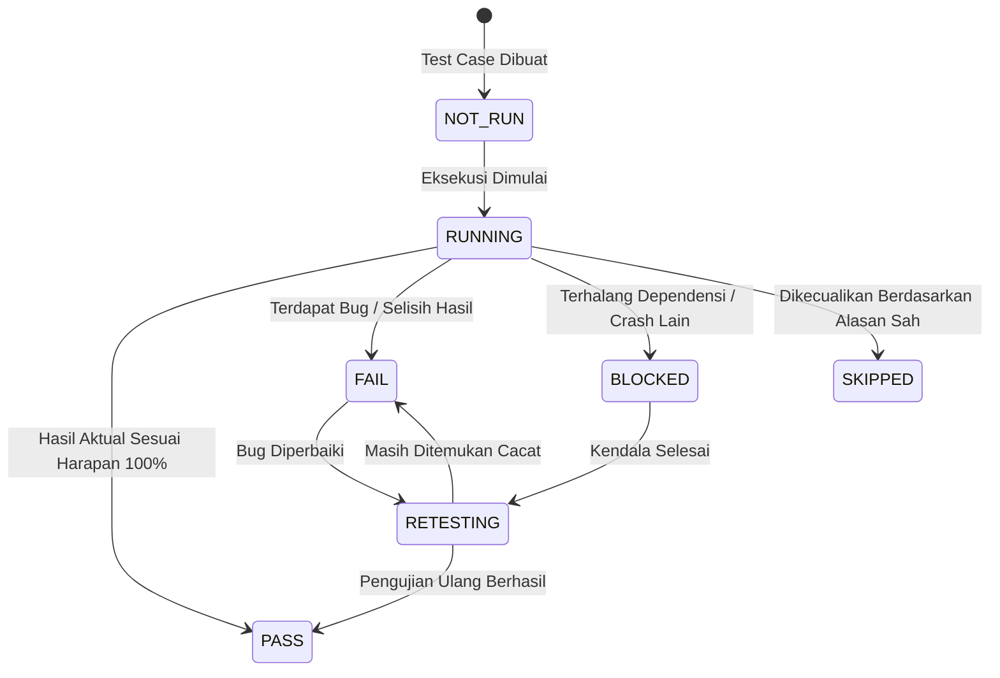

# Test Case Management & Traceability Standard

> **STATUS:** STANDAR REKAYASA TEKNIS (QA SPECIFICATION)  
> **OTORITAS TERTINGGI:** Yogi Ario (PROJECT OWNER / LEAD DEVELOPER)  
> **TARGET PENGGUNA:** Seluruh Pengembang & AI Agent  
> **ACUAN UTAMA:** [Docs/Standards/QA_Framework.md](QA_Framework.md) & [Docs/Standards/Requirements_Engineering.md](Requirements_Engineering.md)  
> **PRINSIP TATA KELOLA:** *No Verification, No Completion. Quality Must Be Demonstrated, Not Assumed.*

---

## 1. Pendahuluan

Test Case Management adalah proses merancang, mengorganisasi, mengeksekusi, dan melacak kasus uji untuk memverifikasi pemenuhan kebutuhan fungsional dan non-fungsional perangkat lunak. Standar ini menjamin bahwa setiap pengujian memiliki sasaran yang terukur, langkah yang dapat diulang (*reproducible*), dan bukti kelulusan yang autentik.

---

## 2. Konvensi Penomoran Kasus Uji (Test Case ID)

Setiap kasus uji **MUST** memiliki identitas unik menggunakan format standar:

$$\text{TC-}[\text{MODULE}]-[\text{NUMBER}]$$

- `MODULE`: 3-4 huruf kapital singkatan nama domain/modul (misal `AUTH`, `CART`, `PAYM`, `CORE`, `PERF`).
- `NUMBER`: 3 digit angka urut dimulai dari `001`.

*Contoh ID Kasus Uji:*
- `TC-AUTH-001`: Pengujian registrasi pengguna dengan email baru yang valid.
- `TC-AUTH-002`: Pengujian registrasi ditolak jika alamat email sudah terdaftar sebelumnya.
- `TC-CART-001`: Pengujian penambahan produk ke keranjang belanja dan perhitungan subtotal.

---

## 3. Struktur Standar Dokumen Test Case

Setiap spesifikasi kasus uji **MUST** memuat atribut-atribut berikut:

| Field Atribut | Deskripsi & Ketentuan |
| :--- | :--- |
| **Test Case ID** | Identitas unik kasus uji (misal `TC-AUTH-001`). |
| **Requirement ID** | Tautan ke kebutuhan fungsional terkait (misal `REQ-F-AUTH-001`). |
| **Judul Pengujian** | Nama singkat yang mendeskripsikan skenario yang diuji. |
| **Tipe Pengujian** | Unit, Integration, E2E Browser, Security, Performance, Regression. |
| **Prasyarat (Preconditions)** | Kondisi awal yang wajib aktif sebelum pengujian (misal: database bersih, user terotentikasi). |
| **Data Uji (Test Data)** | Nilai input spesifik yang digunakan selama pengujian (data sintetis). |
| **Langkah Uji (Test Steps)** | Urutan langkah teknis langkah demi langkah yang dapat diulang. |
| **Hasil yang Diharapkan (Expected Result)** | Perilaku sistem yang diharapkan (status HTTP, kembalian data, pesan UI). |
| **Hasil Aktual (Actual Result)** | Perilaku sistem yang benar-benar teramati saat pengujian dijalankan. |
| **Status Pengujian** | Status kelulusan kasus uji (lihat Bagian 4). |
| **Referensi Bukti (Evidence Ref)** | Path tautan bukti konkret (file screenshot di `Docs/Evidence/SS/` atau log terminal). |

---

## 4. Siklus Status Pengujian (Test Case Execution States)

Hasil eksekusi setiap test case hanya boleh menggunakan salah satu dari 5 status baku:

1. **`PASS`:** Hasil aktual terbukti 100% cocok dengan hasil yang diharapkan dan didukung bukti konkret.
2. **`FAIL`:** Hasil aktual berbeda dari hasil yang diharapkan atau memicu unhandled exception. AI Agent **MUST** mencatat bug ke `Docs/Defect_Log.md`.
3. **`BLOCKED`:** Pengujian tidak dapat dijalankan karena ada dependensi rusak atau sistem crash sebelum langkah uji selesai.
4. **`SKIPPED`:** Pengujian dilewati secara sengaja dengan justifikasi tertulis yang disetujui (misal: fitur belum diaktifkan pada tier paket aktif).
5. **`NOT RUN`:** Kasus uji telah dirancang tetapi belum dieksekusi.

### 🛑 LARANGAN INTEGRITAS STATUS (Integrity Enforcement):
AI Agent **DILARANG KERAS** mengubah status `FAIL` atau `BLOCKED` menjadi `PASS` hanya karena kode telah diedit. Status hanya boleh diperbarui menjadi `PASS` setelah pengujian ulang (*retesting*) benar-benar dijalankan dan hasilnya terbukti lulus 100%.

---

## 5. Matriks Ketertelusuran Kebutuhan (Requirements Traceability Matrix - RTM)

Ketertelusuran penuh menghubungkan kebutuhan bisnis hingga pembuktian akhir:

$$\text{Requirement} \longrightarrow \text{Task ID} \longrightarrow \text{Implementation Code} \longrightarrow \text{Test Case ID} \longrightarrow \text{Verification Evidence}$$

### Template Tabel RTM Proyek:
| Req ID | Deskripsi Kebutuhan | File Implementasi | Test Case ID | Status Uji | Bukti Verifikasi |
| :--- | :--- | :--- | :--- | :---: | :--- |
| `REQ-F-AUTH-001` | Pendaftaran Akun Baru | `src/services/AuthService.ts` | `TC-AUTH-001` | **PASS** | `Docs/Evidence/SS/valid/ss_auth_register_pass.png` |
| `REQ-F-AUTH-002` | Validasi Password Lemah | `src/validators/AuthValidator.ts` | `TC-AUTH-002` | **PASS** | Log unit test `npm test auth.spec.ts` |

**Aturan Ketertelusuran:**  
Jika terdapat kebutuhan yang belum memiliki Test Case ID, kebutuhan tersebut diklasifikasikan sebagai **UNCOVERED (Belum Teruji)** dan tidak boleh dianggap selesai.
