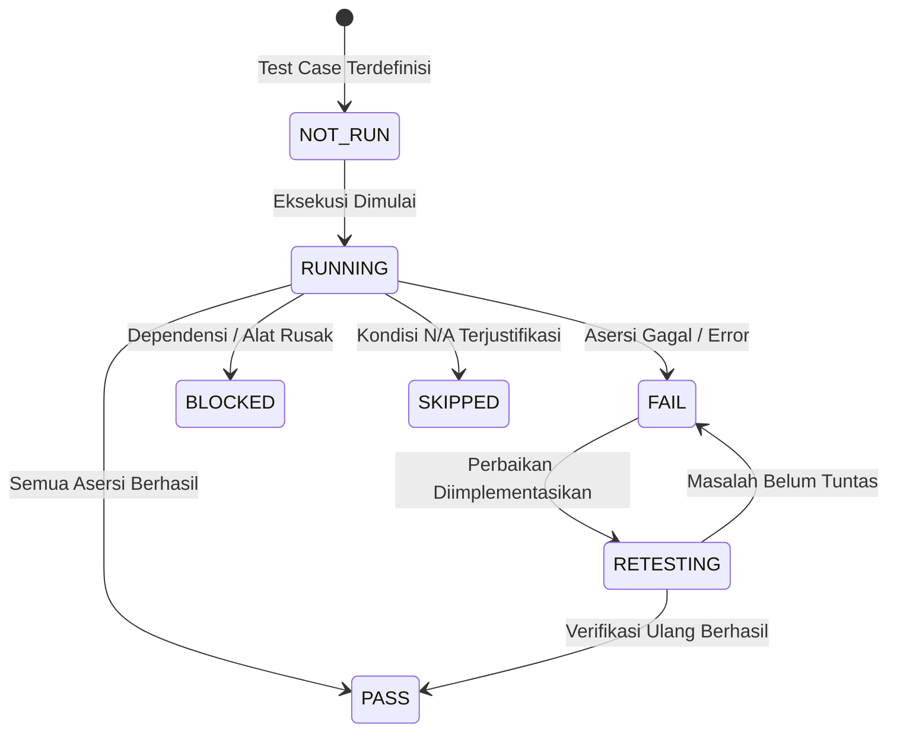

# STANDAR REKAYASA: STRATEGI PENGUJIAN & LINGKUNGAN UJI (TESTING STRATEGY)

> **DOCUMENT ID:** STD-ENG-012-TST  
> **VERSION:** v2.0.0  
> **STATUS:** AKTIF (LEVEL 2 OPERATIONAL STANDARD)  
> **KATEGORI:** PENJAMINAN MUTU, TESTING & LINGKUNGAN UJI  
> **PENANGGUNG JAWAB:** Lead QA Role (Rujuk [config/organization.md](../../config/organization.md))  
> **OTORISASI:** Designated Approver (Rujuk [config/organization.md](../../config/organization.md), saat ini: **Yogi Ario**)  
> **ACUAN UTAMA:** [Docs/Standards/QA_Framework.md](QA_Framework.md) & [Docs/Standards/Engineering_Standards.md](Engineering_Standards.md)  
> **PRINSIP TATA KELOLA:** *No Verification, No Completion. Quality Must Be Demonstrated, Not Assumed.*  
> **KATA KUNCI NORMATIF:** RFC 2119 (MUST, MUST NOT, SHOULD, RECOMMENDED, MAY).

---

## 1. Pendahuluan

Strategi pengujian (*Testing Strategy*) menetapkan pendekatan komprehensif, terstruktur, dan proporsional untuk memverifikasi kebenaran perilaku perangkat lunak. Standar ini bersifat *stack-agnostic* dan menerapkan prinsip **Risk-Based Testing**:
> **Fokuskan intensitas dan kedalaman pengujian pada area sistem yang memiliki dampak risiko dan kegagalan tertinggi (keamanan, autentikasi, integritas data, dan transaksi keuangan).**

---

## 2. Taksonomi Status Kasus Uji Terharmonisasi (Harmonized Test Case States)

Seluruh kasus uji dalam suite pengujian **MUST** menggunakan salah satu dari 7 status terharmonisasi berikut:

| Status Kasus Uji | Definisi Operasional | Ketentuan Tata Kelola |
| :--- | :--- | :--- |
| **`NOT_RUN`** | Kasus uji telah didefinisikan namun belum dieksekusi. | Dilarang menyatakan rilis jika masih ada test mandatory `NOT_RUN`. |
| **`RUNNING`** | Kasus uji sedang dalam proses eksekusi oleh runner. | Status transisi sementara selama proses automated testing. |
| **`PASS`** | Seluruh asersi berhasil terpenuhi tanpa error atau anomali. | Syarat mutlak kelulusan pengujian (*Verified*). |
| **`FAIL`** | Minimal satu asersi gagal atau terjadi unhandled exception. | Wajib dicatat sebagai defect pada [Docs/Defect_Log.md](../Defect_Log.md). |
| **`BLOCKED`** | Pengujian tidak dapat dijalankan karena alat, dependensi, atau data uji gagal. | Wajib dilaporkan melalui `MSG-BLOCKER` dan ditindaklanjuti. |
| **`SKIPPED`** | Pengujian sengaja dilewati karena kondisi lingkungan atau konfigurasi fitur. | **Wajib menyertakan justifikasi tertulis** dan disetujui reviewer. |
| **`RETESTING`** | Pengujian ulang sedang dijalankan setelah perbaikan kode dilakukan. | Memverifikasi apakah perbaikan bug berhasil tuntas tanpa regresi. |

---

## 3. Protokol Penanganan Flaky Tests (Flaky Test Management)

*Flaky test* adalah pengujian otomatis yang menghasilkan status berbeda (kadang PASS, kadang FAIL) pada basis kode yang identik tanpa perubahan logika.

1. **Larangan Mengabaikan Flaky Test:**  
   AI Agent dan pengembang **DILARANG KERAS** mengabaikan flaky test atau menjalankan ulang pengujian berkali-kali hingga beruntung mendapatkan status hijau (*retry-until-green anti-pattern*).
2. **Karantina Cepat (Quarantine Protocol):**  
   Setiap test yang terdeteksi flaky **MUST** segera dipindahkan ke grup karantina (*quarantine suite*), dicatat pada `Docs/Defect_Log.md` dengan tingkat keparahan Medium, dan diinvestigasi akar masalahnya (race condition, timeout yang terlalu ketat, atau state leaking).
3. **Syarat Reintegrasi:**  
   Test hanya boleh dikembalikan ke main test suite setelah terbukti deterministik dan lulus 10x eksekusi beruntun di lingkungan pengujian lokal.

---

## 4. Pengujian Berbasis Risiko (Risk-Based Testing Allocation)

Kedalaman dan intensitas pengujian **MUST** dialokasikan secara proporsional sesuai tingkat risiko:

| Tingkat Risiko | Karakteristik Modul | Strategi & Cakupan Wajib |
| :--- | :--- | :--- |
| **Critical Risk** | Autentikasi, enkripsi, pembayaran, saldo/transaksi finansial, basis data inti. | Unit test 100% mandatory PASS + Integration test + Security boundary test + E2E browser/CLI test + Rollback validation. |
| **High Risk** | Operasi CRUD data utama, migrasi skema tabel, integrasi webhook luar. | Unit test mandatory PASS + Integration test + Regression test suite. |
| **Medium Risk** | Filter pencarian, kalkulasi diskon, ekspor file/laporan, cache. | Unit test logika bisnis + Verifikasi hasil fungsional. |
| **Low Risk** | Penyesuaian tata letak statis, styling teks, perbaikan dokumentasi. | Structural syntax check / link integrity / visual check. |

---

## 5. Standar Lingkungan & Pengelolaan Data Pengujian

1. **Isolasi Mutlak dari Lingkungan Produksi:**  
   Pengujian otomatis maupun manual **DILARANG KERAS MENGGUNAKAN BASIS DATA PRODUKSI LANGSUNG**. Seluruh pengujian wajib berjalan pada basis data uji lokal (`sqlite::memory:`, database docker lokal, atau staging terisolasi).
2. **Determinisme Lingkungan (Reproducibility):**  
   Pengujian harus menghasilkan keluaran yang sama setiap kali dijalankan (*idempotent*). Hindari ketergantungan pada jam sistem riil yang dinamis (gunakan *time mock* bila perlu).
3. **Kewajiban Penggunaan Data Sintetis (Zero Real PII):**  
   Seluruh data uji (nama pengguna, email, nomor telepon, alamat, nomor kartu) **MUST** menggunakan data tiruan sintetis. Dilarang keras menggunakan data riil pengguna (*Personally Identifiable Information / PII*) dalam pengujian.
4. **Pembersihan Otomatis (Automated Cleanup):**  
   Setiap test case yang memutasi data wajib membersihkan kembali state sistem setelah selesai (*teardown / rollback*).

---

## 6. Rujukan Terkait
- Kerangka QA: [QA_Framework.md](QA_Framework.md)
- Standar Evidensi: [Verification_Evidence.md](Verification_Evidence.md)
- Pengelolaan Cacat: [Defect_Management.md](Defect_Management.md)
- Pelacak Defect: [Docs/Defect_Log.md](../Defect_Log.md)
- Laporan Pengujian: [Docs/Test_Report.md](../Test_Report.md)
- Konfigurasi Organisasi: [config/organization.md](../../config/organization.md)
