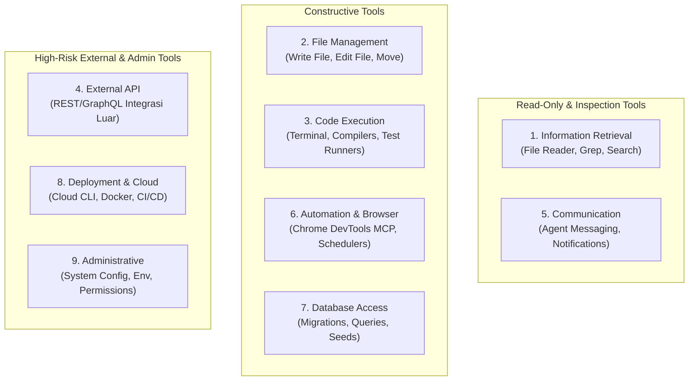

# STANDAR REKAYASA: TATA KELOLA ALAT TEKNIS & EKSEKUSI (TOOL GOVERNANCE & EXECUTION)

> **STATUS:** AKTIF (LEVEL 2 OPERATIONAL STANDARD)  
> **NOMOR DOKUMEN:** STD-ENG-013-AGT  
> **VERSION:** v2.0.0  
> **KATEGORI:** TATA KELOLA ALAT & KEAMANAN EKSEKUSI  
> **PENANGGUNG JAWAB:** Lead Developer Role (Rujuk [config/organization.md](../../config/organization.md))  
> **OTORISASI:** Designated Approver (Rujuk [config/organization.md](../../config/organization.md), saat ini: **Yogi Ario**)  
> **PRINSIP UTAMA:**  
> - *Principle of Least Privilege.*  
> - *Zero Secret Leakage.*  
> - *Never Trust Tool Output Blindly.*  
> - *Technical Enforcement Over Honor System.*  
> **KATA KUNCI NORMATIF:** RFC 2119 (MUST, MUST NOT, SHOULD, RECOMMENDED, MAY).

---

## 1. Pendahuluan

Dokumen ini mengatur standarisasi penggunaan, hak akses, batasan operasional, penanganan kegagalan, dan keamanan seluruh alat teknis (*tools*), antarmuka baris perintah (*CLI*), protokol integrasi, dan *Model Context Protocol (MCP) Server* yang digunakan oleh AI Agent dalam ekosistem *Universal AI Engineering Standard*.

Alat teknis merupakan sarana pembantu eksekusi (*execution instruments*), bukan pengambil keputusan. Seluruh pemanggilan alat **MUST** berada di bawah kendali tata kelola dan penegakan teknis yang ketat.

---

## 2. Taksonomi Sembilan Kategori Alat (The 9 Tool Categories)

Seluruh alat yang dapat diakses oleh AI Agent dikelompokkan ke dalam 9 kategori operasional:

| No | Kategori Alat | Cakupan Operasional | Tingkat Risiko | Kontrol Otorisasi |
| :-: | :--- | :--- | :---: | :--- |
| **1** | **Information Retrieval** | Membaca berkas repositori, penelusuran kata kunci, penelusuran web. | **Low** | Otonom bagi seluruh agen yang berizin. |
| **2** | **File Management** | Membuat berkas baru, mengedit baris kode, merestrukturisasi folder. | **Medium** | Wajib didahului persetujuan *Implementation Plan*. |
| **3** | **Code Execution** | Menjalankan terminal shell (PowerShell/Bash), skrip build, compiler. | **Medium - High** | Hanya untuk skrip lokal terisolasi; dilarang eksekusi destruktif. |
| **4** | **External API** | Menghubungi endpoint API eksternal pihak ketiga via HTTP/REST. | **Medium** | Dilarang mengirim data produksi/kredensial tanpa izin. |
| **5** | **Communication** | Mengirim pesan antaragen atau mengajukan pertanyaan kepada pengguna. | **Low** | Mengikuti format baku [Communication_Protocol.md](../Communication_Protocol.md). |
| **6** | **Automation & Browser** | Otomasi browser bawaan IDE (Chrome DevTools MCP) & tangkapan layar. | **Low - Medium** | Wajib menyimpan screenshot valid/error di `Docs/Evidence/SS/`. |
| **7** | **Database Access** | Mengeksekusi migrasi skema basis data, seeding, atau query SQL. | **High** | Wajib lingkungan lokal/staging; dilarang drop tabel produksi. |
| **8** | **Deployment & Cloud** | Menjalankan build container, memicu pipeline rilis, publish hosting. | **Critical** | Mutlak memerlukan otorisasi tertulis Designated Approver. |
| **9** | **Administrative** | Memodifikasi variabel environment sistem, hak akses akun OS. | **Critical** | Dilarang keras bagi agen; khusus dikelola manusia. |

---

## 3. Prinsip Hak Akses Minimal (Principle of Least Privilege)

1. **Akses Berbasis Kebutuhan Riil (Need-to-Use Basis):**  
   Agen AI **MUST NOT** diberikan izin akses ke alat yang tidak relevan dengan perannya (misal: *Researcher Agent* dilarang memiliki akses write/edit ke file kode sumber produksi).
2. **Larangan Penyalahgunaan Perintah Shell (No Destructive Execution):**  
   Agen **MUST NOT** mengeksekusi perintah shell yang berpotensi menghapus data masif, memformat partisi, atau menghentikan layanan sistem secara paksa (`rm -rf /`, `format`, `drop database`).
3. **Pemberitahuan Sebelum Eksekusi Berdampak Luas:**  
   Jika pemanggilan alat akan mengubah lebih dari 5 berkas sekaligus atau menginstal dependensi baru, agen **MUST** menyajikan analisis dampak terlebih dahulu.
4. **Penegakan Teknis Runtime:**  
   Seluruh pemanggilan alat divalidasi oleh interceptor teknis runtime sesuai spesifikasi pada [Agent_Permission_Enforcement_Spec.md](Agent_Permission_Enforcement_Spec.md).

---

## 4. Perlindungan Kredensial & Redaksi Rahasia (Zero Secret Leakage)

1. **Larangan Menyertakan Token pada Argumen Alat:**  
   AI Agent **MUST NOT** menyertakan API key mentah, kata sandi, token otentikasi JWT, atau data pribadi pengguna (PII) ke dalam argumen perintah terminal atau pesan komunikasi antaragen.
2. **Pemanfaatan Variabel Lingkungan Lokal Terproteksi:**  
   Seluruh nilai sensitif wajib dimuat melalui berkas `.env` lokal yang terlindungi oleh `.gitignore` dan didokumentasikan strukturnya pada `.env.example` bersih.
3. **Penyaringan Otomatis pada Log Eksekusi:**  
   Jika alat mengembalikan output terminal yang memuat data rahasia, agen **MUST** melakukan sensor/redaksi (`[REDACTED]`) sebelum mencatatnya ke dalam dokumen laporan atau changelog.

---

## 5. Penanganan Kegagalan Alat (Tool Failure & Graceful Degradation)

Setiap agen **MUST** memiliki prosedur cadangan (*fallback*) apabila alat yang dipanggil mengalami kegagalan:

1. **Pemeriksaan Status Hasil Eksekusi:**  
   Agen **MUST NOT** mengasumsikan pemanggilan alat selalu berhasil. Selalu periksa kode status keluaran (*exit code*), pesan error, dan integritas berkas target.
2. **Prosedur Fallback Mandiri:**  
   - *Kasus Kegagalan MCP DevTools:* Jika server DevTools tidak merespons, beralih ke verifikasi terminal otomatis atau panduan langkah verifikasi manual.
   - *Kasus Kegagalan Network/API:* Tangani status timeout secara anggun menggunakan kebijakan *bounded retry* yang sadar idempotensi; jangan melakukan perulangan tanpa jeda (*infinite retry*).
3. **Pelaporan Status BLOCKED:**  
   Jika alat yang gagal merupakan dependensi kritis tanpa alternatif yang sah, agen **MUST** segera menghentikan alur kerja dan melaporkan status **BLOCKED** kepada Designated Approver.

---

## 6. Larangan Mempercayai Keluaran Alat Tanpa Verifikasi

Agen **MUST NOT** mempercayai output alat secara membabi buta (*never trust tool output blindly*):
- Status build hijau (*build succeeded*) bukan bukti bahwa fungsionalitas logika bisnis telah berjalan benar.
- Ketiadaan linter error bukan bukti bahwa kode bebas dari bug fungsional.
- Bukti pengujian yang sah hanya dapat diakui melalui eksekusi skenario uji verifikasi nyata dengan pemenuhan seluruh pengujian wajib yang relevan dan dapat direproduksi.

---

## 7. Rujukan Terkait
- Arsitektur Agen: [Agent_Architecture_Governance.md](Agent_Architecture_Governance.md)
- Spesifikasi Penegakan Izin Teknis: [Agent_Permission_Enforcement_Spec.md](Agent_Permission_Enforcement_Spec.md)
- Matriks Hak Akses: [Docs/Agent_Authority_Matrix.md](../Agent_Authority_Matrix.md)
- Penanganan Cacat & Pemulihan: [Error_Handling_Recovery.md](Error_Handling_Recovery.md)
- Standar Keamanan: [Security_Engineering.md](Security_Engineering.md)
- Bukti Evidensi: [Verification_Evidence.md](Verification_Evidence.md)
- Konfigurasi Organisasi: [config/organization.md](../../config/organization.md)
