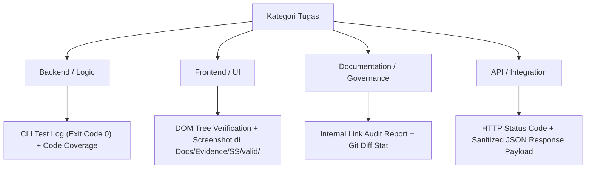

# STANDAR REKAYASA: VERIFIKASI & BUKTI FAKTUAL (VERIFICATION & EVIDENCE STANDARDS)

> **DOCUMENT ID:** STD-ENG-013-EVD  
> **VERSION:** v2.0.0  
> **STATUS:** AKTIF (LEVEL 2 OPERATIONAL STANDARD)  
> **KATEGORI:** PENJAMINAN MUTU, BUKTI EVIDENSI & AUDIT  
> **PENANGGUNG JAWAB:** Lead QA Role (Rujuk [config/organization.md](../../config/organization.md))  
> **OTORISASI:** Designated Approver (Rujuk [config/organization.md](../../config/organization.md), saat ini: **Yogi Ario**)  
> **ACUAN UTAMA:** [Docs/Standards/QA_Framework.md](QA_Framework.md) & [Docs/universal-rule.md](../universal-rule.md)  
> **PRINSIP TATA KELOLA:**  
> - *No Verification, No Completion.*  
> - *No Evidence, No Completion.*  
> - *Multi-Modal Evidence Tailored to Task Type.*  
> **KATA KUNCI NORMATIF:** RFC 2119 (MUST, MUST NOT, SHOULD, RECOMMENDED, MAY).

---

## 1. Pendahuluan & Filosofi Bukti

Dalam tata kelola rekayasa perangkat lunak profesional, klaim verbal atau pernyataan sepihak seperti *"fitur sudah selesai dan berjalan lancar"* tanpa bukti konkret dinyatakan **BATAL DAN TIDAK SAH**.

Prinsip Inti:
> **"No Verification, No Completion. No Evidence, No Completion."**  
> Setiap penyelesaian tugas, perbaikan bug, atau pemenuhan *Acceptance Criteria* **MUST** disertai bukti verifikasi nyata yang dapat diuji ulang dan dapat ditelusuri (*verifiable and reproducible proof*).

---

## 2. Pembedaan Hasil Pengujian vs Bukti Pengujian

Untuk menjaga ketelitian laporan, sistem membedakan antara:
1. **Hasil Pengujian (Test Results):** Pernyataan kesimpulan kuantitatif atau kualitatif (misal: *24/24 Tests Passed, Status: PASS, 0 Gagal*).
2. **Bukti Pengujian (Test Evidence):** Artefak konkret yang mendasari kesimpulan tersebut (misal: rekaman log terminal eksekusi, rekaman diff git, screenshot tangkapan layar, payload respons JSON terverifikasi).

Kedua elemen ini **MUST** tersedia bersama-sama sebelum suatu pekerjaan dapat disahkan.

---

## 3. Jenis-Jenis Bukti yang Diakui (Recognized Multi-Modal Evidence)

Bukti verifikasi harus berbentuk artefak objektif yang disesuaikan dengan jenis pekerjaan:

| Kategori Bukti | Bentuk Artefak Konkret | Ketentuan & Penggunaan |
| :--- | :--- | :--- |
| **Log Terminal / CLI** | Teks output eksekusi test runner (Jest, PyTest, dotnet test, PHPUnit) dengan exit code 0. | Menampilkan total test, durasi eksekusi, dan ringkasan 0 error. |
| **Git Diff & Hash** | Cuplikan `git diff --stat` atau checksum SHA-256 berkas yang dimodifikasi. | Membuktikan integritas dan batasan perubahan terarah (*surgical*). |
| **Tangkapan Layar UI** | Berkas gambar PNG/JPG dari browser bawaan IDE (Chrome DevTools MCP). | Disimpan di `Docs/Evidence/SS/valid/` atau `error/` untuk tugas UI. |
| **Payload Respons API** | Salinan respons JSON aktual dari server (status code + headers + body). | Membuktikan kontrak endpoint REST/GraphQL terpenuhi secara riil. |
| **Validasi Basis Data** | Hasil query data aktual (tabel baris data setelah mutasi). | Membuktikan integritas dan konsistensi penyimpanan data lokal. |
| **Audit Link & Sintaks** | Laporan validasi broken-link internal dan linter markdown. | Khusus untuk tugas dokumentasi, governance, dan spesifikasi. |
| **Pemindaian Keamanan** | Output linter keamanan / dependency audit (`npm audit`, pip-audit). | Membuktikan ketiadaan kerentanan kritis atau secret leakage. |

---

## 4. Penyesuaian Bukti Berdasarkan Kategori Tugas (Task-Type Tailoring)

AI Agent **MUST NOT** memaksakan bukti tangkapan layar antarmuka untuk pekerjaan yang bersifat murni backend atau dokumentasi. Bukti wajib disesuaikan:

1. **Tugas Rekayasa Antarmuka (Web/UI):** Wajib menyertakan inspeksi DOM dan tangkapan layar terstruktur pada `Docs/Evidence/SS/valid/` (atau `Docs/Evidence/SS/error/` saat bug terdeteksi).
2. **Tugas Logika Backend / Library:** Cukup menyertakan log keluaran terminal test runner dengan status passing dan exit code 0.
3. **Tugas Dokumentasi & Tata Kelola:** Cukup menyertakan laporan audit integritas tautan (*link check*) dan ringkasan perbedaan berkas (*git diff*).

---

## 5. Standar Integritas & Keamanan Bukti (Evidence Integrity & Security)

1. **LARANGAN PEMALSUAN BUKTI (No Evidence Tampering):**  
   AI Agent **DILARANG KERAS** memalsukan, memanipulasi, atau merekayasa berkas bukti pengujian. Menghapus log error secara sengaja atau mengklaim hasil pengujian fiktif merupakan pelanggaran tata kelola berat.
2. **Pembersihan Data Sensitif pada Bukti (Secret & PII Redaction):**  
   Sebelum bukti log atau tangkapan layar disimpan atau disajikan dalam laporan:
   - AI Agent **MUST** menyamarkan (*redact / mask*) nilai password, authorization token, API key, atau data pribadi pengguna:
     `Authorization: Bearer [REDACTED]`  
     `API_KEY: [REDACTED]`
3. **Kejujuran Terhadap Keterbatasan Lingkungan:**  
   Jika lingkungan lokal memiliki batasan sehingga suatu pengujian tidak dapat dijalankan secara otomatis (misal: ketiadaan emulator mobile), AI Agent **MUST** mencatat keterbatasan tersebut secara transparan dan menyertakan panduan verifikasi manual langkah-demi-langkah.

---

## 6. Rujukan Terkait
- Kerangka QA: [QA_Framework.md](QA_Framework.md)
- Strategi Pengujian: [Testing_Strategy.md](Testing_Strategy.md)
- Laporan Pengujian: [Docs/Test_Report.md](../Test_Report.md)
- Checklist Verifikasi: [Docs/Verification_Checklist.md](../Verification_Checklist.md)
- Konfigurasi Organisasi: [config/organization.md](../../config/organization.md)
