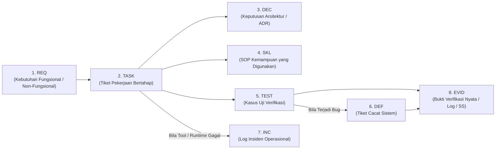

# MATRIKS KETERTELUSURAN SISTEM (TRACEABILITY MATRIX)

> **DOCUMENT ID:** DOC-REF-TRC-001  
> **VERSION:** v1.0.0  
> **STATUS:** AKTIF (OPERATIONAL TRACEABILITY STANDARD)  
> **AUTHORITY LEVEL:** Level 5 — Operational Tracking & Governance Artifact  
> **DESIGNATED APPROVER:** Rujuk [config/organization.md](../config/organization.md) (saat ini: Yogi Ario)  
> **PENANGGUNG JAWAB:** Lead QA & Engineering Team  
> **ACUAN UTAMA (SSOT):** [Docs/universal-rule.md](universal-rule.md) & [Docs/Standards/Requirements_Engineering.md](Standards/Requirements_Engineering.md)  
> **PRINSIP DASAR:**  
> - *Every Requirement Must Be Verifiable.*  
> - *Every Line of Code Must Trace to an Approved Task.*  
> - *Unified Lineage: REQ → TASK → DEC → TEST → DEF → INC → SKL → EVID.*

---

## 1. Pendahuluan

Matriks Ketertelusuran (*Traceability Matrix*) menjamin adanya silsilah ketertelusuran dua arah (*bidirectional traceability*) dari kebutuhan bisnis tingkat tinggi hingga ke artefak bukti eksekusi akhir. 

Dalam arsitektur *Universal AI Engineering Standard*, tidak boleh ada kode "gelap" (*untraceable code*), kasus uji tanpa requirement, atau bukti yang mengambang tanpa korelasi tugas yang jelas.

---

## 2. Pola Rantai Ketertelusuran Terpadu (Unified Lineage Pattern)

Setiap siklus pengerjaan fitur atau perbaikan sistem terhubung melalui 8 node identitas terstruktur:

### Taksonomi Identitas (ID Taxonomy):
1. **`REQ` (Requirement):** `REQ-[F|NF]-[MODULE]-[NUM]` (misal: `REQ-F-AUTH-001`, `REQ-NF-SEC-002`).
2. **`TASK` (Work Unit):** `TSK-[MODULE]-[NUM]` atau `UREV-[NUM]` (misal: `TSK-AUTH-001`, `UREV-2026-001`).
3. **`DEC` (Architecture Decision):** `ADR-[NUM]` atau `DEC-[MOD]-[NUM]` (misal: `ADR-001`, `DEC-AUTH-002`).
4. **`TEST` (Verification Scenario):** `TC-[MODULE]-[NUM]` atau `TC-SKL-[CAT]-[NUM]` (misal: `TC-AUTH-001`).
5. **`DEF` (Defect / Bug):** `DEF-[MODULE]-[NUM]` (misal: `DEF-AUTH-001`).
6. **`INC` (Systemic Incident):** `INC-[CAT]-[NUM]` (misal: `INC-TOOL-001`, `INC-SEC-002`).
7. **`SKL` (Validated Skill):** `SKL-[CAT]-[CODE]-[NUM]` (misal: `SKL-ENG-REQ-001`).
8. **`EVID` (Concrete Proof):** `EVID-[MOD]-[NUM]` atau jalur fisik berkas (`Docs/Evidence/...`, commit hash, diff stat).

---

## 3. Matriks Ketertelusuran Proyek Aktif (Active Traceability Matrix)

| Requirement ID | Task ID | Decision Log (ADR) | Validated Skill | Test Case ID | Defect ID (Bila Ada) | Incident ID (Bila Ada) | Bukti Evidensi (Evidence) | Status Akhir |
| :--- | :---: | :---: | :---: | :---: | :---: | :---: | :--- | :---: |
| *[Template Baris]* | `TSK-...` | `ADR-...` | `SKL-...` | `TC-...` | `DEF-...` | `INC-...` | `Docs/Evidence/...` | `[STATUS]` |

---

## 4. Matriks Ketertelusuran Revisi Komprehensif Opsi A (Audit Traceability)

Tabel berikut memetakan 50 temuan audit master (M-15 s.d. M-64) ke dalam tahapan pelaksanaan revisi:

| Audit Finding ID | Kategori Temuan | Tahap Revisi | Berkas Target Whitelist | Kriteria Keberhasilan Verifikasi | Status |
| :--- | :--- | :---: | :--- | :--- | :---: |
| **M-15 s.d. M-17** | Baseline & Diff Repo | Tahap 0 | `Docs/Baseline_Inventory.md`, `Docs/Repository_Diff_Report.md` | Baseline & inventaris lengkap | **VERIFIED** |
| **M-21, M-47** | Konfigurasi Organisasi | Tahap 1 | `config/organization.md`, `Docs/universal-rule.md` | Personel dipisah ke konfigurasi | **VERIFIED** |
| **M-25, M-51** | Approval Governance | Tahap 1 | `Docs/Approval_Governance.md`, `Docs/Glossary.md` | Scope whitelist & trigger persetujuan ulang | **VERIFIED** |
| **M-53** | Gitignore Negation | Tahap 2 | `coding template/.gitignore`, `Docs/Evidence/` | Git check-ignore valid, typo Evidience fixed | **VERIFIED** |
| **M-23, M-48, M-49**| Agent Authority & Tool | Tahap 3 | `Docs/Agent_Authority_Matrix.md`, `Tool_Governance_Execution.md` | Izin diskrit, runtime spec dibuat, retry bounded | **VERIFIED** |
| **M-22, M-32, M-33**| Skill Lifecycle & Spec | Tahap 4 | `Skill_Lifecycle_Governance.md`, `SKILL.md` (18 atribut) | BLOCKED/REJECTED state & validasi berbasis risiko | **VERIFIED** |
| **M-18, M-19, M-20**| QA, Testing & Evidensi| Tahap 5 | `QA_Framework.md`, `Test_Report.md`, `Verification_Checklist.md`| Multi-modal evidence, template dinetralisir | **VERIFIED** |
| **M-27, M-50** | Clean Main & Standards | Tahap 6 | `Git_Version_Control.md`, `Database_API_Standards.md` | Clean main diperjelas, API neutral | **VERIFIED** |
| **M-24, M-52, M-54**| Traceability & Registry | Tahap 7 | `Docs/Traceability_Matrix.md`, `Docs/Template_Registry.md` | Matriks terpadu & catalog 30+ template sinkron | **IN_PROGRESS** |

---

## 5. Panduan Pemeliharaan Ketertelusuran bagi Agen

1. **Prinsip Forward Traceability (Maju):**  
   Saat menerima kebutuhan baru (`REQ`), agen **MUST** memastikan kebutuhan tersebut didekomposisi ke `TASK`, memiliki kasus uji `TEST`, dan menghasilkan bukti `EVID`.
2. **Prinsip Backward Traceability (Mundur):**  
   Saat meninjau kode atau commit tertentu, reviewer **MUST** dapat melacak kembali perubahan tersebut ke `TASK` yang disetujui dan `REQ` yang mendasarinya.
3. **Pencatatan Defect & Insiden:**  
   Jika kasus uji gagal, defect yang dihasilkan wajib menautkan kembali ke `TC-ID` dan `REQ-ID` terkait agar perbaikan tidak melenceng dari spesifikasi awal.

---

## 6. Rujukan Terkait
- Rekayasa Kebutuhan: [Docs/Standards/Requirements_Engineering.md](Standards/Requirements_Engineering.md)
- Kerangka QA: [Docs/Standards/QA_Framework.md](Standards/QA_Framework.md)
- Registri Template: [Docs/Template_Registry.md](Template_Registry.md)
- Konfigurasi Organisasi: [config/organization.md](../config/organization.md)
