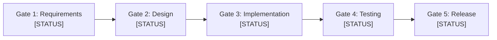

# Verification Checklist (Quality Gates) — [Isi Manual: Nama Proyek]

> **STATUS GERBANG KUALITAS:** `[NOT_EVALUATED | IN_PROGRESS | CLEARED | BLOCKED]`  
> **PROYEK:** [Isi Manual: Nama Proyek]  
> **DESIGNATED APPROVER:** Rujuk [config/organization.md](../config/organization.md) (saat ini: Yogi Ario)  
> **PENANGGUNG JAWAB QA:** [Isi Manual: Peran Agen / Pengembang]  
> **TERAKHIR DIEVALUASI:** [Isi Manual: YYYY-MM-DD HH:mm WIB]  
> **ACUAN STANDAR:** [Docs/Standards/QA_Framework.md](Standards/QA_Framework.md) & [Docs/Standards/Verification_Evidence.md](Standards/Verification_Evidence.md)

---

## 1. Ikhtisar Kelulusan 5 Gerbang Kualitas (Quality Gates Status)

| Gerbang Mutu | Fokus Pemeriksaan | Status Kelulusan | Catatan / Bukti Terkait |
| :--- | :--- | :---: | :--- |
| **Gate 1: Requirement Readiness** | Kejelasan kebutuhan & Acceptance Criteria | `[PENDING]` | [ID REQ & kriteria terukur] |
| **Gate 2: Design Readiness** | Modularitas arsitektur & ADR trade-off | `[PENDING]` | [Skema data / dokumen desain] |
| **Gate 3: Implementation Quality** | Clean code, linter & zero secret leakage | `[PENDING]` | [Hasil linter & proteksi .env] |
| **Gate 4: Testing Quality** | Pengujian mandatory PASS & bukti evidensi | `[PENDING]` | [Hasil test suite & bukti di Docs/Evidence/] |
| **Gate 5: Release Readiness** | Kepatuhan DoD & otorisasi rilis Approver | `[PENDING]` | [Changelog & otorisasi manual rilis] |

---

## 2. Rincian Checklist Kepatuhan per Gerbang

### 📌 Gate 1 — Requirement Readiness (Kesiapan Kebutuhan)
- [ ] Kebutuhan bisnis dan teknis dipahami tanpa asumsi sepihak (*No Understanding, No Execution*).
- [ ] Setiap kebutuhan fungsional memiliki ID unik (`REQ-F-xxx`) dan prioritas terdefinisi.
- [ ] Setiap kebutuhan memiliki *Acceptance Criteria* yang terukur secara objektif.
- [ ] Ketergantungan eksternal dan risiko awal telah diidentifikasi pada dokumen analisis proyek.
- [ ] Rencana implementasi (*Implementation Plan*) telah disusun dan disetujui (*No Plan, No Code & No Approval, No Code*).

### 📌 Gate 2 — Design Readiness (Kesiapan Perancangan)
- [ ] Batas modular dan pemisahan tanggung jawab (*Separation of Concerns*) dipatuhi.
- [ ] Seluruh keputusan arsitektur penting dicatat dalam `Docs/Decision_Log.md` lengkap dengan perbandingan opsi dan trade-off.
- [ ] Skema database dan kamus data terdokumentasi pada `Docs/Database_Design.md` (bila menggunakan basis data).
- [ ] Kontrak antarmuka endpoint API terdokumentasi pada `Docs/API_Contract.md` (bila mengembangkan API).

### 📌 Gate 3 — Implementation Quality (Kualitas Implementasi)
- [ ] Modifikasi kode berpegang teguh pada 4 Standar Presisi (*Clean & Surgical Coding*).
- [ ] Tidak ada modifikasi kode pada bagian sekitar yang sudah berjalan normal (*don't touch unbroken adjacent code*).
- [ ] Linter dan static analysis dijalankan tanpa error atau pelanggaran aturan sintaks.
- [ ] Tidak ada penanganan error sembrono (*No silent error catching / swallow errors*).
- [ ] **Zero Secret Leakage:** Tidak ada kunci API, password, atau kredensial yang ter-hardcode di kode sumber atau file log.
- [ ] Berkas aset mentah tim UI/UX (`Material/`) terbukti utuh tanpa modifikasi (read-only).

### 📌 Gate 4 — Testing Quality (Kualitas Pengujian & Evidensi)
- [ ] Test suite otomatis / skenario verifikasi dieksekusi dengan seluruh pengujian wajib menghasilkan status **PASS**.
- [ ] Bukti verifikasi faktual tersimpan di direktori `Docs/Evidence/` (CLI test log, hash diff, atau tangkapan layar jika antarmuka UI).
- [ ] Seluruh bug/defect yang terdeteksi telah dicatat di `Docs/Defect_Log.md` dan diverifikasi tuntas melalui pengujian ulang (*retesting*).
- [ ] Pengujian regresi telah dijalankan untuk memastikan fungsionalitas lama tidak terganggu.

### 📌 Gate 5 — Release Readiness (Kesiapan Rilis Produksi)
- [ ] Seluruh kriteria *Definition of Done* (DoD) terbukti terpenuhi.
- [ ] Dokumen pelacak progres `Docs/Task_Status.md` dan rekaman keputusan telah diperbarui.
- [ ] Catatan perubahan dibuat secara flat di `changelog/<nomor-urut>changelog<jam><ampm><ddmmyyyy>.md`.
- [ ] Rencana kerja aktif telah dicadangkan ke `Docs/Implementation_plan/`.
- [ ] **Kebijakan Clean `main` Branch:** Dipastikan tidak ada berkas transien/internal (log mentah, scrap file, secret) yang masuk ke cabang `main`.
- [ ] **Otorisasi Rilis Produksi:** Penggabungan branch ke `main` dan rilis produksi telah disetujui secara eksplisit oleh Designated Approver.

---

> [!tip] PETUNJUK KHUSUS TEMPLATE
> Gunakan checklist ini sebagai gerbang kendali mutu formal sebelum menyerahkan hasil kerja atau mengajukan rilis kepada Designated Approver. Isi tanda centang `[x]` hanya setelah kriteria diverifikasi secara faktual.
