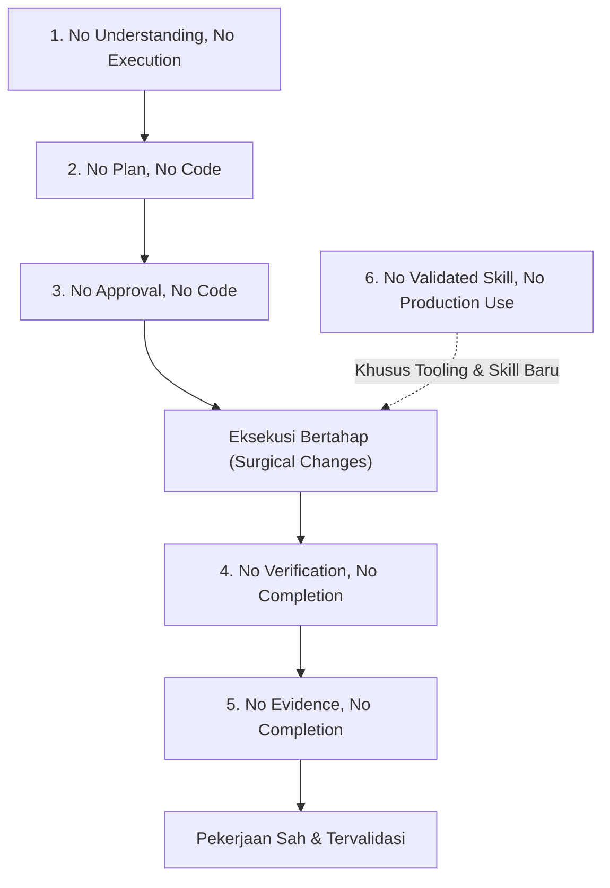
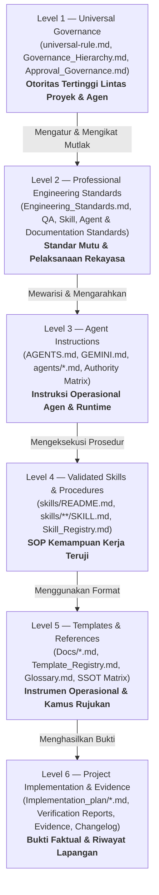
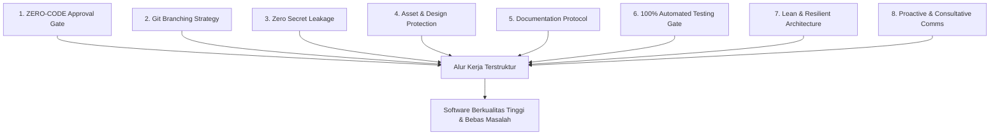
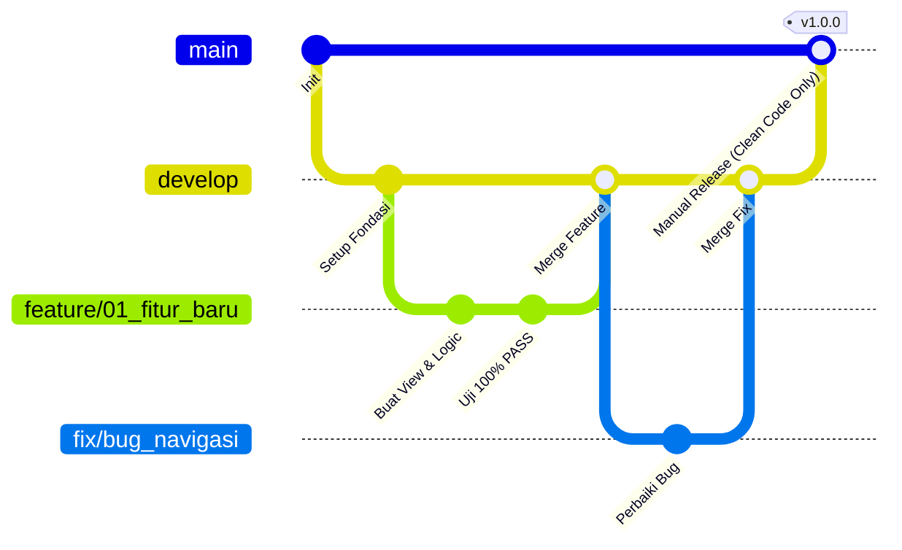

# UNIVERSAL-RULE.md — Kerangka Standar Kerja Pengembangan Proyek & AI Agent

> **DOCUMENT ID:** GOV-UNI-001  
> **VERSION:** v1.1.0 (Comprehensive Revision)  
> **STATUS:** DOKUMEN TATA KELOLA TERTINGGI (LEVEL 1 UNIVERSAL GOVERNANCE)  
> **OTORITAS TERTINGGI:** Project Owner (Parameter identitas dikonfigurasi dalam `config/organization.md`, default: Yogi Ario)  
> **TARGET PENGGUNA:** Seluruh Pengembang (Human Developer) & AI Agent (Antigravity, Gemini, Claude, Cursor, dll.)  
> **REUSABILITAS:** Wajib disalin dan diadopsi pada setiap repositori atau proyek baru di bawah tata kelola organisasi.  
> **AUTHORITATIVE SOURCE (SSOT):** `Docs/universal-rule.md`  
> **RELATED DOCUMENTS:** `Docs/Governance_Hierarchy.md`, `Docs/Approval_Governance.md`, `Docs/Standards/Engineering_Standards.md`, `config/organization.md`  

---

## 📖 Pendahuluan & Filosofi Kerja

Dokumen ini adalah **Pedoman Tata Kelola Universal (Level 1 Universal Governance Framework)** yang dirancang untuk menjaga kualitas, keamanan, transparansi, ketertelusuran (*traceability*), dan kerapian pengerjaan rekayasa perangkat lunak dari inisiasi hingga rilis produksi.

### 🧭 Core Philosophy: Consistent Standards, Variable Intelligence

> **"AI may vary in intelligence. Project standards must remain consistent."**

Kualitas penalaran, kemampuan mempertahankan konteks, dan keandalan eksekusi setiap AI Agent dapat bervariasi. Oleh karena itu, siklus pengembangan perangkat lunak **MUST NOT** bergantung pada asumsi bahwa AI Agent akan selalu memahami instruksi secara sempurna atau menghasilkan kualitas yang setara di setiap sesi. **Standar kerja, gerbang persetujuan, hierarki dokumentasi, dan bukti pengujian MUST tetap seragam, konsisten, dan terukur**, siapa pun AI Agent atau pengembang yang mengeksekusinya.

---

## ⚖️ Klasifikasi Aturan & Terminologi Kepatuhan (RFC 2119 Standards)

Seluruh pernyataan tata kelola, aturan kerja, dan batasan dalam dokumen ini menggunakan kata kunci kepatuhan standar berdasarkan **RFC 2119**:

1. **`MUST` / `WAJIB`**: Ketentuan mutlak yang **harus** dipenuhi tanpa pengecualian. Kegagalan memenuhinya merupakan pelanggaran tata kelola langsung.
2. **`MUST NOT` / `DILARANG KERAS`**: Larangan absolut yang **tidak boleh** dilanggar dalam kondisi apa pun.
3. **`SHOULD` / `DIANJURKAN`**: Rekomendasi teknis yang kuat. Praktik ini wajib diterapkan kecuali terdapat alasan teknis yang valid, analisis dampak tertulis, dan persetujuan eksplisit dari Project Owner.
4. **`SHOULD NOT` / `TIDAK DIANJURKAN`**: Praktik yang memiliki risiko teknis tinggi dan harus dihindari kecuali disertai justifikasi mitigasi yang jelas.
5. **`MAY` / `DIPERBOLEHKAN`**: Pilihan opsional yang sepenuhnya diserahkan kepada pertimbangan pengembang atau AI Agent sesuai konteks teknis.

---

## 🏛 Enam Prinsip Tata Kelola Rekayasa Perangkat Lunak (Core Principles)

Seluruh proses operasional dan interaksi AI Agent **MUST** berlandaskan pada enam pilar prinsip tata kelola berikut secara berurutan:



### 1. No Understanding, No Execution
AI Agent **MUST NOT** mengeksekusi tindakan atau memodifikasi file sebelum memvalidasi pemahamannya terhadap instruksi, kebutuhan proyek, batasan teknis, dan ruang lingkup pekerjaan. Jika terdapat ambiguitas, AI Agent **MUST** meminta klarifikasi terlebih dahulu kepada Project Owner.

### 2. No Plan, No Code
Rencana implementasi tertulis (*Implementation Plan*) **MUST** disusun dan tersedia sebelum kode atau file konfigurasi disentuh. Rencana ini **MUST** memuat tujuan, analisis arsitektur, daftar file target, strategi pengujian, DoR/DoD, dan analisis risiko.

### 3. No Approval, No Code
AI Agent **MUST NOT** menulis, mengubah, atau menghapus kode aplikasi sebelum memperoleh persetujuan eksplisit tertulis (*explicit approval*) dari Project Owner atas rencana implementasi yang diajukan.

### 4. No Verification, No Completion
Pekerjaan apa pun **MUST NOT** dinyatakan selesai (*completed*) sebelum seluruh hasilnya diverifikasi secara langsung terhadap kriteria keberhasilan (*acceptance criteria*) dan spesifikasi teknis yang disepakati.

### 5. No Evidence, No Completion
Setiap klaim keberhasilan atau penyelesaian tugas **MUST** didukung oleh bukti konkret yang dapat diverifikasi (*verifiable evidence*), seperti log terminal pengujian, output eksekusi, hash data, atau tangkapan layar (*screenshot*) visual bila relevan.

### 6. No Validated Skill, No Production Use
Skill, plugin, skrip automasi eksternal, atau tooling AI baru **MUST NOT** digunakan langsung pada lingkungan produksi atau repositori aktif sebelum melalui uji coba sandbox (*dry-run validation*), dokumentasi kapabilitas, dan otorisasi produksi tertulis dari Project Owner.

---

## 🔍 Pembedaan Definisi Kunci Tata Kelola

Untuk menghindari kerancuan istilah (Audit Finding M-18, M-25, M-41), konsep berikut dibedakan secara tegas:

1. **Verification (Verifikasi):** Pemeriksaan teknis obyektif bahwa hasil kerja memenuhi spesifikasi teknis dan kriteria penerimaan (*Are we building the product right?*). Lulus verifikasi teknis TIDAK otomatis berarti disetujui untuk rilis produksi.
2. **Evidence (Bukti):** Catatan konkret yang dapat diverifikasi secara independen (log terminal, commit hash, diff perubahan, data hash, respons API, atau screenshot UI bila relevan). Bukti wajib memiliki identitas, timestamp, konteks, dan lokasi penyimpanan yang dapat diakses.
3. **Validation (Validasi):** Pembuktian bahwa solusi atau modul kemampuan (skill) bekerja dengan benar dan memenuhi kebutuhan operasional nyata dalam kondisi kerja riil maupun *edge cases* (*Are we building the right product?*).
4. **Approval (Persetujuan):** Otorisasi formal dari pihak berwenang (Project Owner) atas suatu rencana kerja, permohonan perubahan (*Change Request*), atau hasil verifikasi dalam batas ruang lingkup yang ditentukan.
5. **Production Authorization (Otorisasi Produksi):** Izin eksplisit tertulis dari Project Owner untuk mempromosikan artefak, kode, atau skill ke lingkungan produksi aktif. Status *Validated* atau *Approved Plan* tidak otomatis memberi wewenang produksi.

---

## 📐 Hierarki Tata Kelola Dokumen (6-Level Documentation Hierarchy)

Sistem tata kelola repositori diatur dalam hierarki 6 tingkat otoritas yang terstruktur (merujuk pada [`Docs/Documentation_Hierarchy.md`](Documentation_Hierarchy.md)):



1. **Level 1 — Universal Governance (`Docs/universal-rule.md`, `Governance_Hierarchy.md`, `Approval_Governance.md`):**  
   Sumber kebenaran tertinggi (*single source of truth*) yang memuat kebijakan fundamental, 6 prinsip tata kelola, kebijakan branch, keamanan kunci, dan etika komunikasi. Berlaku mengikat untuk seluruh proyek dan agen AI.
2. **Level 2 — Professional Standards (`Docs/Standards/*.md`):**  
   Standar teknis 7 pilar rekayasa, QA Framework, Skill Architecture, Agent Architecture, serta Documentation Standards.
3. **Level 3 — Agent Instructions (`AGENTS.md`, `GEMINI.md`, `agents/*.md`):**  
   Pedoman operasional spesifik platform atau runtime AI, profil peran terdaftar, dan matriks wewenang agen.
4. **Level 4 — Skills & Procedures (`skills/`, `Skill_Registry.md`):**  
   SOP kemampuan kerja terstruktur 18 atribut yang telah tervalidasi 6 dimensi.
5. **Level 5 — Templates & References (`Docs/`, `Template_Registry.md`, `Glossary.md`, `Single_Source_of_Truth_Matrix.md`):**  
   Formulir operasional, daftar periksa, glosarium istilah, dan pemetaan SSOT.
6. **Level 6 — Project Implementation & Evidence (`Docs/Implementation_plan/`, `changelog/`, `Docs/Evidence/`):**  
   Artefak empiris riil pelaksanaan proyek dan catatan pembuktian.
7. **Mekanisme Resolusi Konflik (Conflict Resolution):**  
   Jika terjadi kontradiksi antar-dokumen, maka **Level yang lebih tinggi selalu dimenangkan (Level 1 > Level 2 > Level 3 > Level 4 > Level 5 > Level 6)**. AI Agent **MUST** menghentikan tindakan terdampak (*stop and hold*), lalu segera melaporkan kontradiksi tersebut kepada Yogi Ario.

---

## 🛡 Tata Kelola Persetujuan (Approval Governance)

### 1. Otoritas Tunggal Pemberi Persetujuan
Satu-satunya pihak yang memiliki otoritas memberikan persetujuan (*approval authority*) adalah **Yogi Ario (Project Owner / Lead Developer)**. AI Agent dilarang berasumsi atau menganggap konfirmasi diam (*silent approval*) sebagai izin.

### 2. Batasan Tindakan Otonom (Autonomous Scope)
AI Agent **MAY** melakukan tindakan berikut secara otonom tanpa memerlukan persetujuan tambahan:
- Membaca dan meneliti file repositori (*read-only exploration*).
- Menjalankan perintah status (*read-only commands* seperti `git status`, `git branch`, direktori check).
- Menyusun dokumen analisis, draf *Implementation Plan*, atau draf *Consistency Report*.
- Menjalankan skrip pengujian lokal yang bersifat *dry-run* tanpa efek samping pada file kode sumber.

### 3. Tindakan Wajib Persetujuan (Approval-Required Scope)
AI Agent **MUST NOT** melakukan tindakan berikut tanpa persetujuan eksplisit:
- Menulis, mengubah, merefaktor, atau menghapus berkas kode aplikasi.
- Menambahkan dependensi baru (`package.json`, `composer.json`, `requirements.txt`, dll.).
- Mengubah skema basis data atau file migrasi.
- Melakukan operasi Git yang mengubah riwayat atau branch (seperti checkout branch baru, commit, merge, push).
- Menjalankan skill atau automasi baru di luar lingkungan sandbox.

### 4. Penanganan Perubahan Ruang Lingkup (Scope Creep Protocol)
Jika saat melakukan implementasi ditemukan bug tersembunyi, dependensi baru, atau kebutuhan refaktor yang tidak tercantum dalam *Implementation Plan* yang telah disetujui:
1. AI Agent **MUST NOT** langsung memperluas perbaikan secara sepihak.
2. AI Agent **MUST** menghentikan pekerjaan pada bagian baru tersebut.
3. AI Agent **MUST** mendokumentasikan temuan baru, analisis dampak, dan mengajukan addendum rencana kepada Yogi Ario untuk disetujui.

### 5. Penanganan Penolakan (Rejection Handling)
Jika rencana kerja atau hasil implementasi ditolak oleh Yogi Ario:
1. AI Agent **MUST** menghentikan eksekusi seketika.
2. AI Agent **MUST** mencatat umpan balik penolakan secara rinci.
3. AI Agent **MUST** mengkaji alternatif solusi teknis lain dan menyajikan perbandingan opsi revisi untuk evaluasi ulang.

---

## 🚫 Mekanisme Penanganan Pelanggaran Aturan (Rule Violation Handling)

1. **Status Batal Demi Hukum (Null and Void):**  
   Setiap perubahan file atau modifikasi kode yang dilakukan tanpa persetujuan rencana kerja (*Zero-Code Violation*) atau melanggar salah satu dari 6 prinsip tata kelola **dinyatakan batal dan tidak sah**.
2. **Rollback Seketika (Immediate Rollback):**  
   AI Agent **MUST** segera melakukan pembatalan (*rollback*) perubahan ke commit stabil terakhir menggunakan perintah Git yang aman (`git restore` atau `git checkout`).
3. **Pemberitahuan Transparan & Analisis Insiden:**  
   AI Agent **MUST** segera memberitahukan Yogi Ario mengenai pelanggaran yang terjadi, alasan terjadinya, dampak yang ditimbulkan, dan langkah pemulihan yang telah diambil (*post-mortem report* singkat).

---

## 🏛 Delapan Pilar Standar Rekayasa Perangkat Lunak



---

### 🛑 Pilar 1: ZERO-CODE Sebelum Persetujuan Rencana (Approval Gate)

**Prinsip Inti:** *No Understanding, No Execution. No Plan, No Code. No Approval, No Code. No Verification, No Completion. No Evidence, No Completion. No Validated Skill, No Production Use.*

1. **Dilarang Keras Menyentuh Kode Terlebih Dahulu (Zero-Code Rule):**  
   AI Agent **MUST NOT** membuat, mengedit, atau menghapus file kode aplikasi sebelum menyusun rencana kerja tertulis (*Implementation Plan*) dan memperoleh persetujuan eksplisit dari Yogi Ario.
2. **Format Wajib Implementation Plan:**  
   Setiap dokumen *Implementation Plan* **MUST** mencakup:
   - **Tujuan & Ruang Lingkup:** Rincian kebutuhan fungsional dan non-fungsional.
   - **Analisis & Pilihan Solusi (Wajib Trade-off):** Jika terdapat percabangan keputusan teknis atau arsitektur, AI Agent **dilarang memutuskan sendiri**. AI Agent **MUST** menyajikan perbandingan opsi (kelebihan, kekurangan, dan rekomendasi ahli) untuk dipilih oleh Yogi Ario.
   - **Pertanyaan Wajib Pola Arsitektur:** Jika arsitektur proyek belum ditentukan pada instruksi awal, AI Agent **MUST** bertanya terlebih dahulu (misal: jika PHP Native, apakah MVC atau lainnya? Jika mobile, apakah MVVM, Clean Architecture, BLoC, dll.?).
   - **Daftar File Target:** File yang akan dibuat, dimodifikasi, atau diuji.
   - **Alur Pengujian:** Skenario pengujian untuk membuktikan fitur bekerja bebas regresi.
   - **Analisis Risiko & Mitigasi:** Potensi kendala beserta rencana penanggulangannya.
3. **Gerbang Persetujuan (Approval Gate):**  
   AI Agent **MUST** berhenti dan menunggu konfirmasi Yogi Ario (misal: pesan "Oke disetujui", "Lanjut", atau respon positif serupa) sebelum menyentuh kode.
4. **Alur Perencanaan Berkelanjutan (Chained Implementation Plan):**  
   Setelah selesai mengerjakan satu tugas/batch, AI Agent **MUST secara otomatis dan proaktif langsung menyusun Implementation Plan untuk tahapan berikutnya** dalam format dokumen yang dapat dikomentari oleh Yogi Ario sebelum dieksekusi.
5. **Pencadangan Runut Rencana Kerja (Sequential Plan Archiving):**  
   Setiap dokumen rencana kerja yang sudah disetujui (*fix*) dan selesai dikerjakan **MUST dicadangkan** ke dalam folder:  
   `Docs/Implementation_plan/<nomor>_tahap<nomor>_Implementation_plan_<namafituryangdikembangkan>.md`  
   *(Contoh: `Docs/Implementation_plan/01_tahap01_Implementation_plan_setup_database.md`)*.  
   Pencadangan **MUST** dilakukan bertahap sampai seluruh tahapan proyek tuntas. Jika terdapat percabangan rencana teknis, rencana percabangan tersebut **MUST dicadangkan secara terpisah dan runut**.

---

### 🌿 Pilar 2: Protokol Branching Git & Kontrol Rilis (Clean Main Policy)

**Prinsip Inti:** *Branch `main` adalah Mahkota Produksi Bersih — Hanya Yogi Ario yang Boleh Me-Merge.*



1. **Branch `main` (Produksi Tertutup & Bersih / Clean Production Branch):**
   - Berisi murni kode stabil rilis produksi yang siap digunakan oleh pengguna.
   - AI Agent dan pengembang **MUST NOT** melakukan commit atau push langsung ke `main`.
   - **Kebijakan Isolasi Berkas Non-Produksi (Clean Policy):** Seluruh berkas yang berkaitan dengan pengerjaan internal proyek **DILARANG KERAS masuk ke branch `main`**, antara lain:
     * Seluruh file pengujian otomatis (`tests/`, mock data test).
     * Berkas markdown aturan kerja (`Docs/universal-rule.md`, `AGENTS.md`, `GEMINI.md`, `Docs/Rules/`).
     * Berkas arsip rencana kerja & template internal (`Docs/Implementation_plan/`, `Docs/Task_Status.md`, `Docs/Decision_Log.md`, `Docs/Test_Report.md`, `Docs/AGENTS-module-template.md`).
     * Berkas arsip percakapan (`Docs/chat/`).
     * Berkas bukti tangkapan layar pengujian (`Docs/Evidence/`).
   - Branch `main` **MUST** tetap bersih, rapi, dan murni kode aplikasi. Penggabungan (*merge*) ke `main` dilakukan secara manual oleh Yogi Ario dengan menyaring/mengecualikan berkas-berkas pengerjaan proyek tersebut.
2. **Branch `develop` (Branch Integrasi Utama):**
   - Seluruh pembaruan, perbaikan, dan fitur baru yang telah lulus uji **MUST** digabungkan ke `develop` dan di-push ke `origin develop`.
3. **Standar Penamaan Branch Fitur & Perbaikan:**
   - **Fitur Baru:** Wajib menggunakan pola bernomor urut:  
     `feature/<nomor>_<nama_fitur>` *(Contoh: `feature/01_auth_pengguna`, `feature/02_keranjang_belanja`)*.
   - **Perbaikan Bug:** Wajib menggunakan pola:  
     `fix/<nama_bug_atau_yang_diperbaiki>` *(Contoh: `fix/salah_hitung_diskon`, `fix/navigasi_login`)*.
   - Setiap pekerjaan mandiri **MUST** dibuatkan branch tersendiri yang bercabang dari `develop`. Setelah selesai dan lulus uji 100% PASS, branch digabungkan kembali ke `develop`.
4. **Pengecekan Berkala Konflik Git Remote (Periodic Conflict Check):**
   - AI Agent **SHOULD** secara berkala (insidental, tidak harus di setiap push) mengecek apakah terdapat konflik atau divergensi dengan repositori remote GitHub (`git fetch` / inspeksi git status) untuk mengantisipasi *merge conflict* sedini mungkin.
5. **Pertanyaan Kesiapan Repositori di Awal:**
   - Di awal inisialisasi proyek atau sebelum Git dihubungkan ke remote, AI Agent **MUST menanyakan**:  
     *"Apakah repositori Git / GitHub sudah disiapkan?"*

---

### 🔐 Pilar 3: Keamanan Kunci Rahasia & Tata Kelola `.env` (Zero Secret Leakage)

**Prinsip Inti:** *Kunci API dan Kredensial Pribadi adalah Aset Paling Sensitif.*

1. **Perlindungan `.gitignore` Sejak Menit Pertama:**
   - File konfigurasi rahasia (`.env`, `.env.local`), file kunci lokal (`Docs/api`, `secrets.json`, file service account), dan database lokal **MUST** langsung dimasukkan ke `.gitignore` sebelum commit perdana.
2. **Larangan Kebocoran Kunci:**
   - AI Agent **MUST NOT** menuliskan nilai kunci API atau token rahasia ke dalam prompt obrolan publik, commit message, atau file kode yang dilacak oleh Git.
3. **Template Konfigurasi Bersih (`.env.example`):**
   - Pengembang/AI Agent **MUST** selalu menyediakan dan memperbarui file `.env.example` berisi nama variabel tanpa nilai rahasia (gunakan placeholder seperti `your_api_key_here`).

---

### 🎨 Pilar 4: Proteksi Integritas Aset & Desain (`Material/` / Raw Assets)

**Prinsip Inti:** *Aset Asli Tim UI/UX adalah Bahan Rujukan Murni (Read-Only).*

1. **Status READ-ONLY untuk Folder Desain:**
   - Folder prototipe mentah (seperti `Material/`, `design/`, `mockups/`) yang disediakan desainer **MUST NOT** diubah, ditimpa, atau dihapus oleh AI Agent / Backend Developer.
2. **Pola Adopsi Bersih:**
   - Kode tampilan diadopsi secara terstruktur ke folder views/components produksi, lalu dihubungkan dengan logika dinamis.

---

### 📝 Pilar 5: Protokol Dokumentasi Wajib (Documentation-First)

**Prinsip Inti:** *Kode Tanpa Dokumentasi adalah Utang Teknis di Masa Depan.*

Setiap repositori **MUST** memiliki direktori `Docs/` dan direktori `changelog/` yang selalu diperbarui:

| Nama Berkas / Direktori       | Lokasi                                                              | Klasifikasi | Fungsi & Aturan Pembaruan                                                                                            |
| ----------------------------- | ------------------------------------------------------------------- | ----------- | ---------------------------------------------------------------------------------------------------------------------- |
| **`Implementation_plan.md`**   | `Docs/Implementation_plan.md`                                       | MUST        | Rencana kerja aktif untuk tahapan yang sedang dikerjakan.                                                              |
| **Arsip Rencana Kerja Runut** | `Docs/Implementation_plan/<nomor>_tahap<nomor>_...md`               | MUST        | Arsip dokumen rencana kerja yang telah disetujui (*fix*) dan selesai dikerjakan, berurutan sampai habis tahapannya.   |
| **`Task_Status.md`**          | `Docs/Task_Status.md`                                               | MUST        | Melacak status seluruh fase proyek, persentase progres, dan checklist tugas real-time.                               |
| **`Decision_Log.md`**         | `Docs/Decision_Log.md`                                              | MUST        | Mencatat seluruh keputusan teknis/arsitektur (ID, Tanggal, Topik, Keputusan, Rationale, Status Persetujuan).         |
| **`Test_Report.md`**          | `Docs/Test_Report.md`                                               | MUST        | Laporan verifikasi pengujian otomatis dan checklist uji manual (100% PASS Gate).                                      |
| **`Defect_Log.md`**           | `Docs/Defect_Log.md`                                                | MUST        | Pelacak defect/bug aktif, tingkat severity vs priority, siklus defect, dan retesting evidence.                         |
| **`Verification_Checklist.md`**| `Docs/Verification_Checklist.md`                                    | MUST        | Formulir checklist verifikasi pemenuhan 5 Quality Gates sebelum rilis disahkan.                                       |
| **`Skill_Registry.md`**        | `Docs/Skill_Registry.md`                                            | MUST        | Registri master terpusat seluruh modul kemampuan AI (status, izin peran agen, risiko, dan otorisasi).                 |
| **Template Manajemen Skill**   | `Docs/Skill_*Template.md` / `Docs/Skill_*.md`                       | MUST        | Kumpulan template siklus skill (Spesifikasi, Checklist Validasi, Evaluasi, Change Request, Deprecation).             |
| **`Agent_Authority_Matrix.md`**| `Docs/Agent_Authority_Matrix.md`                                    | MUST        | Matriks pemetaan kewenangan 5 peran agen terhadap 10 aksi teknis dan kontrol data.                                    |
| **Template Operasional Agen**  | `Docs/Agent_*.md` / `Docs/Task_*.md` / `Docs/Communication_*.md`    | MUST        | Template profil agen, spesifikasi task (`TSK-xxx`), serah terima (handoff), protokol pesan, dan log insiden agen.   |
| **`API_Contract.md`**         | `Docs/API_Contract.md`                                              | CONDITIONAL | Kontrak spesifikasi endpoint REST API (wajib jika proyek memiliki backend/API).                                      |
| **`Database_Design.md`**      | `Docs/Database_Design.md`                                           | CONDITIONAL | Dokumentasi perancangan skema database, ERD, dan kamus data (wajib jika proyek menggunakan database).                  |
| **`Project_Analysis.md`**     | `Docs/Project_Analysis.md`                                          | MUST        | Catatan analisis repositori aktual, batasan teknologi, dan tech stack (Step 2 Engineering Workflow).                 |
| **`SRS_Template.md`**         | `Docs/SRS_Template.md`                                              | MUST        | Spesifikasi kebutuhan perangkat lunak formal (REQ-F, REQ-NF, acceptance criteria terukur).                           |
| **Standar Rekayasa Modular**  | `Docs/Standards/`                                                   | MUST        | Direktori standar rekayasa perangkat lunak, QA framework, dan standar arsitektur skill.                              |
| **Changelog Bertimestamp**    | `changelog/<nomor-urut>changelog<jam><ampm><ddmmyyyy>.md`           | MUST        | Catatan perubahan bertimestamp waktu lokal per batch rilis/fase selesai. **Wajib flat & urut kronologis** (disimpan langsung di folder `changelog/`, dilarang membuat subfolder). Format: 2 digit nomor urut (`00` template, `01`, `02`, dst.), 2 digit jam (`03am`/`02pm`), dan 8 digit tanggal (`ddmmyyyy`). Contoh: `changelog/01changelog12am07112026.md`. |
| **Bukti SS Pengujian Valid**  | `Docs/Evidence/SS/valid/`                                          | MUST        | Arsip tangkapan layar (screenshot) bukti pengujian browser bawaan IDE yang berhasil/valid.                           |
| **Bukti SS Pengujian Error**  | `Docs/Evidence/SS/error/`                                          | MUST        | Arsip tangkapan layar (screenshot) bug/error yang ditemukan selama pengujian browser bawaan IDE.                      |
| **Panduan Khusus / Modul**    | `Docs/<nama-modul>.md`                                              | MAY         | Panduan tutorial langkah demi langkah untuk konfigurasi pihak ketiga atau modul khusus.                              |
| **Cadangan Riwayat Chat**     | `Docs/chat/riwayat<ddmmyyyy>.md`                                    | MUST        | Arsip riwayat dialog interaktif pengguna dan AI Agent dari awal hingga akhir sesi.                                    |

#### Ketentuan Badge Wajib pada `README.md`:
Setiap repositori GitHub proyek **MUST** mencantumkan badge status shields.io pada `README.md`:
1. **Forks:** `https://img.shields.io/github/forks/<user>/<repo>?style=flat-square`
2. **Repo Size:** `https://img.shields.io/github/repo-size/<user>/<repo>?style=flat-square`
3. **Stars:** `https://img.shields.io/github/stars/<user>/<repo>?style=flat-square`
4. **Branding/Logo:** AI Agent **MUST** menanyakan kepada Yogi Ario apakah logo aplikasi atau logo perusahaan ingin dicantumkan di bagian atas `README.md`.

---

### 🧪 Pilar 6: Gerbang Verifikasi Pengujian (100% Automated Testing Gate & Visual Evidence)

**Prinsip Inti:** *No Verification, No Completion. No Evidence, No Completion. Jangan Pernah Bilang Selesai Jika Belum Terbukti Lulus Uji.*

1. **Wajib Memiliki Test Suite Otomatis:**
   - Setiap proyek **MUST** memiliki skrip verifikasi mandiri (unit test, integration test, atau end-to-end suite) di folder `tests/` atau sesuai konvensi ekosistem yang digunakan.
2. **Definisi Selesai (Definition of Done - DoD):**
   - Suatu tugas **MUST NOT** dilaporkan selesai sebelum test suite dijalankan dan menghasilkan:  
     **`HASIL: 100% PASS (0 GAGAL / 0 ERROR)`**.
3. **Pencegahan Regresi:**
   - Setiap penambahan fitur baru **MUST** disertai penambahan kasus uji pada test suite.
4. **Pengujian Browser Bawaan IDE & Tangkapan Layar Bukti (Browser Automation & Screenshot Evidence):**
   - Jika pengujian memerlukan antarmuka web atau browser, AI Agent **MUST** menggunakan browser bawaan IDE (Chrome DevTools MCP / Chrome automation) yang dapat memeriksa DOM, melakukan aksi otomatis, merekam, dan mengambil tangkapan layar (*screenshot*).
   - **Kewajiban Bukti Visual Valid & Error:** Di setiap percobaan pengujian browser:
     * **Bukti Valid / Berhasil:** AI Agent **MUST** menyimpan tangkapan layar hasil yang berhasil/sesuai di `Docs/Evidence/SS/valid/`.
     * **Bukti Error / Kendala:** AI Agent **MUST** menyimpan tangkapan layar bug atau error yang muncul di `Docs/Evidence/SS/error/`.
   - Seluruh bukti tangkapan layar ini **MUST** ditautkan ke dalam dokumen `Docs/Test_Report.md` atau rencana kerja aktif sebagai bukti verifikasi nyata sebelum fitur dinyatakan tuntas.

---

### ⚡ Pilar 7: Kedisiplinan Arsitektur & Provider (Lean & Resilient)

**Prinsip Inti:** *Sederhana, Cepat, Andal, dan Tanpa Ketergantungan Berlebihan.*

1. **Kunci Provider Tunggal / Efisien (Anti-Bloat):**
   - Hindari mencampuradukkan banyak penyedia layanan pihak ketiga untuk fungsi yang sama. Kunci satu provider terbaik sebagai *single source of truth*.
2. **Mekanisme Ketahanan (Fallback Multi-Tingkat):**
   - Untuk layanan eksternal kritis (seperti LLM AI atau gateway pembayaran), sediakan mekanisme fallback otomatis jika terjadi status HTTP 429 (rate limit) atau kegagalan koneksi.
3. **Pemisahan Tanggung Jawab (Separation of Concerns):**
   - Pisahkan urusan Presentasi (Views/UI), Pengontrol Alur (Controllers), Logika Bisnis (Services), Validasi (Validators), dan Penyimpanan Data (Repositories/Models).
4. **Hierarki Aturan Kode Sumber & Scoped AI Agent (Modular AGENTS.md — Kondisional):**
   - **Proyek Standar / Monolitik:** Cukup mengandalkan satu berkas `AGENTS.md` di root proyek.
   - **Proyek Besar / Monorepo / Multi-Modul:** Jika folder kode sumber memiliki batas arsitektur independen (misal: `frontend/` vs `backend/`, atau modul `src/modules/<nama-modul>/`), folder tersebut **dianjurkan memiliki berkas `AGENTS.md` lokal** yang merujuk pada `Docs/AGENTS-module-template.md`.
   - **Resolusi Konflik:** Jika aturan lokal di folder source bertentangan dengan aturan universal di root, **aturan Level 1 universal root dan keputusan eksplisit Yogi Ario selalu menjadi otoritas tertinggi.**

---

### 🤝 Pilar 8: Standar Komunikasi & Konsultasi AI Agent

**Prinsip Inti:** *AI Agent adalah Rekan Berpikir (Pair Programmer) yang Ramah, Jelas, dan Edukatif.*

1. **Proaktif Memberikan Solusi Berbasis Opsi:**
   - Jika ada kebingungan atau percabangan teknis, sajikan pilihan (misal: *Opsi A: Cepat & Mandiri* vs *Opsi B: Integrasi Pihak Ketiga*) beserta kelebihan, kekurangan, dan rekomendasi ahli.
2. **Bimbingan Setup Mandiri:**
   - Jika pengguna perlu melakukan konfigurasi manual pada console pihak ketiga (seperti Firebase, GCP, AWS, Meta, atau Editor Settings), AI Agent **MUST** membuatkan panduan tutorial tertulis langkah-demi-langkah yang jelas.
3. **Gaya Bahasa:**
   - Ramah, profesional, ringkas, dan menggunakan tautan markdown yang dapat diklik (`[file.ext](file:///path/to/file)`).
4. **Pertanyaan Wajib Terkait Repositori, Branding & Arsitektur di Awal:**
   - Sebelum memulai inisialisasi repositori atau pengerjaan proyek, AI Agent **MUST mengajukan pertanyaan berikut**:
     1. *"Apakah repositori Git / GitHub sudah disiapkan?"*
     2. *"Apakah logo aplikasi atau logo perusahaan ingin dicantumkan di README.md?"*
     3. Jika pola arsitektur belum dilampirkan: *"Proyek ini menggunakan pola arsitektur apa? (Contoh PHP Native: MVC atau lainnya? Mobile: MVVM, Clean Architecture, BLoC, atau arsitektur lainnya?)"*
   - Dilarang keras berasumsi atau memutuskan arsitektur secara sepihak tanpa konfirmasi eksplisit dari Yogi Ario.
5. **Kewajiban Menanyakan Pencadangan Riwayat Chat di Akhir Respon:**
   - **Wajib di Setiap Akhir Respon:** Setiap kali selesai memberikan respon (baik merespons pertanyaan, menyajikan rencana, maupun menyelesaikan implementasi), AI Agent **MUST secara proaktif bertanya di penutup respon** kepada pengguna apakah ingin mencadangkan (*backup*) riwayat percakapan sesi tersebut.
   - **Pola Penamaan & Lokasi Berkas:** Berkas cadangan disimpan dalam format markdown pada subdirektori terstruktur `Docs/chat/` dengan pola:
     `Docs/chat/riwayat<ddmmyyyy>.md`
   - **Contoh Kalimat Penutup yang Ditanyakan:**
     > *"Apakah Anda ingin saya mencadangkan riwayat percakapan sesi ini ke `Docs/chat/riwayat<ddmmyyyy>.md`?"*

---

## 📁 Struktur Standar Proyek Baru (Starter Template)

Saat menginisialisasi proyek baru bersama Yogi Ario, buatlah struktur direktori standar berikut:

```text
<[Isi Manual: Nama Proyek]>/
├── .gitignore                     # Perlindungan awal (.env, secrets, logs, build outputs)
├── .env.example                   # Template konfigurasi tanpa kunci rahasia (bila ada)
├── README.md                      # Dokumentasi pengenalan, badge wajib GitHub, logo & quickstart
├── AGENTS.md                      # Indeks operasional agen Level 2 (merujuk ke Docs/universal-rule.md)
├── GEMINI.md                      # Indeks operasional agen Level 2 (merujuk ke Docs/universal-rule.md)
│
├── Docs/                          # Seluruh dokumentasi formal proyek
│   ├── chat/                      # Arsip berkala riwayat percakapan sesi AI
│   │   └── riwayat<ddmmyyyy>.md   # Berkas riwayat chat per tanggal
│   ├── universal-rule.md          # Dokumen aturan master Level 1 ini
│   ├── Governance_Hierarchy.md    # Spesifikasi hubungan hierarki Level 1, 2, dan 3
│   ├── Approval_Governance.md     # Spesifikasi kewenangan dan prosedur gerbang persetujuan
│   ├── Project_Analysis.md        # Template analisis kondisi repositori (Step 2 Workflow)
│   ├── SRS_Template.md            # Template spesifikasi kebutuhan perangkat lunak (Step 1 Workflow)
│   ├── Task_Status.md             # Pelacak progres fase dan checklist tugas
│   ├── Decision_Log.md            # Catatan riwayat keputusan arsitektur (ADR)
│   ├── API_Contract.md            # Kontrak endpoint & arsitektur data (bila ada API)
│   ├── Database_Design.md         # Perancangan skema database & kamus data (bila ada DB)
│   ├── Implementation_plan.md     # Rencana induk implementasi aktif
│   ├── Implementation_plan/       # Folder arsip runut dokumen rencana kerja yang telah fix
│   │   └── <nomor>_tahap<nomor>_Implementation_plan_<namafitur>.md
│   ├── Standards/                 # [STANDAR REKAYASA] Standar Rekayasa, QA, Skill, Agent & Doc Governance
│   │   ├── Engineering_Standards.md      # Master Framework, 12-Step Workflow, DoR/DoD, Risk Matrix
│   │   ├── Requirements_Engineering.md   # Spesifikasi REQ-F/NF, acceptance criteria, RTM
│   │   ├── Architecture_Design.md        # Modularitas, data flow, ADR trade-off
│   │   ├── Coding_Standards.md           # Clean & Surgical coding, error handling, logging
│   │   ├── Git_Version_Control.md        # Branching, clean main, Conventional Commits, flat changelog berurut
│   │   ├── Database_API_Standards.md     # Skema DB, migrasi, kontrak REST API
│   │   ├── Security_Engineering.md       # Zero Secret Leakage, OWASP Top 10, RBAC
│   │   ├── Deployment_Maintenance.md     # Environment, checklist rilis, incident recovery
│   │   ├── QA_Framework.md               # Master QA Framework, 5 Quality Gates, 15-Step QA Workflow
│   │   ├── Testing_Strategy.md           # 10 Tingkatan Pengujian, Risk-Based Testing, synthetic test data
│   │   ├── Test_Case_Management.md       # Kasus uji TC-[MODULE]-[NUM], status lifecycle, RTM matrix
│   │   ├── Defect_Management.md          # Manajemen bug DEF-[MODULE]-[NUM], Severity vs Priority
│   │   ├── Verification_Evidence.md      # Bukti nyata, otomasi browser DevTools MCP, screenshot
│   │   ├── Skill_Architecture.md         # Master Arsitektur Skill AI, 18 atribut SKILL.md, taksonomi
│   │   ├── Skill_Lifecycle_Governance.md # 9 Tahap Siklus Hidup, hak akses peran, SemVer, revalidasi
│   │   ├── Skill_Validation_Testing.md   # Validasi 6 dimensi, standar kasus uji skill, rubrik evaluasi
│   │   ├── Agent_Architecture_Governance.md # Arsitektur 5 Peran Agen, 13 Atribut Profil & Role Separation
│   │   ├── Agent_Orchestration_Handoff.md   # 5 Model Koordinasi, Task Lifecycle & Handoff 11 Atribut
│   │   ├── Tool_Governance_Execution.md     # Tata Kelola 9 Kategori Alat, Least Privilege & Redaksi Kredensial
│   │   ├── Error_Handling_Recovery.md       # 9 Kategori Kegagalan, Alur Pemulihan 8-Langkah & Bounded Retry
│   │   ├── Documentation_Standards.md       # Master Tata Kelola Dokumentasi, Hierarki 6 Tingkat, Naming & RFC 2119
│   │   ├── Documentation_Change_Management.md # Manajemen Perubahan Dokumen, SemVer Standar, dan Rollback
│   │   └── Repository_Health_Standard.md    # Standar Audit Kesehatan Repositori, Broken Links & Kebersihan Main
│   ├── Documentation_Hierarchy.md     # Panduan visual dan pemetaan hierarki Level 1 s.d. Level 6
│   ├── Single_Source_of_Truth_Matrix.md # Matriks pemetaan sumber otoritatif tunggal (SSOT)
│   ├── Template_Registry.md           # Registri master seluruh template operasional (25+ template)
│   ├── Glossary.md                    # Glosarium istilah baku tata kelola, rekayasa & QA
│   ├── Documentation_Change_Request.md # Formulir permohonan perubahan standar approved
│   ├── Repository_Health_Checklist.md # Lembar kerja audit kesehatan dan integritas repositori
│   ├── Test_Report.md             # Laporan hasil verifikasi pengujian (100% PASS Gate)
│   ├── Defect_Log.md              # Pelacak defect & bug terdeteksi (Severity vs Priority)
│   ├── Verification_Checklist.md  # Checklist verifikasi 5 Quality Gates sebelum rilis
│   ├── Skill_Registry.md          # Registri master katalog skill aktif seluruh proyek
│   ├── Skill_Specification_Template.md # Formulir perancangan awal spesifikasi kebutuhan skill
│   ├── Skill_Validation_Checklist.md   # Daftar periksa 6 dimensi validasi skill
│   ├── Skill_Evaluation_Report.md      # Laporan bukti pelaksanaan pengujian & benchmarking skill
│   ├── Skill_Change_Request.md         # Formulir permohonan perubahan skill production
│   ├── Skill_Deprecation_Report.md     # Laporan penghentian & pengarsipan skill usang
│   ├── Agent_Authority_Matrix.md       # Matriks hak akses & batasan wewenang 5 peran agen
│   ├── Agent_Definition_Template.md    # Template spesifikasi resmi 13 atribut profil agen
│   ├── Task_Specification_Template.md  # Template spesifikasi tugas operasional TSK-[MOD]-[NUM]
│   ├── Agent_Handoff_Template.md       # Formulir resmi protokol serah terima tugas (11 bidang data)
│   ├── Communication_Protocol.md       # Protokol format komunikasi internal 7 tipe pesan baku
│   ├── Agent_Performance_Report.md     # Template evaluasi kinerja & akuntabilitas operasional agen
│   ├── Agent_Incident_Log.md           # Log pelacak insiden kegagalan sistemik & pemulihan kendala
│   ├── Evidence/                  # Bukti tangkapan layar pengujian & artefak bukti
│   │   └── SS/
│   │       ├── valid/             # Screenshot hasil pengujian yang valid/berhasil
│   │       └── error/             # Screenshot kendala / error yang ditemukan
│   └── AGENTS-module-template.md  # [Kondisional] Template aturan teknis untuk folder source baru
│
├── config/                        # [KONFIGURASI ORGANISASI] Parameter identitas & kebijakan sesi
│   └── organization.md            # Identitas pemilik, peran agen default, zona waktu, & kebijakan arsip
│
├── agents/                        # [PROFIL OPERASIONAL AGEN] Spesifikasi resmi peran agen AI
│   ├── README.md                  # Panduan repositori profil agen
│   ├── lead-developer.md          # Profil persona Lead Developer (AGT-PRD-DEV-001)
│   ├── ai-manager.md              # Profil persona AI Project Manager (AGT-MGT-MGR-001)
│   ├── qa-agent.md                # Profil persona AI QA Engineer (AGT-QLT-QAE-001)
│   └── reviewer-agent.md          # Profil persona AI Technical Reviewer (AGT-QLT-REV-001)
│
├── skills/                        # [MODUL SKILL AI] Prosedur operasional baku AI Agent (SOP)
│   ├── README.md                  # Katalog & panduan penggunaan repositori skill
│   ├── template/
│   │   └── SKILL.md               # Master template rujukan SKILL.md (18 atribut)
│   └── software-engineering/
│       └── requirement-analysis/
│           └── SKILL.md           # Seed Validated Skill (SKL-ENG-REQ-001)
│
├── changelog/                     # [FLAT] Catatan perubahan bertimestamp berurut (dilarang membuat subfolder)
│   ├── 00changelog-template.md    # Template rujukan catatan perubahan
│   ├── 01changelog12am07112026.md # Fase 01
│   ├── 02changelog05am07112026.md # Fase 02
│   ├── 03changelog06am07112026.md # Fase 03
│   └── <nomor-urut>changelog<jam><ampm><ddmmyyyy>.md # Pola urut kronologis 2-digit
│
├── Material/                      # [READ-ONLY] Aset mentah dari tim UI/UX / Desainer
│
├── [Isi Manual: Folder Sumber Kode]/ # Kode sumber aplikasi utama (src / backend / Assets / lib)
│   ├── AGENTS.md                  # [Opsional] Aturan teknis lokal khusus folder source/modul ini
│   ├── [Isi Manual: Sub-folder Arsitektur 1]
│   ├── [Isi Manual: Sub-folder Arsitektur 2]
│   └── [Isi Manual: Sub-folder Arsitektur 3]
│
└── tests/                         # Suite pengujian otomatis (wajib 100% PASS, TIDAK boleh masuk main)
    └── [Isi Manual: Skrip Test Suite]
```

---

## 📋 Checklist Kepatuhan AI Agent (Pre-Flight Checklist)

Sebelum AI Agent melaporkan suatu tugas selesai kepada Project Owner, lakukan verifikasi mandiri menggunakan checklist berikut:

- [ ]  Apakah instruksi dan batasan telah divalidasi pemahamannya (*No Understanding, No Execution*)?
- [ ]  Apakah rencana implementasi telah disetujui Project Owner sebelum kode disentuh (*No Plan, No Code & No Approval, No Code*)?
- [ ]  Apakah rencana kerja tahap berikutnya (*Chained Implementation Plan*) sudah langsung disiapkan secara proaktif jika relevan?
- [ ]  Apakah dokumen rencana yang selesai telah dicadangkan ke `Docs/Implementation_plan/<nomor>_tahap<nomor>_...md`?
- [ ]  Apakah branch kerja menggunakan konvensi `feature/<nomor>_<nama_fitur>` atau `fix/<nama_bug>`, bukan langsung ke `main`?
- [ ]  Apakah dipastikan bahwa berkas non-produksi sensitif (secrets, data privat, temporary scratch) tidak bocor ke branch `main`?
- [ ]  Apakah seluruh perubahan telah digabungkan ke `develop` dan dicek berkala potensi konflik di GitHub?
- [ ]  Apakah file `.env` dan kunci rahasia lokal terlindungi oleh `.gitignore`?
- [ ]  Apakah folder aset desain mentah (`Material/`) tetap utuh tanpa modifikasi?
- [ ]  Apakah `Docs/Task_Status.md` dan `Docs/Decision_Log.md` telah diperbarui?
- [ ]  Apakah changelog bertimestamp berurut (`changelog/<nomor-urut>changelog<jam><ampm><ddmmyyyy>.md`) sudah dibuat secara flat tanpa subfolder?
- [ ]  Apakah seluruh pengujian wajib yang relevan telah dijalankan dan terbukti lulus (*No Verification, No Completion*)?
- [ ]  Apakah bukti konkret (log pengujian, diff, hash data, atau screenshot visual bila ada UI) telah disimpan dan dapat diverifikasi (*No Evidence, No Completion*)?
- [ ]  Jika menggunakan skill/tooling baru, apakah sudah divalidasi dan diotorisasi (*No Validated Skill, No Production Use*)?
- [ ]  Apakah pencadangan riwayat obrolan sesi telah dilakukan jika memenuhi kriteria pemicu pada `config/organization.md` (*tidak dipaksakan pada tugas-tugas kecil*)?

---

> 💡 **Cara Mengadopsi Dokumen Ini:**  
> Cukup salin dokumen ini ke dalam folder `Docs/universal-rule.md` di repositori baru Anda, lalu buat file `AGENTS.md` dan `GEMINI.md` di root proyek yang berisi penegasan:  
> *"Seluruh AI Agent wajib membaca dan mematuhi panduan tata kelola di Docs/universal-rule.md sebelum melakukan tindakan apa pun."*
