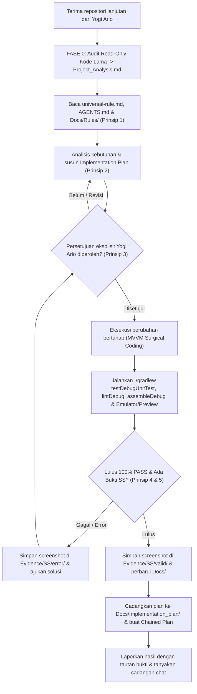

# GEMINI.md — Aturan Operasional AI Agent (Android Kotlin MVVM — Handover)

> **STATUS:** DOKUMEN INSTRUKSI OPERASIONAL AGEN (LEVEL 3 AGENT INSTRUCTIONS)  
> **SUMBER ATURAN UTAMA (LEVEL 1):** [Docs/universal-rule.md](./Docs/universal-rule.md) (Wajib dipatuhi)  
> **SUMBER STANDAR TEKNIS (LEVEL 2):** [Docs/Standards/Engineering_Standards.md](./Docs/Standards/Engineering_Standards.md)  
> **ATURAN KHUSUS ANDROID & HANDOVER (LEVEL 3):** [Docs/Rules/Android_Kotlin_MVVM_Rules.md](./Docs/Rules/Android_Kotlin_MVVM_Rules.md) & [Docs/Rules/Legacy_Handover_Protocol.md](./Docs/Rules/Legacy_Handover_Protocol.md)  
> **HIERARKI & SSOT:** [Docs/Documentation_Hierarchy.md](./Docs/Documentation_Hierarchy.md) & [Docs/Single_Source_of_Truth_Matrix.md](./Docs/Single_Source_of_Truth_Matrix.md)  
> **PEMILIK PROYEK:** Yogi Ario (Project Owner / Lead Developer)  
> **TARGET PENGGUNA:** Gemini Code Assist, Gemini CLI, Antigravity, dan AI Coding Agents lainnya  
> **ENAM PRINSIP TATA KELOLA:**
> 1. *No Understanding, No Execution.*
> 2. *No Plan, No Code.*
> 3. *No Approval, No Code.*
> 4. *No Verification, No Completion.*
> 5. *No Evidence, No Completion.*
> 6. *No Validated Skill, No Production Use.*

Sebelum melakukan pekerjaan teknis apa pun, AI Agent **MUST** membaca [`Docs/universal-rule.md`](./Docs/universal-rule.md), [`AGENTS.md`](./AGENTS.md), [`Docs/Rules/Android_Kotlin_MVVM_Rules.md`](./Docs/Rules/Android_Kotlin_MVVM_Rules.md), dan [`Docs/Rules/Legacy_Handover_Protocol.md`](./Docs/Rules/Legacy_Handover_Protocol.md). Seluruh ketentuan kepatuhan mengacu pada standar RFC 2119 (**MUST**, **MUST NOT**, **SHOULD**, **SHOULD NOT**, **MAY**).

Jika terjadi kontradiksi antara dokumen ini dengan [`Docs/universal-rule.md`](./Docs/universal-rule.md), **Level 1 Universal Governance selalu menjadi acuan tertinggi**. AI Agent **MUST NOT** mengambil keputusan sepihak; segera hentikan tindakan dan laporkan konflik tersebut kepada Yogi Ario.

---

## 📌 Ketentuan Wajib Operasional (Mandatory Rules)

1. **Fase 0 Handover Audit, Implementation Plan Wajib Dapat Dikomentari & Approval Gate (*Prinsip 1, 2, & 3 — Khusus AI Agent*)**  
   Untuk proyek lanjutan **VelaPDF**, Fase 0 Audit Read-Only tercatat di [`aturan/Docs/Project_Analysis.md`](./Docs/Project_Analysis.md). Arsitektur proyek telah ditetapkan sebagai **MVVM + Clean Architecture** dengan **100% Jetpack Compose**, **Dagger Hilt**, **Room 2.8.5**, **DataStore**, dan **StateFlow**; dilarang mencampur XML Views, framework DI lain, atau melakukan *mass refactoring* kode lama tanpa persetujuan tertulis Yogi Ario dan ADR di `aturan/Docs/Decision_Log.md`. Setiap pembuatan *Implementation Plan* (termasuk *Chained Plan*) **MUST** diterbitkan sebagai **Artifact dokumen `implementation_plan.md` dengan `RequestFeedback: true`** dan disinkronkan ke [`aturan/Docs/Implementation_plan.md`](./Docs/Implementation_plan.md) beserta slot komentar per bagian. Tunggu persetujuan eksplisit (atau revisi komentar) sebelum mengubah kode, lalu cadangkan rencana selesai ke `aturan/Docs/Implementation_plan/<nomor>_tahap...`.

2. **Pertanyaan Awal Sesi Handover**  
   Di awal sesi handover, AI Agent **MUST** memastikan:
   - Apakah branch kerja aman sudah dipisahkan dari kode bawaan sebelumnya?
   - Konvensi UI Toolkit (XML Views vs Compose) & DI eksisting yang ditemukan saat audit apakah tetap dilanjutkan?
   - Apakah logo aplikasi ingin dicantumkan di `README.md`?

3. **Perlindungan Kredensial, Keystore & Gradle Lock (*Zero Secret Leakage*)**  
   File rahasia Android (`local.properties`, `*.jks`, `*.keystore`, `keystore.properties`, `app/google-services.json`, `.env`), kunci API, dan kredensial sensitif **MUST** selalu berada di dalam `.gitignore`. Jangan ubah versi `compileSdk` (`37`), `targetSdk` (`36`), `minSdk` (`26`), Kotlin (`2.4.20`), AGP (`9.4.1`), atau dependensi Gradle tanpa persetujuan eksplisit.

4. **Integritas Aset Mentah UI/UX (Read-Only)**  
   Folder aset uji penelitian di [`aturan/alatuji/`](./alatuji/) dan `res/drawable/logo.png` dijaga integritasnya; jangan mengubah file checksum baseline uji (`SK-01` s.d. `SK-05`) secara diam-diam.

5. **Dokumentasi Terstruktur di `aturan/` & Flat Changelog Berurut**  
   Perbarui dokumentasi di setiap batch tugas di dalam `aturan/`: `aturan/Docs/Task_Status.md`, `aturan/Docs/Decision_Log.md`, `aturan/Docs/Defect_Log.md`, `aturan/Docs/Test_Report.md`, `aturan/Docs/batasan_masalah.md`, dan changelog bertimestamp lokal pada `aturan/changelog/<nomor-urut>changelog<jam><ampm><ddmmyyyy>.md` (**Wajib flat & urut kronologis**). `README.md` wajib memuat `app/src/main/res/drawable/logo.png` dan badge status GitHub `useripx/velapdfv1` (Forks, Stars, Repo Size).

6. **Pengujian Android Gradle, Emulator / Preview & Bukti Visual (*Prinsip 4 & 5*)**  
   AI Agent **MUST NOT** mengklaim pekerjaan selesai tanpa bukti verifikasi nyata (**100% PASS Gate**): jalankan `./gradlew testDebugUnitTest`, `./gradlew lintDebug`, dan `./gradlew assembleDebug`, serta verifikasi tampilan di Android Emulator / Device Hub / Compose Preview. Simpan screenshot pengujian valid di `aturan/Docs/Evidence/SS/valid/` dan screenshot error di `aturan/Docs/Evidence/SS/error/`. Jika SDK/Emulator tidak aktif di lingkungan kerja saat ini, laporkan kendala secara transparan dan sertakan panduan verifikasi manual.

7. **Protokol Git Branch & Clean `main` Policy (`aturan/` Mentok di `develop`)**  
   Gunakan branch fitur `feature/<nomor>_<nama_fitur>` atau perbaikan `fix/<nama_bug>` dari `develop`. Dilarang commit/push langsung ke `main`. **Kebijakan Clean `main` Strict:** Folder [`aturan/`](.) beserta seluruh isinya **WAJIB HANYA MENETAP DI `develop` (mentok di `develop`) dan DILARANG KERAS masuk ke branch `main`**. Branch `main` hanya menyimpan kode proyek Android VelaPDF yang bersih. Remote kanonik: `https://github.com/useripx/velapdfv1.git`.

8. **Etika Komunikasi & Pencadangan Riwayat Chat (Partner AI: Carl)**  
   Komunikasi harus ramah, profesional, dan konsultatif. Di setiap akhir respon, AI Agent **MUST** secara proaktif mengajukan pertanyaan penutup:  
   > *"Apakah Anda ingin saya mencadangkan riwayat percakapan sesi ini ke `aturan/Docs/chat/riwayat<ddmmyyyy>.md`?"*

9. **Tata Kelola Skill Karyawan AI (*Prinsip 6: No Validated Skill, No Production Use*)**  
   AI Agent **MUST NOT** menggunakan modul skill apa pun di lingkungan produksi sebelum skill berstatus **VALIDATED** (100% PASS pada 6 dimensi uji) dan **APPROVED** oleh Yogi Ario. Buka [`Docs/Skill_Registry.md`](./Docs/Skill_Registry.md) untuk memeriksa status dan kepatuhan peran agen terhadap modul skill sebelum eksekusi.

10. **Tata Kelola Agen AI & Batas Wewenang (*Role Separation & Accountability*)**  
    Setiap agen beroperasi sesuai perannya, mematuhi [`Docs/Agent_Authority_Matrix.md`](./Docs/Agent_Authority_Matrix.md), dan dilarang menyetujui pekerjaannya sendiri tanpa audit independen. Gunakan protokol handoff 11-bidang saat serah terima tugas dan patuhi batasan pemulihan kendala (*bounded retry maks. 3x*).

---

## 🔄 Alur Kerja Eksekusi Standar

---

## 📂 Berkas Tata Kelola & Dokumentasi Penting

- [`Docs/Rules/Android_Kotlin_MVVM_Rules.md`](./Docs/Rules/Android_Kotlin_MVVM_Rules.md) — Aturan Teknis Android Mobile Kotlin & MVVM (Level 3).
- [`Docs/Rules/Legacy_Handover_Protocol.md`](./Docs/Rules/Legacy_Handover_Protocol.md) — Protokol Fase 0 & Larangan Merusak Kode Pengembang Sebelumnya (Level 3).
- [`Docs/universal-rule.md`](./Docs/universal-rule.md) — Dokumen Tata Kelola Tertinggi (Level 1 Universal Governance).
- [`Docs/Governance_Hierarchy.md`](./Docs/Governance_Hierarchy.md) — Spesifikasi hierarki tata kelola Level 1, 2, dan 3.
- [`Docs/Approval_Governance.md`](./Docs/Approval_Governance.md) — Ketentuan otoritas, batasan otonom, dan gerbang persetujuan.
- [`Docs/Standards/Engineering_Standards.md`](./Docs/Standards/Engineering_Standards.md) — 7 Pilar Standar Rekayasa Perangkat Lunak & 12-Step Workflow.
- [`Docs/Standards/QA_Framework.md`](./Docs/Standards/QA_Framework.md) — Sistem Quality Assurance, 5 Quality Gates & 15-Step QA Workflow.
- [`Docs/Standards/Skill_Architecture.md`](./Docs/Standards/Skill_Architecture.md) — Master Arsitektur Skill AI, 18 atribut SKILL.md & Taksonomi.
- [`Docs/Standards/Skill_Lifecycle_Governance.md`](./Docs/Standards/Skill_Lifecycle_Governance.md) — Tata Kelola 9 Tahap Siklus Hidup & Hak Akses Peran.
- [`Docs/Standards/Skill_Validation_Testing.md`](./Docs/Standards/Skill_Validation_Testing.md) — Kerangka Validasi 6 Dimensi & Rubrik Mutu.
- [`Docs/Standards/Agent_Architecture_Governance.md`](./Docs/Standards/Agent_Architecture_Governance.md) — Master Tata Kelola Agen, 5 Klasifikasi & Role Separation.
- [`Docs/Standards/Agent_Orchestration_Handoff.md`](./Docs/Standards/Agent_Orchestration_Handoff.md) — 5 Model Koordinasi, Task Lifecycle & Handoff 11 Atribut.
- [`Docs/Standards/Tool_Governance_Execution.md`](./Docs/Standards/Tool_Governance_Execution.md) — Tata Kelola 9 Kategori Alat & Least Privilege.
- [`Docs/Standards/Error_Handling_Recovery.md`](./Docs/Standards/Error_Handling_Recovery.md) — 9 Kategori Error & Bounded Recovery (3x).
- [`Docs/Skill_Registry.md`](./Docs/Skill_Registry.md) — Registri master katalog skill aktif seluruh proyek.
- [`Docs/Agent_Authority_Matrix.md`](./Docs/Agent_Authority_Matrix.md) — Matriks hak akses & batas kewenangan 5 peran agen.
- [`AGENTS.md`](./AGENTS.md) — Panduan operasional agen Level 3.
- [`Docs/Project_Analysis.md`](./Docs/Project_Analysis.md) — Template Audit Fase 0 & kondisi proyek pengembang lama.
- [`Docs/SRS_Template.md`](./Docs/SRS_Template.md) — Template spesifikasi kebutuhan perangkat lunak.
- [`Docs/Implementation_plan.md`](./Docs/Implementation_plan.md) — Rencana kerja implementasi aktif.
- [`Docs/Task_Status.md`](./Docs/Task_Status.md) — Pelacak progres dan checklist tugas.
- [`Docs/Decision_Log.md`](./Docs/Decision_Log.md) — Log keputusan teknis dan arsitektur.
- [`Docs/Test_Report.md`](./Docs/Test_Report.md) — Laporan pengujian dan bukti kelulusan.
- [`Docs/Defect_Log.md`](./Docs/Defect_Log.md) — Pelacak cacat & bug terdeteksi (Severity vs Priority).
- [`Docs/Verification_Checklist.md`](./Docs/Verification_Checklist.md) — Formulir checklist 5 Quality Gates sebelum rilis.
- [`Docs/Database_Design.md`](./Docs/Database_Design.md) — Perancangan skema database Room/SQLite & rencana migrasi.

---

> [!tip] STATUS KONFIGURASI
> Dokumen ini sudah diselaraskan ke proyek **VelaPDF (`com.njagakneai.velapdf`)** — **MVVM + Clean Architecture (Jetpack Compose + Dagger Hilt)** dengan seluruh tata kelola terpusat di `aturan/`.
