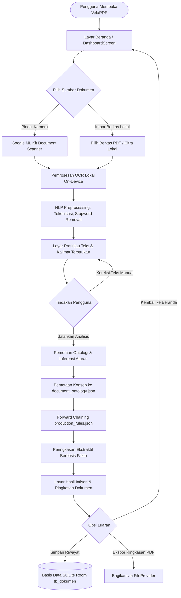

# DESAIN ANTARMUKA PENGGUNA, WIREFRAME, & DEKOMPOSISI ARSITEKTUR BCE

> **Mata Kuliah:** Metodologi Penelitian (Metopen) TA 2026/2027  
> **Mahasiswa:** Yogi Ario Pratama | NPM: 2313020004 | Kelas: 4B  
> **Program Studi:** S-1 Teknik Informatika, Universitas Nusantara PGRI Kediri  
> **Dosen Pembimbing Proposal:** Rony Heri Irawan, M.Kom.  
> **Judul Usulan Penelitian:** *Implementasi Rule-Based Inference pada Sistem VelaPDF*  
> **Fokus Dokumen:** Dasar penyusunan berkas T31 (Bukti Proses Mandiri), T32 (Pemodelan UML OOAD), dan Bab III Laporan 2.

---

## 1. Diagram Alir Antarmuka Pengguna (UI Flow Diagram)

Alur interaksi pengguna dirancang menggunakan pendekatan *Offline-First* yang berorientasi pada kecepatan dan kejelasan perangkuman dokumen:



---

## 2. Wireframe Tata Letak Antarmuka (UI Screen Mockups)

### Layar 1: Dashboard Utama (Menu Penganalisis & Perangkum PDF Cerdas)
```text
┌────────────────────────────────────────────────────────┐
│  [≡] VelaPDF                   [Riwayat] [Pengaturan]  │
├────────────────────────────────────────────────────────┤
│                                                        │
│  Pemindai & Perangkum Dokumen Cerdas Offline           │
│  Ekstrak teks, petakan konsep, dan dapatkan intisari   │
│  dokumen secara instan tanpa sambungan internet.       │
│                                                        │
│  ┌──────────────────────────────────────────────────┐  │
│  │ [Icon: DocumentScanner]                          │  │
│  │                                                  │  │
│  │ Analisis & Ringkas Dokumen AI                    │  │
│  │ Pindai fisik atau unggah PDF untuk merangkum     │  │
│  │ topik, fakta penting, dan klausul kewajiban.     │  │
│  │                                                  │  │
│  │ [ Pindai via Kamera ]     [ Pilih Berkas PDF ]   │  │
│  └──────────────────────────────────────────────────┘  │
│                                                        │
│  Fitur Utilitas Dokumen:                               │
│  [Image to PDF]        [Merge PDF]      [PDF to Image] │
│                                                        │
│  [Convert]              [Scan Dokumen]      [Settings] │
└────────────────────────────────────────────────────────┘
```

### Layar 2: Pratinjau Teks & Segmentasi Kalimat (OcrPreviewScreen)
```text
┌────────────────────────────────────────────────────────┐
│  [←] Pratinjau Teks & Fakta                  [Lanjut →]│
├────────────────────────────────────────────────────────┤
│  Nama Berkas : Surat_Edaran_Jadwal_KRS.pdf             │
│  Ukuran / Hal: 450 KB | 2 Halaman | Status: 100% Lokal │
├────────────────────────────────────────────────────────┤
│  FAKTA METADATA AWAL TEREKSTRAKSI:                     │
│  • Nomor Surat : 048/SE/UNP-KD/2026                    │
│  • Penerbit    : Rektor Universitas Nusantara PGRI     │
│  • Tanggal     : 10 Januari 2026                       │
│  • Perihal     : Pelaksanaan Pemrograman KRS Genap     │
│                                                        │
│  SEGMEN KALIMAT DOKUMEN (Hasil NLP):                   │
│  ┌──────────────────────────────────────────────────┐  │
│  │ [Kalimat 1 - Hal 1]                              │  │
│  │ Diberitahukan kepada seluruh mahasiswa aktif...  │  │
│  │                                                  │  │
│  │ [Kalimat 2 - Hal 1]                              │  │
│  │ Pembayaran SPP wajib diselesaikan paling lambat  │  │
│  │ tanggal 20 Januari 2026.                         │  │
│  └──────────────────────────────────────────────────┘  │
│                                                        │
│  [ Edit Teks Manual ]      [ Jalankan Peringkasan AI ] │
└────────────────────────────────────────────────────────┘
```

### Layar 3: Layar Hasil Intisari & Ringkasan Dokumen (DocumentSummaryScreen)
```text
┌────────────────────────────────────────────────────────┐
│  [←] Intisari Dokumen Cerdas                    [Share]│
├────────────────────────────────────────────────────────┤
│  IDENTITAS DOKUMEN                                     │
│  ┌──────────────────────────────────────────────────┐  │
│  │ Jenis Dokumen: Surat Edaran (SE) Resmi           │  │
│  │ Nomor & Tgl  : 048/SE/UNP-KD/2026 | 10 Jan 2026  │  │
│  │ Penerbit     : Rektor Universitas Nusantara PGRI │  │
│  │ Perihal      : Pemrograman KRS Semester Genap    │  │
│  └──────────────────────────────────────────────────┘  │
│                                                        │
│  POIN-POIN INTISARI DOKUMEN:                           │
│  ┌──────────────────────────────────────────────────┐  │
│  │ • Registrasi semester genap dibuka mulai 12 Jan. │  │
│  │ • Mahasiswa wajib berkonsultasi dengan Dosen PA. │  │
│  │ • Sistem KRS daring ditutup pada 25 Jan 2026.    │  │
│  └──────────────────────────────────────────────────┘  │
│                                                        │
│  KLAUSUL AKSI & TENGGAT WAKTU (DEADLINE):              │
│  ┌──────────────────────────────────────────────────┐  │
│  │ [!] Wajib: Menyelesaikan pembayaran SPP.         │  │
│  │ [!] Tenggat Waktu: 20 Januari 2026 (Hal. 1)      │  │
│  │ [!] Larangan: Pengisian KRS susulan ditiadakan.  │  │
│  └──────────────────────────────────────────────────┘  │
│                                                        │
│  Pemadatan: 74,2% lebih ringkas | Durasi: 412 ms       │
│                                                        │
│  [ Simpan ke Riwayat ]             [ Ekspor Ringkasan ]│
└────────────────────────────────────────────────────────┘
```

---

## 3. Dekomposisi Arsitektur Boundary–Control–Entity (BCE)

Pemisahan tanggung jawab arsitektural mengikuti standar baku *Object-Oriented Analysis and Design* (OOAD) guna memenuhi **Asas Konsistensi Semantik (*Message-to-Method Invariance*)**:

| Lapisan Arsitektur | Komponen / Nama Kelas | Tanggung Jawab Operasional |
| :--- | :--- | :--- |
| **Boundary (Antarmuka)** | `DashboardScreen` | Menangkap interaksi sentuhan pengguna untuk memilih berkas dokumen atau memindai via kamera. |
| | `OcrPreviewScreen` | Menampilkan teks mentah hasil OCR, hasil segmentasi kalimat NLP, dan kontrol koreksi teks. |
| | `DocumentSummaryScreen` | Menyajikan visualisasi intisari dokumen, poin ringkasan, klausul kewajiban/tenggat waktu, dan tombol ekspor. |
| **Control (Pengendali)** | `DocumentAnalysisViewModel` | Mengelola *UI StateFlow*, mengoordinasikan eksekusi pipeline asinkron, dan merespons aksi UI. |
| | `MlKitOcrHelper` | Mengontrol *rendering* bitmap PDF dan menginstruksikan modul *Google ML Kit Text Recognition* lokal. |
| | `NlpTextPreprocessor` | Menjalankan *sentence splitting*, tokenisasi, dan penyaringan kata tugas (*stopword removal*) bahasa Indonesia. |
| | `OntologyLoader` | Mengurai skema taksonomi `document_ontology.json` dan memetakan pola kalimat ke representasi fakta SPO. |
| | `RuleInferenceEngine` | Mengontrol siklus penalaran *Forward Chaining*, pencocokan kondisi aturan, dan penarikan deduksi. |
| | `FactBasedSummarizer` | Mengalkulasi skor relevansi fakta ontologi dan menyusun ringkasan intisari terstruktur. |
| **Entity (Data & Basis Pengetahuan)** | `DocumentMetadata` | Merepresentasikan integritas berkas dokumen (ID, nama berkas, ukuran, checksum SHA-256). |
| | `ExtractedFact` | Merepresentasikan fakta atomik semantik berformat Subjek-Predikat-Objek (SPO). |
| | `DocumentOntologyTaxonomy` | Merepresentasikan struktur taksonomi konsep kelas dokumen, relasi, dan kata kunci leksikal. |
| | `ProductionRule` | Merepresentasikan klausa aturan produksi logika formal (*IF Premis THEN Aksi Deduksi*). |
| | `DocumentSummary` | Menyimpan intisari terpadu, poin ringkasan penting, klausul aksi, dan rasio kompresi. |
| | `AppDatabase (Room)` | Menyimpan persistensi data relasional lokal (`tb_dokumen`, `tb_fakta_semantik`, `tb_ringkasan_inferensi`). |
