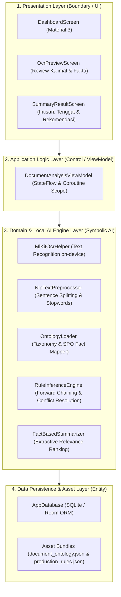

# CETAK BIRU PEMETAAN ASET KE LAPORAN 2: DRAF LENGKAP METODOLOGI PENELITIAN (BAB III)

> **Mata Kuliah:** Metodologi Penelitian (Metopen) TA 2026/2027  
> **Mahasiswa:** Yogi Ario Pratama | NPM: 2313020004 | Kelas: 4B  
> **Program Studi:** S-1 Teknik Informatika, Universitas Nusantara PGRI Kediri  
> **Dosen Pembimbing Proposal:** Rony Heri Irawan, M.Kom.  
> **Judul Usulan Penelitian:** *Implementasi Rule-Based Inference pada Sistem VelaPDF*  
> **Jalur Penelitian:** Pengembangan Sistem / R&D (Engineering Approach)  
> **Sistematika Bab III:** Kepatuhan Mutlak 8 Subbab Resmi (3.1 s.d. 3.8) Bebas Subbab Hipotesis.

---

## 3.1 Pendekatan Rekayasa Sistem
Penelitian ini menggunakan pendekatan *Research and Development* (R&D) berbasis rekayasa perangkat lunak (*software engineering approach*). Pendekatan ini berfokus pada perancangan, konstruksi, dan pembuktian empiris artefak terpasang (*deployed artifact*) berupa aplikasi perangkat bergerak native Android (VelaPDF). Artefak ini mengintegrasikan modul visi komputer lokal (*Google ML Kit OCR on-device*), prapemrosesan teks Bahasa Indonesia (*Indonesian NLP*), representasi pengetahuan semantik (*JSON-based Ontology*), mesin penalaran deduktif (*Rule-Based Forward Chaining*), dan perangkum ekstraktif cerdas (*Fact-Based Summarizer*) dengan prinsip operasional mandiri (*offline-first*).

---

## 3.2 Desain Pengembangan Artefak

Artefak sistem dirancang menggunakan arsitektur berlapis bersih (*Clean Architecture*) 4 (empat) lapisan terisolasi guna menjamin independensi antarmuka, portabilitas logika komputasi, dan modularitas pengujian:

---

## 3.3 Spesifikasi Kebutuhan Sistem (Software Requirements Specification / SRS)

### 3.3.1 Matriks Kebutuhan Fungsional (Functional Requirements / FR)
Seluruh butir kebutuhan fungsional dirumuskan secara berorientasi aksi spesifik dan diberi kodefikasi unik:

| Kode FR | Nama Kebutuhan Fungsional | Deskripsi Tindakan Sistem |
| :---: | :--- | :--- |
| **FR-01** | Pemindaian Dokumen Optik | Sistem mampu membuka antarmuka kamera gawai dan memindai dokumen fisik menggunakan *Google ML Kit Document Scanner* dengan deteksi sudut otomatis. |
| **FR-02** | Pemuatan Berkas Lokal | Sistem mampu membaca berkas dokumen berformat PDF dan citra (JPG/PNG) dari memori penyimpanan internal melalui *Storage Access Framework* (SAF). |
| **FR-03** | Ekstraksi Teks Luring | Sistem mampu merender halaman PDF dan mengekstrak karakter teks dokumen secara lokal on-device menggunakan *Google ML Kit Text Recognition* tanpa jaringan internet. |
| **FR-04** | Prapemrosesan Teks NLP | Sistem mampu melakukan segmentasi kalimat teks berbahasa Indonesia dengan penanganan singkatan formal, pembersihan derau, dan penyaringan kata henti (*stopwords*). |
| **FR-05** | Pemetaan Fakta Ontologi | Sistem mampu mengurai skema taksonomi `document_ontology.json` dan memetakan kalimat hasil OCR menjadi atom fakta berstruktur Subjek-Predikat-Objek (SPO). |
| **FR-06** | Eksekusi Inferensi Aturan & Peringkasan | Sistem mampu mengevaluasi aturan produksi `production_rules.json` menggunakan algoritma *Forward Chaining* serta merangkum dokumen menjadi ringkasan eksekutif, poin intisari, dan klausul kritis (tenggat waktu/larangan). |
| **FR-07** | Persistensi & Ekspor Riwayat | Sistem mampu menyimpan rekaman master dokumen beserta relasi fakta dan ringkasan inferensi ke basis data SQLite Room lokal serta memfasilitasi peninjauan riwayat analisis. |

### 3.3.2 Matriks Kebutuhan Non-Fungsional (Non-Functional Requirements / NFR)
Seluruh batasan non-fungsional dikunci menggunakan ambang batas metrik teknis terukur:

| Kode NFR | Dimensi Parameter | Batasan Teknis Terukur (*Measurable Metric Threshold*) |
| :---: | :--- | :--- |
| **NFR-01** | Independensi Jaringan (*Offline-First*) | Sistem beroperasi 100% tanpa sambungan internet dengan konsumsi kuota data sebesar **0 Byte**. |
| **NFR-02** | Waktu Respons Komputasi (*Latency*) | Total durasi komputasi ekstraksi OCR, NLP, dan inferensi aturan tidak melampaui **1.500 ms** per halaman dokumen standar. |
| **NFR-03** | Efisiensi Alokasi Memori (*RAM Footprint*) | Konsumsi memori kerja (*Heap RAM*) selama siklus analisis aktif berada di bawah **50 MB**. |
| **NFR-04** | Kevalidan Fungsional (*Correctness*) | Tingkat keberhasilan eksekusi pengujian fungsional *Black-Box Testing* mencapai target mutlak **100% valid**. |
| **NFR-05** | Tingkat Keterpakaian (*Usability*) | Evaluasi kemudahan penggunaan menggunakan instrumen baku *System Usability Scale* (SUS) meraih skor rata-rata minimal **$\ge 68$** (*Acceptable* / Kategori *Good*). |

---

## 3.4 Prosedur Model SDLC Terpilih (Siklus Prototyping)
Pengembangan sistem VelaPDF menerapkan model siklus hidup pengembangan perangkat lunak **Prototyping** (Pressman & Maxim, 2020), yang terdiri atas 5 (lima) tahapan iteratif:
1. **Analisis Kebutuhan Cepat (*Quick Analysis*):** Mengidentifikasi inefisiensi alur penelaahan dokumen manual yang panjang dan menetapkan spesifikasi fungsional FR/NFR perangkum cerdas.
2. **Perancangan Kilat Arsitektur (*Quick Design*):** Menyusun pemodelan UML (Use Case, Sequence, Class Diagram) serta skema data fisik (PDM) 3 tabel relasional SQLite/Room.
3. **Konstruksi Prototipe (*Prototype Construction*):** Mengimplementasikan kode program Kotlin pada Android Studio, mencakup *MlKitOcrHelper*, *NlpTextPreprocessor*, *OntologyLoader*, *RuleInferenceEngine*, dan *FactBasedSummarizer*.
4. **Evaluasi Pengguna Terhadap Prototipe (*Customer Evaluation*):** Menguji prototipe awal kepada dosen pembimbing dan perwakilan pengguna mahasiswa untuk menjaring umpan balik antarmuka dan kelengkapan aturan regulasi.
5. **Penyempurnaan & Pengujian Final (*Refinement & Testing*):** Memperbaiki penanganan eksepsi dan mengeksekusi pengujian formal *Black-Box Testing* (SK-01 s.d SK-05) serta kuesioner baku SUS 10 butir.

---

## 3.5 Teknik Elisitasi Kebutuhan Lapangan
Elisitasi kebutuhan dilakukan secara empiris menggunakan 4 (empat) teknik terpadu:
1. **Wawancara Terstruktur (*Structured Interview*):** Dilaksanakan dengan staf bagian administrasi kelembagaan dan civitas kampus untuk menggali beban waktu membaca dokumen resmi yang panjang (rata-rata 10-15 menit per dokumen) serta risiko terlewatnya tenggat waktu kritis (*deadline*).
2. **Observasi Operasional Langsung (*Direct Observation*):** Mengamati langsung interaksi pengguna saat membaca dokumen regulasi atau surat edaran pada smartphone berlayar kecil, mencatat titik lelah kognitif (*information overload*) dan kebutuhan intisari singkat berpoin.
3. **Telaah Dokumen Fisik (*Document Review*):** Membedah struktur naskah dinas formal (Surat Keputusan, Surat Edaran, Pedoman/SOP, Peraturan, dan Laporan) pada lingkungan Universitas Nusantara PGRI Kediri (`SK-01` s.d. `SK-05`).
4. **Survei Kebutuhan Awal (*Questionnaire Survey*):** Menyebarkan kuesioner pendahuluan kepada mahasiswa perihal kebutuhan alat bantu pemindaian dan perangkum dokumen luring yang menjaga privasi data.

---

## 3.6 Pemodelan Logika Sistem Terpadu (UML)
*(Merujuk secara utuh pada cetak biru `pemetaan_ke_tugas_3.md` yang memuat Use Case Diagram, Tabel Skenario Use Case UC-01, Sequence Diagram berpola BCE, Class Diagram, dan Tabel Message-to-Method Invariance).*

---

## 3.7 Perancangan Skema Data Fisik (Physical Data Model / PDM)
*(Merujuk secara utuh pada berkas `pdm_schema.sql` yang memuat tabel fisik `tb_dokumen`, `tb_fakta_semantik`, dan `tb_ringkasan_inferensi` dengan integritas referensial ON DELETE CASCADE).*

---

## 3.8 Kriteria Penilaian Keberhasilan Produk
Keberhasilan rekayasa sistem VelaPDF dikunci secara objektif pada 2 (dua) tolok ukur saintifik:
1. **Kelayakan Fungsional (Black-Box Testing):** Seluruh kasus uji fungsional pada modul analisis dokumen dinyatakan lulus 100% tanpa cacat kritis ($P_{valid} = 100\%$).
2. **Keterpakaian Pengguna (System Usability Scale):** Pengujian kepada responden pengguna menghasilkan skor rata-rata SUS $\ge 68$, membuktikan bahwa sistem diterima secara positif (*Acceptable*) dan mudah dioperasikan.

---

## Daftar Pustaka Bab III (Standar IEEE)

1. R. S. Pressman and B. R. Maxim, *Software Engineering: A Practitioner's Approach*, 9th ed. New York, NY, USA: McGraw-Hill Education, 2020.
2. I. Sommerville, *Software Engineering*, 10th ed. Boston, MA, USA: Pearson, 2016.
3. J. Brooke, "SUS: A 'quick and dirty' usability scale," in *Usability Evaluation in Industry*, P. W. Jordan, B. Thomas, I. L. McClelland, and B. Weerdmeester, Eds. London, UK: Taylor & Francis, 1996, pp. 189–194.
