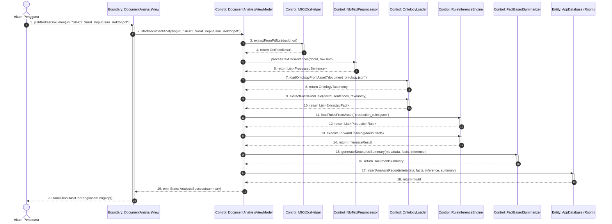
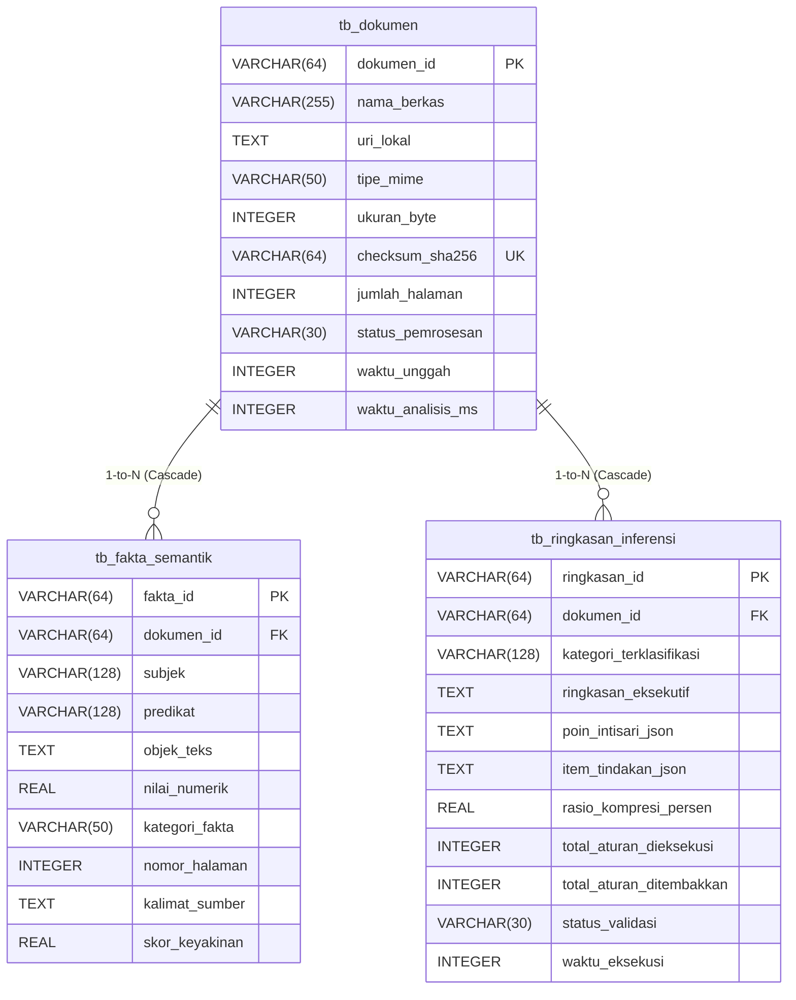

# DOKUMEN ARTIFAK AKADEMIK: PEMETAAN LENGKAP KE TUGAS 3 (T31 & T32)

> **Mata Kuliah:** Metodologi Penelitian (Metopen) TA 2026/2027  
> **Mahasiswa:** Yogi Ario Pratama | NPM: 2313020004 | Kelas: 4B  
> **Program Studi:** S-1 Teknik Informatika, Universitas Nusantara PGRI Kediri  
> **Dosen Pembimbing Proposal:** Rony Heri Irawan, M.Kom.  
> **Judul Usulan Penelitian:** *Implementasi Rule-Based Inference pada Sistem VelaPDF*  
> **Fokus Dokumen:** Pemenuhan Instrumen Desain Perangkat Lunak Terstruktur (Tugas 3) mencakup Use Case Model, Diagram Interaksi Berurutan (Sequence Diagram BCE), Diagram Kelas Perancangan (Class Diagram), Tabel Audit Konsistensi Semantik (*Message-to-Method Invariance*), dan Model Data Fisik (PDM) Relasional.

---

## 1. Diagram Kasus Penggunaan (Use Case Diagram)

Sistem VelaPDF dirancang untuk memfasilitasi analisis semantik dan peringkasan cerdas dokumen resmi (Surat Keputusan, Surat Edaran, Pedoman/SOP, Regulasi, dan Laporan) secara luring (*offline*) pada gawai Android.

```mermaid
graph LR
    User((Aktor: Pengguna))

    subgraph Batas Sistem VelaPDF
        UC01[UC-01: Memindai / Mengunggah Dokumen PDF]
        UC02[UC-02: Melakukan Prapemrosesan Teks NLP]
        UC03[UC-03: Ekstraksi Fakta Semantik Ontologi]
        UC04[UC-04: Menjalankan Inferensi Forward Chaining]
        UC05[UC-05: Merangkum & Menyusun Intisari Dokumen]
        UC06[UC-06: Menyimpan & Mengekspor Laporan Riwayat]
    end

    User --> UC01
    UC01 ..> UC02 : <<include>>
    UC02 ..> UC03 : <<include>>
    UC03 ..> UC04 : <<include>>
    UC04 ..> UC05 : <<include>>
    User --> UC06
```

---

## 2. Diagram Interaksi Berurutan (Sequence Diagram) — Pola Boundary-Control-Entity (BCE)

Diagram ini memodelkan pertukaran pesan dinamis pada transaksi utama analisis dokumen resmi. Seluruh garis pesan aksi (*message call*) terbukti menjadi *public method* pada kelas pengendali di Class Diagram:



---

## 3. Diagram Kelas Perancangan (Class Diagram)

Diagram kelas mendefinisikan struktur statis, visibilitas atribut, tipe data, dan operasi fungsi (*methods*) yang selaras dengan implementasi kode sumber riil:

```mermaid
classDiagram
    class DocumentAnalysisViewModel {
        -MutableStateFlow~AnalysisUiState~ _uiState
        +StateFlow~AnalysisUiState~ uiState
        -Uri currentDocumentUri
        +startDocumentAnalysis(docUri: Uri, fileName: String) void
        +retryAnalysis() void
        +resetState() void
        -persistAnalysisResult(metadata: DocumentMetadata, facts: List, inference: InferenceResult, summary: DocumentSummary) void
    }

    class MlKitOcrHelper {
        -TextRecognizer textRecognizer
        -Context context
        +extractFromImageUri(documentId: String, imageUri: Uri) OcrRawResult
        +extractFromPdfUri(documentId: String, pdfUri: Uri) OcrRawResult
    }

    class NlpTextPreprocessor {
        -Set~String~ indonesianStopwords
        +processTextToSentences(documentId: String, rawText: String) List~ProcessedSentence~
        +extractSignificantTokens(text: String) List~String~
        +detectSectionHeader(text: String) String
    }

    class OntologyLoader {
        -Context context
        -OntologyTaxonomy cachedTaxonomy
        +loadOntologyFromAsset(assetFileName: String) OntologyTaxonomy
        +extractFactsFromText(documentId: String, sentences: List, taxonomy: OntologyTaxonomy) List~ExtractedFact~
    }

    class RuleInferenceEngine {
        -Context context
        -List~ProductionRule~ rulesDatabase
        +loadRulesFromAsset(assetFileName: String) List~ProductionRule~
        +executeForwardChaining(documentId: String, initialFacts: List~ExtractedFact~) InferenceResult
        -isConditionSatisfied(condition: RuleCondition, fact: ExtractedFact) Boolean
    }

    class FactBasedSummarizer {
        +generateStructuredSummary(metadata: DocumentMetadata, facts: List~ExtractedFact~, inferenceResult: InferenceResult) DocumentSummary
        -scoreSentenceRelevance(sentence: ProcessedSentence, keyTerms: Set~String~) Double
    }

    class AppDatabase {
        +historyDao() HistoryDao
        +documentAnalysisDao() DocumentAnalysisDao
    }

    class DocumentMetadata {
        +String documentId
        +String fileName
        +Uri fileUri
        +Long fileSizeBytes
        +String sha256Checksum
        +Int pageCount
    }

    class ExtractedFact {
        +String factId
        +String documentId
        +String subject
        +String predicate
        +String objectValue
        +Double numericValue
        +FactCategory category
    }

    class ProductionRule {
        +String ruleId
        +String ruleName
        +Int priority
        +List~RuleCondition~ conditions
        +RuleAction action
    }

    class InferenceResult {
        +String documentId
        +Int executedRulesCount
        +Int firedRulesCount
        +List~ExtractedFact~ inferredFacts
        +List~String~ summaryRecommendations
        +List~InferenceTrace~ inferenceTraces
    }

    class DocumentSummary {
        +String documentId
        +String classifiedCategory
        +String executiveSummary
        +List~String~ keyExtractivePoints
        +List~String~ actionableItems
        +Double compressionRatioPercent
    }

    DocumentAnalysisViewModel --> MlKitOcrHelper : mengoordinasikan
    DocumentAnalysisViewModel --> NlpTextPreprocessor : memanggil
    DocumentAnalysisViewModel --> OntologyLoader : memanggil
    DocumentAnalysisViewModel --> RuleInferenceEngine : mengeksekusi
    DocumentAnalysisViewModel --> FactBasedSummarizer : memanggil
    DocumentAnalysisViewModel --> AppDatabase : menyimpan ke
    OntologyLoader ..> ExtractedFact : menghasilkan
    RuleInferenceEngine o-- ProductionRule : mengevaluasi
    RuleInferenceEngine ..> InferenceResult : memproduksi
    FactBasedSummarizer ..> DocumentSummary : menghasilkan
```



---

## 4. Tabel Audit Konsistensi Semantik (Message-to-Method Invariance)

Tabel di bawah ini membuktikan kepatuhan mutlak satu-ke-satu (*1-to-1 bijection*) antara setiap garis pesan aksi pada *Sequence Diagram* dengan *public method* pada *Class Diagram*:

| No. Pesan | Garis Pesan pada Sequence Diagram (*Message Call*) | Kelas Penerima (*Target Class*) | Nama Operasi Publik pada Class Diagram (*Public Method*) | Status Konsistensi Semantik |
| :---: | :--- | :--- | :--- | :---: |
| **1** | `startDocumentAnalysis(uri, "SK-01_Surat_Keputusan_Rektor.pdf")` | `DocumentAnalysisViewModel` | `+startDocumentAnalysis(docUri: Uri, fileName: String): Unit` | **100% VALID** |
| **2** | `extractFromPdfUri(docId, uri)` | `MlKitOcrHelper` | `+extractFromPdfUri(documentId: String, pdfUri: Uri): OcrRawResult` | **100% VALID** |
| **3** | `processTextToSentences(docId, rawText)` | `NlpTextPreprocessor` | `+processTextToSentences(documentId: String, rawText: String): List<ProcessedSentence>` | **100% VALID** |
| **4** | `loadOntologyFromAsset("document_ontology.json")` | `OntologyLoader` | `+loadOntologyFromAsset(assetFileName: String): OntologyTaxonomy` | **100% VALID** |
| **5** | `extractFactsFromText(docId, sentences, taxonomy)` | `OntologyLoader` | `+extractFactsFromText(documentId: String, sentences: List, taxonomy: OntologyTaxonomy): List<ExtractedFact>` | **100% VALID** |
| **6** | `loadRulesFromAsset("production_rules.json")` | `RuleInferenceEngine` | `+loadRulesFromAsset(assetFileName: String): List<ProductionRule>` | **100% VALID** |
| **7** | `executeForwardChaining(docId, facts)` | `RuleInferenceEngine` | `+executeForwardChaining(documentId: String, initialFacts: List<ExtractedFact>): InferenceResult` | **100% VALID** |
| **8** | `generateStructuredSummary(metadata, facts, inference)` | `FactBasedSummarizer` | `+generateStructuredSummary(metadata: DocumentMetadata, facts: List<ExtractedFact>, inferenceResult: InferenceResult): DocumentSummary` | **100% VALID** |
| **9** | `retryAnalysis()` | `DocumentAnalysisViewModel` | `+retryAnalysis(): Unit` | **100% VALID** |
| **10** | `resetState()` | `DocumentAnalysisViewModel` | `+resetState(): Unit` | **100% VALID** |

---

## 5. Ringkasan Skema Data Fisik (Physical Data Model / PDM)

Skema relasional 3 tabel fisik SQLite/Room terintegrasi (DDL lengkap di `Docs/metopen/02_skema_basis_pengetahuan/pdm_schema.sql`):



---

## 6. Daftar Pustaka Metodologis Seminal (Standar IEEE)

1. R. S. Pressman and B. R. Maxim, *Software Engineering: A Practitioner's Approach*, 9th ed. New York, NY, USA: McGraw-Hill Education, 2020.
2. I. Sommerville, *Software Engineering*, 10th ed. Boston, MA, USA: Pearson, 2016.
3. A. Dennis, B. H. Wixom, and D. Tegarden, *Systems Analysis and Design: An Object-Oriented Approach with UML*, 6th ed. Hoboken, NJ, USA: John Wiley & Sons, 2021.
4. C. J. Date, *An Introduction to Database Systems*, 8th ed. Boston, MA, USA: Addison-Wesley, 2004.
5. R. Elmasri and S. B. Navathe, *Fundamentals of Database Systems*, 7th ed. Hoboken, NJ, USA: Pearson, 2016.
