# Dokumentasi Belajar & Persiapan Tanya Jawab Dosen — Tahap 01 (`OCR Offline + Rule-Based Inference + ASK Vela`)

> **UNTUK MAHASISWA / PENELITI:** Yogi Ario Pratama (`NPM: 2313020004`, S-1 Teknik Informatika UNP Kediri)  
> **JUDUL PENELITIAN:** *Implementasi Rule-Based Inference pada Sistem VelaPDF*  
> **CAKUPAN TAHAP 01:** Rekonstruksi Mesin OCR Gambar & PDF Luring, Eksternal 4 Berkas JSON Pengetahuan Bahasa Indonesia, Mesin Inferensi *Forward Chaining*, Antarmuka **ASK Vela** & Tombol **"Ringkasan AI (Offline)"**, Room Database v2 (`MIGRATION_1_2`), serta Unit Test Otomatis.  
> **DOKUMEN PENDAMPING:** [`batasan_masalah.md`](../Docs/batasan_masalah.md) | [`Database_Design.md`](../Docs/Database_Design.md) | [`Panduan_Belajar_Dosen.md`](../Docs/Panduan_Belajar_Dosen.md)

---

## 1. Cara Menjelaskan Tahap 1 ke Dosen dalam 30 Detik (*Elevator Pitch*)

> *"Pak/Bu, pada Tahap 1 ini aplikasi Android **VelaPDF** sudah mampu membaca dokumen foto kamera maupun berkas PDF standar secara **100% offline** (nol kuota internet, nol Cloud AI). Misalnya saya memotret atau memilih halaman 23 sampai 35 dari buku IoT berbahasa Indonesia atau Surat Keputusan kampus. Pertama, Google ML Kit OCR mengekstrak teks mentah; kedua, modul NLP lokal membersihkan stopword Bahasa Indonesia dengan 732 kata tugas; ketiga, modul Ontologi & Kamus SPO mengekstrak fakta terstruktur (Subjek–Predikat–Objek); keempat, Mesin **Rule-Based Inference (Forward Chaining)** menembakkan 13 aturan `IF–THEN` dari berkas JSON untuk mengklasifikasikan dokumen dan menurunkan fakta baru; terakhir, sistem menyusun **Ringkasan Poin Intisari (beserta nomor halaman)** dan **Paragraf Kesimpulan Bahasa Indonesia** yang dapat disimpan ke Room SQLite atau diekspor menjadi berkas PDF baru."*

---

## 2. Alur Kerja Sistem End-to-End (*Kenali Setiap Pipa Data*)

```mermaid
flowchart LR
    U["Input Pengguna:<br/>Foto Kamera / Galeri / PDF Tebal (Hal. 23–35)"] --> OCR["1. Google ML Kit OCR & PdfRenderer<br/>(MlKitRepository.kt)"]
    OCR --> OPT{"Ingin koreksi teks?"}
    OPT -->|"Edit Teks OCR"| PRE["OcrPreviewScreen.kt<br/>(Koreksi manual per halaman)"]
    OPT -->|"Ringkasan Langsung"| NLP
    PRE --> NLP["2. Prapemrosesan NLP Lokal<br/>(NlpTextPreprocessor.kt + nlp_lexicon_id.json)"]
    NLP --> ONT["3. Ontologi & Ekstraksi Fakta SPO<br/>(OntologyLoader.kt + document_ontology.json + spo_pattern_dictionary.json)"]
    ONT --> INF["4. Mesin Inferensi Forward Chaining<br/>(RuleInferenceEngine.kt + production_rules.json)"]
    INF --> SUM["5. Penyusun Ringkasan & Kesimpulan ID<br/>(FactBasedSummarizer.kt)"]
    SUM --> OUT["DocumentSummaryScreen.kt:<br/>Simpan Room v2 / Salin / Bagikan / Ekspor PDF (iText7)"]
```

### Penjelasan Sederhana 5 Tahap Pipeline:
1. **Tahap 1 — Input & Ekstraksi Teks (`MlKitRepository.kt`):**
   - Jika sumbernya **foto kamera / galeri** (`extractPagesFromImageUris`), gambar dibaca lewat `InputImage.fromFilePath(...)` oleh ML Kit Text Recognition Latin on-device.
   - Jika sumbernya **berkas PDF** (`extractFromPdfUri`), Android `PdfRenderer` membuka halaman PDF satu per satu sesuai rentang yang dipilih user (`startPage..endPage`, dibatasi maksimal 35 halaman per sesi), menggambarnya di atas `Bitmap` berlatar **putih solid** (`Color.WHITE`), menjaga lebar maksimal `1600px`, mengirimkannya ke ML Kit OCR, lalu langsung memanggil `bitmap.recycle()` di blok `finally` agar RAM perangkat tetap ringan ($\le 50\text{ MB}$).
2. **Tahap 2 — NLP Lokal Bahasa Indonesia (`NlpTextPreprocessor.kt`):**
   - Memecah teks menjadi kalimat utuh sambil **melindungi singkatan** (`No.`, `Hal.`, `Dr.`, `M.Kom.`, `dll.`) supaya titik pada `"No. 112"` tidak salah potong menjadi dua kalimat.
   - Membersihkan karakter acak, mendeteksi seksi bacaan (`HEADER`, `DEFINITION`, `MECHANISM`, `CLAUSE`, `CONCLUSION`), membuang **732 kata tugas (*stopwords*)**, lalu menghitung bobot kata kunci (*domainBoostTerms*) untuk menentukan topik dominan.
3. **Tahap 3 — Pemetaan Ontologi & Ekstraksi Fakta SPO (`OntologyLoader.kt`):**
   - Mengukur skor kemunculan kata kunci taksonomi di `document_ontology.json` untuk membedakan **Dokumen Resmi/Formal** (`SuratKeputusan`, `SuratEdaran`, `PedomanSOP`, `PeraturanRegulasi`, `LaporanResmi`) vs **Buku Ajar/Informatif** (`BukuAjarTeknis`, `DokumenInformatifUmum`).
   - Memindai setiap kalimat terhadap **15 pola SPO** di `spo_pattern_dictionary.json` untuk menghasilkan fakta terstruktur `(Subjek, Predikat, Objek, Halaman)`.
   - *Contoh nyata buku IoT:* Kalimat *"Internet of Things adalah jaringan perangkat fisik..."* diekstrak menjadi fakta:
     `[Subjek: Internet of Things] — (memilikiDefinisi) -> [Objek: jaringan perangkat fisik...]` (`Hal. 23`).
4. **Tahap 4 — Mesin Inferensi *Forward Chaining* (`RuleInferenceEngine.kt`):**
   - Mengurutkan 13 aturan produksi (`RULE_01` s.d. `RULE_13`) dari **prioritas tertinggi ke terendah**.
   - Menggunakan strategi **Data-Driven (*Forward Chaining*)**: selama ada aturan yang semua kondisinya (`conditions`) cocok dengan himpunan fakta kerja (*working memory*) saat ini dan belum pernah ditembakkan (`firedRules`), aturan dieksekusi (*fired*) dan **menghasilkan fakta turunan baru (*inferredFacts*)** yang ditambahkan kembali ke *working memory* serta dicatat jejak penalarannya (`InferenceTrace`).
5. **Tahap 5 — Penyusun Kesimpulan & Ekspor (`FactBasedSummarizer.kt` & `SummaryPdfExporter.kt`):**
   - Meranking kalimat paling informatif (*Extractive Scoring*: kepadatan kata kunci + keselarasan dengan fakta SPO & seksi penting) dengan atribut halaman asli (`Hal. X`).
   - Menyusun **Paragraf Kesimpulan Otomatis Bahasa Indonesia** yang merangkum jenis dokumen, topik dominan, sumber/penerbit, temuan SPO (definisi/komponen/kewajiban/batas waktu), dan rekomendasi tindak lanjut hasil inferensi.
   - Hasil otomatis disimpan ke **Room Database v2** (`analysis_history_table`), bisa disalin ke clipboard, dibagikan sebagai teks, maupun diekspor menjadi berkas `.pdf` offline melalui `iText7` (`SummaryPdfExporter.kt`).

---

## 3. Membedah 4 Berkas JSON Pengetahuan (`app/src/main/assets/`)

> Mengapa 4 berkas JSON ini sangat penting saat presentasi ke dosen? Karena pada sistem berbasis aturan (*Knowledge-Based System*), **Basis Pengetahuan (*Knowledge Base*) WAJIB dipisahkan dari Mesin Inferensi (*Inference Engine*)**. Jika ingin menambah istilah atau aturan baru, kita cukup mengubah JSON tanpa menulis ulang logika mesin Java/Kotlin-nya.

| Nama Berkas | Peran Ilmiah | Isi Aktual Tahap 1 | Contoh Konkret |
| :--- | :--- | :--- | :--- |
| [`nlp_lexicon_id.json`](file:///C:/Users/yogia/AndroidStudioProjects/VelaPDF/app/src/main/assets/nlp_lexicon_id.json) | **Korpus Leksikon NLP** | `732` *stopwords*, `25` singkatan terlindungi, `7` penanda seksi, `33` istilah penguat domain | Menahan titik di `Dr.`, `M.Pd.`, membuang `"yang"`, `"adalah"`, menguatkan `"iot"`, `"sensor"`, `"protokol"` |
| [`spo_pattern_dictionary.json`](file:///C:/Users/yogia/AndroidStudioProjects/VelaPDF/app/src/main/assets/spo_pattern_dictionary.json) | **Kamus Ekstraksi Relasi Semantik SPO** | `15` pola regex berlabel `domainScope` (`FORMAL`, `BOOK`, `ALL`) | `SPO_DOC_NUMBER`, `SPO_OBLIGATION` (`wajib`), `SPO_DEFINITION` (`adalah/merupakan`), `SPO_COMPONENTS` (`terdiri dari`) |
| [`document_ontology.json`](file:///C:/Users/yogia/AndroidStudioProjects/VelaPDF/app/src/main/assets/document_ontology.json) | **Taksonomi & Ontologi Dokumen (`v2.1.0`)** | `8` konsep kelas (`DokumenResmi` induk + `5` subkelas formal `SK-01..SK-05` + `BukuAjarTeknis` + `DokumenInformatifUmum`) | Memisahkan konsep `SuratKeputusan` (*menimbang, memutuskan*) vs `BukuAjarTeknis` (*arsitektur, sensor, bab*) |
| [`production_rules.json`](file:///C:/Users/yogia/AndroidStudioProjects/VelaPDF/app/src/main/assets/production_rules.json) | **Basis Aturan Produksi `IF–THEN` (`v2.1.0`)** | `13` aturan produksi (`RULE_01` s.d. `RULE_13`) dengan `priority`, `conditions`, dan `action` | `RULE_01` (SK), `RULE_05` (Kewajiban + Deadline Kritis), `RULE_09` (Buku Ajar Teknis), `RULE_10..12` (Definisi/Komponen/Fungsi) |

---

## 4. Peta Berkas Kode Android Tahap 1 (MVVM + Clean Architecture)

- **Domain Layer (`domain/` — murni Kotlin, bebas ketergantungan UI):**
  - [`SimpleJsonParser.kt`](file:///C:/Users/yogia/AndroidStudioProjects/VelaPDF/app/src/main/java/com/njagakneai/velapdf/domain/util/SimpleJsonParser.kt) — Parser JSON murni JVM tanpa `org.json` Android stub.
  - [`DocumentAnalysisModels.kt`](file:///C:/Users/yogia/AndroidStudioProjects/VelaPDF/app/src/main/java/com/njagakneai/velapdf/domain/model/DocumentAnalysisModels.kt) — Model domain & kontrak `AssetTextProvider`.
  - [`NlpTextPreprocessor.kt`](file:///C:/Users/yogia/AndroidStudioProjects/VelaPDF/app/src/main/java/com/njagakneai/velapdf/domain/nlp/NlpTextPreprocessor.kt), [`OntologyLoader.kt`](file:///C:/Users/yogia/AndroidStudioProjects/VelaPDF/app/src/main/java/com/njagakneai/velapdf/domain/ontology/OntologyLoader.kt), [`RuleInferenceEngine.kt`](file:///C:/Users/yogia/AndroidStudioProjects/VelaPDF/app/src/main/java/com/njagakneai/velapdf/domain/inference/RuleInferenceEngine.kt), [`FactBasedSummarizer.kt`](file:///C:/Users/yogia/AndroidStudioProjects/VelaPDF/app/src/main/java/com/njagakneai/velapdf/domain/summary/FactBasedSummarizer.kt).
- **Data & DI Layer (`data/` & `di/`):**
  - [`MlKitRepository.kt`](file:///C:/Users/yogia/AndroidStudioProjects/VelaPDF/app/src/main/java/com/njagakneai/velapdf/data/ocr/MlKitRepository.kt) — OCR Gambar & `PdfRenderer` rentang halaman aman memori.
  - [`AppDatabase.kt`](file:///C:/Users/yogia/AndroidStudioProjects/VelaPDF/app/src/main/java/com/njagakneai/velapdf/data/database/AppDatabase.kt) (`v2`), [`AnalysisHistoryEntity.kt`](file:///C:/Users/yogia/AndroidStudioProjects/VelaPDF/app/src/main/java/com/njagakneai/velapdf/data/model/AnalysisHistoryEntity.kt), [`AnalysisHistoryDao.kt`](file:///C:/Users/yogia/AndroidStudioProjects/VelaPDF/app/src/main/java/com/njagakneai/velapdf/data/database/AnalysisHistoryDao.kt).
  - [`DatabaseModule.kt`](file:///C:/Users/yogia/AndroidStudioProjects/VelaPDF/app/src/main/java/com/njagakneai/velapdf/di/DatabaseModule.kt) (`MIGRATION_1_2` eksplisit tanpa destructive fallback) & [`AnalysisModule.kt`](file:///C:/Users/yogia/AndroidStudioProjects/VelaPDF/app/src/main/java/com/njagakneai/velapdf/di/AnalysisModule.kt).
  - [`DocumentAnalysisRepository.kt`](file:///C:/Users/yogia/AndroidStudioProjects/VelaPDF/app/src/main/java/com/njagakneai/velapdf/data/repository/DocumentAnalysisRepository.kt) & [`SummaryPdfExporter.kt`](file:///C:/Users/yogia/AndroidStudioProjects/VelaPDF/app/src/main/java/com/njagakneai/velapdf/utils/SummaryPdfExporter.kt).
- **UI & ViewModel Layer (`ui/`):**
  - [`DocumentAnalysisViewModel.kt`](file:///C:/Users/yogia/AndroidStudioProjects/VelaPDF/app/src/main/java/com/njagakneai/velapdf/ui/viewmodel/DocumentAnalysisViewModel.kt) & [`OcrViewModel.kt`](file:///C:/Users/yogia/AndroidStudioProjects/VelaPDF/app/src/main/java/com/njagakneai/velapdf/ui/viewmodel/OcrViewModel.kt).
  - [`AskVelaScreen.kt`](file:///C:/Users/yogia/AndroidStudioProjects/VelaPDF/app/src/main/java/com/njagakneai/velapdf/ui/screen/AskVelaScreen.kt) (Upload PDF + Pemilih Semua/Rentang Halaman + Scan Kamera + Galeri + Riwayat).
  - [`DocumentSummaryScreen.kt`](file:///C:/Users/yogia/AndroidStudioProjects/VelaPDF/app/src/main/java/com/njagakneai/velapdf/ui/screen/DocumentSummaryScreen.kt) (Kesimpulan ID, Poin berhalaman, Akordion SPO & Jejak Rule, Salin/Bagikan/Ekspor PDF).
  - [`OcrPreviewScreen.kt`](file:///C:/Users/yogia/AndroidStudioProjects/VelaPDF/app/src/main/java/com/njagakneai/velapdf/ui/screen/OcrPreviewScreen.kt), [`EditImageScreen.kt`](file:///C:/Users/yogia/AndroidStudioProjects/VelaPDF/app/src/main/java/com/njagakneai/velapdf/ui/screen/EditImageScreen.kt), [`ImageToPdfScreen.kt`](file:///C:/Users/yogia/AndroidStudioProjects/VelaPDF/app/src/main/java/com/njagakneai/velapdf/ui/screen/ImageToPdfScreen.kt), [`DashboardScreen.kt`](file:///C:/Users/yogia/AndroidStudioProjects/VelaPDF/app/src/main/java/com/njagakneai/velapdf/ui/screen/DashboardScreen.kt) (Bottom Bar 4 tab: `Beranda`, `Scan`, `ASK Vela`, `Settings`), [`NavGraph.kt`](file:///C:/Users/yogia/AndroidStudioProjects/VelaPDF/app/src/main/java/com/njagakneai/velapdf/ui/navigation/NavGraph.kt).

---

## 5. Cara Menambah Pola SPO / Aturan Baru Secara Mudah (Bila Ditanya Dosen)

Jika dosen meminta penambahan pola kalimat baru (misal pola `"metode X digunakan pada..."` atau istilah teknik baru):
1. Buka [`spo_pattern_dictionary.json`](file:///C:/Users/yogia/AndroidStudioProjects/VelaPDF/app/src/main/assets/spo_pattern_dictionary.json) dan tambahkan 1 objek JSON baru pada array `"patterns"` (tentukan `patternId`, `domainScope`, `subject`, `predicate`, dan `regexPattern`). Tidak perlu menyentuh `OntologyLoader.kt`.
2. Bila ada aturan tindak lanjut baru atas predikat tersebut, tambahkan 1 objek pada array `"rules"` di [`production_rules.json`](file:///C:/Users/yogia/AndroidStudioProjects/VelaPDF/app/src/main/assets/production_rules.json). Tidak perlu menyentuh `RuleInferenceEngine.kt`.
3. Bila ingin menambah kata kunci atau stopword, cukup edit `nlp_lexicon_id.json` atau `document_ontology.json`.

---

## 6. Bank 18 Pertanyaan & Jawaban Kritis yang PASTI Muncul (Bimbingan / Sempro / Demo Tahap 1)

### A. Metodologi AI, Ontologi, SPO & *Rule-Based Inference*

**Q1. Mengapa aplikasi ini memakai *Rule-Based Inference*, bukan langsung menembak API Gemini / ChatGPT / LLM saja yang lebih pintar?**  
**Jawaban:** Karena syarat utama sistem **VelaPDF** adalah **100% Luring (*Offline-First*)**, menjaga **privasi dokumen lokal pengguna** (surat keputusan/catatan kampus/buku tidak keluar ke server pihak ketiga), biaya operasional nol rupiah tanpa API Key berbayar, serta hasil ringkasan yang **deterministik dan dapat diaudit** (*explainable* melalui jejak aturan `RULE_01..RULE_13`). Menjalankan LLM lokal berbobot miliaran parameter terlalu berat untuk HP Android kelas menengah, sedangkan *Rule-Based Inference* berjalan dalam hitungan milidetik di perangkat dengan konsumsi memori sangat rendah.

**Q2. Di mana sebenarnya proses *Forward Chaining*-nya? Bukankah ini cuma pencocokan regex biasa?**  
**Jawaban:** Regex pada `spo_pattern_dictionary.json` hanya bekerja di lapisan **Ekstraksi Fakta Awal** (mengubah teks kalimat tidak terstruktur menjadi fakta SPO terstruktur, misalnya `(Dokumen, memilikiNomor, "112/SK/...")` dan `(Dokumen, diterbitkanPadaTanggal, "10 Oktober 2026")`). **Inferensi *Forward Chaining*** terjadi sesudahnya di `RuleInferenceEngine.kt`: mesin mengevaluasi `conditions` multi-syarat secara berulang (*iterative fixed-point loop*) terhadap *Working Memory*. Ketika fakta-fakta awal memenuhi suatu aturan (misal `RULE_01`, `RULE_05`, atau `RULE_07`), aturan menembak dan **melahirkan fakta baru (`inferredFacts`)** ke dalam *Working Memory* (seperti `statusUnsurFormal = LENGKAP_TERVERIFIKASI` atau `memilikiTenggatWaktuKritis`) disertai butir kesimpulan dan rekomendasi tindakan. Bahkan aplikasi menampilkan **Jejak Rule-Based Inference** tersebut langsung di UI `DocumentSummaryScreen`.

**Q3. Apa perbedaan peran antara NLP (`NlpTextPreprocessor`), Ontologi (`OntologyLoader`), dan Aturan (`RuleInferenceEngine`)?**  
**Jawaban:** Ibarat menyaring bahan masakan:
- **NLP** bertugas *membersihkan & mengiris* teks (memecah kalimat dengan aman menjaga singkatan, membuang 732 *stopwords*, mendeteksi topik/kata kunci dominan).
- **Ontologi** bertugas *mengelompokkan jenis benda/konsep* dan *mengekstrak relasi fakta SPO* menggunakan `document_ontology.json` dan `spo_pattern_dictionary.json`.
- **Rule-Based Inference Engine** bertugas *menalar/menyimpulkan* implikasi hukum atau teknis dari fakta-fakta yang terkumpul menggunakan kaidah produksi `IF–THEN` pada `production_rules.json`.

**Q4. Bagaimana sistem mencegah dokumen resmi (misalnya Surat Keputusan atau Laporan) tertukar klasifikasinya menjadi Buku Ajar, atau sebaliknya?**  
**Jawaban:** Pada `OntologyLoader.kt`, seluruh kata kunci kelas ontologi dihitung skor kecocokannya terhadap naskah penuh. Sistem membedakan kelompok kelas formal (`SuratKeputusan`, `SuratEdaran`, `PedomanSOP`, `PeraturanRegulasi`, `LaporanResmi`) dengan kelompok buku/informatif (`BukuAjarTeknis`, `DokumenInformatifUmum`). Bila kata kunci formal mendominasi (skor formal $\ge 2$ atau mengungguli buku), dokumen dikunci sebagai dokumen formal sehingga pola buku yang tidak relevan (`domainScope == "BOOK"`) dilewati agar judul bab/nomor SK tidak rancu. Sebaliknya, pada buku ajar (seperti buku IoT Hal. 23–35), `BukuAjarTeknis` menang dan menembakkan `RULE_09` serta pola SPO definisi/komponen/fungsi.

**Q5. Bagaimana jika ada dokumen atau buku dengan kalimat yang tidak persis cocok dengan 15 pola SPO di JSON — apakah ringkasannya menjadi kosong?**  
**Jawaban:** Tidak kosong. Sistem bersifat *hybrid extractive + rule-based*: selain fakta SPO dan inferensi aturan, `NlpTextPreprocessor` dan `FactBasedSummarizer` tetap menghitung **skor heuristik kalimat** (*keyword density* + *domainBoostTerms* + bobot seksi bacaan) untuk mengambil maksimal 5 kalimat intisari paling representatif beserta nomor halamannya, serta memiliki mekanisme *fallback* ke kalimat pembuka bila teks sangat singkat.

**Q6. Mengapa membuat parser JSON sendiri (`SimpleJsonParser.kt`) daripada memakai `org.json.JSONObject` bawaan Android?**  
**Jawaban:** Karena `org.json.JSONObject` di Android SDK pada pengujian Unit Test JVM lokal hanyalah *stub* kosong yang akan melempar `RuntimeException("Method ... not mocked")` jika dijalankan tanpa emulator. Dengan `SimpleJsonParser.kt` murni Kotlin JVM + antarmuka `AssetTextProvider`, keempat berkas JSON asli di `app/src/main/assets/` bisa langsung diuji pada **JVM Unit Test** dengan cepat dan otentik tanpa emulator.

---

### B. Fitur `ASK Vela`, OCR Kamera/PDF & Manajemen Memori

**Q7. Mengapa menunya bernama "ASK Vela", tetapi pengguna tidak bisa mengetik pertanyaan bebas (chatbot tanya jawab)?**  
**Jawaban:** Sesuai kesepakatan ruang lingkup yang terdokumentasi resmi pada [`batasan_masalah.md`](../Docs/batasan_masalah.md), nama **ASK Vela** memposisikan fitur ini sebagai **Asisten Ringkasan & Kesimpulan Dokumen Offline**, bukan *chatbot* Q&A generatif. Pembatasan ini sengaja diambil agar penelitian tetap fokus, deterministik, bebas halusinasi LLM, dan sepenuhnya *offline*.

**Q8. Mengapa halaman PDF di `ASK Vela` dibatasi maksimal 35 halaman per analisis atau diminta memilih rentang halaman?**  
**Jawaban:** Pada berkas buku ajar tebal (misalnya 200–400 halaman), me-render dan menjalankan ML Kit OCR ke ratusan halaman sekaligus di perangkat mobile akan memicu kelelahan memori (*OutOfMemoryError*) dan waktu tunggu terlalu lama. Sesuai skenario nyata pengguna (*memfoto atau mengambil Bab tertentu seperti buku IoT halaman 23 s.d. 35*) serta batasan konsumsi heap $\le 50\text{ MB}$ di `batasan_masalah.md`, pengguna diberikan pilihan **"Semua Halaman (maks. 35 hal.)"** atau **"Pilih Rentang Halaman (Hal. X s.d. Y)"**.

**Q9. Mengapa `MlKitRepository` merender PDF menggunakan `PdfRenderer` lalu di-OCR, padahal beberapa PDF sudah memiliki teks digital?**  
**Jawaban:** Ada dua alasan teknis kuat:
1. Aplikasi **VelaPDF** juga banyak menerima **PDF hasil pindaian kamera (*image-based PDF*)** yang sebenarnya hanya berisi foto halaman tanpa lapisan teks digital. `PdfRenderer` + ML Kit OCR menjamin **semua PDF non-password** (baik teks digital maupun PDF hasil scan foto) dapat dibaca melalui satu jalur konsisten.
2. Pada kode dasar (`app/build.gradle.kts`), dependensi pihak ketiga untuk membaca teks PDF tanpa rendering (seperti PDFBox) tidak ditambahkan demi menjaga ukuran APK dan mematuhi aturan **Dependency Lock** (`libs.versions.toml` dikunci). Menggunakan `android.graphics.pdf.PdfRenderer` bawaan Android SDK + ML Kit OCR adalah solusi native zero-extra-dependency yang paling aman.

**Q10. Bagaimana cara menjaga agar pemrosesan gambar multi-halaman dan rendering PDF tidak memicu *OutOfMemoryError* (OOM)?**  
**Jawaban:** Pada `MlKitRepository.extractFromPdfUri`:
1. Setiap halaman dirender **secara sekuensial (satu per satu)** di `Dispatchers.IO`, bukan memuat semua halaman sekaligus ke RAM.
2. Dimensi bitmap diskalakan agar lebar maksimum tidak melebihi **`1600px`** (*menjaga rasio aspek asli*).
3. Blok `try { ... } finally { bitmap.recycle() }` memastikan memori piksel bitmap langsung dibebaskan segera setelah ML Kit OCR selesai membaca halaman tersebut.
4. Jumlah halaman per sesi analisis dibatasi maksimal **35 halaman**.

**Q11. Mengapa di `MlKitRepository.kt` ada baris `bitmap.eraseColor(Color.WHITE)` sebelum `page.render(...)`?**  
**Jawaban:** Karena mayoritas dokumen PDF berlatar belakang transparan secara default pada kanal alfa (`Bitmap.Config.ARGB_8888`). Jika tidak diisi putih terlebih dahulu, PDF dengan teks hitam di atas kanvas transparan akan tampak menjadi **teks hitam di atas latar belakang hitam**, sehingga ML Kit OCR gagal membaca satu huruf pun! Mengisi `Color.WHITE` memecahkan masalah ini sepenuhnya.

---

### C. Arsitektur Android, Room Database & Pengujian Otomatis

**Q12. Mengapa versi Room Database dinaikkan dari `v1` ke `v2` memakai `MIGRATION_1_2` eksplisit, bukan `.fallbackToDestructiveMigration()`?**  
**Jawaban:** Jika memakai `fallbackToDestructiveMigration()`, pengguna lama yang sudah memiliki catatan PDF pada `history_table` (v1) akan **kehilangan seluruh riwayat berkasnya** saat memperbarui aplikasi ke versi baru! Dengan menulis skrip SQL `MIGRATION_1_2` di `DatabaseModule.kt` (`CREATE TABLE IF NOT EXISTS analysis_history_table ...`), tabel riwayat analisis baru ditambahkan secara aman tanpa menghapus satu baris pun data `history_table` lama.

**Q13. Bagaimana data hasil OCR pada `ImageToPdfScreen` atau `EditImageScreen` bisa berpindah ke `OcrPreviewScreen` dan `DocumentSummaryScreen` tanpa error ukuran *Intent/Bundle* Android?**  
**Jawaban:** Android `Bundle` antar rute navigasi memiliki batas kapasitas sekitar ~1 MB (`TransactionTooLargeException` bila mengirim puluhan halaman teks panjang lewat argumen route). Oleh karena itu, **VelaPDF** menggunakan pola **Shared Repository StateFlow (`@Singleton DocumentAnalysisRepository`)**: hasil sementara `latestOcrPages`, `latestMetadata`, dan `latestSummary` disimpan aman di `@Singleton` Repository, sedangkan `NavGraph.kt` cukup menavigasikan nama rute bersih (`"ocr_preview"`, `"document_summary"`). `DocumentAnalysisViewModel` juga memisahkan `taskState` (event navigasi sekali tembak yang dikonsumsi lewat `consumeTaskState()`) dari `activeSummary` agar tombol *Back* tidak memicu navigasi berulang.

**Q14. Mengapa di `EditImageScreen` maupun `ImageToPdfScreen` disediakan tombol "Edit OCR" dan "Ringkasan AI (Offline)"?**  
**Jawaban:** Sebagai aplikasi **User-Centered**, tidak semua foto buku hasil kamera memiliki pencahayaan sempurna. Jika pengguna terburu-buru dan foto jelas, mereka bisa menekan **"Ringkasan AI (Offline)"** agar langsung keluar kesimpulan. Namun jika ada beberapa huruf hasil OCR yang salah baca (*typo* akibat bayangan), pengguna bisa mengetuk **"Edit OCR"** (`OcrPreviewScreen.kt`), memperbaiki teks halaman bersangkutan di `OutlinedTextField`, lalu mengetuk **"Buat Ringkasan & Kesimpulan (Offline)"** agar hasil ringkasan lebih akurat.

**Q15. Mengapa pengujian unit test di `app/src/test` membaca 4 berkas JSON asli dari `app/src/main/assets/` dan menguji `SK-01`..`SK-05` + Buku IoT?**  
**Jawaban:** Pengujian ini mengatasi defect warisan `DEF-LEG-007` (sebelumnya hanya ada `2 + 2 == 4`). Dengan menguji `nlp_lexicon_id.json`, `spo_pattern_dictionary.json`, `document_ontology.json`, dan `production_rules.json` asli melalui `TestAssetProvider`, kita membuktikan secara matematis dan otomatis di level CI/Gradle bahwa seluruh aturan `RULE_01`..`RULE_12` benar-benar menembak sesuai dokumen nyata (`SK-01`..`SK-05` + *Buku IoT Hal. 23–35*), termasuk deteksi variasi label nyata seperti `"Nomor Dokumen:"`, `"Tanggal Dokumen:"`, dan `"Ketua Lembaga ... (LPPM)"`.

---

### D. Batasan Sistem & Persiapan Tahap Selanjutnya

**Q16. Bagaimana jika pengguna mengunggah dokumen berbahasa Inggris murni atau PDF yang dikunci kata sandi?**  
**Jawaban:** Sesuai [`batasan_masalah.md`](../Docs/batasan_masalah.md):
- Sistem Tahap 1 dirancang spesifik untuk **Bahasa Indonesia** (korpus 732 stopword, SPO, dan kesimpulan berbahasa Indonesia). Naskah bahasa asing murni di luar cakupan sistem saat ini (meskipun kata serapan/istilah teknis seperti *IoT, sensor, MQTT, cloud, gateway* di dalam naskah Bahasa Indonesia tetap dikenali sebagai kata kunci topik).
- Untuk PDF ber-password atau rusak, `MlKitRepository` menangkap `SecurityException` / `IOException` secara aman dan menampilkan pesan kesalahan ramah dalam Bahasa Indonesia tanpa membuat aplikasi *crash*.

**Q17. Bagaimana jika gambar yang dipindai buram, gelap, atau tidak berisi tulisan (hanya foto pemandangan)?**  
**Jawaban:** Ketika ML Kit OCR mengembalikan teks kosong atau tidak memenuhi panjang kalimat bermakna, `DocumentAnalysisRepository.runOfflineAnalysis` mengembalikan `Result.failure(...)`, lalu `AnalysisProgressOverlay` menampilkan dialog informasi dalam Bahasa Indonesia (*"Teks tidak terdeteksi pada dokumen atau gambar..."*) beserta tombol **"Coba Lagi"** dan **"Tutup"**.

**Q18. Setelah Tahap 1 selesai, apa rencana pengembangannya di Tahap 2 nanti?**  
**Jawaban:** Pada **Tahap 2 (`feature/02_evaluasi_testbed`)**, fokus diarahkan pada **Pengujian Komparatif Akademik & Pengumpulan Data Bab IV / Laporan Penelitian** menggunakan testbed [`aturan/alatuji/`](../alatuji/README.md) (`SK-01`..`SK-05` + sampel buku IoT pada perangkat/emulator nyata), mengukur *Execution Latency*, *Memory Footprint* ($\le 50\text{ MB}$), akurasi penembakan aturan (*Precision/Recall Rules*), serta mendokumentasikan bukti screenshot di `aturan/Docs/Evidence/SS/valid/`.

---

## 7. Ringkasan Bukti Verifikasi Teraktual (Diperiksa Setelah Eksekusi `task-715`)

- **Perintah Verifikasi:** `.\gradlew.bat testDebugUnitTest lintDebug assembleDebug --no-daemon` &rarr; **`BUILD SUCCESSFUL in 1m 53s`** (`exit code 0`).
- **Hasil Unit Test (`app/build/test-results/testDebugUnitTest/`):** **11 / 11 Lulus (`0` gagal, `0` error, `0` dilewati):**
  - `SpoPatternAndRuleEngineTest`: `6/6 PASS` (`SK-01..SK-05` & *Buku IoT Hal. 23–35*).
  - `NlpLexiconAndPreprocessorTest`: `2/2 PASS`.
  - `FactBasedSummarizerTest`: `2/2 PASS`.
  - `ExampleUnitTest`: `1/1 PASS`.
- **Hasil Android Lint (`app/build/reports/lint-results-debug.txt`):** **`0 errors, 48 warnings, 1 hint`**.
- **Hasil Build APK (`assembleDebug`):** **PASS** (APK Debug terkemas dengan ke-4 berkas JSON aset).
- **Catatan Uji Perangkat Nyata:** Pemindaian kamera ML Kit langsung & ketuk UI visual menunggu pengujian manual di Android Studio Emulator atau HP Android fisik (`Tahap 2`).
